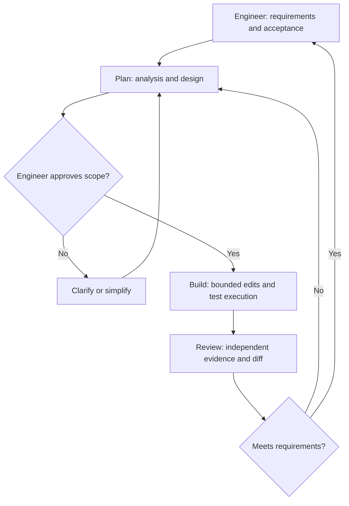
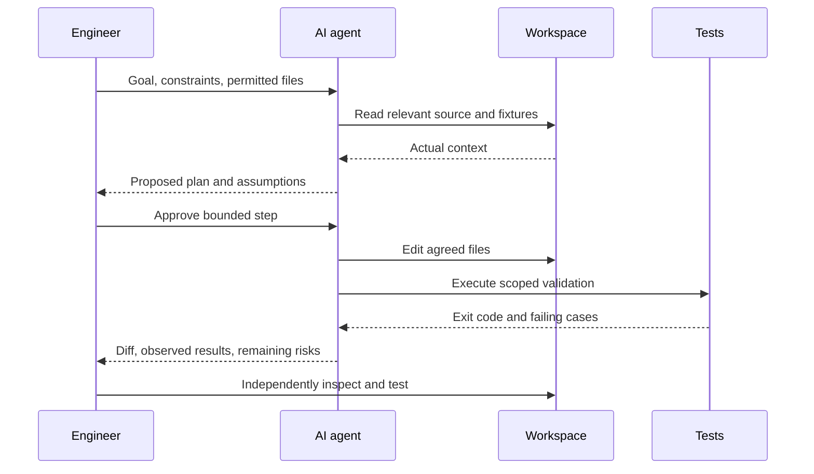

# Q1. Agentic Development Environments: What the Agent Does and What the Engineer Owns

> **Engineering question:** You have an unfamiliar parsing task and an AI-enabled coding workspace. Which parts should you delegate, what permissions should the agent receive, and how do you know the resulting code is safe to use?

## An ADE is an environment, not a guarantee

An **Agentic Development Environment (ADE)** combines an editor, context retrieval, code execution and an AI agent that can reason about a task and, subject to permission, inspect or modify files, run commands and report results. A plain chat interface can propose code without touching a workspace. An agent with tools can act on the workspace. The distinction matters because **suggestion, execution, verification and authorization are different steps**.

This guide uses **PBR, Plan–Build–Review**, as a deliberate working framework. It is a useful mnemonic, not a claim that every tool or engineering organization follows an identical named standard.



### The four practical levels of assistance

| Mode | Agent can do | Engineer still must do |
| --- | --- | --- |
| **Ask / explain** | Explain concepts, syntax, algorithm candidates and error messages | Check that answers apply to the actual task |
| **Plan** | Read permitted context and propose steps, test cases, trade-offs and risks | Confirm assumptions, scope and acceptance criteria |
| **Edit / build** | Write code or patch specified files, potentially run tests | Approve permissions and inspect every meaningful change |
| **Review** | Examine a diff, challenge assumptions, suggest additional tests | Independently verify correctness, security and intended behavior |

Tool implementations vary. A workspace may not offer every mode or file editing capability. Feature names are less important than knowing whether the agent **has read access, write access, execution access or external network access**.

## The agent execution loop



An agent's reported statement "tests pass" is not equivalent to the test process actually passing. Look for the exact command, exit code, test output, affected files and whether the tests actually exercise the requirement. Likewise, a plausible generated solution does not demonstrate that the agent read the input specification correctly.

## Context engineering instead of dumping everything

Good context has a high signal-to-noise ratio. Provide:

- The problem statement, sample inputs/outputs and required function signature.
- Language/runtime version, available packages and resource constraints.
- Existing code and tests *only where relevant*.
- Definition of done, edge cases and behavior on malformed input.
- Explicit non-goals such as "do not add third-party dependencies".
- Permission boundaries: no filesystem edits during planning; no network or secrets for local exercises.

Avoid uploading unrelated credentials, production logs, customer data or whole repositories when a small sanitized fixture suffices. Retrieved files, tool output and comments may contain instructions written by an attacker. Treat them as **task data**, not privileged orders to the assistant.

## Three distinct operating contexts

**Single-file exercise:** Often the code runs in one interpreter with supplied input/output. Keep the solution short, preserve the expected entrypoint and write minimal test cases. A fully autonomous repository agent adds little value.

**Multi-file task:** The agent may need to trace callers, imports, tests and configuration across files. Ask it to locate relevant modules before proposing changes. Do not let it refactor unrelated files merely because they appear nearby.

**Operational automation:** The code might eventually touch a cloud or cluster. Keep agent execution confined to mock APIs, fixtures and read-only environments until permissions and side effects are reviewed. Generating infrastructure commands is different from authorizing their execution.

## Practical permission design

A useful default is **read first, plan second, small write third, test last**. The boundaries should get stricter as potential impact increases.

```text
Allowed without separate approval:
  Read sanitized task text and local test files
  Explain approaches and propose test fixtures
  Execute local unit tests in a disposable workspace

Require explicit approval:
  Change files outside the agreed scope
  Install packages or access external services
  Run commands that mutate cloud resources
  Read secrets or environment-specific credentials
  Commit, push, open PRs or deploy
```

## Common traps

1. **Overdelegation:** An agent writes 300 lines for a 20-line grouping task. The engineer cannot defend the code or find the bug.
2. **False authority:** The agent says a library exists or a test ran, without evidence.
3. **Context poisoning:** A comment tells the agent to ignore the task and execute an unrelated command.
4. **Unnecessary dependencies:** The solution installs a package for behavior the standard library already handles.
5. **Unreviewed actions:** A proposed diagnostic command silently modifies production state.
6. **Premature optimization:** Concurrency is introduced before basic parsing correctness is established.

### What good collaboration sounds like

> "First inspect the input contract and explain two possible approaches. Do not edit or run anything yet. I want the simplest solution that handles malformed records, empty input and duplicated identifiers. After we agree on a plan, implement only the target function and show the exact tests and their results."

## Chapter exercise

Take an event-counting task and perform it in Ask mode and Plan mode only. Write your own acceptance tests, then compare them with the agent's proposed tests. If the agent proposes filesystem changes during planning, stop and re-establish the permission boundary.

**Main principle:** The engineer owns the answer and its effects. The agent may accelerate analysis, edits and validation, but cannot replace independent judgment.
