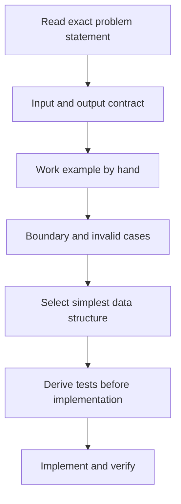

# Understand a Coding Problem Before Writing Code

> **Engineering question:** You are given a log-processing requirement with examples, an input size limit and a function signature. How do you turn an ambiguous paragraph into a precise implementation contract?

Many coding failures begin before the first line of code: a misunderstood denominator, an unnoticed duplicate policy, an incorrect time boundary or an untested empty result. The fastest reliable approach is to identify what **must** be true of the output.

## A seven-part problem contract

1. **Input shape:** JSON array, file lines, strings, records, streamed iterator or API response.
2. **Output shape:** integer, mapping, sorted list, JSON string, stdout format or exception.
3. **Transformation:** filter, validate, group, deduplicate, aggregate, order or paginate.
4. **Identity rules:** what defines a duplicate, an update or the authoritative record?
5. **Edge behavior:** empty input, missing field, malformed record, invalid type, ties and out-of-order data.
6. **Constraints:** record count, memory, time, package availability and permitted dependencies.
7. **Acceptance evidence:** examples and tests that independently distinguish correct from incorrect behavior.



## Worked requirement

"Given timestamped service events, return the three services with the highest count of server errors. Duplicate event IDs must only be counted once. Results must be ordered by descending count, then ascending service name. Reject events missing required fields."

### Translate into explicit behavior

| Detail | Decision |
| --- | --- |
| Event identity | Same `event_id` means duplicate delivery |
| Error definition | Integer HTTP status 500 to 599 inclusive |
| Timestamp | Needed only if the question adds a time window; don't use it gratuitously |
| Malformed event | Raise a descriptive `ValueError` rather than silently skip |
| Tie-breaking | Alphabetical service order |
| Fewer than 3 services | Return all existing error-bearing services |
| Duplicate with conflicting content | Reject or specify authoritative revision; never silently pick arbitrary winner |

**Critical distinction:** If an event with `status=200` appears twice, it still represents one event; however, it does not contribute to the error count. The deduplication contract should apply independently of filtering, or contradictory duplicate payloads may be overlooked.

## Choose the simplest data structures

A set remembers IDs seen. A dictionary maps each ID to a canonical payload for conflict detection. A counter tracks errors per service. Sort only the distinct service totals, not every input row.

```python
from collections import Counter

def top_services(records: list[dict], limit: int = 3) -> list[tuple[str, int]]:
    if limit < 0:
        raise ValueError("limit cannot be negative")

    seen = {}
    errors = Counter()
    for i, row in enumerate(records):
        if not isinstance(row, dict):
            raise ValueError(f"record {i} must be an object")
        event_id, service, status = (
            row.get("event_id"), row.get("service"), row.get("status")
        )
        if not isinstance(event_id, str) or not event_id:
            raise ValueError(f"record {i}: invalid event_id")
        if not isinstance(service, str) or not service:
            raise ValueError(f"record {i}: invalid service")
        if type(status) is not int or not 100 <= status <= 599:
            raise ValueError(f"record {i}: invalid status")

        identity = (service, status)
        if event_id in seen:
            if seen[event_id] != identity:
                raise ValueError(f"conflicting payload for {event_id}")
            continue
        seen[event_id] = identity
        if 500 <= status <= 599:
            errors[service] += 1

    return sorted(errors.items(), key=lambda x: (-x[1], x[0]))[:limit]
```

This is O(n + s log s) time for n input records and s unique services, expected O(n) storage for seen IDs plus counters. For an unbounded stream, storing every ID forever is impossible: define a deduplication horizon or use durable external state only when the requirement calls for it.

## Derive tests that falsify wrong solutions

```python
assert top_services([]) == []
assert top_services([
    {"event_id":"1","service":"a","status":503},
    {"event_id":"1","service":"a","status":503},
    {"event_id":"2","service":"b","status":502},
]) == [("a", 1), ("b", 1)]

assert top_services([
    {"event_id":"x","service":"svc","status":499},
    {"event_id":"y","service":"svc","status":500},
    {"event_id":"z","service":"svc","status":599},
]) == [("svc", 2)]
```

Create one negative test with the same ID but conflicting service or status. Test a missing field and boolean status (`True` is an `int` subclass in Python). These cases catch implementations that superficially satisfy happy-path examples.

## Time allocation is a constraint, not the goal

For a **bounded coding session**, a useful starting allocation is around 15% understand, 15% plan, 45% implement, 25% independently test and explain. Adapt it to task complexity; do not waste half an exercise planning a three-line function. For a multi-file production change, spend much more time on understanding and verification.

### Explain the approach before typing

> "I'll validate the required fields first, then deduplicate by stable event ID. After that I'll count 500–599 statuses by service, sort by descending count and alphabetically on ties, then take the requested limit. I expect one pass through the records and a sort of the distinct services. I'll test duplicate IDs, invalid values and ties."

## What to ask an AI assistant

A productive Ask-mode request is: "Restate this task's exact input, output and duplicate semantics. Identify ambiguities and propose five edge cases that would fail a naive solution. Do not write code." Compare that analysis against the problem statement yourself. An AI-generated interpretation can be confidently wrong.

**Main principle:** If the requirement is uncertain, better prompting cannot make the answer correct. Clarify or state a defensible assumption before implementation.
