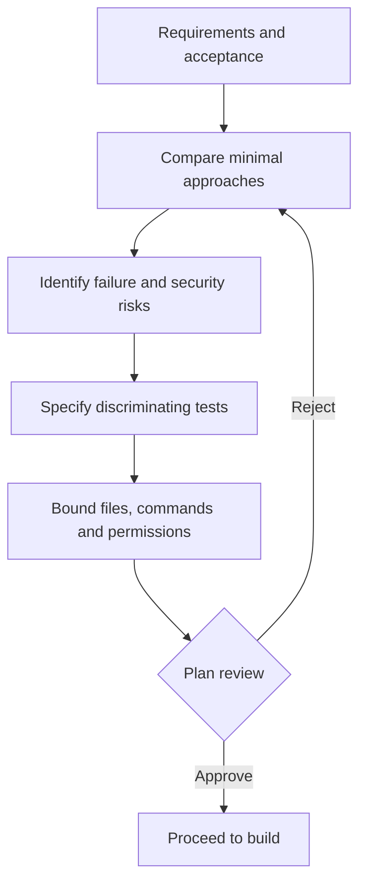

# Q3. The Plan Phase: Structure Thinking Without Overengineering

> **Engineering question:** You can solve a parsing exercise in 20 lines or create a reusable framework. How do you decide, and what should a useful plan contain before the agent edits code?

The **Plan** step of Plan–Build–Review exists to reduce wrong work. It should identify the smallest correct solution and the evidence required to prove it, not create a long design document for every task.

## A good plan fits the task

A small exercise plan might be five lines:

```text
Input: list of dicts with event_id, service, status
Validation: reject invalid records; define duplicate conflicts
Algorithm: seen dictionary + Counter, then deterministic sort
Complexity: O(n + s log s) time; O(n + s) space
Tests: empty, duplicates, 499/500/599/600, ties, malformed
```

For a repository change, add file paths, caller impact, compatibility, migration plan, approval requirements and test commands. If the planned change crosses auth, storage, public APIs or deployment configuration, explicitly evaluate rollback and side effects.



## Choosing the algorithm

| Task | Straightforward choice | Avoid until necessary |
| --- | --- | --- |
| Count occurrences | `Counter` or dictionary | Custom tree/index |
| Remove duplicates | Set or dictionary keyed by stable ID | Nested loops over all records |
| Group objects | `defaultdict(list)` | Database for a tiny input |
| Select top-k from small groups | `sorted` | Complex heap when no measured need |
| Stream huge file | Iterate lines/generator | Materialize the entire dataset |
| Parse nested JSON | `json` + explicit schema checks | Regex on raw JSON |
| Fetch a paged API | Simple cursor loop with guards | Unbounded asynchronous crawler |

Don't introduce concurrency to compensate for inefficient grouping when a dictionary solves the task in linear time. Don't install dependencies until the standard library is inadequate.

## Risk and review matrix

Ask four questions before granting write permission:

1. **Reversibility:** Can the change be undone by reverting source, or does it mutate persistent state?
2. **Reach:** One function, multiple modules, dependency lockfile, IAM or cloud resources?
3. **Observability:** Which test, diff or metric will show that the intended behavior changed?
4. **Authority:** Is the agent permitted to execute a command or only propose it?

A plan should never claim "tested" or "fixed" before the relevant commands have run. Plan status is *intention*. Review status is *observed evidence*.

## Five useful plan prompts

### Requirement discovery

> "Read the exact specification and supplied examples. List input/output constraints, ambiguous points and edge cases. Do not write code or assume access to packages not mentioned."

### Minimal design

> "Propose at most two correct approaches. Prefer the standard library and clear data structures. Give time/space complexity and say which approach you'd choose for 10,000 records."

### Acceptance first

> "Propose tests that would catch duplicate counting, missing fields, off-by-one windows and unstable sorting. Give expected outputs, not just test names."

### Repository investigation

> "Find the relevant parser, its callers and nearby tests. Report exact file paths and the smallest possible change set. Read only; do not edit files."

### Plan critique

> "Critique this plan for unnecessary dependencies, hidden assumptions, unbounded memory and testing gaps. Don't replace it with a larger architecture unless you can explain why the requirement needs one."

## Worked plan: API pagination

**Problem:** Read all pages from an endpoint until `next_cursor` is null, count status categories, and tolerate intermittent 429s.

A defensible plan:

- Define page shape and cursor semantics. Reject malformed responses.
- Keep a set of cursors visited; stop on loops and enforce a maximum page count.
- Aggregate counts **page by page**, not into a giant `all_items` list.
- Apply finite retries to selected transient statuses, honor `Retry-After` where appropriate and enforce a total deadline.
- Abort or mark the report partial if the API cannot be fully traversed. Do not return a success-shaped incomplete inventory.
- Unit-test transport as an injected function; no network needed.

**Overengineering warning:** A task that only asks to sum ten provided records does not need a retry library, a plugin system or a background worker.

### Short spoken plan

> "I'd clarify how pagination ends and whether pages form a consistent snapshot. I'd keep the parser independent from HTTP, aggregate each page immediately, guard against repeated cursors and make partial failure explicit. I'd test empty pages, malformed bodies, retryable and permanent errors before trying concurrency."

**Main principle:** The best plan is the smallest plan that makes wrong implementations less likely.
