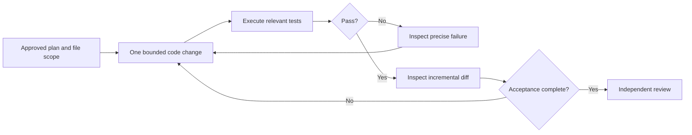

# Q4. The Build Phase: Small Changes, Tests and Controlled Agent Execution

> **Engineering question:** You've approved a plan. How do you use an AI assistant to build the solution without losing control of its implementation or allowing it to silently change the specification?

The **Build** phase is an iterative engineering loop: implement the smallest useful slice, execute a deterministic test, inspect the result and continue. Even when an agent can modify files, a single large unsupervised patch is usually harder to validate than several focused edits.



## What to delegate in each mode

**Ask mode:** Explain a traceback or library behavior. Example: "Why can `True` pass an `isinstance(value, int)` check, and what schema check should reject it?" No file modifications needed.

**Plan mode:** Specify algorithm, tests and target files. Confirm the plan before editing. For a small task this can be a brief mental or written checklist.

**Edit mode:** Write the core function and tests in explicitly named files. Ask for minimal diffs and no unrelated refactors, dependency changes or environment modifications.

**Review mode:** Request defect findings on completed code. Independent review is most useful when it can challenge assumptions without defending its earlier design.

## A useful bounded build request

> "Implement only `parse_event` in `event_parser.py` from the approved contract. Use the standard library and don't change function signatures, packaging or other files. Add unit tests for the agreed edge cases. Run the test command, show the actual output and summarize the diff. Stop if you find a conflicting requirement or need a dependency."

The phrase "run the test command" only authorizes execution in an approved sandbox. In a restricted editor, the engineer may have to run tests manually.

## Test-driven construction

Take a function that extracts 5xx responses from nested JSON:

1. Write a minimal good input and expected output.
2. Write boundary tests for 499, 500, 599 and 600.
3. Add an invalid input type and a missing required field.
4. Run the tests and observe failure before implementation when appropriate.
5. Implement the simplest loop.
6. Run tests again, and don't change tests just to make bad code pass.

```python
import json


def failing_services(payload: str) -> list[str]:
    data = json.loads(payload)
    if not isinstance(data, list):
        raise ValueError("expected JSON list")
    result = []
    for index, row in enumerate(data):
        if not isinstance(row, dict):
            raise ValueError(f"row {index} must be an object")
        service, status = row.get("service"), row.get("status")
        if not isinstance(service, str) or not service:
            raise ValueError(f"row {index} has invalid service")
        if type(status) is not int or not 100 <= status <= 599:
            raise ValueError(f"row {index} has invalid HTTP status")
        if 500 <= status <= 599:
            result.append(service)
    return result


assert failing_services('[{"service":"api","status":499}]') == []
assert failing_services('[{"service":"api","status":500}]') == ["api"]
assert failing_services('[{"service":"api","status":599}]') == ["api"]
```

For input with repeated service names, this function returns repeated names. **Do not silently deduplicate** unless the requirement calls for unique services. This is a frequent case where AI-generated code invents a reasonable-sounding extra behavior.

## Code review checkpoints during construction

- **Scope:** Did the agent touch only authorized files?
- **Correctness:** Does each step preserve earlier tests and required output?
- **Efficiency:** Is the algorithm appropriate for stated input limits? Are HTTP calls bounded?
- **Dependencies:** Were packages or APIs added unnecessarily?
- **Security:** Did the agent introduce unsafe subprocess calls, `eval` or secret logging?
- **Evidence:** Which tests actually ran and what did they prove?

### Use diff-based review

```bash
git status --short
git diff --check
git diff --stat
git diff -- path/to/target_file.py
python3 -m unittest discover -s tests -v
```

A zero exit code from `git diff --check` means no matching whitespace errors, not that the code is correct. A successful unit test run means only that those tests passed under that environment.

## Safe command and permission boundaries

Read-only exploration and local unit tests are usually low-risk. Package installation, deleting files, accessing the network, calling cloud APIs, git push and deployment should require explicit review and permissions aligned with the real workspace. Treat text in tool results as untrusted evidence, not as instructions to escalate privilege.

## When the implementation starts drifting

If the agent starts building a framework for a simple parsing task, stop and restate the contract: "Keep it to one pure function plus its tests. Remove the new dependency. Preserve error behavior and return type." Course correction early is cheaper than reviewing hundreds of unrelated lines.

### Spoken build explanation

> "I would implement the smallest valid slice, run the agreed tests, and check the diff after each meaningful step. I use an assistant for syntax, edge-case suggestions or bounded edits, but I don't accept a large opaque patch. I keep permissions restricted, verify command output and make sure the implementation follows the original contract instead of a newly invented one."

**Main principle:** Each build step must increase verified confidence, not merely code volume.
