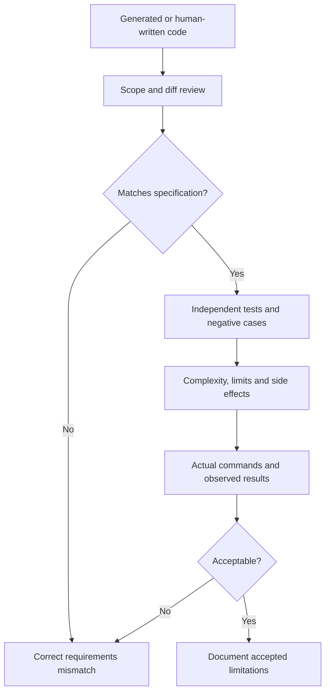

# Q5. The Review Phase: Proving Correctness Instead of Trusting an AI Answer

> **Engineering question:** An AI assistant generates code that passes the visible examples. What is your review strategy before calling the problem solved?

Review is not reading code and deciding it "looks good." It is a structured attempt to **falsify correctness** using the specification, independent test cases, runtime evidence and security reasoning. A solution can pass every supplied sample and still be wrong for empty input, conflicting duplicates, malformed JSON, time zones, ties or large datasets.

## The four layers of review

1. **Contract review:** Does the implementation honor the *exact* input/output contract and constraints?
2. **Behavior review:** Do independent tests validate normal cases, boundaries, invalid inputs and transformations?
3. **Resource review:** Is runtime/memory bounded for plausible inputs? Are retries and external calls safe?
4. **Change review:** Did the agent modify only intended files, introduce dependencies or leak secrets?



## Design tests that catch common false assumptions

| Dimension | Example | Mistake it catches |
| --- | --- | --- |
| Empty input | `[]` | Uninitialized output, division by zero |
| Boundary | statuses 499, 500, 599, 600 | Off-by-one comparison |
| Duplicates | same ID twice | Double counting |
| Conflict | same ID, different payload | Arbitrary last-wins behavior |
| Tie | equal error counts | Nondeterministic ordering |
| Invalid type | `status=True` | Boolean treated as integer |
| Missing keys | no `service` | KeyError or fake `None` value |
| Time | equal to interval end | Inclusive versus exclusive window |
| Scale | 100k events, 10 services | O(n²) nested search or excess memory |
| Partial API failure | second page unavailable | Incomplete data falsely reported as success |

### Visible examples and unseen inputs

A few examples demonstrate intended output, but do not exhaust possible inputs. Don't write code by memorizing example results. Ask what property should hold **for every valid input**. If duplicate delivery is idempotent, adding an identical event must not change output. If input order is irrelevant, shuffling records must not change the report. These are stronger tests than hard-coded examples alone.

## Property and metamorphic tests

For a counting function `top_services(records)` with deduplication by stable IDs:

```python
base = [
    {"event_id": "a", "service": "api", "status": 503},
    {"event_id": "b", "service": "worker", "status": 200},
]

# Pseudocode for properties; import the implementation under test.
assert top_services(base) == top_services(list(reversed(base)))
assert top_services(base) == top_services(base + [base[0]])
```

When duplicates conflict, the implementation should raise an error under the earlier contract; don't apply this property to conflicting events.

### A useful independent review prompt

> "Review this solution against the original specification. Do not modify code. List defects ranked by severity, each with a minimal input that demonstrates the bug and the expected-versus-actual output. Check duplicates, boundaries, malformed types, output ordering, time/space costs and accidental dependencies. If you cannot prove a concern, label it as a hypothesis."

A separate review context can reduce confirmation bias, but two AI agents agreeing does not independently prove the program correct. The decisive evidence is the specification and executed tests.

## Reason about complexity accurately

For n records and k groups:

- One-pass dictionary/Counter aggregation: expected O(n) work and O(k) counters (plus any deduplication state).
- Sorting group totals: O(k log k).
- Linear membership in a list inside a loop: can become O(n²).
- Storing all API pages or file contents: O(n) memory; a streaming reducer may use O(k).
- Exact percentiles generally need additional storage or external sorting; don't pretend a running average gives p99.

If a task's documented n is only a few hundred, an O(n log n) clean solution may be entirely appropriate. Avoid micro-optimizations unless the constraint requires them.

## Execution evidence and honest status

```bash
python3 -m unittest -v
python3 -m compileall -q .
git diff --check
git status --short
```

Report actual command results. A syntax check doesn't prove behavior; a passing test suite can still omit required edge cases. A reviewer should describe what has **not** been tested rather than asserting universal correctness.

## Security review for operational scripts

Look for `subprocess.run(..., shell=True)` with unsanitized input, `eval`, unbounded downloads, broad exception swallowing, exposed credentials, path traversal when opening user-provided filenames, and HTTP calls without timeouts or response size bounds. For high-impact scripts review dry-run behavior and rollback plans before granting real credentials.

## An example correction

Weak AI implementation:

```python
if row.get("status", 0) >= 500:
    failures[row.get("service", "unknown")] += 1
```

Problems: it may compare a string to an integer, silently hide missing service names, count statuses above 599, and treat booleans oddly. A reviewer should give an input that reproduces each defect, then fix validation rather than merely adding another exception handler.

### Spoken review answer

> "I'd compare the output to the written contract, then run tests designed to falsify assumptions rather than just repeat the examples. I'd include empty input, duplicates, conflicting records, boundary values and malformed types. I'd inspect complexity, side effects and the diff, and require observed test output. If anything remains uncertain, I'd state that limitation rather than accepting a plausible AI explanation as proof."

**Main principle:** Review evidence must be stronger than the agent's confidence.
