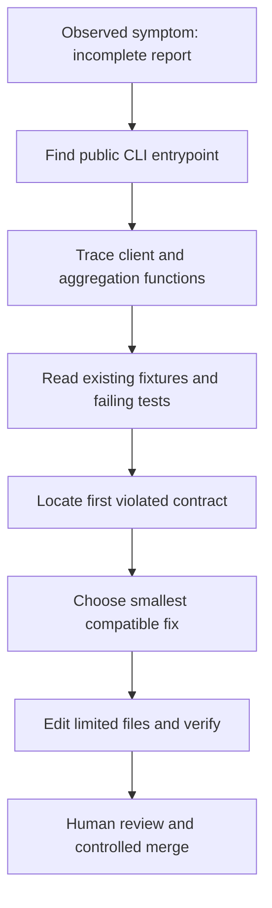

# Q7. Multi-File Tasks: Repository Exploration, Safe Edits and Handoffs

> **Engineering question:** A service's API client occasionally produces incomplete monitoring inventories. The repository has a client module, transformation module, tests and deployment configuration. How should an AI agent investigate, plan and modify this codebase?

Single-file problems reward a clear algorithm. Multi-file problems add **dependency tracing, field ownership, stateful test fixtures, backward compatibility and deployment risk**. The correct first step is usually navigation, not code generation.

## Explore the repository in layers

```text
project/
  src/
    api_client.py       # pagination and transport
    report.py           # aggregation and output
    cli.py              # arguments, exit codes
  tests/
    test_api_client.py
    test_report.py
  pyproject.toml
  README.md
```

Start with the README/test command and inspect the smallest relevant code paths. A useful exploration report states: exact relevant files, call graph, data contract, failure location, coverage gaps and proposed scope. Avoid reading every secret/configuration file just to collect context.



## A practical read-only investigation request

> "Investigate why the inventory stops after one page. Read only the CLI entrypoint, client, report reducer and relevant tests. Identify the exact call path and tell me which file owns pagination. Do not edit files or run mutating commands. Show one minimal reproduction and a proposed bounded change."

Verify the report against actual source. An agent might conclude "the API only returns one page" based on a fixture while the live contract returns a cursor. If the external API documentation is unavailable, label uncertainty and use a mock until the contract is clarified.

## A bounded implementation plan

1. Add a failing unit test where the first page has a cursor and the second page has no cursor.
2. Add tests for empty response, malformed page, repeated cursor and a timeout on page two.
3. Make the client loop through pages with a maximum page guard, keeping page aggregation separate.
4. Preserve the CLI output schema and nonzero exit behavior for partial failure.
5. Run existing tests, add the new tests and inspect the final diff.
6. Verify no new package was introduced and no deployment configuration changed.

### Owner and contract matrix

| Component | Owns | Should not silently own |
| --- | --- | --- |
| API client | Requests, timeouts, cursors, response validation | Business report sorting |
| Report reducer | Grouping, filtering, deterministic output | Network retries |
| CLI | File/arg handling, format and exit code | Hidden dependency orchestration |
| Tests | Contract examples and fault injection | Rewriting spec to make failing code pass |
| Deployment policy | Release and runtime configuration | Parser business logic |

## Example: dependency injection for tests

```python
from collections import Counter


def count_pages(fetch, max_pages: int = 20) -> dict[str, int]:
    if max_pages <= 0:
        raise ValueError("max_pages must be positive")
    cursor = None
    used = set()
    counts = Counter()

    for _ in range(max_pages):
        page = fetch(cursor)
        if not isinstance(page, dict) or not isinstance(page.get("items"), list):
            raise ValueError("invalid page")
        for item in page["items"]:
            if not isinstance(item, dict) or not isinstance(item.get("service"), str):
                raise ValueError("invalid item")
            counts[item["service"]] += 1
        next_cursor = page.get("next_cursor")
        if next_cursor is None:
            return dict(sorted(counts.items()))
        if not isinstance(next_cursor, str) or not next_cursor or next_cursor in used:
            raise ValueError("invalid or repeated cursor")
        used.add(next_cursor)
        cursor = next_cursor

    raise RuntimeError("page limit reached; report incomplete")


pages = {
    None: {"items": [{"service": "api"}], "next_cursor": "p2"},
    "p2": {"items": [{"service": "api"}, {"service": "worker"}], "next_cursor": None},
}
assert count_pages(lambda cursor: pages[cursor]) == {"api": 2, "worker": 1}
```

This intentionally counts observations, not unique resource IDs. If pages can repeat records, the contract needs stable IDs or versioning for deduplication. The function reports failure rather than pretending partial counts are complete.

## Review at repository scale

```bash
git status --short
git diff --stat
git diff --check
python3 -m unittest discover -s tests -v
# When configured, also run formatting, lint and static checks.
```

Assess more than tests: do existing import paths work? Is public CLI output compatible? Have input exceptions become silent errors? Has the agent edited lockfiles or CI configuration unnecessarily? For multi-file changes, ask for the *reason* each modified file is necessary.

## Handoff and PR description

A meaningful handoff contains: observed bug, root cause backed by evidence, minimal fix, new tests, actual commands/results, known limitations and deployment risk. It should not assert "fully verified" when a real API or target environment wasn't exercised. A plan is not proof of completed work.

### Spoken answer

> "I'd trace the failure from the CLI through the API client and reducer, read the relevant tests, and identify which layer owns pagination. I'd have the agent propose a read-only plan, then change only the client and associated tests. I'd inject a fake fetcher to test multiple pages, loops and partial failures, inspect the diff and preserve the CLI contract. An agent may help navigate quickly, but evidence from tests and code ownership governs acceptance."

**Main principle:** Multi-file AI work improves when context, scope and change ownership are narrower and explicit.
