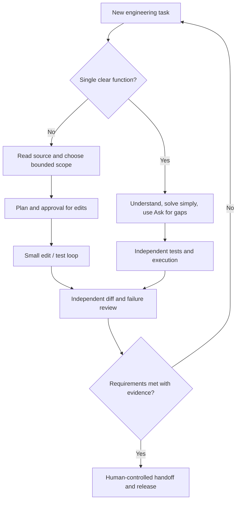

# Operating Principles: Failure Modes, Permissions, Time Management and Learning

> **Engineering question:** How do you become more effective with AI-assisted engineering over time without losing the ability to reason, debug or take responsibility for the result?

Tools evolve quickly. A durable workflow should depend on **requirements, independent evidence and permissions**, not one interface or a remembered model command. The practical goal is to use assistance to remove low-value effort while retaining deep understanding of the code that ships.

## Eight failure patterns to recognize

| Pattern | Symptom | Better response |
| --- | --- | --- |
| Prompt-only programming | Accepts a full answer without understanding it | Restate algorithm and run independent tests |
| Premature code | Agent writes before clarifying duplicates or errors | Ask/Plan first, pin contract |
| Overengineering | Layers and dependencies for a 30-line task | Limit scope and prefer standard library |
| Confidence laundering | Agent asserts tests passed without output | Request exact command, exit code, observed result |
| Hidden spec changes | Agent makes malformed rows silently disappear | Compare against original acceptance criteria |
| Scope creep | Edits unrelated files or IAM | Require path limits and diff review |
| Review echo | Same agent simply praises its own code | Test against independent counterexamples |
| Context overload | Too many files and stale instructions | Narrow to relevant source and summarize decisions |

## A practical decision tree



## A practical timebox for a small coding problem

This is a **starting heuristic**, not a rule:

- **First few minutes:** confirm schema, output, duplicate policy and 2–3 examples.
- **Next few minutes:** choose data structures and write boundary tests.
- **Most of the session:** implement the simplest correct solution in small steps.
- **Final portion:** run tests, try hostile inputs, inspect complexity and explain assumptions.

Avoid spending 15 minutes crafting a perfect prompt for a five-minute programming exercise. An AI assistant is most valuable when it resolves a real blocker, highlights missed edge cases or accelerates verified routine edits.

## Three modes of practice

### Independent practice

Solve a problem without AI and explain complexity. Then review your solution with an assistant and attempt new counterexamples. This protects your core reasoning skills.

### Assisted practice

Have the assistant act as a **reviewer**, not an author. Request one hint at a time or ask it to generate adversarial tests. Confirm each suggestion yourself.

### Agentic implementation

For a multi-file task, supply a written contract, approve a plan, allow limited edits, run a test suite and independently inspect the diff. Compare the result with a smaller manual alternative.

## An evidence ledger

Keep a compact log, especially for longer tasks:

```text
Requirement: paginated inventory must be complete or fail clearly
Assumption: next_cursor is opaque and ends at null
Change: api_client.py pagination loop, tests/test_api_client.py
Tests run: python -m unittest discover -s tests -v
Observed: 18 tests passed, one timeout test simulated
Not verified: behavior against the real remote provider
Risk: page changes may duplicate records without snapshot tokens
```

This makes handoff honest and helps prevent a future agent from treating assumptions as measured facts. It is more useful than saving a long raw conversation transcript.

## How to evaluate your own AI usage

Measure correctness and engineering throughput, not prompt length or generated line count:

- **Time to useful result:** Can the user actually execute and understand it?
- **Defects caught before handoff:** Did independent tests find hidden edge cases?
- **Change scope:** Were only necessary files altered?
- **Reviewability:** Can a teammate explain the diff and reproduce results?
- **Security:** Were permissions and data boundaries respected?
- **Learning:** Can you solve a similar problem without copying the previous answer?

## Final worked exercise sequence

Pick one of the practice tasks from the Python/Shell module, such as a paginated API summarizer. Perform it three ways: independently, Ask/Review assistance only, and full Plan–Build–Review with bounded workspace edits. Use identical fixtures and hidden edge cases you create before the implementation. Compare defects, time and unnecessary complexity. Do not pick the longest generated answer as the winner.

### Spoken summary

> "I use AI as an engineering collaborator, not an authority. For a small function I start from the requirements and solve it simply. For a larger task I use Plan–Build–Review: inspect context, agree on scope, implement small changes and verify against tests and a diff. I constrain permissions, challenge plausible answers with counterexamples and keep a record of what actually ran. The result must be something I can explain and maintain without the assistant."

**Main principle:** A good engineer can describe both *why the code should work* and *what evidence shows it does*.
