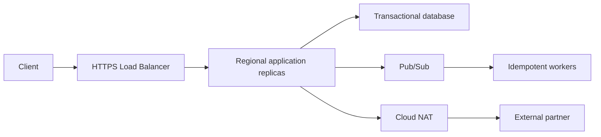

# Google Cloud Fundamentals: Eight Practical Labs

The exercises reinforce the eight chapters. Each lab has a result to explain, not simply a command to run.

::: warning Use only an approved sandbox
Google Cloud services can create billable resources. Before creating anything, choose an authorized project, set a budget alert, understand cleanup, avoid real credentials or PII in logs and never open test services publicly without permission. Read-only inspection labs are suitable when creation privileges are unavailable.
:::

## Lab 1. Resource hierarchy, API and quotas

**Goal:** Explain the boundaries between IAM, enabled service APIs, billing, quota and zone capacity.

```bash
gcloud auth list
gcloud config get-value project
gcloud projects describe PROJECT_ID
gcloud services list --enabled --project=PROJECT_ID
gcloud billing projects describe PROJECT_ID
gcloud compute regions describe europe-west1 --project=PROJECT_ID
```

**Expected:** A project can exist without some APIs enabled. CPU quota is scoped by the relevant service/region, while resource availability can also be constrained by the zone. IAM roles on folders/organization can influence project access.

**Challenge:** Describe how `API_DISABLED`, permission denied, quota exceeded and out-of-capacity would differ. Read operation error details instead of guessing.

**Safety:** Do not change org policies, billing or quotas to complete the lab.

## Lab 2. IAM and effective workload identity

**Goal:** Show that authentication identity and resource authorization differ.

On an authorized sandbox bucket, inspect:

```bash
gcloud auth list
gcloud auth application-default print-access-token
gcloud storage buckets get-iam-policy gs://OWNED_BUCKET
gcloud projects get-iam-policy PROJECT_ID --format=json
```

**Expected:** The CLI and ADC identities can differ. A service account with no bucket access authenticates but may fail authorization. An applicable ancestor binding or deny can affect the result.

**Challenge:** Draw an external CI OIDC assertion exchange through workload identity pool/provider, STS and optional service account impersonation. Describe audience, issuer and attribute restrictions.

**Safety:** Never paste actual tokens into public tickets or CI logs. If printing a token for inspection, keep the terminal secure and avoid recording output.

## Lab 3. VPC, Shared VPC and firewall path

**Goal:** Trace a connection from one VM/subnet to another.

Read-only inventory:

```bash
gcloud compute networks list --project=PROJECT_ID
gcloud compute networks subnets list --project=PROJECT_ID
gcloud compute routes list --project=PROJECT_ID
gcloud compute firewall-rules list --project=PROJECT_ID
gcloud compute networks subnets list-usable --project=PROJECT_ID
```

**Expected:** The VPC is global and its subnetworks regional. A route existing does not guarantee firewall permission or application reachability. A Shared VPC consumer can use host-project subnets only with proper host/service attachment and IAM.

**Challenge:** Draw both ingress and egress decisions, including guest firewall and service listener. Explain why Cloud Router isn't a per-packet forwarding VM.

**Safety:** Do not broaden production firewall rules for debugging. Use Connectivity Tests or a permitted temporary test VM with narrow rules.

## Lab 4. Cloud DNS, load balancer and Public NAT

**Goal:** Separate the inbound HTTPS path from outbound internet translation.

```bash
gcloud dns managed-zones list --project=PROJECT_ID
gcloud compute backend-services list --project=PROJECT_ID
gcloud compute url-maps list --project=PROJECT_ID
gcloud compute health-checks list --project=PROJECT_ID
gcloud compute routers list --project=PROJECT_ID
```

On a permitted host with relevant DNS configuration:

```bash
dig example.org A
curl -I --connect-timeout 5 https://example.org/
```

**Expected:** Public and private DNS zones can return different answers. A Cloud Application Load Balancer handles an inbound frontend/target proxy/backend chain. Public NAT handles eligible outbound source translation and does not make the VM directly reachable from the public Internet.

**Challenge:** Differentiate a TLS/SNI failure, LB 502 and outbound Cloud NAT port exhaustion. Describe what NAT metrics and LB backend health would prove.

**Safety:** No production NAT address allocation, DNS zone or LB changes are necessary; cloud provider cost and reachability requirements make creation a separate controlled exercise.

## Lab 5. Compute Engine and managed instance group design

**Goal:** Understand VM versus template versus MIG lifecycle without deploying an expensive regional fleet.

```bash
gcloud compute instances list --project=PROJECT_ID
gcloud compute instance-templates list --project=PROJECT_ID
gcloud compute instance-groups managed list --project=PROJECT_ID
gcloud compute machine-types list --zones=europe-west1-b --limit=10
```

**Expected:** An instance template specifies repeatable configuration, while a MIG controls replica lifecycle. Autoscaling controls count; autohealing replaces unhealthy instances. A regional MIG improves zone distribution, but doesn't eliminate quota and zonal capacity risk.

**Challenge:** Design a rollout with a canary, application warmup, LB health check, surge capacity, draining and rollback. Explain why a Spot-only single-replica financial service is unsafe.

**Safety:** Use design/paper exercise unless an authorized budgeted disposable MIG is available.

## Lab 6. Cloud Storage, Artifact Registry and event idempotency

**Goal:** Distinguish object storage, image artifacts, transactional data and queue delivery semantics.

Read-only:

```bash
gcloud storage buckets list --project=PROJECT_ID
gcloud artifacts repositories list --location=europe-west1 --project=PROJECT_ID
gcloud sql instances list --project=PROJECT_ID
gcloud pubsub subscriptions list --project=PROJECT_ID
```

If an owned test bucket is available:

```bash
printf 'sample\n' > sample.txt
gcloud storage cp sample.txt gs://OWNED_BUCKET/lab/sample.txt
gcloud storage objects describe gs://OWNED_BUCKET/lab/sample.txt
```

**Expected:** Cloud Storage is object storage with generation/retention behavior, not a POSIX database. Artifact Registry contains deployable image/package artifacts. Pub/Sub at-least-once patterns mean consumer business effects must be idempotent.

**Challenge:** Trace a worker committing a DB side effect then crashing before ack. Explain outbox, idempotency key and dead-letter routing.

**Safety:** Only write into an owned sandbox bucket; cleanup may not immediately remove charges if soft delete/retention is enabled.

## Lab 7. Logging, tracing and SLO calculation

**Goal:** Translate a user-facing symptom to traces and resource evidence.

```bash
gcloud logging read 'severity>=ERROR' \
  --project=PROJECT_ID --limit=20 --format=json
gcloud logging sinks list --project=PROJECT_ID
```

Choose a hypothetical SLO: 99.9% of valid checkout operations complete successfully within a specified bound over 30 days.

Given 100,000 eligible events and 220 noncompliant events:
- Allowed noncompliant events under 99.9% = 100.
- Actual noncompliant fraction = 0.22%.
- Budget consumption = 220%, exceeding budget by 120%.
- Burn rate relative to steady-state allowed error fraction = 2.2x over that evaluated window.

**Expected:** Explain difference between an event-based SLO and downtime minutes. A trace reveals nested latency; metrics show distributions; audit logs reveal administrative operations; logs can be sampled or excluded.

**Challenge:** Explain why averaging regional p99 values is mathematically wrong. Use aggregate histograms/distributions instead.

## Lab 8. Marketplace architecture and failure-recovery tabletop

**Goal:** Defend a design and a response to failure.

Assume: global external HTTPS API, regional Compute/GKE backends, transactional Cloud SQL, Cloud Storage media, Pub/Sub background work and Cloud NAT outbound partner calls.



**Failure injection (paper exercise):** One region's application replicas become unhealthy, while the secondary region remains healthy but the transactional primary database is still regional.

Answer in order:
1. What user actions are failing and what is the data correctness risk?
2. What do backend health, traces, SQL status and errors say?
3. Is it safe to redirect read requests? What about writes?
4. What is the measured RPO/RTO versus required objective?
5. How do you prevent split-brain or duplicate partner side effects?
6. What are the exact operator approvals and rollback/failback conditions?
7. Which IaC, SLO and recovery changes prevent recurrence?

**Expected:** A multi-region frontend does not guarantee a writable multi-region backend. The correct answer includes data state, authorization, capacity, failover sequencing and post-recovery business checks.

## Completion checklist

- Explain a failed GCP API request through credential, IAM, API enablement, org policy and quota.
- Trace packet forwarding and firewall decisions across Shared VPC projects.
- Distinguish NAT, Private Google Access, DNS and HTTPS LB.
- Design MIG rollout without equating VM startup to application readiness.
- Select object, transactional, analytical and queue services based on guarantees.
- Define a measurable event-based SLO and error budget.
- Demonstrate a safe regional recovery decision, including data correctness.

[← Module 5](./) · [40 advanced technical FAQs](./follow-ups)
