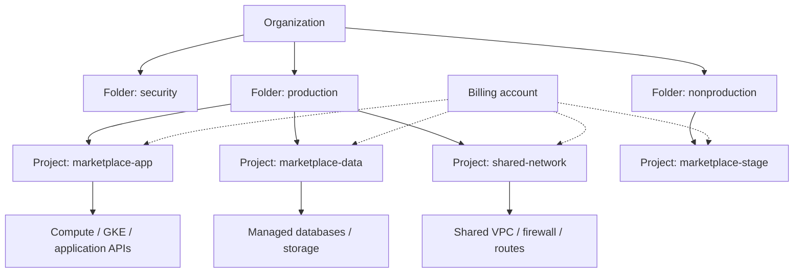
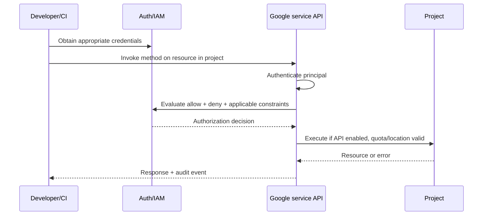

# Google Cloud Architecture, Resource Hierarchy and Governance

> **Engineering focus:** You have used other clouds, but now need to design a Google Cloud landing zone for multiple product teams. Explain the resource hierarchy, project boundaries, billing, IAM inheritance, APIs, quotas, regions, organizational policies and what happens when a project is deleted.

## 1. Start with the control model

Google Cloud is not one big collection of VMs. Every resource belongs to an administrative hierarchy, identity and policy model, and a service API. A project is the principal operational container for many Google Cloud resources, but it is **not** necessarily the boundary of the network. A Shared VPC can be hosted in a different project, while organization and folder policies apply from higher ancestors.



Organization, folders and projects form a parent/child hierarchy; services' resources normally live under projects. IAM allow-policy inheritance flows down the hierarchy. An allow binding on a production folder may confer access in all descendant projects, so access granted high in the tree has wide blast radius. Organization Policy constraints can restrict what descendants may configure; their inheritance/evaluation is not identical to IAM allow policies. Deny policies are an additional IAM enforcement mechanism. <https://cloud.google.com/resource-manager/docs/cloud-platform-resource-hierarchy> and <https://cloud.google.com/iam/docs/overview>.

**AWS mapping:** GCP organization/folder/project roughly resembles AWS Organizations/OUs/accounts for governance, but **a GCP project isn't an AWS account clone**. AWS accounts are generally stronger autonomous boundaries; Google Cloud IAM, VPC sharing and project/service policy models must be evaluated on their own terms. Cloud Billing accounts are not IAM organizations or network namespaces.

## 2. Resource location and scope

| Resource | Typical scope | Important consequence |
| --- | --- | --- |
| Organization / folder / project | Administrative hierarchy | Controls inherited permissions and policies |
| VPC network | Global | One VPC can contain subnets in multiple regions |
| Subnet | Regional | VMs in eligible zones in that region use its address range |
| VM instance | Zonal | Zone failure affects the VM |
| Regional managed instance group | Regional | Can place replicas across zones |
| Cloud Storage bucket | Selected location type | Data placement and redundancy follow bucket location |
| Global external Application Load Balancer | Global frontend; backend scopes vary | Multi-region backends possible depending on type |
| GKE Standard cluster | Zonal or regional by cluster configuration | Control-plane and node availability differ |

Do not describe a global VPC as globally available application infrastructure: workloads and backends have their own zonal/regional failure domains.

## 3. API enablement and identity

Google services expose service APIs such as `compute.googleapis.com`, `container.googleapis.com` and `iam.googleapis.com`. A project may exist and have billing enabled while a required API is disabled. API enablement is not itself an IAM grant.

```bash
gcloud auth login
gcloud auth list
gcloud config configurations list
gcloud config set project marketplace-sandbox
gcloud projects describe marketplace-sandbox
gcloud services list --enabled --project=marketplace-sandbox
gcloud services enable compute.googleapis.com --project=marketplace-sandbox
gcloud billing projects describe marketplace-sandbox
```

These commands are instructional. Never run `services enable` or billing changes in an unapproved project. For automation, prefer service account impersonation, metadata-based credentials or federation over personal user credentials.



The diagram is conceptual; authorization, org policy, quota and validation may be enforced at different service stages. **A 403 can mean missing permission, API disabled, service policy, or billing/service restriction.** Read structured error details rather than guess.

## 4. Roles and hierarchy

- **Principal:** User, group, service account or eligible federated identity.
- **Role:** Collection of IAM permissions, for example `compute.instances.get`.
- **Policy binding:** Associates role with members on an applicable resource.
- **Predefined/custom/basic roles:** Prefer narrowly scoped predefined/custom roles to broad basic Owner/Editor.
- **IAM Conditions:** Additional conditional constraints on a binding when supported.
- **IAM Deny:** Can explicitly forbid permissions; inherited allow doesn't override applicable deny.
- **Organization Policy:** Governs permitted configurations, such as location, public exposure or allowed external identities.

```bash
gcloud projects get-iam-policy marketplace-sandbox   --format=json
gcloud organizations list
gcloud resource-manager folders list --organization=ORGANIZATION_ID
gcloud projects get-ancestors marketplace-sandbox
```

Permissions to enumerate an organization and its folders depend on caller access. A project user might not see its organizational ancestors in detail.

## 5. Quotas, service limits and billing

Quotas are frequently **project-, region- or resource-specific**. A team may have sufficient regional CPU quota but hit external IP, forwarding-rule, API rate, GPU or managed-service quotas. A quota increase is not a guarantee of zonal physical capacity.

For production readiness record:
1. Service usage and enabled APIs.
2. Project-specific regional quota ceilings.
3. Requested maximum capacity and buffer.
4. Billing budgets/alerts and labels.
5. Organization-policy restrictions.
6. Disaster-recovery project/region strategy.
7. Ownership and escalation contacts.

```bash
gcloud compute regions describe europe-west1   --project=marketplace-sandbox   --format='table(quotas.metric,quotas.usage,quotas.limit)'
gcloud services list --enabled --project=marketplace-sandbox
gcloud asset search-all-resources --scope=projects/PROJECT_NUMBER
```

Quota command output varies by service/version; use the provider's Quotas & System Limits console/API for authoritative per-service values. Cloud Asset Inventory requires additional access.

## 6. Projects, lifecycle and production safety

Project deletion is a high-impact operation. Deleting a project affects resources, service access and related billing, with a recovery window and behavior subject to current policy. Don't model it as equivalent to deleting a folder in a source repository. Use deletion controls, separated administration, least privilege, asset inventory and documented recovery.

An organization may separate:
- **Shared-network host project:** centrally managed networking.
- **Application service projects:** independently managed workloads.
- **Security/logging projects:** central security tools and sinks.
- **Data projects:** restricted data services and encryption controls.

But more projects introduce IAM, service API and quota management overhead. Choose boundaries aligned with owners and trust domains.

## 7. Production incident: no new VMs after a release

**Hypothetical:** An autoscaler cannot add more Compute Engine workers. Cloud Monitoring shows low CPU usage on the existing fleet.

**Evidence-driven investigation**
1. Examine instance/instance-group operations and the exact failure reason.
2. Verify project, zone, requested machine family and quota.
3. Distinguish `QUOTA_EXCEEDED` from `ZONE_RESOURCE_POOL_EXHAUSTED`, IAM authorization and disabled API.
4. Check org policy denying the requested external address, region or machine.
5. Assess fallback zones, different supported machine types and required workload topology.
6. Add appropriate quota/capacity headroom; do not simply raise a Kubernetes replica target.

```bash
gcloud compute operations list --project=marketplace-sandbox --limit=20
gcloud compute instance-groups managed list --project=marketplace-sandbox
gcloud logging read 'severity>=ERROR' --project=marketplace-sandbox --limit=20
```

The error source is the operation and service API response, not necessarily Cloud Logging.

## 8. Architecture trade-offs

A single project for every environment is easy to start but broadens privileges, quota contention and billing attribution. A project per ephemeral deployment can be operationally costly. A lead engineer should define an intentionally limited project taxonomy, automation for provisioning and cleanup, organization policies, budgets and explicit service-project/host-project responsibilities.

## Key takeaways

> I start with the resource hierarchy: organization, folders, projects and the service resources within them. Projects provide important isolation for billing, service APIs, IAM and quotas, but network boundaries can be shared. IAM access can be inherited from folders and organization; deny and organization policy can impose restrictions. Design separate production, nonproduction, network and security ownership where justified, use narrow roles and short-lived identities, and model regional failure domains and quotas early. When provisioning fails, check the API's exact error, identity, organization policy, quota and physical capacity separately.

**Further reading:** [Resource hierarchy](https://cloud.google.com/resource-manager/docs/cloud-platform-resource-hierarchy) · [IAM overview](https://cloud.google.com/iam/docs/overview) · [Organization Policy](https://cloud.google.com/resource-manager/docs/organization-policy/overview) · [Quotas](https://cloud.google.com/docs/quotas/overview)

[Module index](./) · [Next: IAM and identities](./q2)
