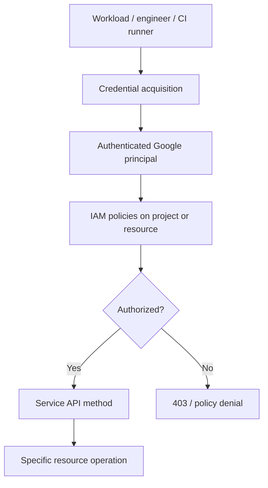
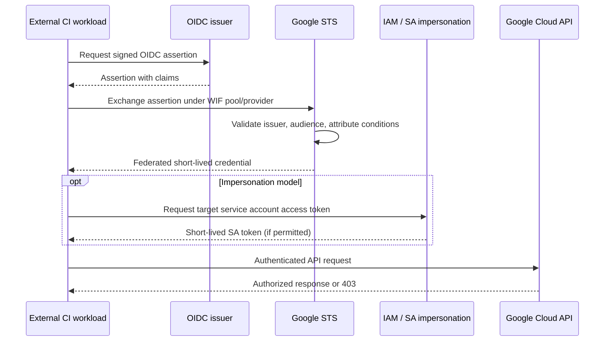
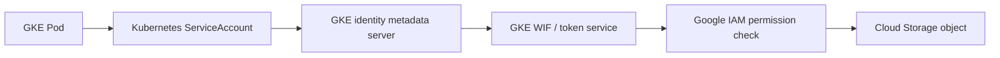

# Q2. IAM, Service Accounts, OAuth, ADC and Workload Identity Federation

> **Interviewer:** A backend runs on GKE and needs to read from Cloud Storage. Explain how you would authenticate it without a JSON key. What is the difference between authentication, authorization, OAuth scopes, IAM role bindings, service account impersonation and workload identity? Show your diagnostic method for 403 errors.

## 1. Two different questions

**Authentication:** Which principal is the caller? OAuth access tokens, identity tokens and other supported credentials establish identity and audience.

**Authorization:** May that principal perform `storage.objects.get` on the specific resource? IAM allow/deny, conditions, organizational constraints and any product-specific controls apply.



Roles contain permissions; principals are bound to roles at a scope. Permissions can inherit from higher resources, but resource-level data access still depends on the exact service's controls.

## 2. Service accounts

A **service account** is a Google identity for machine-to-machine access. Its email resembles `catalog-reader@marketplace-sandbox.iam.gserviceaccount.com`. Merely attaching a service account doesn't grant it permissions; assign the smallest roles on the intended resource.

```bash
gcloud iam service-accounts create catalog-reader   --project=marketplace-sandbox   --display-name="Catalog read-only workload"
gcloud iam service-accounts describe   catalog-reader@marketplace-sandbox.iam.gserviceaccount.com
```

For a sandbox bucket, grant bucket-scoped access instead of project-wide Storage Admin:

```bash
gcloud storage buckets add-iam-policy-binding   gs://EXAMPLE_CATALOG_BUCKET   --member="serviceAccount:catalog-reader@marketplace-sandbox.iam.gserviceaccount.com"   --role="roles/storage.objectViewer"
```

Use an actual owned bucket; this is not a public sample bucket. Avoid creating/downloadable JSON private keys except exceptional legacy integrations, with compensating controls and rotation.

## 3. ADC and credential sources

Application Default Credentials (ADC) are the standard discovery mechanism for Google client libraries. ADC is **not** itself a Google IAM role. In an environment with access to workload metadata, clients can obtain short-lived credentials without a key file. Local `gcloud auth login` and `gcloud auth application-default login` configure different credential stores.

```bash
gcloud auth list
gcloud auth application-default print-access-token
gcloud config get-value project
gcloud auth print-identity-token --audiences=https://example.invalid
```

The identity-token command is illustrative and requires compatible credentials and an appropriate audience. Avoid printing real tokens into shared terminal histories or CI logs.

**Access token versus ID token:** An access token authorizes Google API calls within granted permissions; an ID token primarily identifies the workload to an audience-verifying service, such as a protected HTTP endpoint. A valid token for one audience is not automatically valid for another service.

## 4. Workload Identity Federation from external CI

For a GitHub Actions runner, federation can exchange a trusted OIDC assertion for credentials through Security Token Service, then use direct resource permissions or service account impersonation:



Restrict the provider to expected issuer, repository/ref/environment identity and audience, and grant only the required principal identities. Workload identity pools use **project numbers** in their fully qualified principal identifiers. For impersonation, grant the appropriate `roles/iam.workloadIdentityUser` role to the allowed principal on the target service account. Direct federated principal resource access is an alternative when the API supports it. See [Workload Identity Federation](https://cloud.google.com/iam/docs/workload-identity-federation).

## 5. Workload Identity Federation for GKE

A Kubernetes ServiceAccount (KSA) identity and Google IAM principal/Google Service Account (GSA) are different objects.



Depending on supported cluster settings, grant direct access to the GKE workload principal or configure service account impersonation. The sample KSA:

```yaml
apiVersion: v1
kind: ServiceAccount
metadata:
  name: catalog-api
  namespace: marketplace
---
apiVersion: apps/v1
kind: Deployment
metadata:
  name: catalog-api
  namespace: marketplace
spec:
  replicas: 2
  selector:
    matchLabels: { app: catalog-api }
  template:
    metadata:
      labels: { app: catalog-api }
    spec:
      serviceAccountName: catalog-api
      containers:
        - name: app
          image: europe-west1-docker.pkg.dev/PROJECT_ID/apps/catalog-api:VERSION
```

The YAML does **not** by itself grant Cloud Storage access. Grant IAM permissions to the actual workload principal or impersonated GSA. Refer to the cluster workload pool, project number, KSA namespace/name and node metadata support.

Kubernetes RBAC governs the Kubernetes API; IAM governs Google Cloud APIs. Neither automatically grants the other.

## 6. Google IAM scope and ownership

```bash
gcloud projects get-iam-policy marketplace-sandbox --format=json
gcloud storage buckets get-iam-policy gs://EXAMPLE_CATALOG_BUCKET
gcloud iam service-accounts get-iam-policy   catalog-reader@marketplace-sandbox.iam.gserviceaccount.com
```

Be aware of IAM role binding drift: Terraform's `google_project_iam_policy` is authoritative over a whole policy; `google_project_iam_binding` authoritative for role membership; `google_project_iam_member` additive for a member/role binding. Two independent controllers writing authoritative policies can revoke each other.

**OAuth scopes** are an additional legacy/VM access-token boundary in some workloads, not a substitute for IAM. On GKE, client scopes and node configuration can affect access paths, but workload identity should be the main Pod-level identity design.

## 7. Troubleshoot a Cloud Storage 403

1. Identify exactly **which principal** sent the request; don't assume the pod's named KSA is mapped.
2. Confirm token type, expiry and intended audience.
3. Verify permission and role at the bucket/object scope, including resource ancestry, conditions and applicable denies.
4. Inspect project number, KSA namespace/name, workload pool and WIF provider attributes.
5. Check storage-specific restrictions (VPC Service Controls, bucket policies, object retention, requester pays if relevant).
6. Use Policy Troubleshooter and audit logs, while accounting for audit-log coverage/configuration.

```bash
gcloud storage ls gs://EXAMPLE_CATALOG_BUCKET
gcloud policy-intelligence troubleshoot-policy iam   //storage.googleapis.com/projects/_/buckets/EXAMPLE_CATALOG_BUCKET   --principal-email=catalog-reader@marketplace-sandbox.iam.gserviceaccount.com   --permission=storage.objects.list
gcloud logging read   'protoPayload.status.code=7'   --project=marketplace-sandbox --limit=20
```

The Policy Troubleshooter command and resource format depend on current `gcloud` components and permissions; check `gcloud policy-intelligence troubleshoot-policy iam --help` before using. Logs may be absent when applicable Data Access audit logs aren't enabled.

## 8. Common failures and trade-offs

| Symptom | Likely branch |
| --- | --- |
| 401 | Missing, invalid or expired authentication |
| 403 | Identity authentic but lacks permission or blocked by policy |
| CI worked locally but fails in pipeline | Different ADC principal / audience / impersonation rights |
| GKE Pod works on one node pool only | Metadata server/WIF node configuration or networking |
| Token good but request denied | Role scope, condition, VPC SC, service-specific controls |
| Broad Owner role fixes issue | Unsafe masking of missing least-privilege permission |

**AWS comparison:** GCP Workload Identity Federation relates conceptually to AWS STS web-identity role assumption, but IAM role trust policies and Google IAM principal bindings have distinct formats and evaluation rules. Treat them separately.

## Spoken answer

> “I'd first identify the calling principal, then trace how its short-lived credential was issued and which permission is needed for the exact Cloud Storage resource. On GKE I'd use Workload Identity Federation rather than mounting JSON keys, with a dedicated Kubernetes ServiceAccount and narrow bucket IAM. For external CI I'd restrict OIDC federation to expected repository or environment claims. A 403 should be diagnosed through identity, role scope, conditions, deny and product-specific policy; adding Project Owner is never a satisfactory root-cause fix.”

**Further reading:** [Service accounts](https://cloud.google.com/iam/docs/service-account-overview) · [ADC](https://cloud.google.com/docs/authentication/application-default-credentials) · [WIF for GKE](https://cloud.google.com/kubernetes-engine/docs/concepts/workload-identity) · [IAM Conditions](https://cloud.google.com/iam/docs/conditions-overview)

[Previous](./q1) · [Next: VPC and Shared VPC](./q3)
