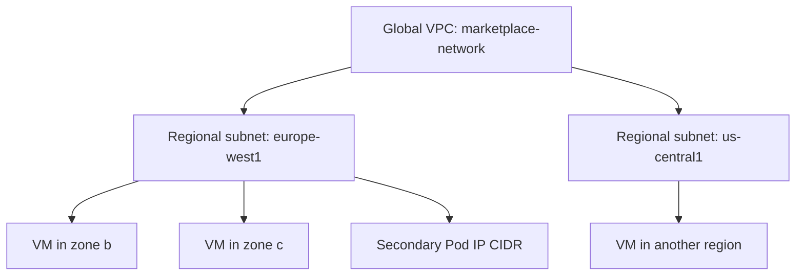
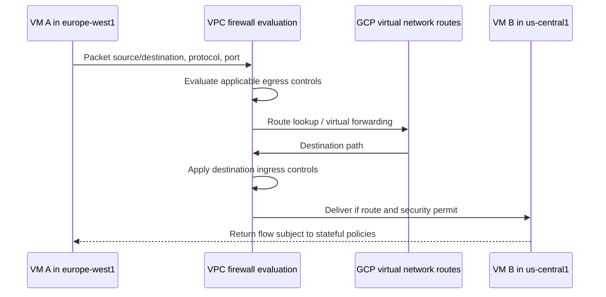
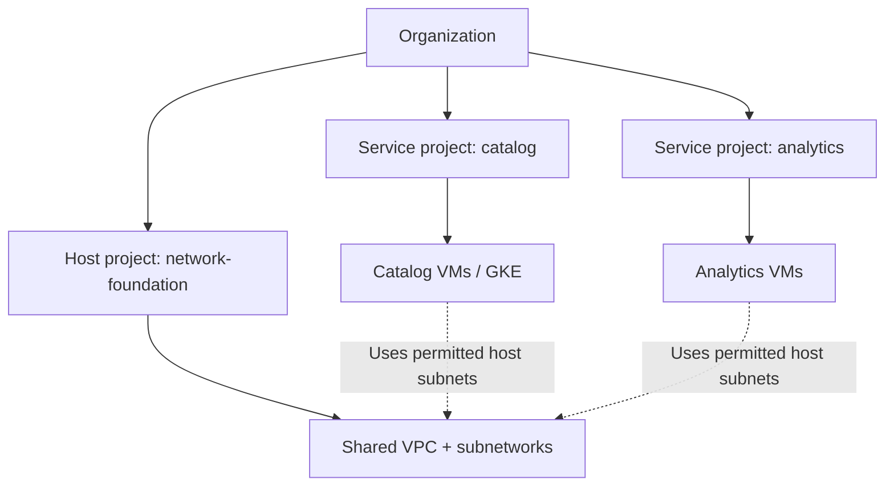
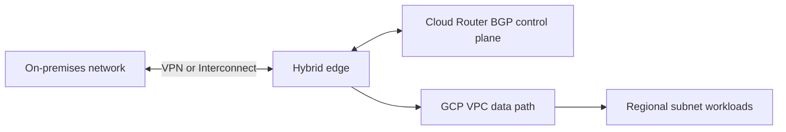

# VPC Networking, Shared VPC, Routes, Firewalls and Hybrid Connectivity

> **Engineering focus:** Design networks for a multi-project service. Explain global VPC scope, regional subnets, routes, hierarchical firewall policy, Shared VPC, Private Google Access, hybrid connectivity and how to trace a VM-to-VM packet. Why does the AWS mental model often mislead engineers on GCP?

## 1. Resource scope is fundamental

A GCP VPC network is global; its subnets are regional. A subnet's primary IPv4 range serves eligible VMs and other primary-address consumers; it may have secondary ranges for alias IPs, such as VPC-native GKE Pods and Services.



GCP automatically provides subnet routes and supports additional static/dynamic routes. Intra-VPC network reachability remains subject to firewall rules and applicable service security. Do not describe VPC global scope as promising low-latency or failure-free interregional traffic. See [VPC specifications](https://cloud.google.com/vpc/docs/vpc).

**AWS contrast:** AWS VPC is regional with zonal subnet placement. GCP networks can hold subnets across regions in one VPC; resources are not all global.

## 2. Create custom-mode network and subnet

```bash
gcloud compute networks create marketplace-vpc \
  --subnet-mode=custom --project=marketplace-sandbox
gcloud compute networks subnets create app-ew1 \
  --network=marketplace-vpc \
  --region=europe-west1 \
  --range=10.40.0.0/20 \
  --enable-private-ip-google-access \
  --enable-flow-logs \
  --project=marketplace-sandbox
gcloud compute networks describe marketplace-vpc --project=marketplace-sandbox
gcloud compute networks subnets list --project=marketplace-sandbox
```

All examples assume a disposable sandbox; creating resources may incur cost. Auto-mode networks predefine subnets; custom mode offers explicit CIDR and region planning and is generally easier to govern for mature platforms.

Plan CIDRs across VPCs, VPN/Interconnect networks, peered networks and secondary ranges. Overlap can break routing/peering and complicate migrations. Address-family support and IPv6 details vary by configuration.

## 3. Packet route from one VM to another



This is a logical policy/routing model, **not** a claim that packets traverse centralized firewall or router VMs. Google Cloud virtual networking implements distributed forwarding and firewall evaluation. VPC firewall rules are stateful for permitted connections, with details depending on the rule and protocol.

### Route decision

Google Cloud determines the applicable routes using route categories, specificity and documented precedence. Never assume the simple “longest prefix always wins over every class of route” model when policy-based routes and system-generated routes are involved.

```bash
gcloud compute routes list \
  --filter='network:marketplace-vpc' \
  --project=marketplace-sandbox
gcloud compute firewall-rules list \
  --filter='network:marketplace-vpc' \
  --project=marketplace-sandbox
```

For BGP-learned dynamic routes, inspect Cloud Router status and advertised/learned routes.

## 4. Firewall model

GCP supports VPC firewall rules and hierarchical/network firewall policies in supported environments. Evaluation includes rule priorities, match conditions, implied policy and higher-level enforcement. Rules can target instances by service account or network tags, with limitations according to firewall type.

```bash
gcloud compute firewall-rules create allow-internal-api \
  --network=marketplace-vpc \
  --direction=INGRESS \
  --priority=1000 \
  --action=ALLOW \
  --rules=tcp:8080 \
  --source-ranges=10.40.0.0/20 \
  --target-tags=internal-api \
  --project=marketplace-sandbox
```

This uses a broad internal source range solely to illustrate command syntax, not a complete production least-privilege policy. Network tags aren't a cryptographic identity; constrain who may set them. Where supported, service-account-targeted rules improve association with workload identities.

**Implicit rule intuition:** In a VPC, implied ingress denial and implied egress allowance exist, unless higher-priority explicit applicable policy changes behavior. Check the current firewall policy hierarchy instead of assuming an empty VPC is fully isolated.

### Rule evaluation and GKE

Node firewall rules, GKE network policies and cloud LB health-check ranges operate at different layers. A VM can be reachable from peers but fail health checks if firewall policy blocks the health-check source ranges relevant to its LB type.

## 5. Shared VPC

Shared VPC centralizes network administration while letting workloads belong to different **service projects**. The host project owns shared VPC and subnets; an attached service project may run VM/GKE workloads using granted host subnets.



Service-project teams require suitable roles such as subnetwork use permissions on host resources, plus ordinary permissions to create workloads in their service project. Network admins retain control of subnet routing and firewall policy. Host/service attachment is a project-level relationship; current Shared VPC policy imposes organization constraints. See [Shared VPC](https://cloud.google.com/vpc/docs/shared-vpc).

### Why adopt Shared VPC?

- Central networking and address allocation.
- One policy/firewall governance model.
- Independent service-team project/billing/resource IAM.
- Cleaner interservice private routing.

**Trade-offs:** Shared failure domains, network dependency on host project, more complex IAM and potential cross-team change coordination. It is not appropriate if teams require fully independent trust/routing domains.

## 6. Private Google Access is not Public NAT

Private Google Access allows eligible VMs without external IPs to reach supported Google APIs/services through internal routing/address mechanisms. It doesn't provide general outbound internet access to arbitrary third-party services.

Public NAT provides eligible outbound internet access to external destinations using managed source translation. Private Service Connect provides private connectivity to supported services through endpoints/service attachments and has different consumer-producer semantics. VPC Service Controls are a data exfiltration security perimeter, **not** a packet routing feature.

```text
VM without external IP -> Google API:
  eligible PGA/private endpoint path may suffice
VM without external IP -> external partner API:
  requires appropriate egress path, commonly Public NAT
VM -> private producer service:
  PSC/private network path if supported
```

## 7. Hybrid networking

Cloud VPN creates encrypted IPsec tunnels for supported routing topologies. Cloud Interconnect provides dedicated or partner connectivity. Cloud Router exchanges BGP routes for supported dynamic routing modes, but isn't an ordinary appliance that forwards each data packet.



For a hybrid incident, distinguish tunnel health, BGP session status, imported/advertised routes, CIDR overlap, firewall rules, MTU and return routes. A green VPN tunnel by itself does not prove application reachability.

## 8. Production scenario: one project cannot reach a shared backend

**Hypothetical:** Catalog runs in service project A and data services in service project B. Both should use Shared VPC, but catalog times out.

Runbook:
1. Confirm both service projects attached to correct host.
2. Check source/destination subnet and actual VM interfaces.
3. Check route, local/global firewall policy and service identity targeting.
4. Capture VPC Flow Logs from relevant subnets; remember sampling and aggregation mean missing log entries aren't proof that packets never existed.
5. Run Network Intelligence Center Connectivity Tests to evaluate modeled paths.
6. Check application listener, process, TLS and downstream security.

```bash
gcloud compute networks subnets list-usable \
  --project=marketplace-sandbox
gcloud compute routes list --project=marketplace-sandbox
gcloud compute firewall-rules list --project=marketplace-sandbox
gcloud logging read 'resource.type="gce_subnetwork"' \
  --project=marketplace-sandbox --limit=30
```

The log filter is illustrative; Flow Logs may appear in specific logging resource types and projects depending on configuration. Use observed log metadata and Connectivity Tests instead of assuming a universal resource-type filter.

## Key takeaways

> Start with the global VPC and regional subnet model, then separate network routing from firewall policy and workload identity. Shared VPC lets a central host project govern network resources while service projects own workloads, provided the required cross-project IAM is in place. For a failed connection trace source IP and subnet, route choice, ingress/egress firewall, service listener and return traffic. Distinguish Private Google Access from NAT and remember Cloud Router is a routing control plane, not an in-path NAT appliance. Hybrid links add BGP, MTU and return-route failure modes.

**Further reading:** [VPC](https://cloud.google.com/vpc/docs/vpc) · [Shared VPC](https://cloud.google.com/vpc/docs/shared-vpc) · [Routes](https://cloud.google.com/vpc/docs/routes) · [Firewall](https://cloud.google.com/firewall/docs/firewalls) · [Hybrid Connectivity](https://cloud.google.com/network-connectivity/docs)

[Previous](./q2) · [Next: NAT, DNS and load balancing](./q4)
