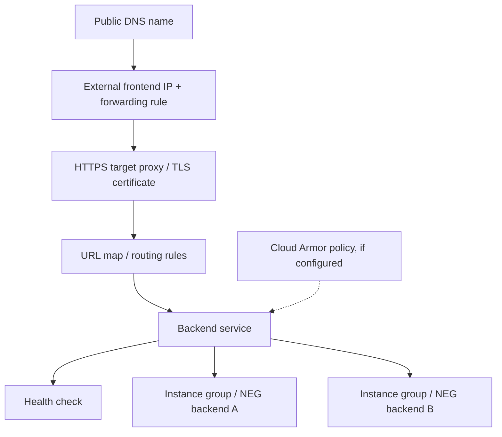
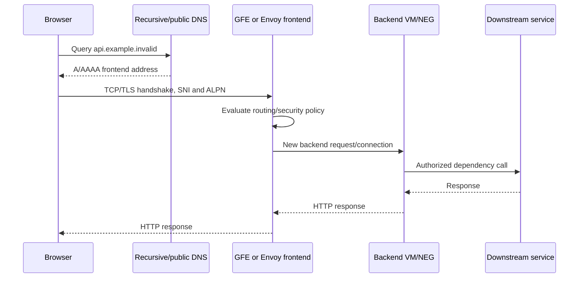
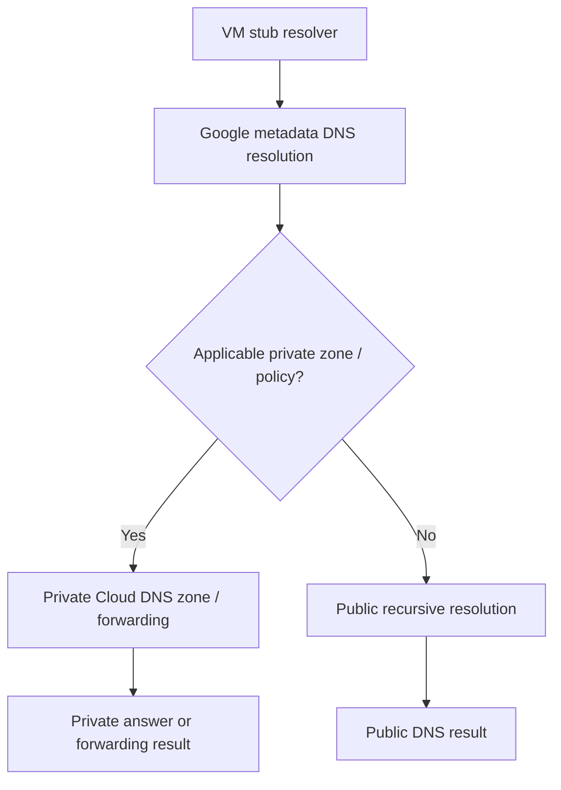
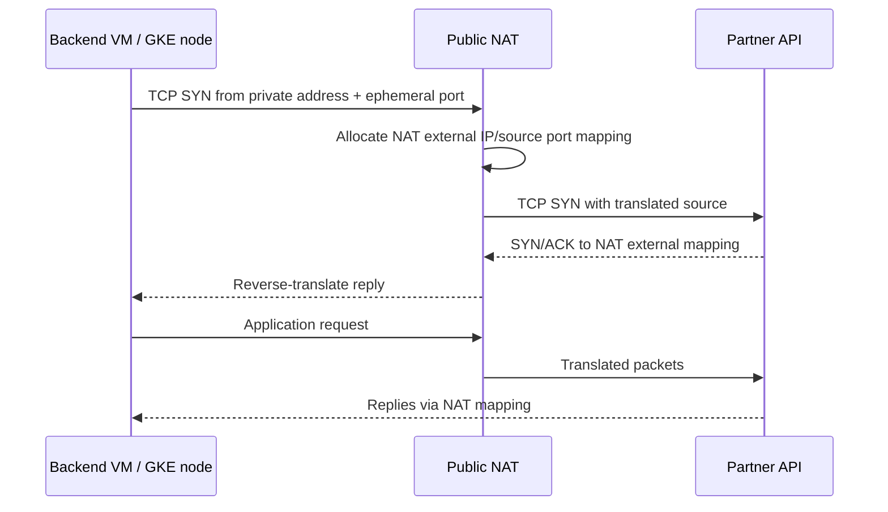

# Cloud NAT, Cloud DNS, Load Balancing and End-to-End Request Flow

> **Engineering focus:** A user reaches a public HTTPS marketplace API in Google Cloud, and the backend calls an external payment provider. Trace both directions through DNS, TLS, load balancing, VPC connectivity, firewall rules and NAT. Explain how to diagnose timeouts, 502s, NAT port exhaustion and DNS failures.

## 1. Don't collapse products into “one load balancer”

Google Cloud load balancing offers Application (HTTP/S, Layer 7) and Network (Layer 4, proxy and passthrough) products, each with external/internal, global/regional and sometimes cross-region deployments. Feature support and backend location depend on the exact class. External global Application Load Balancers can support multi-region backends; internal regional L7 LBs have different reachability rules. See [Cloud Load Balancing overview](https://cloud.google.com/load-balancing/docs/load-balancing-overview).

### Layer 7 conceptual resources



The forwarding rule points at the frontend target; the target proxy handles TLS; URL map selects backend service; backend service defines health, capacity/session features and backends. Some load balancer types expose a different resource chain. **Not every product's packet flow looks like this.**

## 2. HTTPS request end to end



This is a logical proxy-based L7 path. Client TLS may terminate at the frontend, while backend traffic can use HTTP or separately configured HTTPS. Backend health and real request success are distinct. For passthrough L4 products, the packet destination/source handling differs; don't assume TLS terminates in the LB.

### Production failure isolation

- DNS lookup failure: resolver/delegation/zone/policy path.
- TCP connect failure: frontend listener, reachability or policy.
- TLS failure: certificate/SNI/ALPN or protocol mismatch.
- 502/503: backend service routing/health, wrong named port, backend TLS, deployment health, rate limits or application response errors.
- High TTFB: proxy queueing, backend saturation, dependency latency.
- Inconsistent regions: routing, health, service capacity and policy.

```bash
dig +short api.example.invalid A
dig +trace api.example.invalid
curl -Iv --connect-timeout 5 https://api.example.invalid/
openssl s_client -connect api.example.invalid:443 -servername api.example.invalid
gcloud compute backend-services list --project=marketplace-sandbox
gcloud compute url-maps list --project=marketplace-sandbox
gcloud compute health-checks list --project=marketplace-sandbox
```

The domain is a documentation-only domain and intentionally doesn't resolve to a real service. For backend health, select the correct `--global` or `--region` API and inspect the specific backend service.

## 3. Cloud DNS

Cloud DNS supports public zones and private zones, with inbound/outbound forwarding and server policies for supported hybrid environments. Public authoritative DNS answers external recursive resolvers; a private zone is visible to associated authorized VPC networks. Overlapping private zones and forwarding policy can change which answers VMs receive.



Private DNS lookup precedence and forwarding details are implementation-specific; see documentation instead of assuming public fallback after every private NXDOMAIN.

```bash
gcloud dns managed-zones list --project=marketplace-sandbox
gcloud dns record-sets list --zone=ZONE_NAME --project=marketplace-sandbox
gcloud dns policies list --project=marketplace-sandbox
dig @169.254.169.254 internal.example. A
```

The last test assumes Linux VM metadata resolver behavior; actual query results require a configured zone. Diagnose negative caching and TTL changes at recursive resolvers too. Split-horizon can cause Cloud VMs and public clients to resolve different addresses.

## 4. Public NAT and outbound connections

Public NAT translates supported outbound connections from eligible private instances using external IPv4 addresses and allocated source ports. It **doesn't create a listening inbound public endpoint** on a private VM. Cloud NAT is distributed and managed; Cloud Router carries its configuration and routing-related control data but isn't the packet forwarding appliance.



This is conceptual; there is no mandatory separate NAT middlebox VM. For GKE, determine whether Pod sources are SNATed to node IPs first; NAT allocation and logs can vary with source mode.

### Why can NAT ports run out?

Port allocations are finite. Connection churn, many source VM instances, concentrated connections to the same remote IP/port, static/minimum port allocations and NAT address supply can create port allocation failures even with spare CPU/RAM. Watch NAT packet-drop and port-allocation metrics. Unlike a proxy, NAT doesn't automatically queue/retry a failed application request.

```bash
gcloud compute routers nats list   --router=marketplace-router --region=europe-west1   --project=marketplace-sandbox
gcloud compute routers nats describe marketplace-nat   --router=marketplace-router --region=europe-west1   --project=marketplace-sandbox
gcloud compute routers get-nat-mapping-info marketplace-router   --region=europe-west1 --project=marketplace-sandbox
```

These operations require existing router/NAT and appropriate IAM permissions. Mapping inspection may require selecting a VM in some CLI/API versions; check help and actual schema.

## 5. Configure Public NAT (example)

```bash
gcloud compute routers create marketplace-router   --network=marketplace-vpc --region=europe-west1   --project=marketplace-sandbox
gcloud compute routers nats create marketplace-nat   --router=marketplace-router --region=europe-west1   --auto-allocate-nat-external-ips   --nat-all-subnet-ip-ranges   --enable-logging   --project=marketplace-sandbox
```

Review logging cost, min/max port allocation mode, supported subnet coverage and firewall/route behavior before production. Automatic NAT IP allocation doesn't eliminate port planning.

## 6. Private Google Access, DNS and Private Service Connect

- **Private Google Access:** Supported Google API access for eligible VMs without external IP.
- **Public NAT:** Outbound internet connectivity using shared external address/port translation.
- **Private Service Connect:** Private endpoint/service attachment architecture for supported Google or producer services.
- **Cloud DNS:** Name resolution; it does not itself grant network reachability.
- **Cloud Armor:** Security policy attached to supported load-balancing backends; not a generic VM firewall.

These components have different failure modes; using one does not imply the others are configured.

## 7. Hypothetical incident: checkout cannot call partner API

**Symptoms:** Internal health checks pass; newly initiated outbound partner calls time out during a high-volume auction close.

**Investigation**
1. Confirm DNS resolves the expected partner destination from affected nodes.
2. Separate connection timeout from TLS timeout and application 429/5xx.
3. Check source subnet, private/default route, NAT region and eligible source range.
4. Inspect allocated NAT ports, packet drops, translation IPs and destination concentration.
5. Examine ephemeral port churn, connection pooling and HTTP keepalive.
6. Verify partner allowlisted outbound IPs and firewall egress rules.
7. Mitigate via appropriate port/address capacity, connection reuse and bounded concurrency; don't blindly increase Pod replica count because more sources/connections can worsen exhaustion.

```bash
getent ahosts partner.example.invalid
curl -sv --connect-timeout 3 https://partner.example.invalid/health
ss -s
ss -tan state time-wait | head
```

The partner domain and endpoint are hypothetical. Use approved diagnostic endpoints; retries of payments must preserve idempotency.

### Another incident: 502 while Pods show Ready

Inspect backend health with the relevant LB API, check NEG membership and health-check settings, backend firewall ranges, application port and recent rollout. A Kubernetes readiness probe does not guarantee Google load-balancer health.

## Key takeaways

> For external HTTPS trace public DNS, the frontend address, TLS termination, URL map and backend service before reaching a VM or NEG. For the backend's outbound partner call separately trace DNS, routes, egress firewall and Cloud NAT source-port translation. Google L7 and L4 load balancers have different termination models, so name the exact product. For 502s inspect backend health and application errors; for outbound connection timeouts check NAT coverage, allocated ports, connection churn and partner allowlisting. Validate the actual source address rather than assume AWS NAT behavior maps directly to GCP.

**Further reading:** [Load balancing](https://cloud.google.com/load-balancing/docs/load-balancing-overview) · [Cloud DNS](https://cloud.google.com/dns/docs/overview) · [Public NAT](https://cloud.google.com/nat/docs/public-nat) · [Connectivity Tests](https://cloud.google.com/network-intelligence-center/docs/connectivity-tests/concepts/overview)

[Previous](./q3) · [Next: Compute Engine](./q5)
