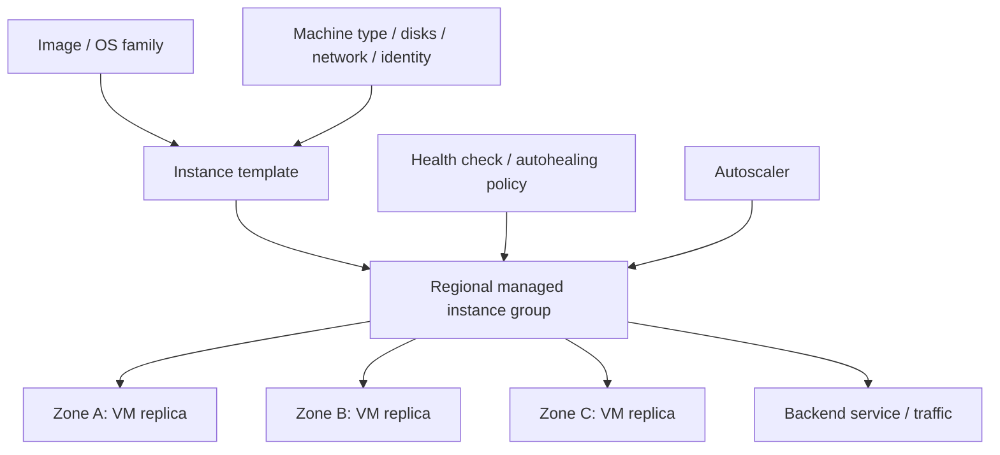
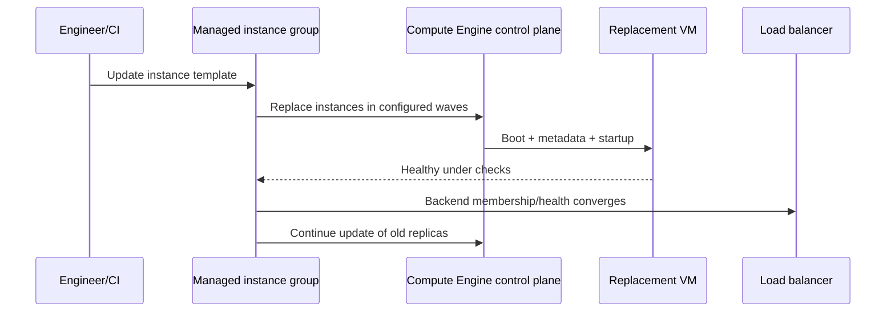
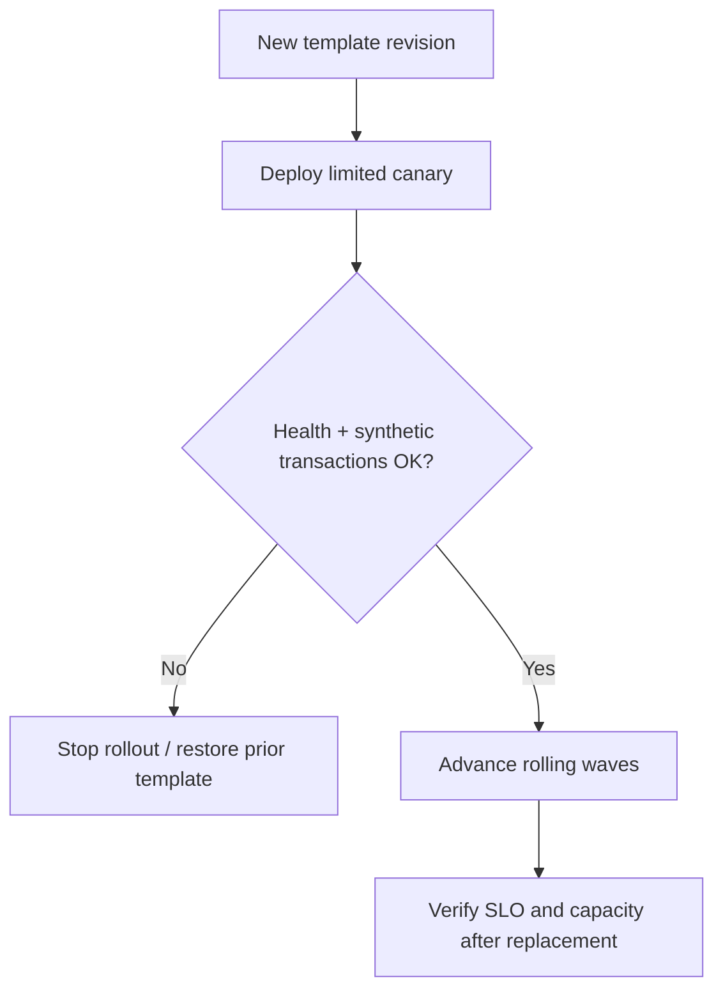

# Q5. Compute Engine, Instance Templates, Managed Instance Groups and Autoscaling

> **Interviewer:** Design a fault-tolerant catalog API on Compute Engine. Explain VM creation, machine families, zones, boot images, service accounts, disks, instance templates, managed instance groups, health checks, autoscaling and rolling replacement. How would you run it during a zonal outage or a Spot VM reclamation?

## 1. Compute Engine resource layers

A VM is a zonal compute instance whose definition includes machine type, image/boot disk, network interfaces, metadata, attached service account and disk/storage settings. Creating a VM invokes the Compute Engine API to place it on available infrastructure in the chosen zone; requesting sufficient CPU quota is not proof that the zone has spare capacity for every machine family.



A VM is not a container. Operating system, patching, process supervision, OS Login and runtime bootstrap remain explicit responsibilities.

## 2. Machine family and disk decisions

Choose from general-purpose, compute-optimized, memory-optimized, accelerator-optimized and specialized instances using a documented benchmark. Compare vCPU/memory, network bandwidth, disk IOPS/throughput, guest OS support, committed-use discounts and availability by region/zone.

Storage options differ:
- Persistent Disk / Hyperdisk: managed persistent block options, subject to attachment, performance and redundancy semantics.
- Local SSD: high-performance local data, not a durable source of truth across loss of the VM.
- Cloud Storage: object API, not equivalent to a local POSIX filesystem.
- Regional disks: replication/availability properties differ from ordinary zonal disks and must be evaluated with supported machine/service configuration.

### Instance disk inventory

```bash
gcloud compute machine-types list --zones=europe-west1-b --limit=15
gcloud compute disks list --project=marketplace-sandbox
gcloud compute disks describe DATA_DISK --zone=europe-west1-b   --project=marketplace-sandbox
gcloud compute images list --filter='family:debian' --limit=10
```

## 3. Create a disposable private VM

```bash
gcloud compute instances create catalog-dev   --project=marketplace-sandbox   --zone=europe-west1-b   --machine-type=e2-standard-2   --subnet=app-ew1   --no-address   --image-family=debian-12   --image-project=debian-cloud   --service-account=VM_RUNTIME_SA_EMAIL   --scopes=https://www.googleapis.com/auth/cloud-platform   --tags=internal-api
```

This presumes networking, IAM, machine availability and OS image support. It creates billable resources. Prefer appropriate OS Login and IAP TCP tunneling instead of assigning a public IP or opening SSH to the world.

```bash
gcloud compute instances describe catalog-dev   --zone=europe-west1-b --project=marketplace-sandbox
gcloud compute ssh catalog-dev --tunnel-through-iap   --zone=europe-west1-b --project=marketplace-sandbox
```

IAP access requires IAM and network policy, including allowed IAP proxy source ranges where appropriate. The VM service account is for workload APIs and should have narrow roles; `cloud-platform` OAuth scope does not grant permissions beyond IAM.

## 4. Instance templates versus mutable VMs

Instance templates describe the configuration from which MIG instances are created. Treat them as effectively immutable versions. A change to template configuration normally means creating a new template and rolling the group forward, not hand-editing each instance.

Example:

```bash
gcloud compute instance-templates create catalog-template-v2   --project=marketplace-sandbox   --machine-type=e2-standard-2   --subnet=app-ew1   --no-address   --image-family=debian-12   --image-project=debian-cloud   --service-account=VM_RUNTIME_SA_EMAIL   --scopes=https://www.googleapis.com/auth/cloud-platform   --metadata-from-file=startup-script=./startup.sh
```

Review flags against the actual gcloud version and whether the template includes a full subnet URL in a Shared VPC. Avoid placing long-lived secrets in metadata or startup scripts. Use Secret Manager with authorized access.

## 5. Managed instance groups

**Zonal MIG:** replicas in one zone. **Regional MIG:** places managed VMs across multiple zones in a region and supports broader failure-domain resilience.

A MIG can manage homogeneous instances from templates, health-based repair, rolling updates and autoscaling. An unmanaged instance group provides grouping for externally managed VMs but not the same automatic lifecycle features. Google Cloud documentation describes both. <https://cloud.google.com/compute/docs/instance-groups>.



The exact update controller, health-check policies and LB membership propagation are asynchronous. Template rollout progress isn't proof an application business request succeeds.

## 6. Autoscaling and autohealing are different

**Autoscaling:** adjusts replica count based on supported signals, such as CPU, LB serving capacity, Cloud Monitoring metrics or schedules. **Autohealing:** recreates VMs that fail the configured health check.

An application can be alive but deadlocked, so health checks should reflect real progress without amplifying shared dependency outages. A database outage that causes every node's autohealing probe to fail can cause a fleet-wide restart storm.

```bash
gcloud compute instance-groups managed list   --project=marketplace-sandbox
gcloud compute instance-groups managed describe catalog-mig   --region=europe-west1 --project=marketplace-sandbox
gcloud compute instance-groups managed list-instances catalog-mig   --region=europe-west1 --project=marketplace-sandbox
gcloud compute instance-groups managed list-errors catalog-mig   --region=europe-west1 --project=marketplace-sandbox
```

Regional versus zonal flags must match the real MIG. Quotas, firewall rules, instance-template errors and lack of zone capacity can prevent autoscaler fulfillment.

## 7. Rolling updates and surge capacity

A deployment should account for:
1. New VM boot and application warmup.
2. Health check passing.
3. LB backend registration.
4. Draining old connections.
5. Database compatibility between versions.
6. Maximum unavailable and surge capacity.
7. Rollback when a template has a defect.



A safe rollout depends on the actual MIG update policy, health behavior and LB draining, not simply choosing “rolling.”

## 8. Spot VM capacity

Spot VMs are discounted, interruptible capacity. They can be preempted, subject to current Compute Engine behavior, with stop/delete termination action and limited advance notice. Use for fault-tolerant stateless serving with baseline capacity, batch processing, or checkpointed jobs. They are not suitable for a single unrecoverable leader or sole persistent writer.

Compare with AWS Spot instances conceptually, but do not assume identical pricing, interruption signals or capacity pools.

## 9. Troubleshooting case: checkout VMs never become healthy

Hypothetical evidence:
- Regional MIG desired=9, healthy=3.
- LB backend health fails for new version.
- VM systemd logs show app binding only to 127.0.0.1:8080; backend health reaches VM NIC address.

Evidence path:
1. Confirm the instance template and startup script actually deployed.
2. Inspect guest application listener and service logs.
3. Check health-check protocol/port/path and firewall source.
4. Inspect LB backend health separately from MIG health.
5. Correct application bind address or health config.
6. Canary new image; verify real checkout requests, then proceed.

```bash
gcloud compute instances get-serial-port-output VM_NAME   --zone=europe-west1-b --project=marketplace-sandbox
gcloud compute operations list --project=marketplace-sandbox --limit=20
sudo systemctl status catalog-api
ss -lntp
curl -v http://127.0.0.1:8080/health
```

The final three commands run inside the VM. Avoid using `curl localhost` alone to prove remote network reachability.

## Spoken answer

> “I'd choose a regional managed instance group for a stateless API that must survive a zone failure, with versioned instance templates, health-based autohealing and autoscaling. I separate machine/OS provisioning from application readiness and load-balancer health. For rollouts, I'd stage replacement waves and validate end-to-end traffic and dependency compatibility. If VMs don't scale, I'd distinguish quota from physical zonal capacity and check the template and health checks. Spot can lower costs for interruptible workloads, but baseline capacity and checkpointing must be deliberate.”

**Further reading:** [Compute Engine](https://cloud.google.com/compute/docs) · [MIGs](https://cloud.google.com/compute/docs/instance-groups) · [Autoscaling](https://cloud.google.com/compute/docs/autoscaler) · [Spot VMs](https://cloud.google.com/compute/docs/instances/spot)

[Previous](./q4) · [Next: Storage, data and artifacts](./q6)
