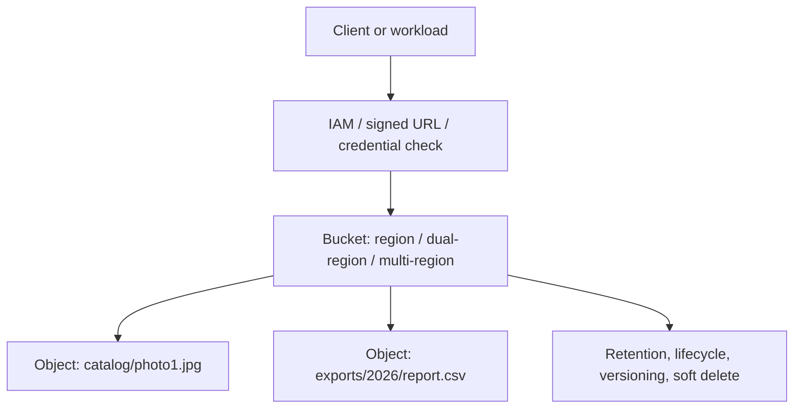
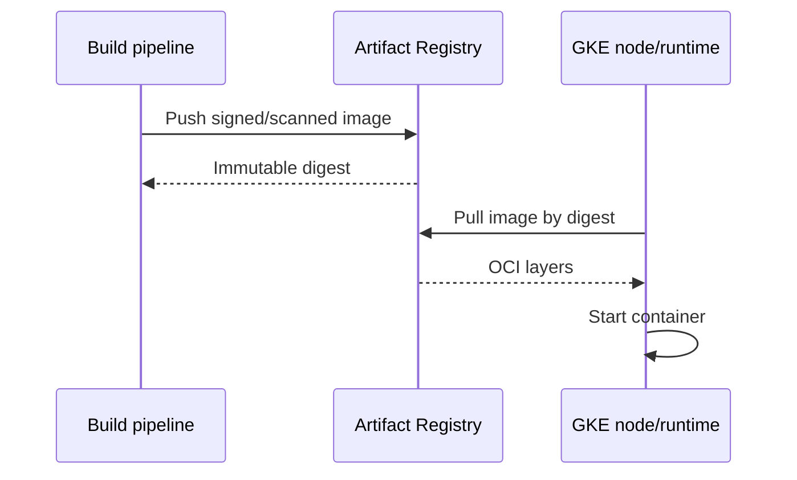
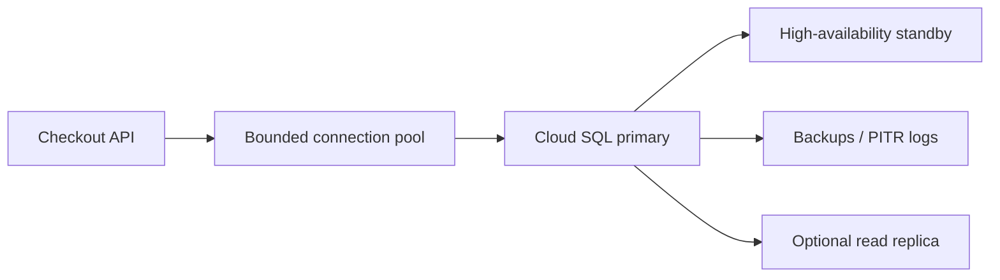
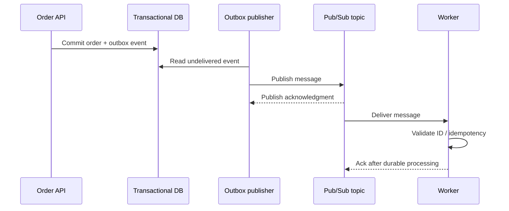

# Cloud Storage, Artifact Registry, Databases and Asynchronous Services

> **Engineering focus:** Design how a marketplace stores catalog images, application artifacts, transactional orders, event processing and analytical data in Google Cloud. Compare Cloud Storage, Persistent Disk, Artifact Registry, Cloud SQL, Spanner, Firestore, Bigtable, BigQuery, Memorystore and Pub/Sub. What guarantees do they provide and what do they not?

## 1. Select by data model, not product popularity

| Requirement | Typical Google Cloud service | Main question |
| --- | --- | --- |
| Images, exports, immutable blobs | Cloud Storage | Object durability, location, lifecycle, access |
| Container images and packages | Artifact Registry | Build provenance, IAM, scanning, regional dependency |
| PostgreSQL/MySQL transactional app | Cloud SQL | HA, backups, connection limits, PITR |
| Relational transactions at significant global scale | Spanner | Data model, consistency, cost, topology |
| Document/key-value app data | Firestore | Query shape, indexes, transactional boundaries |
| High-throughput wide-column/key access | Bigtable | Key design, access latency, column-family model |
| Analytical warehouse | BigQuery | Columnar analytics, ingestion and query cost |
| Cache / low-latency ephemeral data | Memorystore | Cache invalidation and authoritative storage |
| Event transport / decoupled workers | Pub/Sub | At-least-once delivery, ordering options, idempotency |

The choices overlap in some use cases. Model transaction invariants, scale, RPO/RTO, query patterns and operational overhead first.

## 2. Cloud Storage fundamentals

Cloud Storage is an object storage system: **bucket + object name + generation** identify relevant object versions. It is not automatically a POSIX filesystem. Object operations offer strong consistency guarantees under documented semantics, but don't assume atomic multi-object transactions or traditional rename operations.



### Location and storage classes

A bucket's location influences data placement, redundancy, latency and egress. Storage classes include Standard, Nearline, Coldline and Archive, each with different access cost and minimum storage durations. Additional newer classes such as Rapid can have specialized scope and availability; inspect the current pricing and product documentation before applying the older four-class model universally.

Nearline/Coldline/Archive have retrieval and minimum-duration economics. A bulk reclassification may incur operation/retrieval/early-deletion fees. Cloud Storage Autoclass can optimize class transitions for supported buckets.

### Secure bucket example

```bash
gcloud storage buckets create gs://EXAMPLE_CATALOG_BUCKET \
  --location=europe-west1 \
  --uniform-bucket-level-access \
  --public-access-prevention \
  --project=marketplace-sandbox
gcloud storage buckets describe gs://EXAMPLE_CATALOG_BUCKET
gcloud storage cp ./example.jpg gs://EXAMPLE_CATALOG_BUCKET/demo/example.jpg
gcloud storage ls gs://EXAMPLE_CATALOG_BUCKET/demo/
```

The bucket name must be globally unique and owned by the sandbox project. Cloud Storage public access prevention and uniform bucket-level access are distinct controls. IAM role `roles/storage.objectViewer` can be scoped to the bucket for application reads.

### Soft delete, retention and object versioning

Cloud Storage soft delete can retain deleted/overwritten objects for recovery; eligible buckets are generally created with default soft-delete retention, but actual policy and duration are configurable. Object Versioning and retention locks serve different objectives. A backup plan should specify whether accidental overwrite, malicious delete, cryptographic-key loss or regional disaster is in scope.

```bash
gcloud storage objects describe gs://EXAMPLE_CATALOG_BUCKET/demo/example.jpg
gcloud storage buckets describe gs://EXAMPLE_CATALOG_BUCKET \
  --format=json
```

Don't apply lifecycle delete rules to legal/financial data without retention approval.

## 3. Artifact Registry

Artifact Registry stores container images and other supported build artifacts in named repositories. A GKE workload pulls `europe-west1-docker.pkg.dev/PROJECT_ID/apps/catalog-api:VERSION`. Image reference location, IAM and network reachability all affect pull success.



For reproducibility, deploy by digest rather than mutable tags when feasible. Plan artifact retention/cleanup and billable regional storage/egress. Supply-chain policy may include vulnerability scanning, signing/attestation and controlled registries. GKE nodes require pull permissions on the correct repository or project.

```bash
gcloud artifacts repositories list --location=europe-west1   --project=marketplace-sandbox
gcloud artifacts docker images list   europe-west1-docker.pkg.dev/PROJECT_ID/apps   --include-tags
```

## 4. Cloud SQL and transaction integrity

Cloud SQL provides managed MySQL, PostgreSQL and SQL Server variants with service-specific HA/backup capabilities. Managed doesn't mean connection pooling, schema compatibility, index tuning and replica lag disappear.



**Important:** HA failover, read replicas and backups solve different problems. A replica can be stale or replicate logical corruption. PITR is for restoring data to an earlier point, while HA is about restoring availability. Design RPO/RTO and recovery tests explicitly.

```bash
gcloud sql instances list --project=marketplace-sandbox
gcloud sql instances describe orders-db --project=marketplace-sandbox
gcloud sql backups list --instance=orders-db --project=marketplace-sandbox
gcloud sql operations list --instance=orders-db --project=marketplace-sandbox
```

Networking options include supported private IP paths, Private Service Connect integrations and authorized Cloud SQL connection mechanisms. Don't assume VPC-native private reachability without configuring relevant connectivity and IAM.

## 5. Pub/Sub delivery is not a database transaction

Pub/Sub decouples publishers from subscribers with topics and subscriptions. Delivery guarantees and ordering vary by subscription type and supported feature configuration. Design consumers to handle redelivery, out-of-order events where applicable and poison messages.



This depicts an outbox pattern, not a built-in Cloud SQL-to-Pub/Sub atomic commit. Publish and business transaction can't be assumed atomic merely because both calls succeeded. Use database outbox or another proven integration when avoiding lost events matters.

A subscriber may acknowledge only after durable side effect. If it crashes after committing business work but before ack, it may process the event again. Use a deduplication key or transactional uniqueness constraint.

## 6. Spanner, Bigtable, Firestore and BigQuery

- **Spanner:** relational SQL with transactional semantics and distributed architecture; carefully evaluate interregion latency, schema and pricing.
- **Bigtable:** wide-column low-latency large-scale key access. Row-key distribution is critical; poor sequential hot key design can create hotspotting.
- **Firestore:** document data with query/index design considerations and transactional constraints; assess index/write costs.
- **BigQuery:** analytical warehouse, not a substitute for low-latency OLTP order processing. Control scan/query cost, partitioning and access.
- **Memorystore:** an in-memory data service; don't treat a cache as source of truth unless the application explicitly tolerates that failure model.

AWS conceptual analogues include RDS/Aurora, DynamoDB, S3, ECR, Redshift and SQS/SNS, but consistency, indexing, networking and identity semantics vary.

## 7. Production incident: duplicate charges after queue redelivery

**Hypothetical:** A worker processes a payment-completed message, commits the ledger operation, crashes before ack, then receives the message again. A retry blindly repeats the side effect.

**Fix:** Store an idempotency key or unique transaction ID in the transactional system; verify durable processing before acknowledgement. Set bounded retries, dead-letter routing, alerting and replay policy. Exactly-once *delivery* options for some Pub/Sub subscription modes do not automatically make an external payment side effect exactly once.

**Diagnosis:**
```bash
gcloud pubsub topics list --project=marketplace-sandbox
gcloud pubsub subscriptions list --project=marketplace-sandbox
gcloud logging read 'severity>=ERROR' --project=marketplace-sandbox --limit=50
```

Inspect message IDs, business event IDs, ack deadlines, redelivery rate, worker retry count and database uniqueness constraints. Avoid printing payment payload PII into logs.

## Key takeaways

> Separate durable objects, transactional business state, low-latency caches, events and analytics. Cloud Storage suits images and exports, Artifact Registry stores deployable packages, Cloud SQL or another transactional database holds orders, Pub/Sub decouples workers and BigQuery supports analysis. The key design question is each service's consistency and failure guarantee. HA, backups and replicas aren't interchangeable, and message redelivery must not duplicate payments. Enforce bucket IAM and retention, immutable image deployment, bounded DB connections, idempotent consumers and tested restores.

**Further reading:** [Cloud Storage](https://cloud.google.com/storage/docs/introduction) · [Storage classes](https://cloud.google.com/storage/docs/storage-classes) · [Soft delete](https://cloud.google.com/storage/docs/soft-delete) · [Artifact Registry](https://cloud.google.com/artifact-registry/docs) · [Cloud SQL](https://cloud.google.com/sql/docs) · [Pub/Sub](https://cloud.google.com/pubsub/docs)

[Previous](./q5) · [Next: Observability](./q7)
