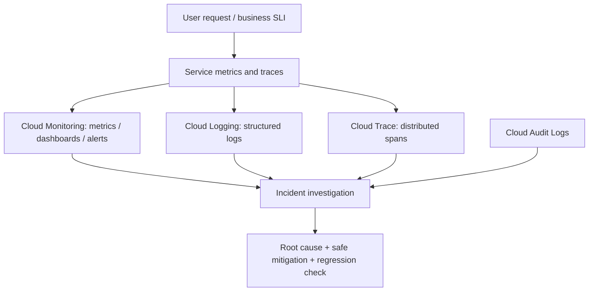
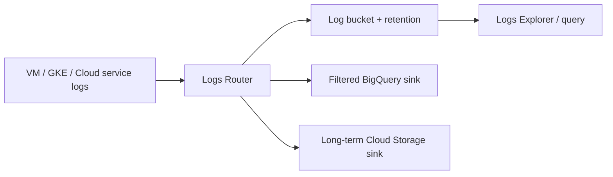
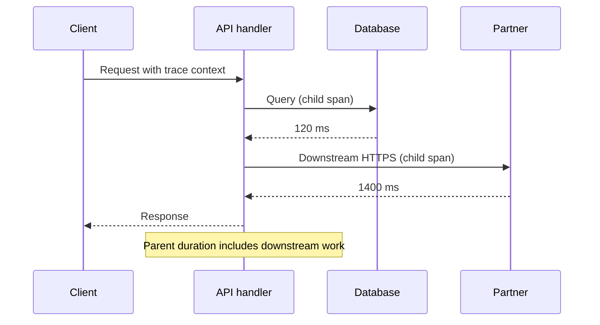

# Q7. Cloud Monitoring, Logging, Tracing, Audit and Operational Reliability

> **Interviewer:** A marketplace API's p99 latency rises while Compute Engine CPU remains low. Explain Google Cloud observability, resource metrics, logs, trace propagation, SLOs and audit logs. How would you isolate latency without assuming the infrastructure is healthy merely because VMs are Running?

## 1. Observability begins with user impact

A reliable system needs a clear signal of **what the user experiences** and enough correlated telemetry to locate where progress stops. CPU percent, VM Running state and GKE Pod readiness aren't substitutes for a successful checkout or catalog API response.

Use the RED method at the service level:
- **Rate:** Requests or work units per second.
- **Errors:** Failed or invalid operations, including correctness failures not necessarily reported as 5xx.
- **Duration:** p50/p95/p99 latency and latency distributions.

Use USE on resources:
- **Utilization:** How busy the resource is.
- **Saturation:** Queues, resource pressure and waiting.
- **Errors:** Drops, throttle and service API errors.



## 2. Metrics

Cloud Monitoring stores time-series data, including platform service metrics and application/custom metrics. Labels help segment by service, region, status and revision. High-cardinality labels such as raw request IDs or customer IDs can create extreme cost and query overhead; keep unique values in traces/logs instead.

```bash
gcloud monitoring metrics list   --project=marketplace-sandbox   --filter='metric.type=starts_with("compute.googleapis.com/instance/")'
gcloud monitoring time-series list   --project=marketplace-sandbox   --filter='metric.type="compute.googleapis.com/instance/cpu/utilization"'   --interval-start-time="2026-10-25T00:00:00Z"   --interval-end-time="2026-10-25T01:00:00Z"
```

The availability/flags of these commands can vary by Cloud SDK release; `gcloud monitoring --help` or Monitoring API/console is authoritative. The interval is intentionally an example, not current incident timing.

### Histograms and percentiles

A service with p50 30 ms and p99 2 s has a tail problem. Average latency can hide an overloaded minority of instances or slow downstream calls.

For reliable percentiles use distributions/histograms (with suitable buckets and aggregation) rather than taking the arithmetic average of per-instance p99s. Percentiles cannot generally be combined by simple averaging.

## 3. Structured logs and Logs Router

A useful JSON log includes time, severity, service, revision, trace ID, span ID, request outcome, sanitized error category and latency. Avoid secrets, access tokens, raw payment details and customer PII.

```json
{
  "severity": "ERROR",
  "service": "checkout-api",
  "revision": "r42",
  "trace_id": "sample-trace-id",
  "operation": "submit_order",
  "error_type": "dependency_timeout",
  "latency_ms": 1250
}
```

Google Cloud Logging supports logs from infrastructure and apps. Logs Router determines how incoming entries reach configured sinks and storage destinations. Sinks can send selected entries to log buckets or supported destinations such as BigQuery, Cloud Storage and Pub/Sub. The destination writer requires the right IAM permission.



### Logs are not guaranteed complete by merely enabling a service

Check agent/logging configuration, sampling, exclusion filters, sink permissions, retention and quotas. VPC Flow Logs may be sampled/aggregated. Cloud Audit **Data Access** log availability depends on service, policy and configuration. The absence of a log entry alone is not proof an event never happened.

```bash
gcloud logging read   'resource.type="gce_instance" AND severity>=ERROR'   --project=marketplace-sandbox --limit=30 --format=json
gcloud logging sinks list --project=marketplace-sandbox
gcloud logging buckets list --location=global --project=marketplace-sandbox
```

Log bucket locations can differ; inspect relevant region-specific locations too.

## 4. Distributed tracing

A request can spend time in:
1. External LB/proxy.
2. Application accept queue and worker scheduling.
3. User authentication/authorization.
4. Database connection acquisition.
5. Query execution.
6. External partner HTTP call.
7. Response serialization and egress.



Propagate trace context using supported OpenTelemetry/W3C headers. Spans should reflect causal relationships, not just unrelated logs with timestamps. Sampling reduces costs, but it can miss rare incidents; align sampling strategy with traffic and high-value error paths.

## 5. Cloud Audit Logs

Audit logs help answer **who did what to which resource, when and via which API**. Core categories include Admin Activity, Data Access and System Event, with service-specific coverage. A human console change, Terraform apply and service account API action can produce different audit evidence.

```bash
gcloud logging read   'logName:"cloudaudit.googleapis.com" AND protoPayload.methodName:"setIamPolicy"'   --project=marketplace-sandbox --limit=20
```

Inspect `principalEmail`, service name, method, resource, status and caller context when available. Audit visibility/retention is not identical for every project or service. Protect audit sinks from alteration by workload administrators.

## 6. SLIs, SLOs and error budgets

**SLI:** Quantitative measure, e.g., fraction of valid checkout requests completed under 500 ms.

**SLO:** Objective for that metric over a window, e.g., 99.9% compliant events over rolling 30 days.

**Error budget:** Allowed fraction of noncompliant events: `1 - objective` under that SLO definition. For an event-count SLI of 99.9%, budget = 0.1% of eligible events. **Do not** mechanically convert that into “minutes of downtime” when the SLI measures request latency or correctness rather than time-window availability.

**Burn rate:** How quickly the error budget is being spent relative to the steady-state allowance.

```text
SLO target = 99.9%
Allowed noncompliant fraction = 0.001
Actual error fraction over short window = 0.0144
Burn rate = 0.0144 / 0.001 = 14.4x
```

For alerting, pair a short window with a longer confirmation window to catch sustained customer-impacting failures while limiting noise. Alert on symptoms/SLO burn, then use resource alerts as diagnostic context.

## 7. Alerting and incident response

A strong alert has:
- Service or product impact.
- Threshold and duration, not merely a transient data point.
- Links to runbooks/dashboards.
- Responsible owner and severity.
- No sensitive payloads.
- Sufficient sampling/metric freshness context.

An overly aggressive page on every high CPU instance creates noise. A checkout success-rate burn alert is closer to customer impact.

## 8. Production incident: slow checkout with healthy CPU

**Hypothetical:**
- 99th percentile jumped from 150 ms to 3 seconds.
- API CPU only 30%.
- New connections to Cloud SQL increased after a deployment.
- DB connection pool reaches limit, requests wait before executing queries.

**Investigation**
1. Confirm RED signals and the affected region/revision.
2. Inspect trace spans to locate request waiting before SQL operations.
3. Compare Cloud SQL connections, lock waits and query latency.
4. Inspect code/config change to pool size and replica counts.
5. Reduce unbounded request concurrency or rollback, preserving transaction idempotency.
6. Verify p99/error budget recovery and correlate with DB sessions.

Other possible causes include NAT port pressure, LB unhealthy endpoints, IAM token refresh, DNS timeouts and quota throttling. Don't select one without evidence.

## 9. Observability cost and data governance

Metrics label cardinality, verbose logging, log retention, cross-region export, tracing sampling and BigQuery scan size affect cost. Centralize restricted audit evidence while allowing teams their own service dashboards. A lead engineer balances diagnostic value with access/privacy and budget rather than blindly collecting every packet/payload.

## Spoken answer

> “I begin with a user-facing SLI and RED metrics, then locate the time spent using correlated traces, structured logs and resource metrics. In Google Cloud I'd examine Cloud Monitoring, Cloud Logging, Cloud Trace and Cloud Audit Logs, while remembering that some logs and traces are sampled or filtered. I'd define SLOs that measure business-relevant availability or latency and alert on burn rate, not just VM CPU. During a p99 incident I'd use trace spans to distinguish queueing, database contention and remote network waits, then verify recovery in the same user-facing signals.”

**Further reading:** [Cloud Monitoring](https://cloud.google.com/monitoring/docs/monitoring-overview) · [Cloud Logging](https://cloud.google.com/logging/docs/overview) · [Cloud Trace](https://cloud.google.com/trace/docs/overview) · [Audit Logs](https://cloud.google.com/logging/docs/audit) · [SLOs](https://cloud.google.com/stackdriver/docs/solutions/slo-monitoring)

[Previous](./q6) · [Next: architecture and cost](./q8)
