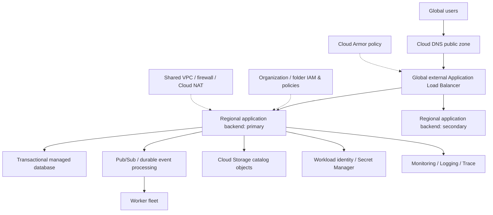
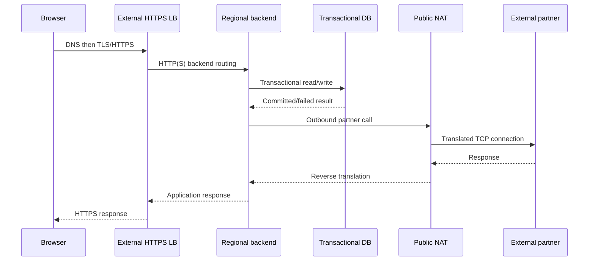

# Senior GCP Architecture, Security, Costs and Production Failure Modes

> **Engineering focus:** Design a secure, highly available marketplace platform on Google Cloud. Defend project boundaries, networking, identity, regional resilience, database selection, scale-out, backups, cost trade-offs and operational controls. Then explain how you'd lead a regional incident without making unsafe recovery assumptions.

## 1. Begin with constraints

Architecture should follow concrete requirements:
- Maximum acceptable downtime, RTO and RPO.
- Expected baseline/peak requests and concurrent connections.
- User regions and latency objective.
- Data residency and security classification.
- Read/write transaction consistency.
- Migration and operational team capacity.
- Cost ceiling and recovery funding.
- Expected failure domains: VM, zone, region, dependency, identity and operator error.

An attractive diagram is not a substitute for a verifiable SLO and failure model.

## 2. A plausible marketplace foundation



**Hypothetical reference model, not verified production infrastructure.** The secondary backend doesn't imply transactional cross-region failover is solved. A DB's actual replication, promotability and application consistency must be designed separately.

### Project boundaries

- Network host project: global VPC, regional subnet ranges, Shared VPC, firewall governance and hybrid connectivity.
- Application service projects: deployment/compute, runtime IAM, quotas.
- Data project: database/storage and narrow network access.
- Observability/security projects: protected audit logs, sinks and governance.
- Nonproduction projects: quota, cost and IAM separated from production.

Avoid indiscriminate folder-wide `roles/editor` access. Organization Policy, IAM deny, resource-level bindings and private networking each solve different problems.

## 3. Routing and traffic security

Request path:



Cloud NAT only applies to eligible egress flows; internal DB traffic does **not** traverse public NAT. LB backends may be MIGs or NEGs and the precise proxy/data path depends on LB class. Use HTTPS or mTLS between components when required by the threat model; VPC placement alone isn't end-to-end authorization.

## 4. Availability and failure domains

| Layer | Failure | Design lever | Residual risk |
| --- | --- | --- | --- |
| Single VM | OS hang/disk failure | Autohealing + multiple replicas | Faulty health check restarts fleet |
| Zone | Zone unavailable | Regional MIG or regional GKE/node spread | Stateful zonal disk attachment |
| Region | Widespread service outage | Secondary region + planned failover | Data lag, DNS/LB decision, provider dependency |
| Database | Primary outage/corruption | HA + backups/PITR + tested restore | Shared bad writes/replicated corruption |
| Identity | IAM change/metadata outage | Least privilege, audit, recovery access | Shared org policy change |
| External provider | Partner timeout | Bounded retries, circuit breaker, idempotency | Uncertain transaction result |
| Deployment | Broken release | Canary + rollback + schema compatibility | Already committed incompatible data |

Avoid claiming multi-zone deployment equals multi-region disaster recovery. Likewise a multi-region HTTPS frontend doesn't automatically provide a writable secondary transactional database.

## 5. Scaling as a latency pipeline

From load increase to ready capacity:

```text
Metric production
 -> Autoscaler decision
 -> Cloud quota/capacity selection
 -> VM/GKE node creation
 -> OS/container bootstrap
 -> Application warmup
 -> Health check success
 -> LB registration
 -> Requests served
```

Predictable promotional or auction peaks often justify scheduled pre-scaling and baseline headroom. Reactive autoscaling cannot retroactively remove startup and quota delays.

### Data and queue scaling

Do not increase application replicas without considering database connection limits, Pub/Sub processing capacity and external API quotas. The service may become faster at accepting work but slower or less correct at finishing it. Bound concurrency, use backpressure and preserve business idempotency.

## 6. Regional disaster recovery

Write down:
- Recovery point objective (RPO): acceptable durable data loss.
- Recovery time objective (RTO): acceptable time to restore service.
- Data source of truth and replication direction.
- Cross-region restore locations, keys, permissions and dependencies.
- Failover trigger/approval and split-brain prevention.
- Planned failback and consistency verification.
- Disaster recovery drills with measured recovery times.

A secondary region isn't ready merely because Terraform resources exist there. It must have compatible application release, secrets, IAM, network access, data copy and tested traffic switching.

## 7. Cost architecture

The meaningful total cost includes:
- Compute hours, machine families and Spot/committed-use strategy.
- Storage GB, operations, retrieval and soft-delete retention.
- Inter-region, interzone and internet egress.
- Cloud NAT gateway/data processing, public IPs and LB resources.
- Cloud SQL/Spanner capacity and backups.
- Logging/Monitoring labels, metrics retention and traced events.
- Unused reserved capacity, duplicate staging environments and snapshots.

Rightsizing shouldn't eliminate resilience headroom. A smaller regional footprint may save money until one zonal event causes hours of downtime.

### Guardrails

Use budgets and alerts, resource labels/tags, quotas, scoped project ownership, infrastructure plan cost checks, scheduled temporary environment cleanup and monthly service-level chargeback. Cloud billing labels aren't guaranteed to capture every cost dimension; reconcile with billing export.

```bash
gcloud billing accounts list
gcloud billing projects describe marketplace-sandbox
gcloud compute instances list --project=marketplace-sandbox
gcloud compute disks list --project=marketplace-sandbox
gcloud storage buckets list --project=marketplace-sandbox
gcloud services list --enabled --project=marketplace-sandbox
```

These are inventory commands; identity permissions determine visibility.

## 8. Incident: public API fails only in one region

**Hypothetical:** A deployment succeeds but 30% of global users experience 503s. Secondary regional backends are healthy; primary region experiences unhealthy endpoints after a node pool change.

**Senior incident sequence**
1. Classify business impact: checkout/bidding errors, data correctness, affected regions.
2. Freeze risky deployments and identify the rollout revision.
3. Inspect Cloud LB backend health by region, forwarding rule, route and policy.
4. Determine whether failure is at application, health check, NEGs/MIGs, IAM, network or underlying capacity.
5. Verify DB write path and whether secondary region can truly serve writes safely.
6. Shift traffic only when data consistency, capacity and service dependency readiness are validated. A blind failover can make an outage a data incident.
7. Validate error rate, p99 and transaction outcomes.
8. Record timeline, cause, contributing conditions and corrective controls.

```bash
gcloud compute backend-services list --project=marketplace-sandbox
gcloud compute url-maps list --project=marketplace-sandbox
gcloud compute health-checks list --project=marketplace-sandbox
gcloud logging read 'severity>=ERROR' --project=marketplace-sandbox --limit=50
gcloud compute operations list --project=marketplace-sandbox --limit=25
```

Use `--global` or `--region` on appropriate backend subcommands; different LB classes have different APIs.

## 9. A lead-level answer must include rejected alternatives

Consider and explain:
- **GKE versus MIGs:** Container orchestration/self-service versus simpler VM lifecycle, team capabilities and workload shape.
- **Cloud SQL versus Spanner:** Ordinary relational application needs versus distributed scale/availability and cost.
- **Regional only versus multi-region:** Budget and simplicity versus RTO/RPO requirements.
- **Shared VPC versus independent VPCs:** Central governance versus fault/isolation boundaries.
- **Spot versus standard capacity:** Cost versus reclamation and startup risk.
- **Centralized policy versus team autonomy:** Consistency/security versus workflow friction.

Choose based on required outcomes and measured constraints, not cloud-fashion preferences.

## Key takeaways

> Begin with SLO, RTO/RPO, transaction semantics, peak load and data residency. Use a governed resource hierarchy with separate network, service and data ownership, narrow IAM and workload identity, and an ingress/load-balancing design matched to the application's traffic. Regional compute distribution protects against zones; a region-level recovery requires a separate plan for data, secrets, dependencies and cutover. Favor managed services when they reduce operational risk without violating requirements, use quota and cost headroom, and exercise failure recovery. During an incident correlate load-balancer health, service metrics and application transactions before making a potentially unsafe region switch.

**Further reading:** [Google Cloud architecture framework](https://cloud.google.com/architecture/framework) · [Well-Architected reliability](https://cloud.google.com/architecture/framework/reliability) · [Cost optimization](https://cloud.google.com/architecture/framework/cost-optimization) · [Security foundations](https://cloud.google.com/architecture/security-foundations)

[Previous](./q7) · [Module index](./) · [Challenge questions](./follow-ups)
