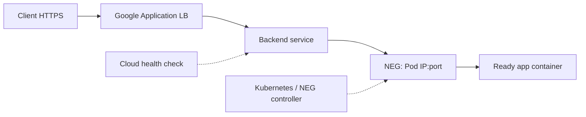

# Module 6: Eight GKE Labs and Production Tabletop Exercises

These exercises accompany the eight chapters. A successful lab means you can explain the mechanism and expected failure evidence, not just execute a command.

::: warning Safety and cost
Use an approved disposable GCP project/cluster with a budget and teardown plan. GKE cluster nodes, load balancers, regional disks, logging and NAT create charges. The commands below use placeholders and are primarily read-only unless marked. Never deliberately break production ingress, force-detach a disk, disable admission security, expose the API endpoint or drain critical nodes for practice. Autopilot/Standard feature support differs.
:::

## Lab 1. GKE API, controllers and lifecycle

**Goal:** Trace an accepted Deployment through ReplicaSet, scheduler, kubelet and readiness.

```bash
gcloud container clusters list --project=PROJECT_ID
gcloud container clusters get-credentials CLUSTER \
  --location=europe-west1 --project=PROJECT_ID
kubectl config current-context
kubectl get --raw=/readyz
kubectl get deployment,replicaset,pods -A
kubectl -n marketplace get events --sort-by=.lastTimestamp
```

In a sandbox namespace, deploy a simple approved HTTP image with `replicas: 2`, requests and readiness probes. Inspect:

```bash
kubectl -n marketplace describe deployment demo
kubectl -n marketplace get rs,pods -o wide
kubectl -n marketplace describe pod POD
```

**Expected:** API acceptance precedes Pod readiness. Deployment owns ReplicaSet, ReplicaSet owns Pod; the scheduler binds Pod to node; kubelet starts it. A successful apply is not proof of a healthy user request. Track `metadata.ownerReferences` and readiness conditions.

**Challenge:** Explain whether already-running Pods keep serving when Kubernetes API becomes unavailable, and what new scheduling/reconciliation stops.

## Lab 2. Standard pools, scheduling and failure domains

**Goal:** Distinguish requests from utilization and hard from soft placement.

```bash
kubectl get nodes -o wide
kubectl get nodes -L cloud.google.com/gke-nodepool,topology.kubernetes.io/zone
kubectl describe node NODE
kubectl -n marketplace describe pod POD
gcloud container node-pools list --cluster=CLUSTER \
  --location=europe-west1 --project=PROJECT_ID
```

In a paper exercise, a Pod requests 3 CPU, a candidate node has 4 vCPU capacity but only 2.5 CPU allocatable free after reservations and existing requests. **Expected:** Scheduler rejects the Pod even if measured host CPU is 15%.

Try a dry-run manifest with `nodeSelector` that matches no node (in a disposable namespace, only if authorized), then inspect FailedScheduling without creating expensive new capacity:

```bash
kubectl -n sandbox apply -f scheduling-demo.yaml
kubectl -n sandbox describe pod demo-pod
```

The YAML must be constructed for your sandbox; don't force an unschedulable Pod into production.

**Challenge:** Contrast nodeSelector, taints, topology spread and PriorityClass; explain why node autoscaler might fail to satisfy a hard constraint.

## Lab 3. Service dataplane, Pod CIDRs and DNS

**Goal:** Inspect VPC-native subnet ranges and understand virtual ClusterIP routing.

```bash
gcloud container clusters describe CLUSTER \
  --location=europe-west1 --project=PROJECT_ID
gcloud compute networks subnets describe SUBNET \
  --region=europe-west1 --project=PROJECT_ID
kubectl get nodes -o wide
kubectl -n marketplace get pods -o wide
kubectl -n marketplace get svc,endpointslices,networkpolicy
kubectl -n kube-system get daemonsets
```

**Expected:** Nodes use primary subnet addresses, Pods use secondary alias-IP ranges. A Service ClusterIP is a virtual VIP backed by EndpointSlices. In Dataplane V2, `anetd`/eBPF handles Service routing rather than kube-proxy iptables rules.

**Calculation challenge:** Pod range /17 with node allocation /24 offers at most 128 per-node blocks from that range. Explain why 128 nodes can be the limiting factor long before all addresses are in live Pods. Confirm actual max-Pod settings before applying the formula elsewhere.

**Network policy challenge:** In a sandbox namespace only, create a default-deny policy, demonstrate DNS/connectivity failures, then add a narrowly scoped DNS egress rule and app peer ingress. Clean up policies afterwards. Don't apply default deny to an existing production namespace.

## Lab 4. GKE Ingress, Gateway and NEG backend health

**Goal:** Compare Kubernetes readiness with Google LB backend readiness.

```bash
kubectl -n marketplace get ingress,gateway,httproute,svc,endpointslices
kubectl -n marketplace describe pod POD
kubectl -n marketplace get pod POD -o jsonpath='{.status.conditions}'
gcloud compute backend-services list --project=PROJECT_ID
gcloud compute network-endpoint-groups list --project=PROJECT_ID
gcloud compute health-checks list --project=PROJECT_ID
```

Some CRDs are unavailable if Gateway isn't installed/enabled; a missing resource type isn't proof the cluster is broken.



**Expected:** A Pod might pass local readiness but fail an external backend health check due to path, port, TLS or firewall mismatch. On supported Ingress NEGs the readiness gate may remain false and a rollout can stall.

**Challenge:** Trace a 502 and show why blindly replacing Gateway with NodePort changes the data path and security/operational semantics. Creating new public LBs for a lab costs money and should be avoided unless expressly budgeted.

## Lab 5. GKE Workload Identity and RBAC

**Goal:** Prove Google Cloud IAM and Kubernetes RBAC are separate.

```bash
kubectl -n marketplace get serviceaccount
kubectl -n marketplace get role,rolebinding
kubectl auth can-i get pods -n marketplace
kubectl auth can-i get secrets -n marketplace
gcloud storage buckets get-iam-policy gs://OWNED_BUCKET
```

For a **sandbox only**, create a dedicated KSA and grant the exact bucket viewer role to its GKE WIF principal according to the cluster's workload pool. Run an application using a compatible Google Cloud client and observe successful read access to that bucket while unauthorized Kubernetes API operations remain denied.

**Expected:** Identity path is KSA -> metadata server/federation -> Google IAM authorization. If using GSA impersonation, both the IAM workload identity user binding and KSA annotation matter. Granting bucket access does not imply Kubernetes cluster-admin.

**Safety:** Don't print tokens, grant Project Owner or give all namespace Pods a shared privileged identity. A `kubectl auth can-i --as` test requires authorized impersonation permissions.

## Lab 6. CSI, zonal storage and failure recovery

**Goal:** Inspect the complete PVC -> PV -> disk -> attach/mount lifecycle.

```bash
kubectl -n marketplace get pvc
kubectl get storageclass
kubectl get pv,volumeattachments
kubectl -n marketplace get events --sort-by=.lastTimestamp
kubectl -n marketplace describe pod STATEFUL_POD
gcloud compute disks list --project=PROJECT_ID
```

**Expected:** PVC Bound does not prove disk attachment to the scheduled node. `WaitForFirstConsumer` allows topology-aware provisioning. A zonal PD binds a workload to eligible zone capacity; a regional PD adds two-zone replication but does not grant concurrent safe DB writers.

**Tabletop fault:** Old database node is unreachable, new Pod logs Multi-Attach. Explain why forcibly detaching may create dual-writer corruption, how to establish fencing, and how to distinguish disk replication from backup.

**Safety:** Do not create/delete PVCs that contain application data or trigger real multi-attach incidents on shared clusters.

## Lab 7. Autoscaling, CPU quota and database pressure

**Goal:** Compute HPA recommendations and reason about node and dependency limits.

```bash
kubectl -n marketplace get hpa
kubectl -n marketplace describe hpa bidding-api
kubectl -n marketplace top pods
kubectl -n marketplace get events --sort-by=.lastTimestamp
```

**Calculation:** 10 current Pods, 80% average CPU utilization relative to request, 50% target -> `ceil(10*80/50)=16` suggested Pods before tolerance and other HPA behavior.

**Observation:** A Pod using 400m with 500m CPU request is at 80% utilization; change request to 1000m without changing usage and HPA reports 40%. Explain why VPA/HPA CPU feedback can conflict.

**Tabletop incident:** HPA doubles replicas, Cloud SQL connection limit is reached, p99 worsens. Propose bounded per-Pod pools, backpressure, pre-scaling and request/queue signals while preserving idempotency.

**Safety:** Prefer dry-run calculations and existing metrics to triggering uncontrolled scale tests.

## Lab 8. Upgrade readiness and full incident tabletop

**Goal:** Plan GKE upgrades without treating control-plane success as product success.

```bash
gcloud container clusters describe CLUSTER --location=europe-west1 --project=PROJECT_ID
gcloud container node-pools list --cluster=CLUSTER \
  --location=europe-west1 --project=PROJECT_ID
gcloud container operations list --location=europe-west1 --project=PROJECT_ID
kubectl get nodes -o wide
kubectl get pdb -A
kubectl get validatingwebhookconfigurations
kubectl get crd
```

**Review:** Release channel, version skew, maintenance windows/exclusions, deprecated APIs, add-on/CSI compatibility, PDBs, zone headroom and Pod IP space for surge.

**Tabletop failure:**
1. Control plane upgrades successfully.
2. Old Pods continue serving.
3. New Pods are rejected by an outdated admission webhook.
4. A second symptom appears: a CSI node plugin fails to mount a zonal disk on new nodes.

Describe what to check first in each failure path, how to prevent uncontrolled rollouts, and why a blanket control-plane downgrade is not a safe recovery plan.

**Regional DR extension:** Secondary region cluster exists but database writer remains in primary region. Define RPO/RTO, data replication/restore, credentials, frontend routing, writer fencing and synthetic transaction verification before traffic cutover.

## Completion review

- Trace Deployment API acceptance through controllers, scheduler, kubelet and LB eligibility.
- Explain Standard, Autopilot and supported Autopilot workloads on Standard.
- Diagnose FailedScheduling from node allocatable, taints, topology and IP ranges.
- Distinguish kube-proxy routing from Dataplane V2 eBPF.
- Explain NEG direct-to-Pod routing and health/readiness gates.
- Design direct GKE workload identity or permitted GSA impersonation.
- Recover safely from CSI attachment failures and verify backups.
- Compute HPA decisions and explain database-dependent scale limits.
- Upgrade with version/channel policy, headroom and app compatibility.
- Defend regional DR with data correctness and controlled failover.

[← Module 6 index](./) · [40 advanced technical FAQs](./follow-ups)
