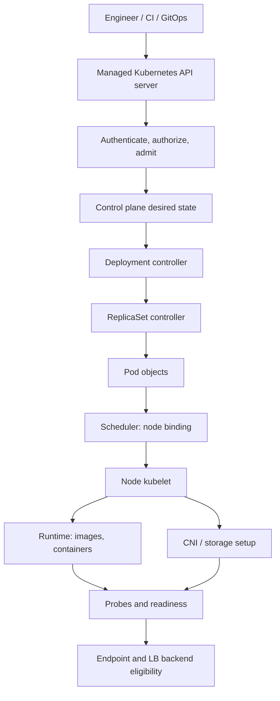
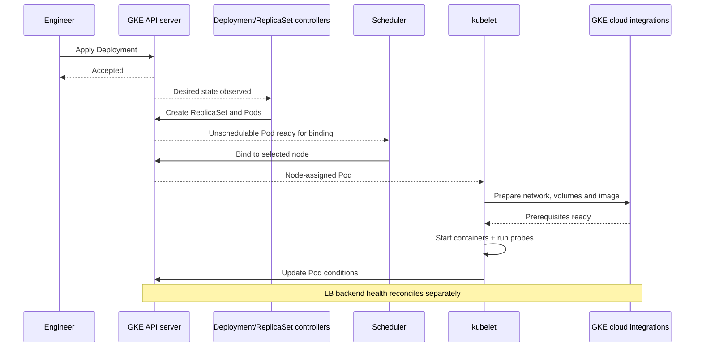
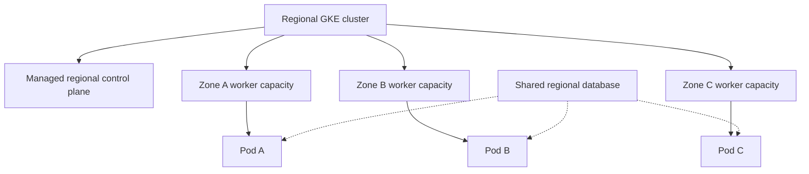

# Q1. GKE Architecture, Control Plane, Standard and Autopilot

> **Interviewer:** Starting from a Deployment YAML, trace the request through GKE's managed control plane to the running Pod. Compare Standard and Autopilot, regional versus zonal clusters, API endpoints, ownership and failure modes.

## First principles: Kubernetes with a cloud operations contract

GKE runs Kubernetes integrated with Google Compute Engine, IAM, networking, storage, observability and load balancing. The managed control plane runs the API server, etcd-backed state, scheduler and Kubernetes controllers. In Standard clusters, teams have control of node pools and node configuration. In Autopilot, Google manages more of the node resources and applies stronger workload restrictions and defaults.

**Managed doesn't mean automatically available applications.** Image bugs, invalid readiness, incompatible schema changes, unsuitable quotas, IAM, Pod resource specifications and transaction consistency are still platform/application responsibilities.



Controllers do not run as one synchronous request chain. They observe accepted API objects and reconcile asynchronously. A successful `kubectl apply` is only one stage.

## End-to-end Deployment lifecycle

1. The client establishes TLS to its configured GKE Kubernetes API endpoint and authenticates with supported Google identity/cluster credentials.
2. Kubernetes RBAC authorizes the operation. Admission checks applicable policy and mutations.
3. The API server stores the Deployment. Deployment controller manages ReplicaSet; ReplicaSet controller creates Pods.
4. The scheduler evaluates hard resource/topology/taint constraints, scores feasible nodes and binds Pods.
5. Kubelet observes bound Pod specs, prepares sandbox/network/volume resources, pulls images through the runtime and launches containers.
6. Readiness probes and applicable readiness gates determine Pod status. EndpointSlices and cloud controllers asynchronously update routing/backends.
7. Application requests can flow only after the relevant network, load balancer and health-control states converge.



## Standard, Autopilot and ComputeClasses

| Topic | Standard | Autopilot |
| --- | --- | --- |
| Node management | User-configured node pools | Google-managed node provisioning |
| Machine/OS tuning | Greater flexibility | Constrained to supported platform model |
| Privileged/host-level workloads | More configurable | More restrictive |
| Workload resource governance | Configurable | Managed defaults and enforcement |
| Capacity planning | Explicit pool autoscaling, optional node auto-provisioning | Workload-led automated capacity |
| Best fit | Specialized runtime/network/agent requirements | Conventional production workloads |

**Current nuance:** Supported Standard clusters can also host Autopilot-managed workloads using ComputeClasses and provider-managed nodes. Don't describe Standard and Autopilot as mutually exclusive at every workload level. See [GKE modes](https://cloud.google.com/kubernetes-engine/docs/concepts/choose-cluster-mode) and [Autopilot workloads on Standard](https://cloud.google.com/kubernetes-engine/docs/concepts/about-autopilot-mode-standard-clusters).

Choose Standard for specialized node control, host-level agents, device support, workload constraints or operational settings not available in Autopilot. Choose Autopilot to reduce node lifecycle toil when workloads fit its supported model. Neither automatically fixes bad application resource requests or gives free capacity.

## Regional and zonal failure domains



A regional cluster improves regional control-plane/node placement resilience subject to cluster and node-pool configuration. A multi-zone control plane doesn't guarantee multi-zone application replicas. The scheduler also needs appropriate topology spread, capacity and network/IP availability. Even three replicas across zones can share one failed database.

## API endpoint/network isolation

GKE control-plane access can use DNS-based and IP-based endpoints, with supported private/public endpoint settings and authorized networks. A cluster's private nodes do not automatically prove that its control plane accepts only private IP clients. DNS-based endpoints integrate Google IAM and can use VPC Service Controls policy. IP-based endpoints have separate network reachability/allowlisting characteristics.

```bash
gcloud container clusters list --project=PROJECT_ID
gcloud container clusters describe CLUSTER --location=europe-west1 --project=PROJECT_ID
gcloud container clusters get-credentials CLUSTER --location=europe-west1 --project=PROJECT_ID
kubectl config current-context
kubectl cluster-info
kubectl get --raw=/readyz
kubectl auth can-i create deployments -n marketplace
kubectl get nodes -o wide
```

Verify current context before operations. Authentication, Google IAM permission to obtain cluster credentials, Kubernetes RBAC and network reachability are distinct checks.

## Failure investigation: object accepted but Pods unavailable

Hypothetical: Deployment `desired=4, available=0`. Classify by lifecycle boundary:

- No ReplicaSet: deployment controller or malformed/blocked object.
- ReplicaSet but no Pods: ReplicaSet controller, namespace ResourceQuota or admission.
- Pending Pods: scheduling constraints, allocatable, taints, node pools or autoscaler.
- ContainerCreating: CNI/CSI/runtime/image prep.
- CrashLoopBackOff: application/process/probe or config.
- Running, not Ready: readiness probe, startup and NEG readiness gates.
- Ready but 502: Google LB backend health, networking and application failure.

```bash
kubectl -n marketplace describe deployment catalog-api
kubectl -n marketplace get rs,pods -o wide
kubectl -n marketplace describe pod POD
kubectl -n marketplace get events --sort-by=.lastTimestamp
```

## Architecture trade-offs

Tenants need more than namespaces: RBAC, Pod Security/admission, NetworkPolicy, quotas, dedicated workload identities, and sometimes separate projects/clusters. GKE manages infrastructure components but leaves compatibility, workload security and SLOs to engineering teams.

## Spoken answer

> “GKE follows the standard Kubernetes reconciliation model with managed Google Cloud integrations. A client authenticates to the API, RBAC and admission accept the Deployment, controllers create Pod objects, the scheduler selects a node and kubelet starts them through runtime, networking and storage integrations. Readiness and cloud backend health are asynchronous after that. Standard provides deeper node control, while Autopilot manages more node operations and enforces different workload constraints. I'd choose the mode and regional topology from actual application requirements, then troubleshoot from the first broken lifecycle stage rather than restarting the cluster.”

**References:** [GKE operation modes](https://cloud.google.com/kubernetes-engine/docs/concepts/choose-cluster-mode) · [GKE network isolation](https://cloud.google.com/kubernetes-engine/docs/concepts/network-isolation) · [Kubernetes architecture](https://kubernetes.io/docs/concepts/architecture/)

[Module index](./) · [Next: node pools](./q2)
