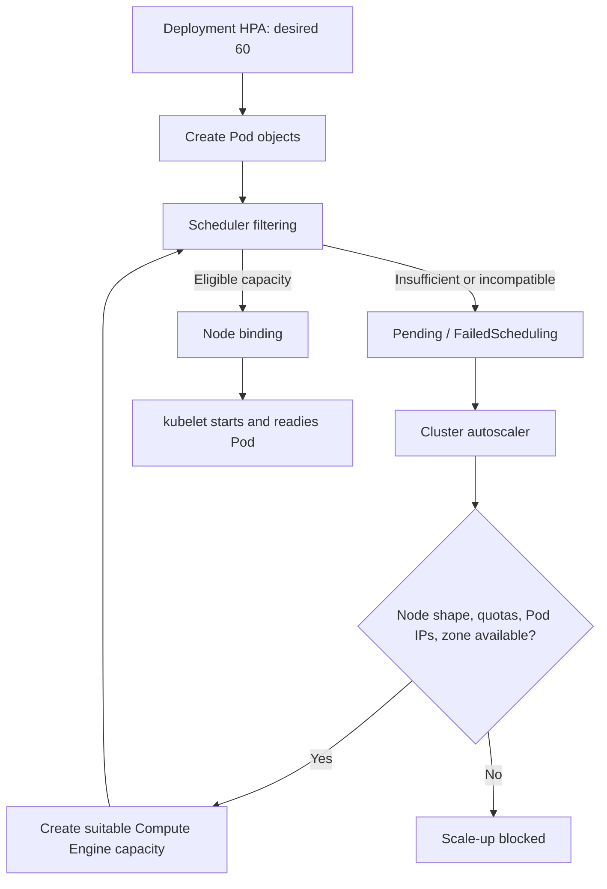
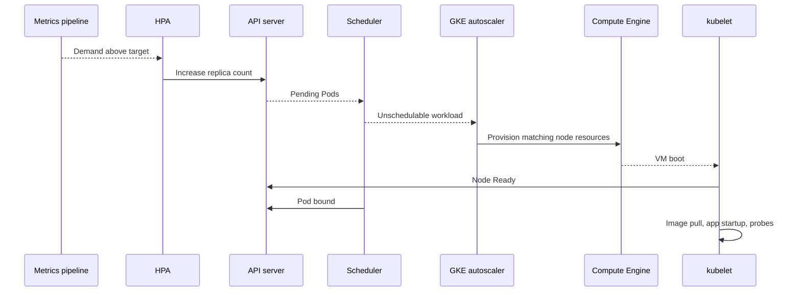

# Q2. GKE Node Pools, Scheduling, Runtime and Capacity

> **Interviewer:** HPA increases an application from 10 to 60 replicas, yet Pods remain Pending while nodes show low CPU usage. Explain node pools, kubelet/runtime responsibilities, resource requests, taints, affinity, zones, ComputeClasses, autoscaler and quota/capacity limits.

## 1. Workers, node pools and the scheduler

In GKE Standard, worker nodes are Compute Engine VMs running kubelet, container runtime and GKE system components. A node pool groups VMs with common configuration such as machine type, OS image, node service account, labels, taints and scaling/upgrade policies.

Scheduler feasibility is based on **allocatable resources and requests**, not current real-time utilization. A node can have idle CPU but no schedulable requested CPU headroom.



### Capacity versus usage

A 4-vCPU node does not offer four full CPUs to application requests if kube/system reservations and DaemonSet allocations consume part of allocatable. `kubectl top nodes` reports utilization, whereas `kubectl describe node` reports allocatable and requested resource commitments.

```bash
kubectl get nodes -o wide
kubectl describe node NODE
kubectl top nodes
kubectl -n marketplace describe pod POD
kubectl -n marketplace get events --sort-by=.lastTimestamp
```

## 2. Hard and soft placement constraints

| Construct | Scheduling meaning | Trap |
| --- | --- | --- |
| nodeSelector | Required node labels | No matching nodes |
| required nodeAffinity | Hard node constraint | No provisionable eligible shape |
| preferred nodeAffinity | Preference | Not a hard guarantee |
| taint + toleration | Taint repels; toleration permits | Toleration does not attract |
| podAntiAffinity | Separate selected Pods | May block under zonal shortage |
| topologySpreadConstraints | Bound distribution skew | DoNotSchedule can block recovery |
| PriorityClass | Preemption priority | Can't create missing GPU or IPs |

A high-priority Pod can preempt lower-priority Pods when doing so satisfies hard constraints, but it cannot schedule onto the wrong zone or acquire absent hardware.

## 3. Multi-zone workload example

```yaml
apiVersion: apps/v1
kind: Deployment
metadata:
  name: catalog-api
  namespace: marketplace
spec:
  replicas: 6
  selector:
    matchLabels: { app: catalog-api }
  template:
    metadata:
      labels: { app: catalog-api }
    spec:
      topologySpreadConstraints:
        - maxSkew: 1
          topologyKey: topology.kubernetes.io/zone
          whenUnsatisfiable: DoNotSchedule
          labelSelector:
            matchLabels: { app: catalog-api }
      containers:
        - name: api
          image: europe-west1-docker.pkg.dev/PROJECT_ID/apps/catalog-api:VERSION
          ports:
            - containerPort: 8080
          resources:
            requests: { cpu: 500m, memory: 512Mi }
            limits: { memory: 1Gi }
```

This is a **hypothetical manifest**, not an available image. Hard spread can reduce availability if one zone has no capacity. `ScheduleAnyway` is a softer alternative when scale availability is more important than strict skew.

## 4. Standard node pools and version-dependent options

```bash
gcloud container node-pools list \
  --cluster=CLUSTER --location=europe-west1 --project=PROJECT_ID

gcloud container node-pools describe api-pool \
  --cluster=CLUSTER --location=europe-west1 --project=PROJECT_ID

kubectl get nodes -L cloud.google.com/gke-nodepool,topology.kubernetes.io/zone
```

A conceptual sandbox creation command:

```bash
gcloud container node-pools create api-pool \
  --cluster=CLUSTER --location=europe-west1 --project=PROJECT_ID \
  --machine-type=e2-standard-4 \
  --service-account=NODE_SA_EMAIL \
  --num-nodes=1 \
  --enable-autoscaling --min-nodes=1 --max-nodes=5
```

**Verify min/max scope** for regional pools in your deployed CLI: per-zone node count and total-pool bounds may use different flags/semantics. The node service account must have required IAM permissions. The command incurs cost and should only run in approved sandboxes.

Some nodes use Container-Optimized OS, others supported Ubuntu images. Host package availability and runtime debugging differ. Autopilot restricts direct node access. Node upgrades may change kernel, cgroups, runtime, logging and CSI behavior even with no application manifest change.

## 5. HPA versus node scaling

HPA changes a workload's `scale` desired replicas. GKE cluster autoscaling adds/removes nodes when Pod requests and scheduling indicate need. **HPA does not allocate Compute Engine capacity.**



Total scale-out delay = metric collection + HPA reconciliation + scheduling + node acquisition if needed + boot/image download + warmup + endpoint/LB readiness. For predictable campaigns or close-time spikes, pre-warm enough capacity instead of relying exclusively on reactive scaling.

## 6. Why node autoscaling may not happen

- Node pool already at max.
- Compute Engine CPU/GPU quota exhausted.
- Requested VM shape unavailable in that zone.
- Cluster primary or Pod secondary range lacks assignable IPs.
- Required node affinity/taint incompatible with all provisionable pools.
- Pod requests larger than any available shape.
- Volume affinity restricts scheduling to unavailable zone.
- Too many constrained node pools; conflicting ComputeClass selection.
- API/organization policy rejects new instances.

**Autopilot** automates node provisioning but can't bypass resource and quota constraints. In current Standard, node auto-provisioning and ComputeClasses can create/manage pools for appropriate workloads. Feature support and node pool counts vary with GKE version. See [node auto-provisioning](https://cloud.google.com/kubernetes-engine/docs/concepts/node-auto-provisioning).

## 7. Spot and failure tolerance

Spot worker nodes can reduce cost for interruptible capacity. Design PodDisruptionBudgets for voluntary evictions, graceful termination, workload replication, retry safety and rebalancing. PDBs do **not** prevent an involuntary Spot reclaim or node failure. Stateful databases require durable data and fencing independently of node lifetime.

## 8. Incident: 35% CPU, 80 Pending Pods

Hypothetical scheduler output:

```text
0/9 nodes are available:
3 Insufficient cpu,
3 node(s) had untolerated taint,
3 node(s) didn't match Pod node affinity
```

Determine which constraints are blockers and whether changing a Pod's request, affinity or class is safe. Check GKE autoscaler events, node-pool bounds and Compute Engine operations. Do not blindly raise `maxReplicas`; that creates more pending work and may worsen quota/database pressure.

```bash
kubectl -n marketplace describe pod POD
kubectl describe node NODE
kubectl -n marketplace get events --sort-by=.lastTimestamp
gcloud container operations list --location=europe-west1 --project=PROJECT_ID
```

Then verify new nodes joined, Pods reached readiness, LB endpoints are healthy, and user-facing p99/error rate returned to normal.

## Spoken interview answer

> “I treat HPA scale-out and node provisioning as separate controllers. Scheduler uses Pod requests and hard constraints against node allocatable, not low average CPU. If Pods remain Pending, I'd inspect FailedScheduling, taints, affinity, topology, volume zones and pool limits, then see whether GKE can provision a matching node given IPs, quotas and capacity. Standard offers direct node-pool control; Autopilot manages more of that but doesn't bypass scheduling. Ultimately I'd measure time to traffic-ready capacity, not just the number of new VMs.”

**References:** [GKE cluster autoscaling](https://cloud.google.com/kubernetes-engine/docs/concepts/cluster-autoscaler) · [Node pool auto-creation](https://cloud.google.com/kubernetes-engine/docs/concepts/node-auto-provisioning) · [Kubernetes scheduling](https://kubernetes.io/docs/concepts/scheduling-eviction/)

[Previous](./q1) · [Next: GKE networking](./q3)
