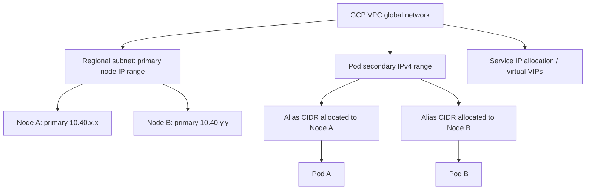
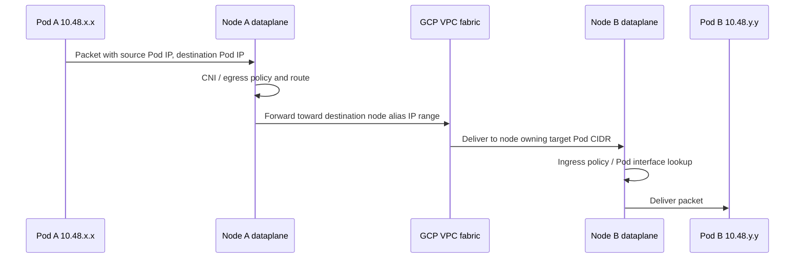
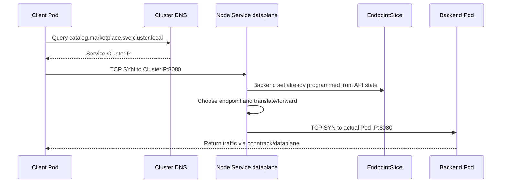
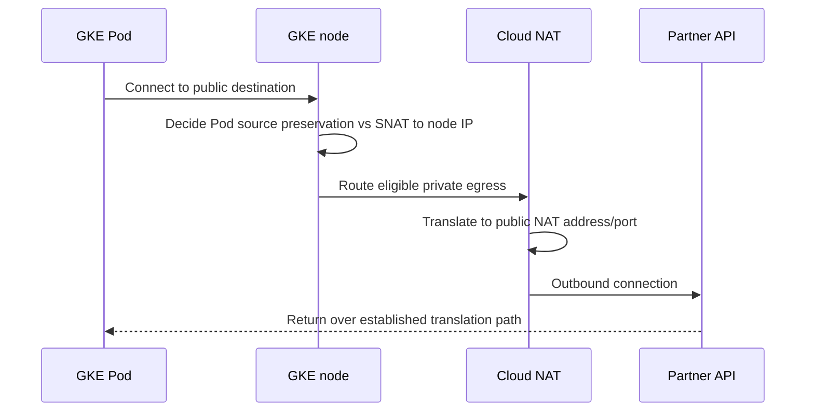

# Q3. GKE Networking: VPC-native Pods, Services, DNS and Dataplane V2

> **Interviewer:** Trace a packet from one Pod to another in GKE, then from a Pod to a ClusterIP Service, and finally from a private Pod to an external API. Explain alias IP allocations, Service programming, NetworkPolicy, Dataplane V2 eBPF, kube-dns/Cloud DNS, IP masquerading and Cloud NAT.

## 1. VPC-native addressing from first principles

Google Cloud VPCs are global, with regional subnets. GKE VPC-native clusters can allocate:
- **Node addresses:** From the subnet primary IP range.
- **Pod addresses:** From a secondary IP range as alias-IP blocks allocated to nodes.
- **Service ClusterIP:** From a Service address range; implementation varies with GKE networking mode and newer managed-Service-range features.



**Critical capacity distinction:** GKE reserves a block of Pod addresses per node according to max Pods per node. The common 110 Pods/node setting results in a /24 per node; not only the actual live Pod addresses count against the secondary range. A /16 range that allocates /24 blocks supports at most 256 node blocks in that range before other topology constraints. Default/settings differ between Standard and Autopilot; calculate actual limits instead of assuming 256 universally. Read [VPC-native clusters](https://cloud.google.com/kubernetes-engine/docs/concepts/alias-ips).

## 2. Example IP calculation

Suppose:
- Pod secondary range: 10.48.0.0/17, 32,768 addresses.
- Configured maximum Pods per node: 110.
- GKE allocated Pod block per node: /24 = 256 addresses.

The theoretical pool has `2^(24 - 17) = 128` /24 blocks, so at most **128 nodes** from that particular Pod address range. Actual node limit can be lower due to primary subnet capacity, resource quotas, cluster limits, other users of the range and GKE-specific accounting.

For the GKE Autopilot max-32-Pods/node model, block sizing may be different. Use the documented formula and deployed version details.

## 3. Pod-to-Pod datapath



This is logical and omits implementation-specific encapsulation/routing optimizations. In a VPC-native cluster, Pod alias addresses are routable by GCP VPC under supported configurations. VPC firewall policy, NetworkPolicy, node dataplane and guest processing still affect reachability.

## 4. Pod-to-Service flow

A Kubernetes ClusterIP is usually a **virtual service address**, not a permanent VM owning that IP. Kubernetes EndpointSlices describe selected backend Pods, and the cluster dataplane chooses a backend using programmed routing/NAT.



The dataplane doesn't query the EndpointSlice API synchronously for each SYN; controller/agent observes API changes and programs backend maps/rules **ahead of packet arrival**. The arrow is conceptual backend selection, not a per-packet API call.

### Legacy versus Dataplane V2

- Legacy GKE dataplane commonly uses kube-proxy/iptables programming for Services and Calico for NetworkPolicy.
- GKE Dataplane V2 uses Cilium-derived eBPF programs and **does not use kube-proxy for Service routing**.
- `anetd` DaemonSet in `kube-system` programs the eBPF dataplane in Dataplane V2.
- Kubernetes NetworkPolicy is built into Dataplane V2; additional policy logging is available.
- GKE does not support adding arbitrary custom eBPF programs to nodes using Dataplane V2 because they can interfere with system programs.

Check the cluster's actual dataplane mode before relying on `iptables-save` or assuming kube-proxy exists. See [Dataplane V2](https://cloud.google.com/kubernetes-engine/docs/concepts/dataplane-v2).

## 5. NetworkPolicy is not a VPC firewall

Kubernetes NetworkPolicy selects Pods/namespaces and controls supported ingress/egress traffic. VPC firewall policies operate on VPC/node/cloud resource identity and routes. Both may apply to a communication path, but solving one denial doesn't automatically solve the other.

Example default deny for Pods in one namespace:

```yaml
apiVersion: networking.k8s.io/v1
kind: NetworkPolicy
metadata:
  name: default-deny
  namespace: marketplace
spec:
  podSelector: {}
  policyTypes: [Ingress, Egress]
```

**Important:** Default-deny egress can block DNS, cloud metadata, auth and application dependencies. Add narrowly scoped DNS and workload requirements only after mapping egress. Some metadata connectivity has implementation-specific NetworkPolicy treatment, so validate the actual dataplane.

Example permit catalog API callers by namespace label:

```yaml
apiVersion: networking.k8s.io/v1
kind: NetworkPolicy
metadata:
  name: allow-frontends
  namespace: marketplace
spec:
  podSelector:
    matchLabels: { app: catalog-api }
  policyTypes: [Ingress]
  ingress:
    - from:
        - namespaceSelector:
            matchLabels: { tenant-role: frontend }
      ports:
        - protocol: TCP
          port: 8080
```

Namespace labels are access-control inputs. Limit who can set them.

## 6. DNS resolution

An application usually queries a configured cluster DNS service through `/etc/resolv.conf`. Search domains like `marketplace.svc.cluster.local` and `svc.cluster.local` allow short names; CoreDNS/kube-dns architecture and Cloud DNS integration depend on the GKE DNS provider/configuration. Cloud DNS VPC scope may change cross-cluster behavior compared with cluster-scoped DNS.

```bash
kubectl -n marketplace exec deploy/catalog-api -- cat /etc/resolv.conf
kubectl -n marketplace get svc,endpointslices
kubectl -n kube-system get deploy,svc | grep -E 'dns|coredns'
kubectl -n marketplace run dns-test --rm -it   --image=busybox:1.36 --restart=Never -- nslookup kubernetes.default.svc.cluster.local
```

If the application image is distroless, use an authorized ephemeral debug container. DNS `NXDOMAIN` is not a TCP timeout. Distinguish stub resolver, cluster DNS backend, upstream recursive/private zone, network policy egress and negative TTL caching.

## 7. Pod egress and IP masquerading



This path depends on GKE IP-masquerade configuration, cluster mode, NAT subnet coverage, default routes and firewalls. Cloud NAT port allocation source identities differ depending on whether Pods are SNATed first. An additional Cloud NAT address is not always the right fix when application churn and connection pooling are the real problem.

## 8. Common production failure patterns

| Symptom | First hypothesis |
| --- | --- |
| Pending new nodes after scale-out | Primary/Pod secondary IP range or quota |
| ClusterIP times out but Pod IP works | Service rules/eBPF, EndpointSlice selection, policy |
| DNS lookup fails from one namespace | Default-deny policy, kube-dns/service reachability |
| External API times out at peak | Egress firewall, Cloud NAT port capacity, connection churn |
| Pod-to-Pod works within node but not across nodes | Node dataplane, VPC routing/firewall, alias range |
| `iptables` rules absent | Dataplane V2 may use eBPF, not kube-proxy |

### Investigation commands

```bash
gcloud container clusters describe CLUSTER --location=europe-west1 --project=PROJECT_ID
gcloud compute networks subnets describe SUBNET --region=europe-west1 --project=PROJECT_ID
kubectl get nodes -o wide
kubectl -n marketplace get pods -o wide
kubectl -n marketplace get svc,endpointslices,networkpolicy
kubectl -n kube-system get daemonsets
kubectl -n marketplace describe pod POD
```

Use tcpdump and host-level utilities only with appropriate privileges and on modes that permit them. A packet capture can distinguish SYN loss, RST, TLS failure and application timeouts; avoid using OCR-like logs as a substitute for source/destination evidence.

## Spoken interview answer

> “GKE VPC-native networking uses primary subnet addresses for nodes and secondary alias IP ranges for Pods, so Pod IP allocation is a node-block capacity problem. A ClusterIP is a virtual Service; the node dataplane forwards to endpoints already programmed from EndpointSlices. Dataplane V2 uses eBPF with anetd rather than kube-proxy. I'd diagnose networking by separating DNS, Pod-to-Pod, Service routing, NetworkPolicy, VPC firewall and egress masquerading/Cloud NAT. I would validate exact packet source addresses and CIDR capacity before simply increasing node pools.”

**References:** [VPC-native GKE](https://cloud.google.com/kubernetes-engine/docs/concepts/alias-ips) · [Dataplane V2](https://cloud.google.com/kubernetes-engine/docs/concepts/dataplane-v2) · [Cloud NAT](https://cloud.google.com/nat/docs/public-nat)

[Previous](./q2) · [Next: Ingress, Gateway and NEGs](./q4)
