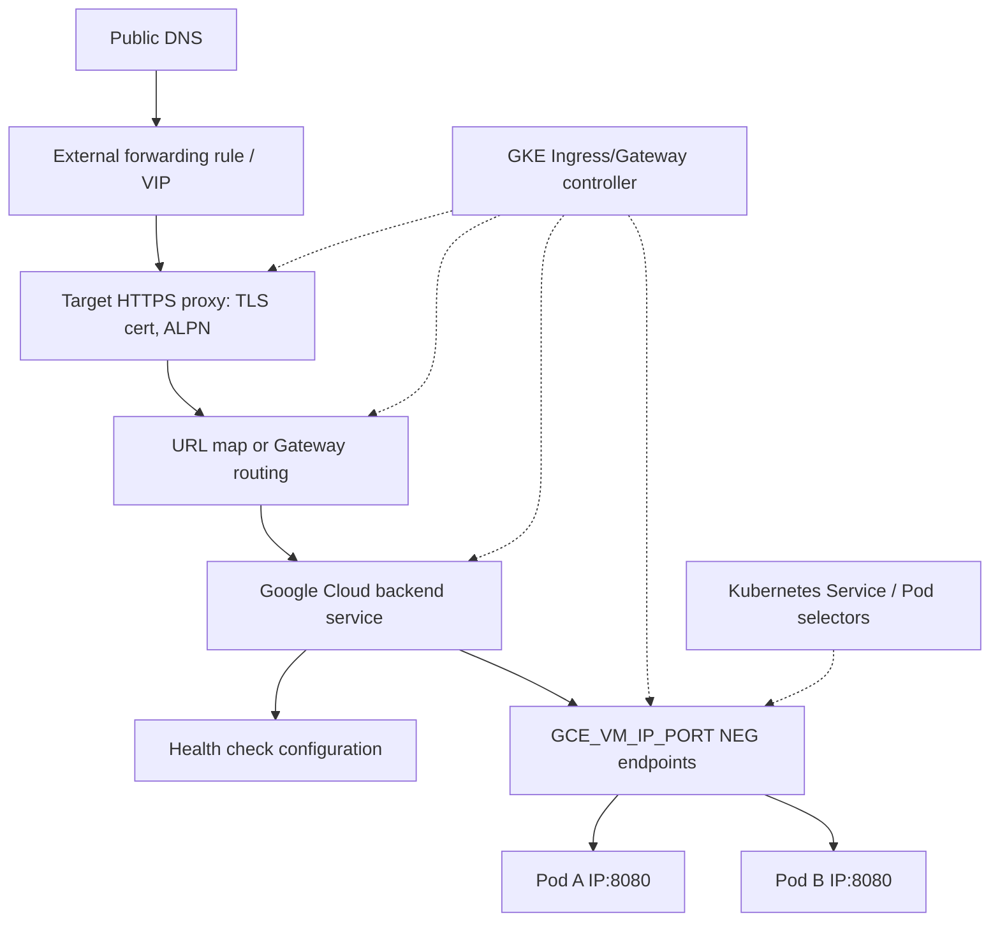
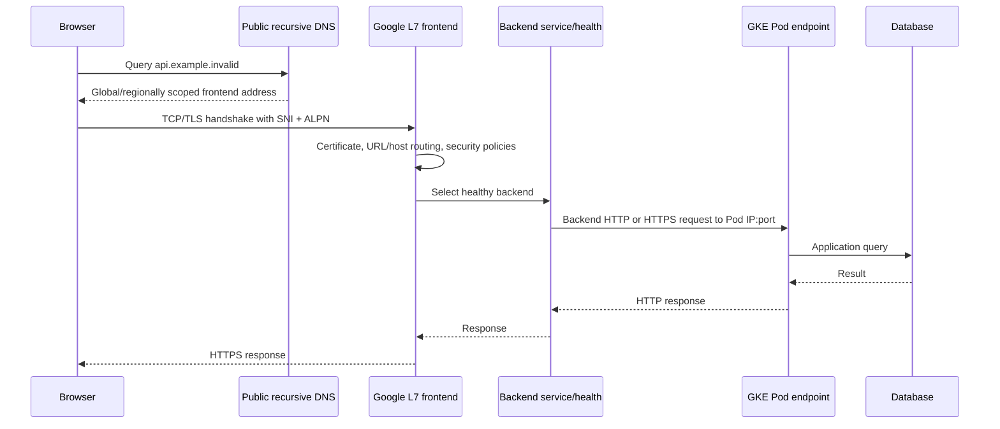
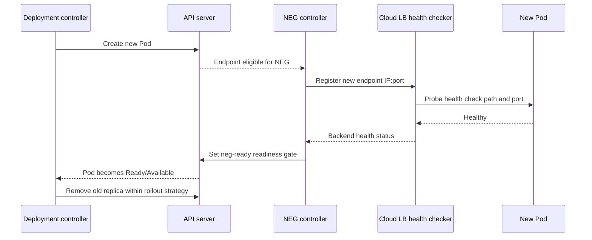

# Q4. GKE Ingress, Gateway API, NEGs and Load-Balancer Lifecycle

> **Interviewer:** A browser reaches a Kubernetes backend through a Google Cloud HTTPS load balancer. Trace DNS, TLS, forwarding rules, routing, backend services, NEGs, health checks, EndpointSlices, readiness gates and graceful termination. Explain Ingress versus Gateway API versus Service type LoadBalancer.

## 1. Kubernetes API object is not the cloud datapath

GKE has controllers that watch Kubernetes objects and provision/configure Google Cloud load-balancing resources. Those controllers are **control-plane reconcilers**, not necessarily in-path proxies that receive every user request.

For supported GKE L7 Ingress/Gateway configurations, cloud backend services can use Pod-direct `GCE_VM_IP_PORT` Network Endpoint Groups (NEGs). Cloud load balancer sends requests to the Pod endpoint IP:port, rather than necessarily to a NodePort then through a ClusterIP Service.



The diagram is a **proxy L7** path, not a generic GKE Service LoadBalancer path. GKE documentation notes all GKE-managed L7 load balancers, including Ingress and Gateway, use container-native backend routing; `type: LoadBalancer` Services have different network load-balancer behavior. See [GKE load balancing](https://cloud.google.com/kubernetes-engine/docs/concepts/about-load-balancing).

## 2. Complete user request flow



The backend's own TLS is independent of frontend termination and must be configured deliberately. A successful browser TLS handshake does not prove the Pod or database works.

## 3. Ingress, Gateway API and LoadBalancer Service

| Mechanism | Main abstraction | Cloud integration |
| --- | --- | --- |
| `Ingress` | HTTP(S) host/path routing | GKE Ingress controller provisions supported Application LBs |
| Gateway API `Gateway` + `HTTPRoute` | Listener ownership + route attachment/traffic policy | GKE Gateway controller; GatewayClass selects LB family |
| `Service type=LoadBalancer` | Expose a Service at L4 | GKE network load-balancer product, not automatically L7 NEG |
| Standalone NEG | Direct Pod endpoints used by independently managed LB | Explicit controller/ownership coordination |

Gateway API separates infrastructure-facing Gateway/listener ownership from application HTTPRoute routing and permissions. A `ReferenceGrant` may be required for supported cross-namespace object references. GatewayClass must match the desired cloud LB family (for example `gke-l7-global-external-managed` for a supported global external Application LB).

## 4. A minimal HTTP backend and Gateway API example

```yaml
apiVersion: apps/v1
kind: Deployment
metadata:
  name: catalog-api
  namespace: marketplace
spec:
  replicas: 3
  selector:
    matchLabels: { app: catalog-api }
  template:
    metadata:
      labels: { app: catalog-api }
    spec:
      containers:
        - name: api
          image: europe-west1-docker.pkg.dev/PROJECT_ID/apps/catalog-api:VERSION
          ports:
            - containerPort: 8080
          readinessProbe:
            httpGet: { path: /ready, port: 8080 }
            periodSeconds: 5
---
apiVersion: v1
kind: Service
metadata:
  name: catalog-api
  namespace: marketplace
spec:
  selector: { app: catalog-api }
  ports:
    - port: 80
      targetPort: 8080
```

An illustrative **HTTP-only** Gateway for a sandbox (not a secure public HTTPS production endpoint):

```yaml
apiVersion: gateway.networking.k8s.io/v1
kind: Gateway
metadata:
  name: marketplace-gateway
  namespace: marketplace
spec:
  gatewayClassName: gke-l7-global-external-managed
  listeners:
    - name: http
      protocol: HTTP
      port: 80
      allowedRoutes:
        namespaces:
          from: Same
---
apiVersion: gateway.networking.k8s.io/v1
kind: HTTPRoute
metadata:
  name: catalog-route
  namespace: marketplace
spec:
  parentRefs:
    - name: marketplace-gateway
  rules:
    - matches:
        - path: { type: PathPrefix, value: /catalog }
      backendRefs:
        - name: catalog-api
          port: 80
```

**Caveats:** Actual GatewayClass/controller feature support, static IP, HTTPS certificates, BackendPolicy health checks and allowedRoutes policies need environment-specific configuration. A real public production Gateway should provide HTTPS, correct DNS, certificate lifecycle and security controls. Do not deploy this demo publicly unchanged.

## 5. Ingress and NEG readiness gates

In some supported GKE Ingress/NEG deployments, the controller injects a Pod readiness gate:

```text
cloud.google.com/load-balancer-neg-ready
```

It represents the load balancer controller's assessment of NEG endpoint/backend health in addition to kubelet container probes. A Pod can pass `/ready` inside Kubernetes yet remain not Ready until external NEG readiness is satisfied. Misconfigured backend health checks can **stall rollouts** rather than immediately send broken new traffic. See [GKE Ingress readiness gates](https://cloud.google.com/kubernetes-engine/docs/concepts/ingress-routing-security).



This sequence simplifies GKE controller behavior and timing. **Do not assume all Gateway configurations inject exactly the same readiness gate behavior as Ingress**; inspect Pod conditions, backend policies and supported controller semantics.

## 6. Health checks, graceful draining and rolling updates

A safe path requires:
1. Readiness reflects ability to accept traffic.
2. Cloud backend health checks use the correct port and endpoint.
3. Pod termination stops admitting new work.
4. Endpoint/NEG withdrawal propagates.
5. In-flight requests drain within the allowed grace period.
6. Application/database schema supports overlap of versions.
7. Remaining replicas have enough capacity.

```yaml
spec:
  terminationGracePeriodSeconds: 90
  containers:
    - name: api
      image: europe-west1-docker.pkg.dev/PROJECT_ID/apps/catalog-api:VERSION
      lifecycle:
        preStop:
          exec:
            command: ["/bin/sh", "-c", "wget -qO- http://127.0.0.1:8080/drain && sleep 10"]
```

This is an **illustrative Pod spec fragment** and requires app endpoint/tools. A 10-second sleep is not a universal propagation guarantee. preStop consumes termination grace, and endpoint updates occur asynchronously. For long-lived connections, investigate actual LB timeout/connection drain features, application protocol and graceful shutdown.

## 7. Troubleshooting health divergence

```bash
kubectl -n marketplace get ingress,gateway,httproute,svc,endpointslices
kubectl -n marketplace describe gateway marketplace-gateway
kubectl -n marketplace describe httproute catalog-route
kubectl -n marketplace describe pod POD
kubectl -n marketplace get pod POD -o jsonpath='{.status.conditions}'
gcloud compute backend-services list --project=PROJECT_ID
gcloud compute network-endpoint-groups list --project=PROJECT_ID
gcloud compute health-checks list --project=PROJECT_ID
```

Use the right `--global` or `--region` backend service API for the LB class. Some commands/CRDs may be absent if Gateway API isn't enabled/supported in that cluster.

### Incident A: Pod Ready but external 502

Identify the exact URL map/backend service and whether the requested host/path reaches the intended backend. Verify endpoints in the NEG, health check response, firewall health check access, backend HTTP vs HTTPS, actual Pod listener, app error and Cloud Armor policy. Internal Pod readiness is only one piece of evidence.

### Incident B: rollout stuck when new Pods healthy locally

Inspect Pod condition `cloud.google.com/load-balancer-neg-ready`. Cloud LB health check may target wrong path, wrong port, blocked firewall or insufficient warmup. Fix cloud health/backends rather than lowering readiness requirements or blindly increasing rollout surge.

### Incident C: two controllers edit the same load balancer

Terraform provisions an external backend while GKE Gateway/Ingress controller also reconciles it. Changes oscillate or controllers recreate resources. Establish one authoritative owner or use a supported standalone NEG integration with documented division of responsibilities. Never assume controller-created cloud resources are safe to manage manually.

## 8. Senior design trade-offs

Choose Ingress for a simpler existing HTTP exposure contract when supported. Gateway API provides richer ownership/route attachment abstractions and product-specific policy. `LoadBalancer` Service suits appropriate L4 exposure. Don't choose based on manifest brevity alone; account for LB location, client IP semantics, security policy, certificate renewal, rate controls, request timeout, backend endpoint mode, cost and migration strategy.

## Spoken interview answer

> “I'd first name the load balancer class, because GKE Application and Network LBs differ substantially. In a GKE-managed L7 path, DNS resolves the frontend, the target proxy handles HTTPS, route selection chooses a backend service, and a NEG can expose Pod IP:port endpoints directly. The Ingress or Gateway controller manages cloud resources but doesn't have to proxy user packets itself. I'd examine both Kubernetes probes and cloud backend health, including NEG readiness gates where supported. During deployments, endpoint convergence and draining are asynchronous, so I would verify a real request path rather than equating Pod Running with customer availability.”

**References:** [GKE load balancing](https://cloud.google.com/kubernetes-engine/docs/concepts/about-load-balancing) · [Gateway API](https://cloud.google.com/kubernetes-engine/docs/concepts/gateway-api) · [Ingress routing and security](https://cloud.google.com/kubernetes-engine/docs/concepts/ingress-routing-security)

[Previous](./q3) · [Next: GKE security](./q5)
