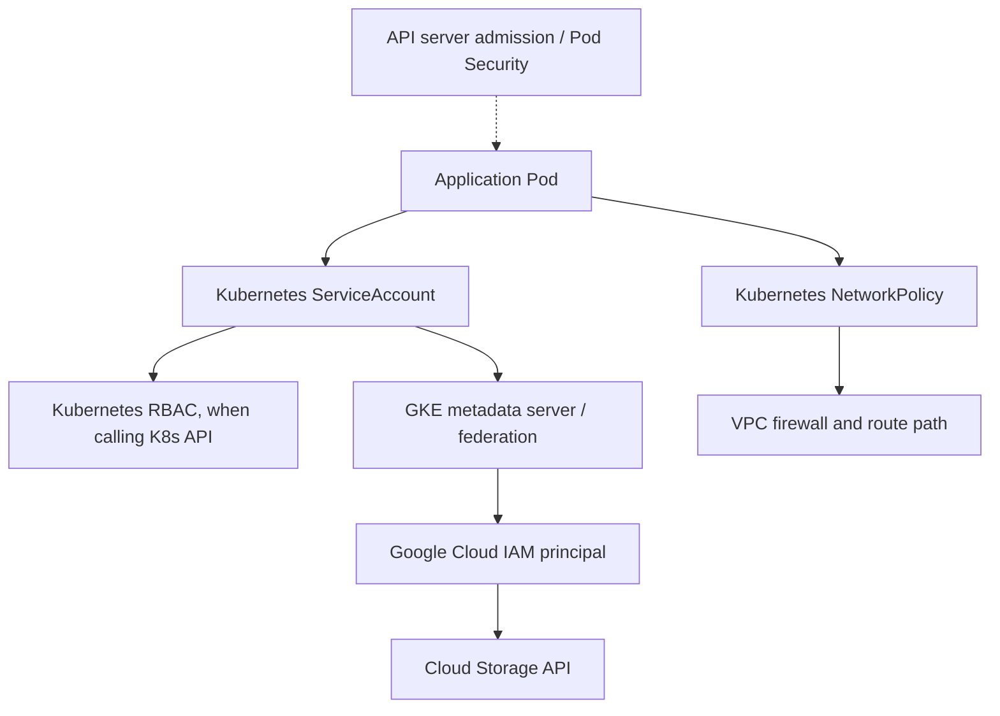
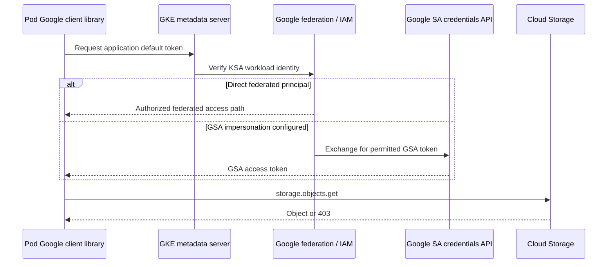

# GKE Security: IAM, RBAC, Workload Identity, Admission and Isolation

> **Engineering focus:** A GKE catalog Pod must read one Cloud Storage bucket but must not list Kubernetes Secrets or access other teams' services. Explain Google's IAM model versus Kubernetes RBAC, Workload Identity Federation, network policy, Pod Security, admission, image provenance and a production 403 incident.

## 1. Four distinct boundaries

1. **Google Cloud IAM:** Authorizes Google Cloud API operations on projects, service accounts, buckets and other services.
2. **Kubernetes RBAC:** Authorizes Kubernetes API operations such as get Pods or create Deployments.
3. **Network isolation:** NetworkPolicy controls supported Pod traffic; GCP VPC firewall policies control applicable network flows.
4. **Admission / runtime controls:** Pod security, container privileges, allowed images, host access, quotas and custom policies.

A Kubernetes ServiceAccount is not the same object as a Google IAM service account.



A Pod allowed to read Cloud Storage can still be Forbidden from the Kubernetes API. Conversely a namespace administrator doesn't automatically gain Google Project Owner, but permission to create workloads using a privileged KSA/GSA can create an **effective privilege escalation** path. Review who can use each ServiceAccount.

## 2. GKE Workload Identity Federation: direct access

GKE Workload Identity Federation maps Kubernetes workload identities to IAM principals in an identity pool. With direct resource authorization, assign a role to the KSA principal identifier rather than attach a JSON key file.

```text
principal://iam.googleapis.com/projects/PROJECT_NUMBER/locations/global/workloadIdentityPools/PROJECT_ID.svc.id.goog/subject/ns/marketplace/sa/catalog-api
```

Use the actual numerical project number and project ID. Restrict to one KSA, one namespace and the intended resource.

Example (requires existing bucket, cluster WIF and permissions):

```bash
kubectl -n marketplace create serviceaccount catalog-api

gcloud storage buckets add-iam-policy-binding \
  gs://OWNED_CATALOG_BUCKET \
  --member="principal://iam.googleapis.com/projects/PROJECT_NUMBER/locations/global/workloadIdentityPools/PROJECT_ID.svc.id.goog/subject/ns/marketplace/sa/catalog-api" \
  --role="roles/storage.objectViewer"
```

Don't grant `roles/storage.admin` project-wide if the workload only reads one bucket. For APIs where direct federation has limitations, use supported impersonation.

## 3. Alternative: impersonate a Google IAM service account

The KSA is annotated with a GSA email, and the identity relationship has an IAM binding allowing impersonation.

```bash
gcloud iam service-accounts add-iam-policy-binding \
  catalog-reader@PROJECT_ID.iam.gserviceaccount.com \
  --role="roles/iam.workloadIdentityUser" \
  --member="serviceAccount:PROJECT_ID.svc.id.goog[marketplace/catalog-api]"

kubectl -n marketplace annotate serviceaccount catalog-api \
  iam.gke.io/gcp-service-account=catalog-reader@PROJECT_ID.iam.gserviceaccount.com
```

Both IAM binding and KSA annotation are required for this GSA impersonation approach. The GSA itself also needs permission to read the target bucket. Don't conflate this with direct KSA-principal permissions.



The diagram is conceptual; metadata server returns credentials via the client path and API token formats/flows vary by integration. See [Authenticate GKE workloads](https://cloud.google.com/kubernetes-engine/docs/how-to/workload-identity).

## 4. Kubernetes RBAC and impersonation

A namespace-specific read-only Role:

```yaml
apiVersion: v1
kind: ServiceAccount
metadata:
  name: audit-reader
  namespace: marketplace
---
apiVersion: rbac.authorization.k8s.io/v1
kind: Role
metadata:
  name: configmap-reader
  namespace: marketplace
rules:
  - apiGroups: [""]
    resources: ["configmaps"]
    verbs: ["get", "list", "watch"]
---
apiVersion: rbac.authorization.k8s.io/v1
kind: RoleBinding
metadata:
  name: audit-reader-config
  namespace: marketplace
subjects:
  - kind: ServiceAccount
    name: audit-reader
    namespace: marketplace
roleRef:
  kind: Role
  name: configmap-reader
  apiGroup: rbac.authorization.k8s.io
```

Test:

```bash
kubectl auth can-i get configmaps -n marketplace
kubectl auth can-i list secrets -n marketplace
kubectl auth can-i list configmaps -n marketplace \
  --as=system:serviceaccount:marketplace:audit-reader
```

Impersonation tests require permission to impersonate that principal. A RoleBinding can refer to a ClusterRole while granting its **namespaced resource rules** in one namespace. RBAC evaluation also includes cluster-scoped resources, impersonation, `bind`, `escalate` and operational paths through `pods/exec`.

## 5. Pod Security and admission

Pod Security Admission can enforce baseline or restricted policies by namespace labels:

```bash
kubectl label namespace marketplace \
  pod-security.kubernetes.io/enforce=restricted \
  pod-security.kubernetes.io/audit=restricted \
  pod-security.kubernetes.io/warn=restricted
```

Verify application compatibility before enforcement. Some infrastructure DaemonSets need privileged access and should use separately governed namespaces with deliberate policies.

Workload hardening:

```yaml
securityContext:
  runAsNonRoot: true
  seccompProfile:
    type: RuntimeDefault
containers:
  - name: app
    image: europe-west1-docker.pkg.dev/PROJECT_ID/apps/app:VERSION
    securityContext:
      allowPrivilegeEscalation: false
      capabilities:
        drop: ["ALL"]
    resources:
      requests:
        cpu: 250m
        memory: 256Mi
      limits:
        memory: 512Mi
```

Fragment only; attach container securityContext inside a full Pod spec. Different node OS and application permissions may require compatible UID, filesystem and capabilities.

Admission webhooks and ValidatingAdmissionPolicy can enforce approved images, labels, privileged controls, quotas and standards. A fail-closed unreachable webhook can block new Pod creation cluster-wide even when existing Pods are running. Scope webhooks and test failure policies/recovery.

## 6. NetworkPolicy and tenancy

A namespace label and Kubernetes NetworkPolicy can constrain peer traffic, but the CNI must enforce it, and not every metadata/network path has identical policy semantics. With GKE Dataplane V2, NetworkPolicy enforcement is built into the eBPF path, with supported network-policy logging. Keep application authorization even if network traffic is limited: a reachable Pod may still be an unauthorized caller.

## 7. Image and secrets supply chain

Artifact Registry IAM controls who can push or pull container images. Deploying by OCI digest improves immutability. Binary Authorization and attestations can enforce supply-chain provenance for supported GKE deployment workflows. Admission/image scanning is not a guarantee against malicious runtime behavior.

Kubernetes Secrets are base64 representations, not encryption by themselves. Protect:
- Kubernetes API access and etcd/control-plane encryption features.
- Secret Manager/CSI integrations, runtime permissions and rotation.
- Workload identity and node service account grants.
- Logging and debugging paths so secrets aren't accidentally printed.

A node service account with overly broad permissions can become a fallback risk if workload identity isn't configured correctly.

## 8. Production 403 investigation

A hypothetical catalog Pod logs `storage.objects.get: permission denied` after a node-pool change.

1. Check actual workload KSA from Pod spec, not Deployment defaults.
2. Confirm GKE WIF and metadata server availability on that node/pool.
3. Verify cluster workload pool, project number, namespace/name, IAM binding and GSA annotation if impersonating.
4. Check token audience/expiry and client library ADC behavior.
5. Check exact bucket/object permissions, IAM Conditions/Deny, VPC Service Controls and Cloud Storage restrictions.
6. Correlate Cloud Audit Logs and policy troubleshooting where supported.
7. Fix the correct role or identity, not by granting basic project Owner.

```bash
kubectl -n marketplace get pod POD -o jsonpath='{.spec.serviceAccountName}'
kubectl -n marketplace describe serviceaccount catalog-api
kubectl -n marketplace describe pod POD
gcloud storage buckets get-iam-policy gs://OWNED_CATALOG_BUCKET
gcloud container node-pools describe POOL --cluster=CLUSTER \
  --location=europe-west1 --project=PROJECT_ID
```

## Key takeaways

> I separate Kubernetes API permissions from Google Cloud API permissions and network controls. On GKE assign an individual KSA to the workload and use Workload Identity Federation for bucket access, either directly to the KSA principal or via a narrowly permitted Google service account. Restrict who can launch workloads under that identity. Admission and Pod Security limit privilege escalation; NetworkPolicy limits network paths, not application authorization. For a 403, verify the actual runtime identity, token path, exact resource/permission, IAM conditions and service-specific policy before changing grants.

**References:** [WIF for GKE](https://cloud.google.com/kubernetes-engine/docs/concepts/workload-identity) · [Configure WIF](https://cloud.google.com/kubernetes-engine/docs/how-to/workload-identity) · [Kubernetes RBAC](https://kubernetes.io/docs/reference/access-authn-authz/rbac/) · [Pod Security](https://kubernetes.io/docs/concepts/security/pod-security-standards/)

[Previous](./q4) · [Next: storage and CSI](./q6)
