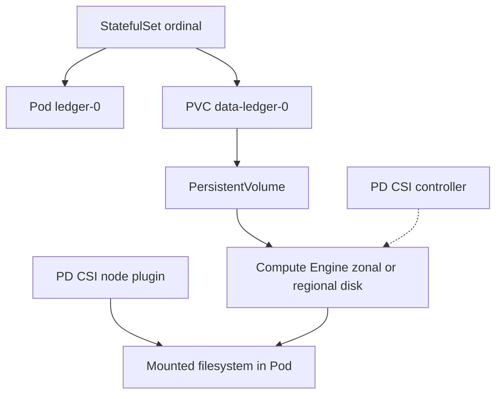
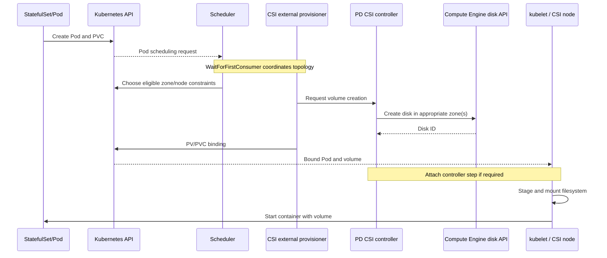

# Q6. GKE Storage, CSI, StatefulSets and Data Recovery

> **Interviewer:** A StatefulSet Pod is stuck on volume attachment after node replacement. Explain PV/PVC/StorageClass, Compute Engine Persistent Disk CSI, immediate versus delayed binding, zonal versus regional volumes, snapshots, StatefulSet identity and recovery safety. Why doesn't a Bound PVC guarantee mountability?

## 1. Storage is a distinct lifecycle from Pods

A Pod may be destroyed/recreated while its data persists. Kubernetes models desired storage through:

- **PersistentVolumeClaim (PVC):** A workload request for size, access mode and storage class.
- **PersistentVolume (PV):** A bound/presented volume with capacity and backing volume identity.
- **StorageClass:** Dynamic provisioning settings and topology/binding behavior.
- **CSI controller plugin:** Provisions, deletes, resizes and may attach/detach storage.
- **CSI node plugin:** Stages and publishes/mounts the volume on a node.
- **VolumeAttachment:** Tracks controller-level attachment when supported.



StatefulSets give stable ordinals, associated PVCs and rollout order. They don't implement database replication, quorum, fencing or transaction correctness. A three-replica StatefulSet is not automatically a reliable three-node database.

## 2. Dynamic provisioning path



Actual provisioning and binding order depends on StorageClass binding mode, scheduler integration and CSI driver behavior. Some volumes don't require attach operations. **PVC Bound means identity/capacity binding, not that a disk is attached/mounted successfully.**

## 3. WaitForFirstConsumer and topology

```yaml
apiVersion: storage.k8s.io/v1
kind: StorageClass
metadata:
  name: pd-balanced-delayed
provisioner: pd.csi.storage.gke.io
parameters:
  type: pd-balanced
  csi.storage.k8s.io/fstype: ext4
volumeBindingMode: WaitForFirstConsumer
allowVolumeExpansion: true
reclaimPolicy: Retain
```

This is an illustrative class using the supported Persistent Disk CSI driver. `WaitForFirstConsumer` lets scheduler constraints help choose a valid zone before provisioning, reducing disks created in zones where Pods cannot run.

**Immediate binding trap:** A volume may be provisioned in zone A before a Pod with hard node affinity to zone B is scheduled. Both resources exist but cannot be brought together. Delayed binding is especially valuable for zonal disks. See [GKE Persistent Disk CSI driver](https://cloud.google.com/kubernetes-engine/docs/how-to/persistent-volumes/gce-pd-csi-driver).

## 4. PVC and StatefulSet example

```yaml
apiVersion: apps/v1
kind: StatefulSet
metadata:
  name: ledger
  namespace: marketplace
spec:
  serviceName: ledger-headless
  replicas: 3
  selector:
    matchLabels: { app: ledger }
  template:
    metadata:
      labels: { app: ledger }
    spec:
      containers:
        - name: ledger
          image: europe-west1-docker.pkg.dev/PROJECT_ID/apps/ledger:VERSION
          volumeMounts:
            - name: data
              mountPath: /var/lib/ledger
  volumeClaimTemplates:
    - metadata:
        name: data
      spec:
        storageClassName: pd-balanced-delayed
        accessModes: [ReadWriteOnce]
        resources:
          requests:
            storage: 20Gi
```

A real StatefulSet also needs an appropriate governing headless Service, app configuration, secrets, replication/quorum/fencing and backup policy. The image is fictional.

## 5. Access-mode semantics

| Mode | Meaning | Pitfall |
| --- | --- | --- |
| RWO | Read-write access from one node | Not necessarily one Pod; multiple Pods on same node may access |
| ROX | Read-only many nodes where driver supports | Not a database writer |
| RWX | Read-write many nodes where driver supports | PD CSI default block disks don't provide generic shared POSIX RWX |
| RWOP | Read-write access restricted to one Pod with compatible CSI | Still not a distributed transaction/fencing protocol |

A CSI provider must actually support the requested mode. Don't simply change `ReadWriteOnce` to `ReadWriteMany` when a two-node mount fails.

## 6. Zonal versus regional persistent disks

**Zonal PD:** Disk resides in one zone. Pods attaching it must run on eligible nodes in that zone. If zone is unavailable, a Pod scheduled elsewhere usually can't attach the zonal disk.

**Regional PD:** Backing disk replicates synchronously between two supported zones and is designed to tolerate some zonal failures. Attachment/writer orchestration remains important; replication doesn't automatically make an active-active multi-writer database.

Illustrative regional StorageClass:

```yaml
apiVersion: storage.k8s.io/v1
kind: StorageClass
metadata:
  name: regional-pd
provisioner: pd.csi.storage.gke.io
parameters:
  type: pd-balanced
  replication-type: regional-pd
volumeBindingMode: WaitForFirstConsumer
allowedTopologies:
  - matchLabelExpressions:
      - key: topology.gke.io/zone
        values: [europe-west1-b, europe-west1-c]
```

The `topology.gke.io/zone` key and regional PD support require compatible GKE/CSI and zones; validate current machine/disk constraints. Regional replication provides zone resilience, not backups or protection from deletion/corruption. See [Regional PD](https://cloud.google.com/kubernetes-engine/docs/how-to/persistent-volumes/regional-pd).

## 7. Snapshots versus backups

CSI snapshot objects (`VolumeSnapshotClass`, `VolumeSnapshot`, `VolumeSnapshotContent`) use external snapshot-controller integrations where supported. A storage snapshot may be **crash-consistent**, not guaranteed application-consistent. For databases, coordinate flush/checkpoints/WAL and restore validation.

Recovery requirements:
- RPO/RTO.
- Snapshot/backup location and access permissions.
- Key material and independent restore rights.
- Cross-region and off-cluster recovery.
- Consistent database transactions.
- Explicit cleanup/retention.
- Drill at least one full restore.

A cloud disk's retention policy and a StatefulSet's persistent claim lifecycle can preserve data after Pod or StatefulSet deletion, but they don't replace recovery backups.

## 8. Incident: Multi-Attach error during node replacement

Hypothetical:

```text
PVC Bound, Pod ContainerCreating
FailedAttachVolume: Multi-Attach error
Disk attached to previous node in zone A
New Pod scheduled to node B
```

Investigate:

```bash
kubectl -n marketplace describe pod ledger-0
kubectl -n marketplace get pvc
kubectl get pv
kubectl get volumeattachments
kubectl -n marketplace get events --sort-by=.lastTimestamp
kubectl -n kube-system get pods | grep -Ei 'csi|pd'
gcloud compute disks list --project=PROJECT_ID
gcloud compute disks describe DISK --zone=europe-west1-b --project=PROJECT_ID
```

Different CSI drivers create resources in multiple namespaces. Inspect the relevant controller/node driver logs with an authorized cluster view.

**Do not force-detach a disk while the old database writer may still be active.** Establish fencing or verify the node/instance is dead and cannot resume writing. Deleting PVC or PV to “fix” attach is potentially destructive.

Potential causes: stale old attachment, CSI controller failure, zone affinity mismatch, unsupported simultaneous attachment, node failed mid-shutdown, volume operation quota/API error.

## 9. Senior architecture decision

For mission-critical transactional databases, prefer a managed service where requirements/latency allow, or use a properly engineered database operator with proven replication and backup. A StatefulSet plus three PVs isn't a substitute for consensus, failover logic, disaster recovery and data correctness.

## Spoken interview answer

> “I'd separate Pod lifecycle from storage lifecycle. A PVC asks for storage; a PV represents the bound volume; the CSI driver provisions, attaches and mounts through controller and node components. Delayed binding aligns zonal provisioning with scheduling. Bound doesn't prove attach and mount succeeded. For a Multi-Attach incident I'd inspect VolumeAttachments, Pod events, disk topology and the previous node, and fence an old writer before detaching storage. Regional PD improves zonal resilience but not database consistency or backup. I'd verify a restore rather than equate snapshots with recoverability.”

**References:** [GKE PV overview](https://cloud.google.com/kubernetes-engine/docs/concepts/persistent-volumes) · [PD CSI driver](https://cloud.google.com/kubernetes-engine/docs/how-to/persistent-volumes/gce-pd-csi-driver) · [Regional PD](https://cloud.google.com/kubernetes-engine/docs/how-to/persistent-volumes/regional-pd)

[Previous](./q5) · [Next: autoscaling and resource management](./q7)
