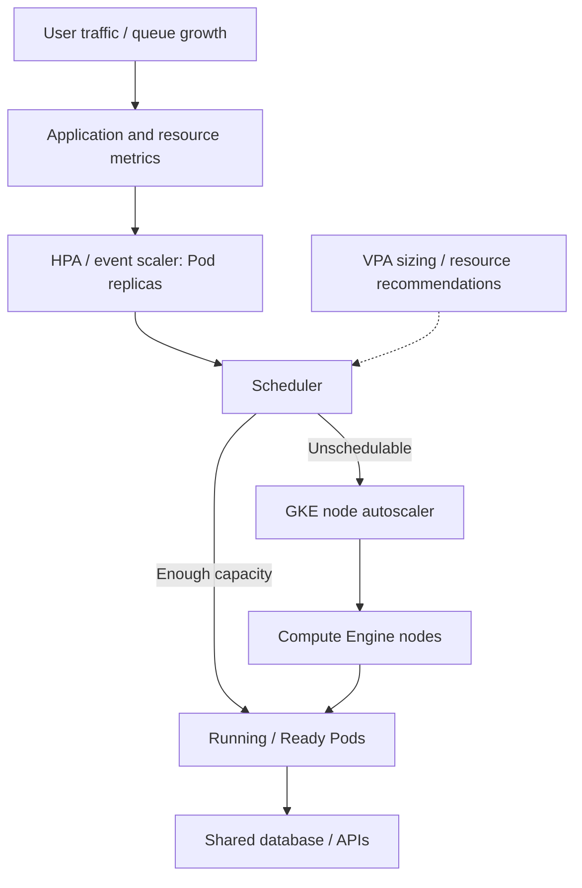
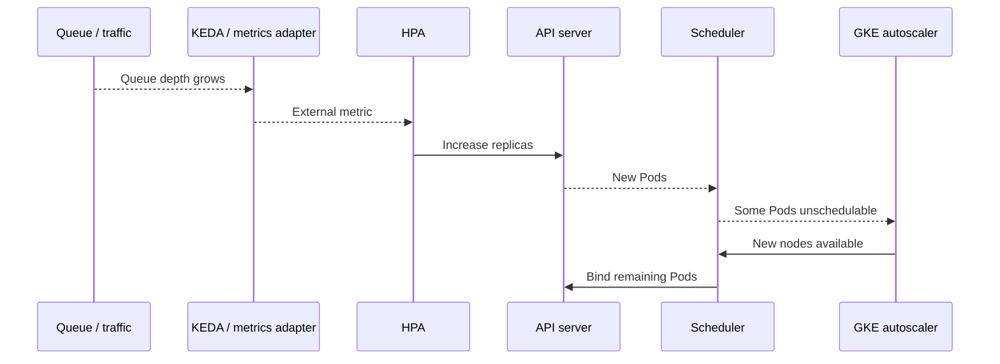

# Q7. GKE Autoscaling, Resource Management, QoS and Performance

> **Interviewer:** A bidding API's p99 latency spikes during a scheduled event. HPA says 20 replicas, 10 Pods are Pending, nodes show spare CPU, and the database is near connection limits. Explain requests, limits, QoS, CPU throttling, memory OOM, HPA/VPA, node autoscaling, KEDA and reliable scale-out.

## 1. Model three separate scaling questions

**Horizontal scaling:** How many Pod replicas should exist? HPA or an event-driven scaler adjusts workload replica count.

**Vertical sizing:** How much CPU/memory should each Pod request? Resource analysis, VPA recommendations and workload benchmarking inform sizing.

**Infrastructure capacity:** Where do those Pods run? GKE Standard cluster autoscaling/node auto-provisioning or Autopilot-managed capacity responds to eligible scheduling demands.



The controllers operate asynchronously, with different feedback delays and ownership.

## 2. CPU requests, limits and memory

- **CPU request:** Scheduler placement entitlement; HPA CPU utilization denominator if resource utilization is configured.
- **CPU limit:** Linux cgroup CPU quota in typical implementations. A multi-threaded app can exhaust quota and be throttled while host has idle cores.
- **Memory request:** Scheduling/pressure considerations.
- **Memory limit:** Cgroup memory ceiling; crossing it can cause OOM kill after reclaim.
- **Ephemeral-storage request/limit:** Placement and local disk accounting where supported.

```yaml
resources:
  requests:
    cpu: 500m
    memory: 512Mi
  limits:
    memory: 1Gi
```

This intentionally omits CPU limit, allowing CPU bursting under available capacity and applicable policy. It is **not** always the right choice: some multi-tenant or cost-isolation environments require quotas/limits. Use actual load tests and SLO data.

### QoS classes

- **Guaranteed:** Applicable CPU and memory requests equal limits for all relevant containers.
- **Burstable:** Some requests/limits but not Guaranteed.
- **BestEffort:** No CPU/memory requests or limits.

Guaranteed does **not** prevent OOM when the Pod exceeds its memory cgroup limit. Container OOMKilled and kubelet eviction under node pressure are distinct. PriorityClass/Pod QoS influence scheduling and eviction, but neither guarantees immunity to node failure.

## 3. HPA math

Simplified HPA calculation:

```text
desiredReplicas = ceil(currentReplicas × currentMetric / targetMetric)

Example:
  10 Pods
  average CPU utilization 80% of requests
  target CPU utilization 50%

desired = ceil(10 × 80/50) = 16 Pods
```

The real controller accounts for missing metrics, not-yet-ready Pods, tolerance, scaling policies and stabilization windows.

**CPU utilization is relative to requests**, not node capacity. A Pod using 400m with 500m CPU request reports 80% of request; with 1000m request and identical usage it reports 40%. Changing VPA CPU request recommendations can alter HPA decisions without changing workload demand.

```yaml
apiVersion: autoscaling/v2
kind: HorizontalPodAutoscaler
metadata:
  name: bidding-api
  namespace: marketplace
spec:
  scaleTargetRef:
    apiVersion: apps/v1
    kind: Deployment
    name: bidding-api
  minReplicas: 6
  maxReplicas: 60
  metrics:
    - type: Resource
      resource:
        name: cpu
        target:
          type: Utilization
          averageUtilization: 60
  behavior:
    scaleDown:
      stabilizationWindowSeconds: 300
```

This requires a functional metrics pipeline and CPU requests. Use observed traffic concurrency or request/queue metrics where CPU isn't a good leading indicator.

## 4. HPA multiple metrics and missing data

When multiple metrics are configured, HPA derives desired counts per metric and generally chooses the highest recommendation, subject to error handling and behavior constraints.

If CPU recommends 8 and requests-per-second recommends 14, HPA may select 14. If one metric fails and another recommends downscaling, the controller may conservatively skip that downscale. Read HPA conditions rather than assuming a bug.

```bash
kubectl -n marketplace get hpa
kubectl -n marketplace describe hpa bidding-api
kubectl -n marketplace top pods
kubectl -n marketplace describe deployment bidding-api
```

## 5. Vertical Pod Autoscaling

VPA estimates suitable CPU/memory requests from workload usage and policy. Depending on supported mode/version, it can recommend or apply resource adjustments through admission or in-place/eviction mechanisms. Don't describe VPA as changing runtime CPU consumption itself or assume every provider/version supports all update modes.

**Feedback-loop hazard:** HPA scaling on CPU utilization and VPA modifying CPU requests can alter each other's control signals. A common conservative strategy uses VPA for recommendations and HPA for replica scaling, then applies right-sizing through controlled rollout. Other combinations require intentional complementary metrics and testing.

## 6. Event and queue scaling

Queue depth can be more directly connected to worker demand than CPU utilization.

Suppose 20,000 queued events and target 500 events/worker. A simple backlog-per-worker goal suggests ~40 replicas, but processing time, arrival rate, allowed deadlines and retry behavior also matter.

KEDA is an optional third-party extension, not core GKE or always installed. With a compatible scaler it can expose queue/external metrics to HPA and support scale-to-zero under supported configurations. Workload startup and node startup delays can make reactive scale-from-zero unsuitable for low-latency user endpoints.



## 7. Scale-out is not instantaneous

End-to-end added capacity:

```text
Request/queue measurement
+ metric publication/scrape
+ HPA calculation
+ Pod object creation
+ scheduler wait
+ optional VM/node provisioning
+ image pull and container startup
+ readiness and cloud NEG/backend health
= time before additional traffic is safely handled
```

For a predictable auction closing period, pre-scale ahead of known demand and maintain reserve capacity across zones. Reactive HPA is part of the system, not the entire capacity plan.

## 8. Downstream amplification and feedback safety

More Pods can create:
- More Cloud SQL connections and lock contention.
- More NAT source/connection churn.
- More queue consumers increasing API throttle/rate-limit errors.
- More egress spend.
- More startup load from image pulls and cache misses.

Avoid an unbounded retry storm: use bounded concurrency, request deadlines, exponential backoff with jitter and business idempotency. Monitor **successful transactions per second**, not just requests accepted or Pod count.

## 9. Troubleshoot CPU throttling and memory

On a permitted Standard Linux worker/container context:

```bash
cat /sys/fs/cgroup/cpu.max
cat /sys/fs/cgroup/cpu.stat
cat /sys/fs/cgroup/memory.current
cat /sys/fs/cgroup/memory.max
cat /sys/fs/cgroup/memory.events
cat /proc/pressure/cpu
```

Paths are cgroup-v2 oriented and may vary by node OS/runtime. Privileged node access is limited or unavailable in Autopilot. Use Cloud Monitoring and runtime metrics when direct cgroup reading isn't available.

Kubernetes event inspection:

```bash
kubectl -n marketplace get pods -o wide
kubectl -n marketplace describe pod POD
kubectl -n marketplace logs POD --previous
kubectl -n marketplace get events --sort-by=.lastTimestamp
```

**OOMKilled** is different from **Evicted**. A container may exceed its own memory limit even if the node has free memory. `kubectl top` averages may not capture a short transient peak.

## 10. Hypothetical incident: Pods scale while checkout gets slower

Observed:
- Requests increase 4x.
- HPA expands 8 to 25 ready replicas.
- Database connections rise from 250 to 1,200.
- Cloud SQL max connections approached; request queue time jumps.
- New Pods increase pressure on the same database.

Response:
1. Confirm p99/error impact by endpoint and revision.
2. Trace waiting time to DB connection acquisition/transaction locks.
3. Cap connection pool per Pod and global concurrency.
4. Evaluate whether scaling should be limited by backend capacity rather than CPU alone.
5. Pre-scale safely, warm caches, preserve backpressure and test with modeled peak traffic.
6. Verify actual completed business operations and error-budget recovery.

## Spoken interview answer

> “GKE autoscaling involves three loops: workload replicas, per-Pod resource sizing and available nodes. HPA computes desired replicas from target metrics, but doesn't create node capacity. VPA changes sizing recommendations, and GKE autoscaler responds to scheduling needs within quota/IP/capacity limits. I'd measure throttling, memory/OOM and startup latency, and I'd pre-scale for predictable demand. Most importantly I'd check databases and dependent APIs because making more Pods can worsen the bottleneck. Successful scale-out means sustainable customer throughput and latency, not just a larger replica count.”

**References:** [Kubernetes HPA](https://kubernetes.io/docs/tasks/run-application/horizontal-pod-autoscale/) · [GKE cluster autoscaler](https://cloud.google.com/kubernetes-engine/docs/concepts/cluster-autoscaler) · [Kubernetes resource management](https://kubernetes.io/docs/concepts/configuration/manage-resources-containers/) · [KEDA](https://keda.sh/docs/)

[Previous](./q6) · [Next: GKE upgrades and production incidents](./q8)
