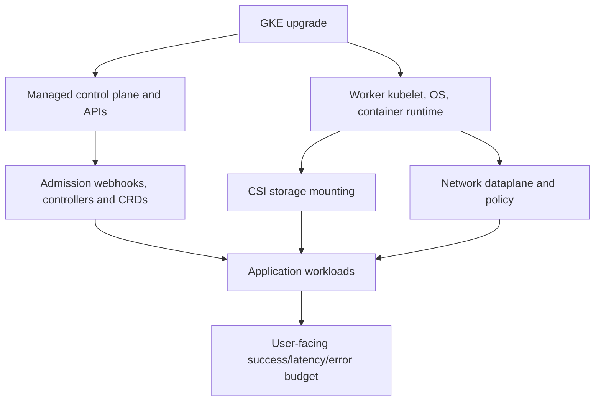
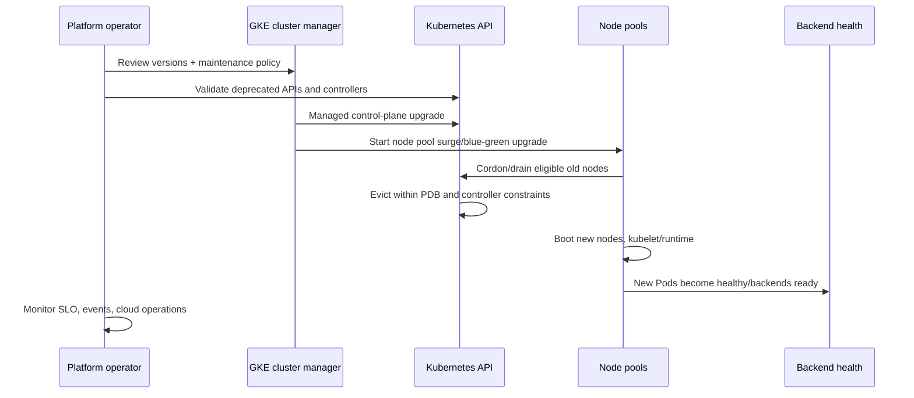
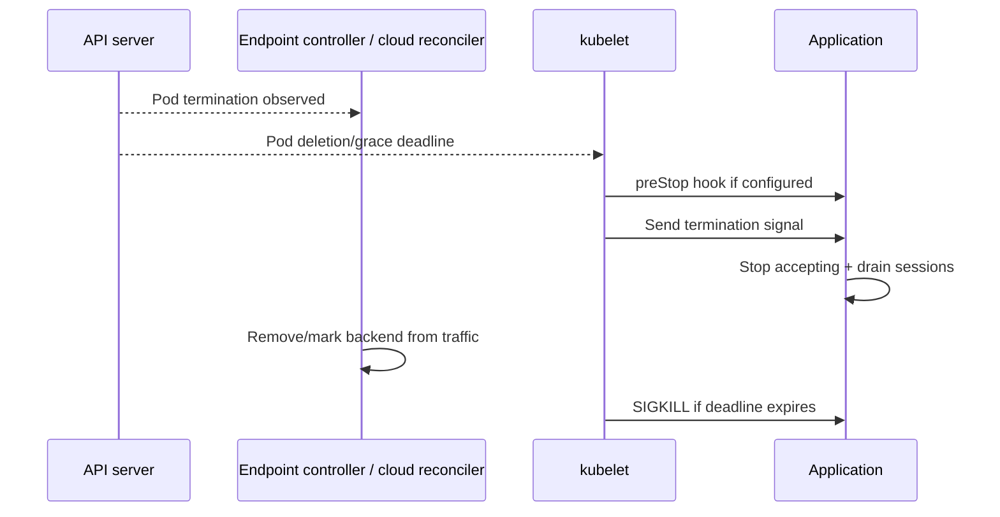
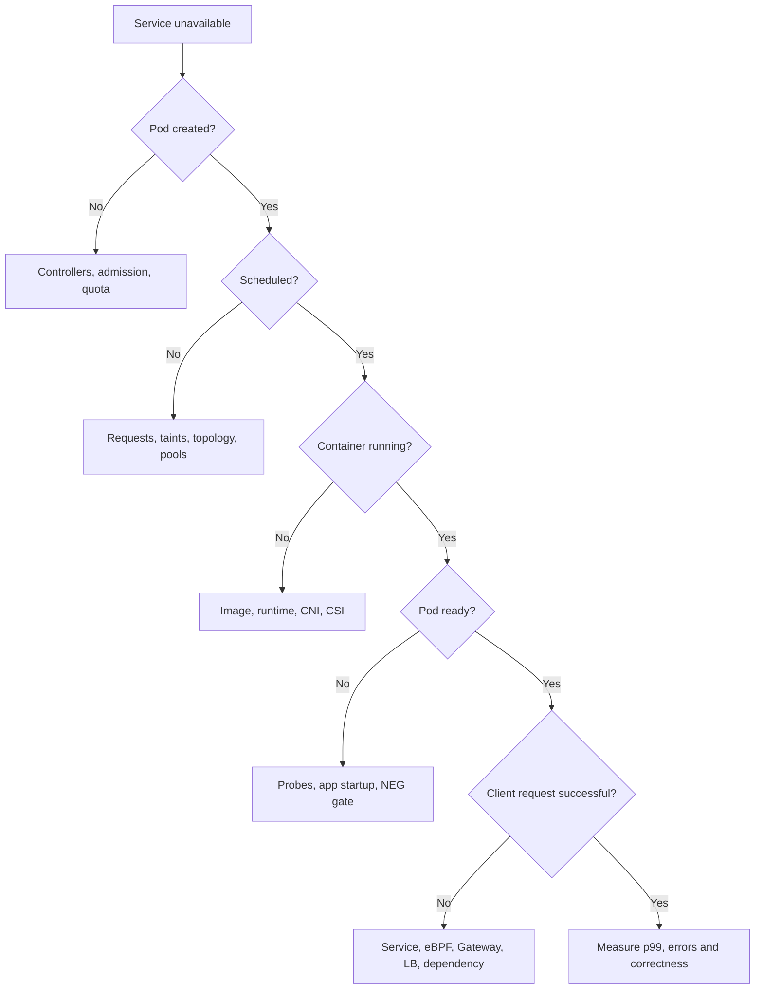
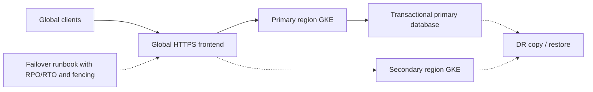

# Q8. GKE Upgrades, Observability, Incident Response and Disaster Recovery

> **Interviewer:** You operate production GKE clusters supporting a marketplace. Design safe Kubernetes/GKE upgrades and maintenance. Explain release channels, node upgrades, PDBs, admission/CSI/CNI compatibility, logging and monitoring. Then diagnose a cluster-wide incident and discuss regional disaster recovery.

## 1. A GKE upgrade changes several systems

Upgrading isn't only changing an API version. Production depends on:



A cluster upgrade can break an obsolete Kubernetes API, a custom webhook schema, a CSI driver/node dependency or application scheduling topology. A control plane that reports healthy does not prove image pulls, new Pods or real user requests will succeed.

## 2. Release channels and lifecycle

GKE release channels include **Rapid, Regular, Stable and Extended**, each balancing earlier availability against rollout maturity and supported lifecycle. GKE automatically upgrades clusters over time under its documented policy; a Standard cluster not enrolled in a release channel is not a way to freeze upgrades forever, and “No channel” is being deprecated for current lifecycle schedules.

- Choose channels based on organization's compatibility and maintenance policy.
- Use maintenance windows and appropriately scoped exclusions for required testing or planned freezes, without assuming indefinite postponement.
- Test early patches and deprecations in representative nonproduction.
- Review GKE release notes and versions supported in each channel.
- Keep versions in supported skew for control plane, kubelet and add-ons.
- Emergency security updates and end-of-support rules can override planned maintenance assumptions.

The exact availability, exclusions, auto-upgrade target and supported versions change over time. See [GKE release channels](https://cloud.google.com/kubernetes-engine/docs/concepts/release-channels) and [version lifecycle](https://cloud.google.com/kubernetes-engine/docs/concepts/versioning).

## 3. Upgrade stages and canary capacity



This is a conceptual GKE maintenance sequence; managed auto-upgrade scheduling, surge/blue-green support and sequencing depend on cluster mode/pool settings. Control plane upgrades are distinct from node pool upgrades. Some node replacement is managed under GKE upgrade policy without an operator-issued drain command.

### Surge and blue-green

**Surge upgrades:** Add replacement node capacity while draining/removing old capacity according to configured `maxSurge` and `maxUnavailable` policy for supported pools.

**Blue-green node upgrades:** Create a new pool-like replacement generation, transition workloads and retain old capacity during a configurable soak period under supported configurations.

Both require quotas, secondary/primary IP space, capacity and working readiness/draining. A lack of surge capacity can delay an otherwise supported upgrade.

## 4. PDB, eviction and graceful termination

```yaml
apiVersion: policy/v1
kind: PodDisruptionBudget
metadata:
  name: bidding-api
  namespace: marketplace
spec:
  minAvailable: 4
  selector:
    matchLabels: { app: bidding-api }
```

This controls permitted voluntary evictions through the Eviction API. It doesn't prevent node power failure, involuntary loss, all direct deletions or Deployment rolling-update unavailability, which uses Deployment strategy.

A PDB requiring `minAvailable: 4` with only four healthy replicas can block planned drains; that's working as configured, not necessarily a Kubernetes bug. Increase safe replica capacity or plan maintenance.

### Pod termination sequence



Endpoint withdrawal and hook execution are asynchronous. A hard-coded 5-second sleep is not proof that Cloud Load Balancer endpoint propagation completed. TerminationGracePeriod, app SIGTERM behavior, LB connection-draining settings and session lengths must be designed together.

## 5. Upgrade preparation checklist

1. Inventory GKE versions, release channel, control-plane endpoint and node pool OS/runtime.
2. Read target GKE/Kubernetes release notes and removed/deprecated APIs.
3. Audit CRDs, admission policies/webhooks, CNI, CSI, gateways/ingress and security agents.
4. Verify ServiceAccounts/IAM, node service account, Artifact Registry access and policy changes.
5. Check node, CPU/GPU and **Pod IP secondary range** headroom for surge replacements.
6. Review PDBs, readiness gates, replicas and zone spread.
7. Test application and cluster add-ons in a representative staging cluster/node pool.
8. Canary node pool or selected workload class, observe errors/p99/latency and backend health.
9. Document mitigation and compatible forward-fix strategy, not an assumed control-plane downgrade.
10. Confirm post-upgrade API and workload operations through real synthetic business requests.

```bash
gcloud container clusters list --project=PROJECT_ID
gcloud container clusters describe CLUSTER --location=europe-west1 --project=PROJECT_ID
gcloud container node-pools list --cluster=CLUSTER --location=europe-west1 --project=PROJECT_ID
gcloud container operations list --location=europe-west1 --project=PROJECT_ID
kubectl get nodes -o wide
kubectl get pdb -A
kubectl get validatingwebhookconfigurations,mutatingwebhookconfigurations
kubectl get crd
```

The exact supported release channel maintenance commands/fields should be validated with the current Cloud SDK and provider documentation, not copied from an old playbook.

## 6. Observability for GKE

Start from service SLIs (request success, duration, correctness), not “all nodes Ready.”

Correlate:
- Cloud Monitoring GKE node/pod/container and autoscaling metrics.
- Kubernetes events, resource conditions and container restart reasons.
- Cloud Logging: workload, kubelet/system, controller and audit entries where available.
- Network policy logs on Dataplane V2.
- GKE operation logs for cluster/node changes and failures.
- Google LB backend health/NEG and application traces.
- Database/service dependency latency and errors.

```bash
kubectl get events -A --sort-by=.lastTimestamp | tail -50
kubectl get pods -A -o wide
kubectl top nodes
kubectl -n marketplace logs deploy/catalog-api --previous
gcloud logging read 'severity>=ERROR' --project=PROJECT_ID --limit=50
```

Logs may be filtered, sampled or absent depending on configured collection. `--previous` works when a previously terminated container instance's logs remain accessible; it is not a historical log archive.

## 7. Production troubleshooting hierarchy



### Diagnostic map

| Symptom | Investigate |
| --- | --- |
| API kubectl timeout | Endpoint/DNS/authorized networks/API availability |
| Forbidden | Identity, IAM to cluster API and Kubernetes RBAC |
| Pending | Scheduler resources, taints, topology, PVC binding |
| ContainerCreating | CSI mounts, CNI sandbox, image setup |
| ImagePullBackOff | Artifact Registry IAM, image location/digest, network |
| CrashLoopBackOff | Process exit, probe, missing config, OOM |
| Ready but 502 | NEG/backend health, LB routing/health, app upstream |
| New nodes fail | Quota, zonal capacity, node SA, subnet/Pod CIDRs |
| Network only one namespace | NetworkPolicy, DNS, service mesh policy |
| Stateful Pod Multi-Attach | Old writer fencing, VolumeAttachment, zone |
| Rolling upgrade blocked | PDB, surge capacity, health gates, constraints |

## 8. Hypothetical incident: upgrade healthy, new Pods broken

Situation:
- GKE managed control plane upgraded.
- Existing Pods serve traffic.
- Newly scheduled Pods report `CreateContainerConfigError` or admission rejection.
- Helm/GitOps release fails, but no API-server outage exists.

Investigation:
1. Compare failure stage: API admission versus kubelet container config.
2. Inspect Pod events, missing Secret/ConfigMap, removed API fields or webhook incompatibility.
3. Check CRD schemas/controller versions and deployment revisions.
4. Confirm node pool images, registry auth and kubelet versions if container creation begins but fails.
5. Mitigate by restoring compatible webhook/controller or config, rather than restarting all healthy application Pods.
6. Validate ordinary create/scale/rollout operations and end-to-end transaction success.

## 9. Regional disaster recovery for GKE

A regional GKE cluster is not a cross-region failover service. Disaster recovery may involve:
- Secondary cluster and its node/IP capacity.
- IAM/WIF principal design for both projects/clusters.
- Container registry availability.
- DNS/LB multi-cluster routing and backend health.
- Kubernetes state/application manifests and Secrets recovery.
- CSI and database data restoration/replication.
- Preventing simultaneous active writers or duplicate payment processing.



Dashed lines mean planned standby/replication paths, not guaranteed automatic database failover. Before shifting writes, verify current data state and leader/writer fencing. Practice restore/failover and measure actual RTO/RPO.

## 10. Senior/lead trade-offs

Choose release channel and maintenance policy based on support and compliance, not avoidance of every upgrade. Maintain compatibility tests and declarative manifests. Reserve enough node and IP capacity for maintenance. Protect app availability with correct readiness/draining and PDBs but understand what they do not guarantee. Make cluster debugging a lifecycle-boundary decision rather than a broad “restart things” response.

## Spoken interview answer

> “I'd approach GKE upgrades as a stack: managed API compatibility, node OS/runtime, CNI/CSI, admission, ingress and application contracts. I'd use a supported release channel, maintenance controls and a staging/canary upgrade to validate actual Pod startup, backend health and transactions. For worker changes I'd check PDBs, surge and Pod IP capacity, zone spread and drain time. If an incident occurs I'd trace the first failed transition from API admission through scheduler, kubelet, networking, readiness and client response. A regional cluster alone doesn't solve regional data recovery; that needs separate RPO/RTO, replicated data, identity, routing and fencing.”

**References:** [GKE release channels](https://cloud.google.com/kubernetes-engine/docs/concepts/release-channels) · [GKE upgrades](https://cloud.google.com/kubernetes-engine/docs/how-to/upgrading-a-cluster) · [Kubernetes disruptions](https://kubernetes.io/docs/concepts/workloads/pods/disruptions/) · [GKE operations](https://cloud.google.com/kubernetes-engine/docs/how-to/logging)

[Previous](./q7) · [Module index](./) · [Challenge questions](./follow-ups)
