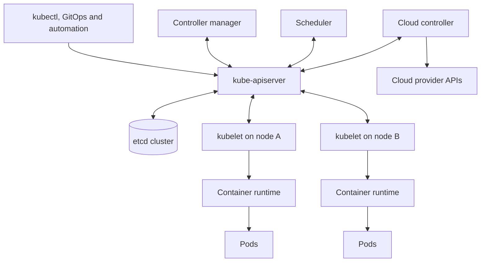

# Kubernetes architecture: control plane, nodes and failure boundaries

> **Engineering focus:** Explain Kubernetes from first principles. What does each control-plane and node component own, what is its source of truth, and what happens if the control plane is unavailable?

Kubernetes is a **declarative distributed control system**. Clients specify desired state through API objects, controllers repeatedly compare that with observed state, and node agents execute the resulting workloads. This is different from a deployment script that starts a process once and assumes it stays healthy.



### Control plane versus data plane

| Component | Principal responsibility | What it does **not** do |
|---|---|---|
| `kube-apiserver` | TLS API endpoint, authentication, authorization, admission, validation, persistence, watch delivery | It does not forward normal application requests between Pods |
| `etcd` | Durable, strongly consistent backing store for API state | Not a transactional customer-data database |
| `kube-controller-manager` | Reconciles built-in resources: Deployment, ReplicaSet, Job, endpoints, node lifecycle and others | Does not personally execute containers on worker nodes |
| `kube-scheduler` | Selects feasible nodes for unscheduled Pods and performs binding | Doesn't download images or start containers |
| `cloud-controller-manager` | Integrates cloud-backed node, route and load-balancer functions where supported | Doesn't automatically implement every provider feature |
| `kubelet` | Realizes assigned Pod specs on its node, runs probes, reports state | Doesn't choose a node for a pending Pod |
| CRI runtime (e.g. containerd) | Image and container lifecycle | Doesn't independently decide desired replica counts |
| CNI / network dataplane | Sets up Pod connectivity and implements routing/policy | Isn't the Kubernetes API backing store |
| CSI plugins | Volume provisioning, attachment and mounting through supported drivers | Don't guarantee application-level transaction consistency |

**Three types of state must be kept distinct:** API desired state (e.g. `Deployment.spec.replicas=5`), controller-observed state (e.g. three Ready replicas), and user-visible correctness (e.g. a bid actually commits). The first two are necessary but not sufficient for the third.

### Reconciliation instead of imperative execution

If a Deployment requests five replicas and two Pods fail, the control plane need not remember and replay a particular command. It observes the ReplicaSet's current state and creates replacements. This is *eventual convergence*, subject to capacity, scheduling, credentials, controllers and healthy infrastructure.

Kubernetes is not a magic instantaneous convergence mechanism. Informer caches, watch delivery, admission, scheduling, CNI, CSI and load-balancer health propagate asynchronously. A Pod may be Running but not Ready; a Pod may be Ready while cloud backend registration has not yet completed.

### What happens if the API server fails?

Existing healthy containers and already-programmed network rules **typically keep serving traffic**. However, new administrative writes fail, controllers cannot reliably reconcile changes, kubelets cannot report status, and new Pods may remain pending. Applications directly using the Kubernetes API can fail too. A short control-plane disruption is not a blanket application outage, but prolonged disruption weakens recovery from node and workload failures.

If etcd loses quorum, the API server may be reachable but cannot complete the necessary state-changing operations. If only the scheduler fails, existing workloads can run but newly created unscheduled Pods cannot be placed by that scheduler. If a kubelet fails while containers remain alive, node lifecycle and status eventually become uncertain, potentially triggering eviction/rescheduling decisions depending on health and tolerance settings.

### Commands to map the architecture

```bash
kubectl cluster-info
kubectl get --raw='/readyz?verbose'         # Requires permitted API access
kubectl get nodes -o wide
kubectl get componentstatuses               # Legacy/deprecated; prefer targeted health endpoints
kubectl get pods -n kube-system -o wide
kubectl api-resources
kubectl explain deployment.spec.strategy
```

For **managed** Kubernetes, the provider may hide API server, etcd and scheduler processes. Use the provider's supported control-plane metrics and configuration endpoints instead of assuming shell access to control-plane nodes.

### Production scenario: the control plane is unavailable during peak traffic

A hypothetical marketplace has 30 healthy API Pods across three zones. `kubectl` times out and HPA cannot scale despite growing request queues. Existing API responses may still work, but the platform is running on already-available capacity. The incident response should distinguish **serving availability** from **control-plane reconciliation capability**, stop risky configuration changes, check managed control-plane status, validate spare capacity, and avoid causing unnecessary Pod turnover while the control plane is impaired.

**Key takeaways:** Kubernetes is an API-backed reconciliation system. The API server accepts desired state; etcd persists it; controllers produce dependent objects; the scheduler assigns Pods; and kubelets coordinate runtime, networking and storage to run them. These stages are asynchronous. During a control-plane outage, running applications often continue, but the ability to scale, recover and change the cluster is impaired. Identify the failed layer before restarting anything.