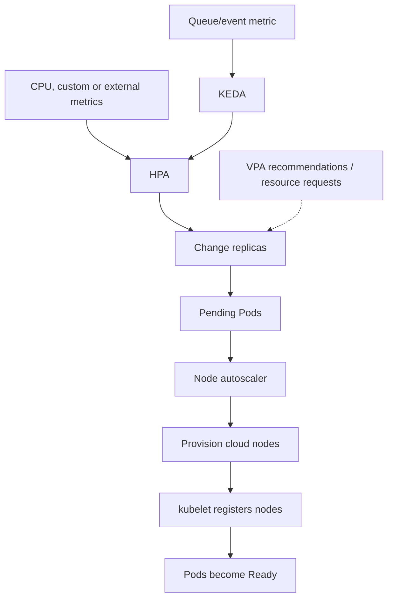

# Autoscaling: HPA, VPA, KEDA and node capacity

> **Engineering focus:** Replicas are increased, but the Pods remain Pending and latency is still rising. Compare scaling controllers, calculate an HPA decision, and design a safe response to known peak traffic.

### Four different questions

- **HPA:** How many Pod replicas should a workload have?
- **VPA:** What CPU/memory request sizing should each Pod use (and optionally apply changes according to supported modes)?
- **KEDA:** What external/event signals should initiate/drive replica scaling, often through HPA integration?
- **Node autoscaler:** What nodes must exist for unschedulable Pods, subject to cloud quota, provisioning and placement constraints?



### HPA calculation

Simplified formula:

\[desiredReplicas = \left\lceil currentReplicas \times \frac{currentMetric}{targetMetric} \right\rceil\]

If there are **4 replicas**, observed average CPU utilization is **80% of requests**, and target utilization is **50%**, the unadjusted recommendation is `ceil(4 * 80 / 50) = 7` replicas.

**Important:** CPU utilization is relative to *CPU requests*, not node CPU capacity. A Pod using 400m with a 500m request reports 80% utilization; the same usage with a 1000m request reports 40%. HPA also adjusts for tolerance, missing metrics, not-yet-ready Pods, stabilization windows and max/min replica limits.

```yaml
apiVersion: autoscaling/v2
kind: HorizontalPodAutoscaler
metadata: {name: catalog-api, namespace: marketplace}
spec:
  scaleTargetRef:
    apiVersion: apps/v1
    kind: Deployment
    name: catalog-api
  minReplicas: 4
  maxReplicas: 40
  metrics:
    - type: Resource
      resource:
        name: cpu
        target:
          type: Utilization
          averageUtilization: 60
  behavior:
    scaleDown:
      stabilizationWindowSeconds: 300
```

### Multiple metrics and failure behavior

With several metrics, HPA generally chooses the largest proposed replica count, subject to controls. If a metric is unavailable, the controller can conservatively avoid a downscale even when another signal recommends one. Inspect conditions such as `AbleToScale`, `ScalingActive` and `ScalingLimited` and metrics-adapter health.

```bash
kubectl get hpa -A
kubectl describe hpa catalog-api -n marketplace
kubectl top pods -n marketplace
kubectl get --raw '/apis/metrics.k8s.io/v1beta1/namespaces/marketplace/pods'  # If authorized
```

### Event/queue-based scaling with KEDA

For a queue-processing worker, CPU may be a poor signal. Queue depth, message age and consumption lag may represent demand more directly. A KEDA `ScaledObject` can create/manage a compatible HPA or handle event-driven activation, given installed CRDs/scalers.

```yaml
apiVersion: keda.sh/v1alpha1
kind: ScaledObject
metadata: {name: event-worker, namespace: marketplace}
spec:
  scaleTargetRef:
    name: event-worker
  minReplicaCount: 1
  maxReplicaCount: 40
  pollingInterval: 30
  cooldownPeriod: 300
  triggers:
    - type: prometheus
      metadata:
        serverAddress: http://prometheus.monitoring.svc:9090
        metricName: queue_depth
        query: sum(marketplace_queue_depth)
        threshold: "500"
```

If messages are expensive or highly variable, queue-depth / target-backlog alone can be misleading. Account for **arrival rate, processing duration, message age and concurrency**. Backpressure, retries, downstream capacity and idempotency remain required.

### Node provisioning is a separate loop

HPA writes more desired replicas → ReplicaSet creates Pods → scheduler discovers insufficient feasible node capacity → node autoscaler requests suitable cloud instances → kubelets register → Pods schedule and initialize. Failure can occur at cloud quota, instance availability, IP ranges, taints, volume topology or image pull. The node autoscaler can't fix impossible scheduling constraints.

### Avoid controller feedback loops

VPA changes CPU requests; HPA CPU-utilization ratios use those requests. GitOps continually forcing a fixed `spec.replicas` may fight HPA. Define a clear owner for replica fields and compatible VPA/HPA metrics. Evaluate scale-out *latency* (metric sampling, node boot, image pull, warmup, readiness, backend registration), not only peak replicas.

### Peak marketplace case

Auction close times are partially predictable. Pre-scale baseline replicas and possibly nodes before expected spikes; combine with reactive HPA and event-based worker scaling. Maintain zone redundancy, limit admission and retries, protect downstream databases and test the full ramp. Purely reactive scaling often arrives after a short-lived surge has already caused errors.

**Key takeaways:** HPA changes replica count; VPA helps size resource requests; event scalers like KEDA translate queue/external signals into scaling; node autoscalers add physical capacity. They're separate feedback loops. Calculate HPA against requested CPU or explicit custom metrics, observe missing-metric behavior and scale-down stabilization, and verify pending Pods can actually be scheduled. For predictable spikes pre-scale, preserve headroom and monitor dependency load rather than assume more replicas always improves reliability.