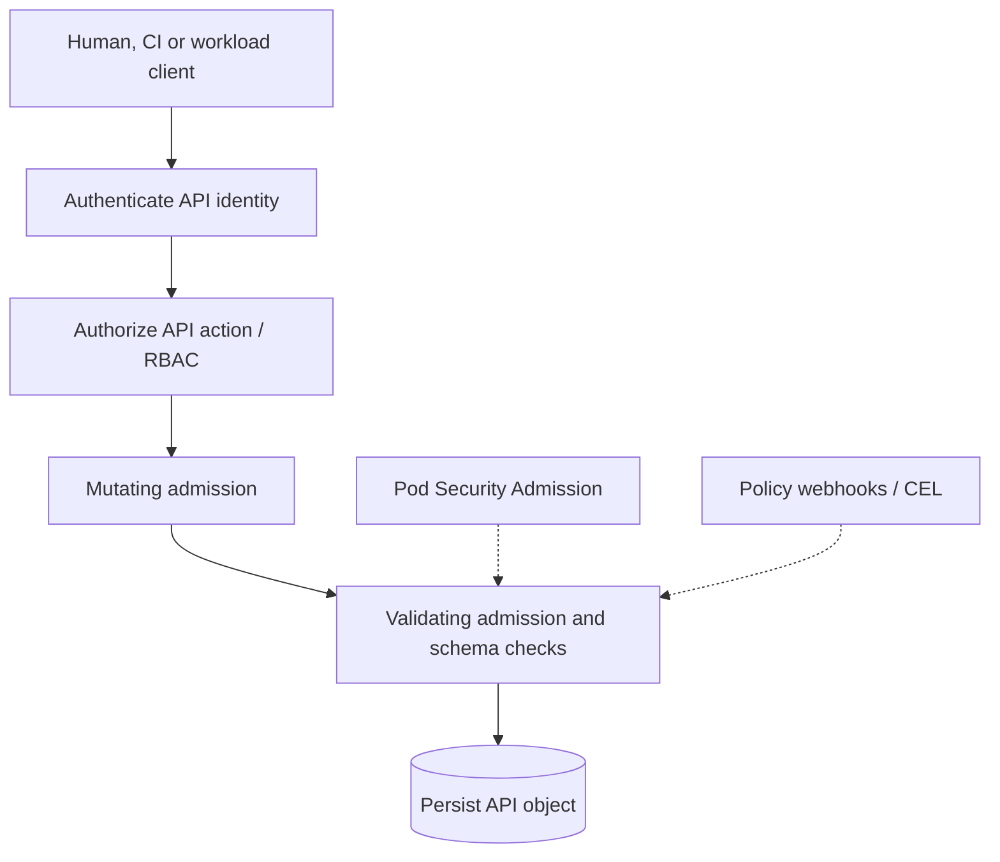

# Security: identity, RBAC, admission and workload isolation

> **Interviewer:** Design least-privilege Kubernetes access for dozens of product teams. How do authentication, authorization, admission, ServiceAccounts, cloud identity and Pod Security Standards fit together? Can an admission webhook become an outage?



### Security stages are distinct

1. **Authentication:** Who is calling the API? (human OIDC/client cert, CI identity or ServiceAccount token).
2. **Authorization:** May the principal perform the requested API verb on this resource? (often RBAC).
3. **Admission:** May this *resulting object configuration* enter the cluster? Mutating policy can alter objects; validating policy can reject them.
4. **Runtime/network/cloud enforcement:** Pod security, CNI policy, Linux capabilities and cloud IAM remain independent boundaries.

Successful RBAC authorization to create a Pod doesn't imply the Pod configuration is safe or the user should be allowed to mount host paths.

### ServiceAccounts and tokens

Use distinct ServiceAccounts per workload and avoid unnecessary Kubernetes API tokens. Modern projected tokens have bounded lifetime and audience; avoid treating all tokens as permanently valid cluster-global secrets. Application access to a cloud API through workload federation is a different authorization decision from permission to create Deployments through Kubernetes RBAC.

```yaml
apiVersion: v1
kind: ServiceAccount
metadata: {name: catalog-reader, namespace: marketplace}
automountServiceAccountToken: false
```

If the workload needs Kubernetes API access, explicitly configure the necessary token and narrowly scoped RBAC.

### Role, ClusterRole and binding scope

```yaml
apiVersion: rbac.authorization.k8s.io/v1
kind: Role
metadata: {name: configmap-reader, namespace: marketplace}
rules:
  - apiGroups: [""]
    resources: ["configmaps"]
    verbs: ["get", "list", "watch"]
---
apiVersion: rbac.authorization.k8s.io/v1
kind: RoleBinding
metadata: {name: catalog-config-reader, namespace: marketplace}
subjects:
  - kind: ServiceAccount
    name: catalog-reader
    namespace: marketplace
roleRef:
  kind: Role
  name: configmap-reader
  apiGroup: rbac.authorization.k8s.io
```

A `Role` is namespaced. A `ClusterRole` can define cluster-scoped or reusable permissions. A namespaced RoleBinding may reference a ClusterRole while binding namespaced permissions only in its own namespace. `ClusterRoleBinding` grants relevant privileges cluster-wide.

**Privilege paths:** reading Secrets, `pods/exec`, modifying workloads to use privileged ServiceAccounts, and special `impersonate`, `bind` or `escalate` permissions can create effective privilege escalation. Review capability to *cause execution as another identity*, not just direct read verbs.

```bash
kubectl auth can-i get configmaps -n marketplace
kubectl auth can-i list pods -n marketplace \
  --as=system:serviceaccount:marketplace:catalog-reader
kubectl get role,rolebinding -n marketplace
kubectl get clusterrole,clusterrolebinding
```

Impersonation tests themselves require authorization to impersonate that identity.

### Admission and webhook availability

Mutating webhooks run in supported admission phases before validating admission. A policy might reject privileged containers, unapproved registries or missing labels. Webhooks are **API write dependencies**: if a matching webhook becomes unavailable, `failurePolicy: Fail` can block writes; `Ignore` can allow operations to proceed on invocation error, trading security enforcement for availability.

Prefer narrowly scoped rules, sensible timeouts, highly available webhook backends, reinvocation-safe mutation, and declarative in-process validation when requirements can be expressed as `ValidatingAdmissionPolicy` with CEL on compatible clusters. Version-specific mutating admission capabilities should be checked before use.

### Pod Security Standards

Three profile levels: **Privileged**, **Baseline**, **Restricted**. Restricted aims for stronger isolation through constraints such as non-root execution, capabilities, seccomp and forbidden privilege escalation (precise rules depend on version).

```yaml
apiVersion: v1
kind: Namespace
metadata:
  name: marketplace
  labels:
    pod-security.kubernetes.io/enforce: restricted
    pod-security.kubernetes.io/audit: restricted
    pod-security.kubernetes.io/warn: restricted
```

Audit/warn existing workloads before broad enforcement. Infrastructure agents may need tightly reviewed exemptions; don't grant host-level privileges to ordinary application namespaces.

### NetworkPolicy, workload federation and secrets

NetworkPolicy governs supported Pod network flows, not Kubernetes API permissions. Cloud workload identity federation (e.g. in GKE) governs access to cloud resources and shouldn't require distributing long-lived JSON keys. Kubernetes Secrets are base64-encoded in API output, not inherently encrypted by base64; protect via RBAC, at-rest encryption, rotation and appropriate external secret systems.

### Production scenario: webhook outage prevents every new Pod

Existing Pods serve requests but ReplicaSets cannot create replacements. Inspect matching Mutating/ValidatingWebhookConfigurations, failure policies, service endpoints, webhook certs and logs. Restore the webhook if possible; if emergency policy change is necessary, narrowly adjust scope under security review instead of disabling every security control.

**Spoken answer:** “I separate identity, permission, configuration policy and runtime enforcement. Humans use central identity, workloads use least-privilege ServiceAccounts and cloud federation, RBAC limits API verbs and scope, and admission rejects unsafe resource configurations. Pod Security and NetworkPolicy protect different runtime boundaries. I'd also treat policy controllers and webhooks as production infrastructure because a broken fail-closed webhook can stop cluster changes.”