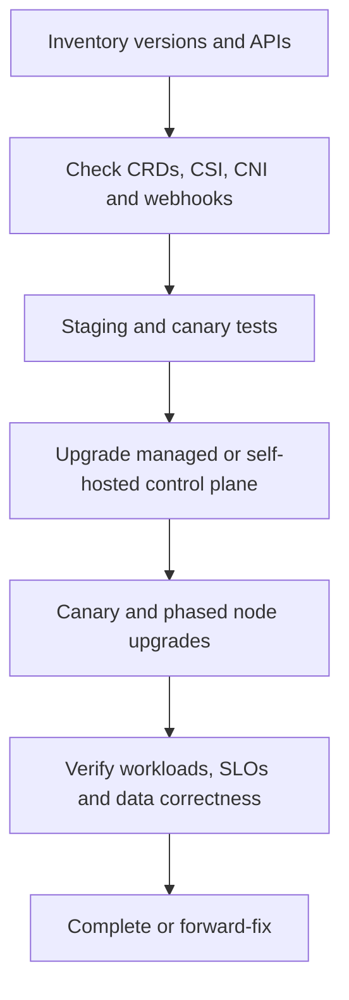
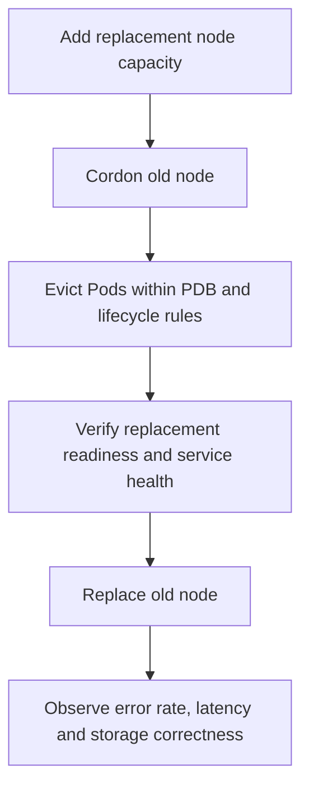

# Upgrades, compatibility and end-to-end Kubernetes troubleshooting

> **Engineering focus:** Design a safe production Kubernetes upgrade. What is the right order, what can break beyond the API server version, and how do you diagnose a cluster where old Pods work but new Pods cannot start?

### Upgrading the ecosystem, not just `kube-apiserver`



A production cluster includes API/etcd, scheduler/controllers, kubelet/runtime, CNI, CSI, ingress/Gateway, metrics and admission systems, CRDs/operators and application clients. A version bump can affect a field/API group, cgroup/network behavior, registry access, node kernels or CSI mount behavior even if application manifests appear unchanged.

**Version skew:** Each Kubernetes component has a documented supported version relationship. The control plane is normally upgraded ahead of kubelets, but the precise permitted skew depends on source and target version. Cloud providers may impose narrower windows. Review the official skew policy and provider constraints for the *actual* versions; never apply a generic minor-version rule blindly.

### Pre-upgrade plan

1. Inventory cluster, add-ons and workloads; pin current and target versions.
2. Review removed/deprecated API versions and schema changes, including installed CRDs.
3. Verify compatibility of CNI, CSI, ingress/Gateway, autoscaler, admission webhooks, observability and security agents.
4. Inspect topology spread, PDBs, local data, stateful quorum and spare capacity.
5. Test in a representative staging cluster and a canary node pool.
6. Record operational metrics, SLO thresholds and release gates.
7. Plan maintained restore/forward-recovery paths; do not assume downgrade support.
8. Coordinate maintenance, rollback for **applications**, and stakeholder communication.

### Node replacement path



```bash
kubectl get nodes -o wide
kubectl cordon worker-1
kubectl drain worker-1 --ignore-daemonsets --delete-emptydir-data
kubectl get pdb -A
kubectl rollout status deployment/catalog-api -n marketplace
```

`--delete-emptydir-data` permits deletion of data in `emptyDir`; assess data loss first. A blocked drain may be protecting a PDB or a stateful quorum; do not blindly use `--force`. Node upgrades may involve new node pool creation, canary placement, controlled drain and replacement, depending on managed-provider features.

### Why control-plane rollback is different

Application image rollback is often feasible within compatibility constraints. Kubernetes control-plane downgrade may be unsupported or unsafe because of stored resource versions, API transformations, etcd state and newer controllers. Managed providers may prohibit downgrades. Focus on compatibility testing, disaster-recovery rehearsal and forward fixes.

### Triage based on the first incomplete lifecycle stage

| Symptom | Likely boundary to investigate | Useful first check |
|---|---|---|
| Pod `Pending`, no node | Scheduler, requests, affinity, taints, PVC topology | `kubectl describe pod` events |
| Pod assigned, sandbox not created | Kubelet/CRI/CNI | Runtime/kubelet logs and Pod events |
| `ContainerCreating` and mount errors | CSI attachment/staging/publish | `VolumeAttachment`, CSI logs |
| `ImagePullBackOff` | Image URL, registry auth, connectivity, rate limits | Pod events, pull Secret |
| `CreateContainerConfigError` | Missing Secret/ConfigMap or invalid reference | Pod describe/config objects |
| `CrashLoopBackOff` | Application crash, startup command, probe, OOM | `kubectl logs --previous` |
| `Running`, not Ready | Readiness probe/gate, dependent service | Pod conditions and probe failures |
| `Evicted` | Node pressure, local storage/memory/PIDs | Node conditions and kubelet events |
| `Terminating` stuck | Finalizers, kubelet shutdown, mounts | Finalizer, events, runtime state |
| Pod Ready, requests fail | Service endpoints, LB routing, network, app dependencies | Endpoints, ingress, traces |

### A complete sample incident

After a cluster upgrade, existing Pods serve requests; replacement Pods remain Pending. Node utilization appears moderate. `describe pod` reports a mix of untolerated taints and volume affinity conflicts. Isolate whether the new node pool has changed labels/taints, whether the PVC's volume is zonal and whether the autoscaler can create suitable node types. Correct the actual placement mismatch. Don't globally remove affinity or force-delete stateful workloads to make the rollout green.

### Low-risk investigation commands

```bash
kubectl cluster-info
kubectl get nodes -o wide
kubectl get deploy,sts,ds,job -A
kubectl get pods -A -o wide
kubectl get events -A --sort-by=.lastTimestamp
kubectl describe pod POD -n NAMESPACE
kubectl logs POD -n NAMESPACE --previous
kubectl get pvc -A && kubectl get pv
kubectl get volumeattachments
kubectl describe node NODE
kubectl get hpa -A
kubectl get validatingwebhookconfigurations
kubectl auth can-i list pods -n NAMESPACE
```

For distroless containers, permitted ephemeral debug containers can be useful:

```bash
kubectl debug -it POD -n NAMESPACE \
  --image=busybox:stable --target=CONTAINER_NAME
```

Be cautious: debugging may expose sensitive data and requires appropriate RBAC/admission. Managed systems can restrict direct node access.

### Lead-level operational priorities

Define incident severity from **customer behavior**, not only `Deployment Available`. Assign focused workstreams for application, control plane, node and network/storage; build a timeline of symptoms/changes; choose a reversible mitigation; validate business correctness after recovery; and turn the root cause into preflight checks, SLOs and rehearsed failure tests.

**Key takeaways:** I plan a Kubernetes upgrade as a compatibility migration across API, nodes, runtime, networking, CSI, admission, operators and application schemas. I validate the target version and removed APIs, use canary nodes and staged drains, and don't assume the control plane can simply be downgraded. During an incident I identify the first broken transition,admission, scheduling, sandbox, mount, readiness, endpoint routing or application dependency,then mitigate narrowly and verify the user journey.