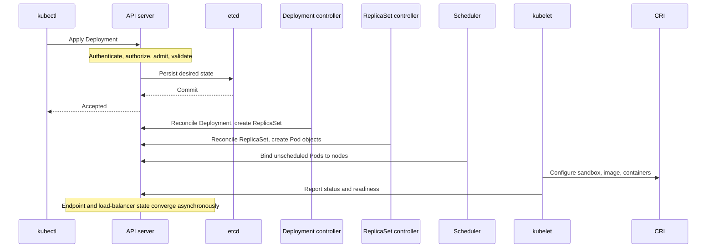

# Complete Deployment lifecycle: `kubectl apply` to serving traffic

> **Engineering focus:** I apply a Deployment with three replicas. Explain every significant step, including API admission, optimistic concurrency, storage, controllers, scheduling, runtime initialization and readiness.

### Example manifest

```yaml
apiVersion: apps/v1
kind: Deployment
metadata:
  name: catalog-api
  namespace: marketplace
spec:
  replicas: 3
  revisionHistoryLimit: 5
  strategy:
    type: RollingUpdate
    rollingUpdate:
      maxSurge: 1
      maxUnavailable: 0
  selector:
    matchLabels:
      app: catalog-api
  template:
    metadata:
      labels:
        app: catalog-api
    spec:
      containers:
        - name: api
          image: registry.example.com/catalog-api:v2
          ports:
            - containerPort: 8080
          resources:
            requests: {cpu: 250m, memory: 256Mi}
            limits: {memory: 512Mi}
          readinessProbe:
            httpGet: {path: /ready, port: 8080}
            periodSeconds: 5
```



### Stage 1: API request,not container startup

The client sends an HTTPS request to `kube-apiserver`. Depending on `kubectl apply` mode, the request may use server-side apply with field management or a client-side patch workflow. The API server performs authentication, authorization, API decoding/defaulting/conversion and admission/validation according to its internal pipeline. **Mutating admission precedes validating admission**, though schema/defaulting/conversion subtleties prevent treating the entire implementation as one universal fixed diagram. When accepted, the resource is persisted to etcd and a response is returned.

A successful `kubectl apply` only establishes that the API object was accepted. It does **not** mean replicas are scheduled, started or healthy. `kubectl rollout status` tracks later convergence.

**Authentication:** Establish client identity (client certificate, token, identity provider). **Authorization:** Check whether that principal can create/update this resource. **Mutating admission:** Potentially inject defaults/sidecars/labels. **Validating admission:** Reject invalid or disallowed objects. A failing webhook can block writes when configured to fail closed.

### Stage 2: Deployment and ReplicaSet reconciliation

The Deployment controller sees the updated Pod template, creates or updates the matching ReplicaSet and manages old/new ReplicaSet sizes during a rolling update. The ReplicaSet controller creates enough Pod API objects to satisfy its desired count. Controllers use cached lists/watches and may reconcile multiple times; they must tolerate conflicts and stale state.

The controller ownership chain is generally `Deployment → ReplicaSet → Pod`. An owner reference enables appropriate garbage-collection behavior; it does not imply parent and child are created atomically.

### Stage 3: scheduling

New Pod objects are initially unscheduled (`spec.nodeName` unset). The scheduler filters nodes by requests, affinity, taints, topology, volumes and other constraints; scores feasible nodes; then binds the Pod via the API. A pending Pod can have valid YAML and a healthy Deployment controller while no node is feasible.

### Stage 4: kubelet, CRI, CNI and CSI

The kubelet on the chosen node observes the assignment and coordinates volumes, sandbox/container creation, Pod networking, image pull, init containers and application containers. CSI may need to attach/mount storage; CNI/network implementation configures namespace/IP/routes; the CRI runtime launches containers. Multiple init containers run in their required order; application containers follow, with special lifecycle semantics for native sidecars on supported versions.

### Stage 5: health, endpoint registration, business readiness

Container started is not the same as `Pod Ready=True`. Readiness probes and any readiness gates must succeed. EndpointSlice and routing controllers subsequently update eligible service backends, and cloud load-balancer target health may converge separately. An end-to-end synthetic request is stronger evidence of actual serving health than merely counting Running Pods.

### Read each boundary

```bash
kubectl apply --server-side -f catalog.yaml
kubectl get deploy catalog-api -n marketplace -w
kubectl rollout status deploy/catalog-api -n marketplace
kubectl get rs,pods -n marketplace -o wide
kubectl describe deploy catalog-api -n marketplace
kubectl describe pod POD -n marketplace
kubectl get events -n marketplace --sort-by=.lastTimestamp
kubectl get pod POD -n marketplace -o jsonpath='{.metadata.ownerReferences}'
kubectl get endpointslices -n marketplace -l kubernetes.io/service-name=catalog-api
```

### Failure laboratory: `kubectl apply` succeeds, service stays unavailable

Trace in order: (1) Deployment conditions and ReplicaSets; (2) Pods created? (3) Pending versus assigned? (4) image/config/CSI/CNI container creation? (5) startup and readiness? (6) Service selectors and EndpointSlices? (7) ingress/cloud backend health? (8) actual request and dependent transactions? This prevents the frequent mistake of restarting a healthy workload when the failure is a missing Service endpoint or wrong cloud load-balancer health-check path.

**Key takeaways:** API acceptance, controller convergence, scheduling, node execution and serving readiness are separate transitions. The API server authenticates and admits the manifest, persists it, the Deployment controller creates a ReplicaSet, ReplicaSet creates Pods, scheduler binds them, and kubelet plus CRI/CNI/CSI run them. Probes, endpoint discovery and load-balancer health then determine serving eligibility. Debug the first incomplete transition, not infer end-to-end success from `kubectl apply`.