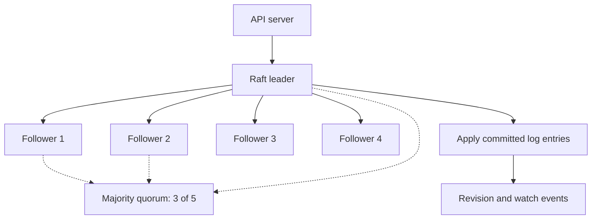

# etcd, Raft, quorum, watches and recoverability

> **Interviewer:** What does etcd actually guarantee? Explain leader election, replicated writes, quorum, revisions, watch compaction, backups and why an etcd restore is not an ordinary rollout rollback.

etcd is Kubernetes' strongly consistent backing key-value store. It persists Kubernetes API object state,not application payment transactions, cloud disk contents or files inside containers. The API server is the normal interaction layer: controllers generally watch Kubernetes APIs rather than connecting directly to etcd.



### Raft write path

1. A client submits an API write; the API server eventually asks etcd to persist it.
2. The current Raft leader appends the proposed entry to its replicated log.
3. Followers replicate entries over the peer network.
4. A majority acknowledgement allows the log entry to be committed under Raft's rules.
5. Committed operations are applied to the state machine; clients receive the resulting status.

The leader cannot commit arbitrary new writes after losing quorum. An election after leader failure can temporarily affect availability or latency. Keeping an odd number of voting members is common because an even increment may not improve fault tolerance.

| Members | Majority quorum | Maximum member failures tolerated |
|---:|---:|---:|
| 1 | 1 | 0 |
| 3 | 2 | 1 |
| 5 | 3 | 2 |
| 7 | 4 | 3 |

For a **five-member** etcd cluster, losing two retains a majority of three; losing a third removes quorum. This assumes the remaining members can actually communicate and operate with acceptable disk/network health.

### Revisions, watches and optimistic concurrency

etcd assigns revisions to changes. Kubernetes exposes opaque `metadata.resourceVersion` tokens for version-aware API operations and watches; callers must **not assume** they are timestamps or build portable business logic on parsing them numerically. Watches are not permanent event archives. After etcd history compaction, requesting an expired version can produce HTTP **410 Gone**. Correct controller behavior is to re-list current objects and restart the watch with a valid version.

Controllers also need to handle `409 Conflict` when updating a resource using a stale version. Read again, reconcile against current state, and retry appropriately; don't blindly replace another controller's newer state. Server-side apply uses field ownership/managedFields to help coordinate declarative writers but still requires understanding conflicts.

### Etcd performance and failure diagnosis

Signals worth tracking: leader elections, proposal failures, API server write/read latencies, etcd WAL sync/fsync latency, storage latency, network RTT between voting members, database size and fragmentation. A cluster may have quorum and still be too slow for useful reconciliation because of disk stalls or network loss.

Self-managed etcd inspection (authorized endpoints/certs required):

```bash
ETCDCTL_API=3 etcdctl \
  --endpoints=https://etcd-1.example.internal:2379 \
  --cacert=ca.crt --cert=client.crt --key=client.key \
  endpoint health --cluster

ETCDCTL_API=3 etcdctl \
  --endpoints=https://etcd-1.example.internal:2379 \
  --cacert=ca.crt --cert=client.crt --key=client.key \
  endpoint status --cluster -w table
```

Managed Kubernetes services may not permit direct member access. Use supported managed-control-plane metrics and service status instead.

### Snapshot, restore and consistency boundaries

```bash
etcdctl --endpoints=https://etcd-1.example.internal:2379 \
  --cacert=ca.crt --cert=client.crt --key=client.key \
  snapshot save /secure/etcd-snapshot.db
etcdutl snapshot status /secure/etcd-snapshot.db -w table
```

The snapshot must be protected because Kubernetes state can include Secrets. An etcd snapshot doesn't include application DB data, object storage or external managed resources. Restoring an old cluster snapshot may leave the restored API state inconsistent with disks, load balancers or credentials changed after the snapshot. Rehearse the complete recovery plan, including external state and application validation.

### Production scenario: `kubectl` hangs while API traffic still works

Existing Pods may remain healthy, but controllers cannot add replacements quickly. Establish whether the issue is API server overload, etcd quorum, etcd disk I/O, a failing admission webhook or an overloaded watch/client. These are different failure boundaries and require different mitigation. Don't restart running applications to fix an unhealthy etcd member.

**Spoken answer:** “etcd persists the cluster's API state using Raft consensus. For five voters, three form quorum and two failures can be tolerated; more failures prevent normal writes. Watches can expire after compaction, so controllers must re-list. I'd monitor leader stability, disk latency, API latency and proposal failures. Backups need secure snapshots *and* tested restoration of external application resources, because etcd isn't the complete business data plane.”