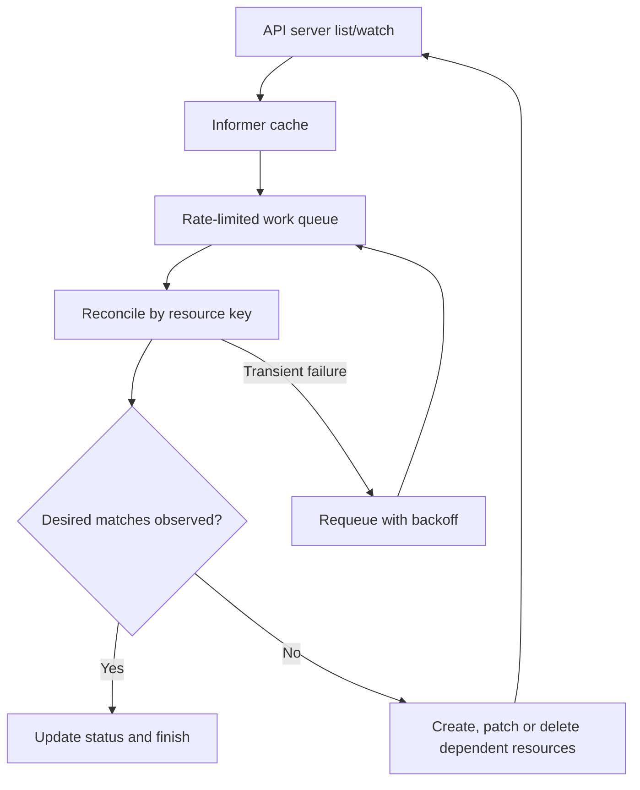
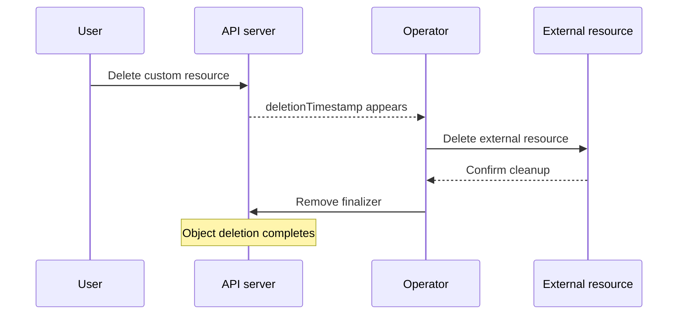

# Controllers, informers, operators, ownership and finalizers

> **Engineering focus:** How does a Kubernetes controller reconcile state, why is it safe to receive an event twice, and how would you write an operator that provisions external cloud infrastructure without leaking resources?

Controllers reconcile **desired** and **observed** state rather than executing a one-time imperative plan. A robust controller assumes missing/duplicate events, stale caches, transient API errors, retries, leadership changes and eventually consistent external systems.



### Informer, cache and work queue

A common implementation lists and watches objects via the API server. An informer maintains a local cache and enqueues keys when relevant objects change. Workers process keys from a rate-limited queue, read a consistent-enough current view, compare it to desired state and submit create/update/delete operations. The cache is a convenience, not a perfect instantaneous snapshot. Work queues may deduplicate keys; reconciliation should still be **idempotent**.

For example, processing a `PreviewEnvironment` CR twice must not create two cloud databases. Use stable resource identity, state checks, cloud API idempotency tokens where supported, a status machine, and recovery for partially completed actions.

### Spec versus status and observed generation

`spec` communicates desired state; `status` records observed state and progress. A custom resource might report:

```yaml
status:
  observedGeneration: 5
  conditions:
    - type: Ready
      status: "False"
      reason: WaitingForDatabase
      message: "Cloud database provisioning is still in progress"
```

Without `observedGeneration`, `Ready=True` might describe a previous version of the spec rather than the user's current request. Define precise condition meanings, actionable errors, backoff, and whether the resource can safely recover after controller restarts.

### Owner references and garbage collection

Deployment → ReplicaSet → Pod is the familiar ownership chain. Garbage collection can use owner references for dependent-resource cleanup. Deletion propagation may be foreground, background or orphaned. Scope rules restrict cross-namespace ownership; owner references should not be invented across unsupported scopes. An owner reference does not itself tell an external cloud API to delete its resources.

### Finalizers and `Terminating`

A finalizer prevents deletion completion while a controller performs necessary cleanup. When deletion is requested, the API object receives a `deletionTimestamp`, remains visible, and the controller performs cleanup before removing its finalizer.



Example:

```yaml
metadata:
  finalizers:
    - platform.example.com/external-cleanup
```

If a resource is stuck `Terminating`, inspect the exact finalizer, controller availability, cloud credentials and external-operation error. **Manual finalizer removal bypasses cleanup** and may orphan disks, DNS entries or accounts. Treat it as a documented, reviewed last resort.

### CRD versus controller versus operator

A **CRD** defines an API type and schema. A **custom resource** is an instance of that type. A **controller** implements reconciliation. An **operator** commonly combines custom resources with domain-specific operational knowledge,backups, upgrades, replication, provisioning and cleanup. A CRD alone doesn't implement automation.

Example hypothetical API:

```yaml
apiVersion: platform.example.com/v1alpha1
kind: PreviewEnvironment
metadata:
  name: checkout-pr-214
  namespace: engineering
spec:
  ttlHours: 24
  branch: feature/checkout
```

A controller could provision a namespace, quota, service accounts, policies, preview workloads and an expiration workflow. The hard parts are idempotency, cleanup, security boundaries, quotas and ensuring repeated reconciliations are safe.

### Lead-level operator review

- Who owns each field and external resource? Document lifecycle and invariants.
- How are **partial failures** recorded and recovered? Retry a stable action rather than duplicate it.
- What are the credential scope and rate limits? Avoid cluster-wide privilege by default.
- Can two controller replicas both act? Use safe coordination/leader election where appropriate, but still write idempotent reconciliation.
- What if the external API is slow? Bound concurrency and use exponential backoff.
- What happens when the CRD/webhook/controller is upgraded? Version and migration compatibility matter.
- How does the user find out *why* Ready=False? Expose conditions and events.

```bash
kubectl get crd
kubectl describe CRD_NAME
kubectl get RESOURCE -A -o yaml
kubectl describe RESOURCE NAME -n NAMESPACE
kubectl get RESOURCE NAME -n NAMESPACE -o jsonpath='{.metadata.finalizers}'
```

**Key takeaways:** A controller consumes API state, usually through cached list/watch informers and a work queue, and repeatedly reconciles resources until observed state matches the spec. I design that loop to be idempotent, tolerant of stale reads and safe to retry. I use owner references for supported Kubernetes ownership and finalizers for external cleanup. A strong operator exposes observed generation, conditions, stable resource IDs and bounded retries; it behaves as a distributed system, not a shell script triggered by one event.