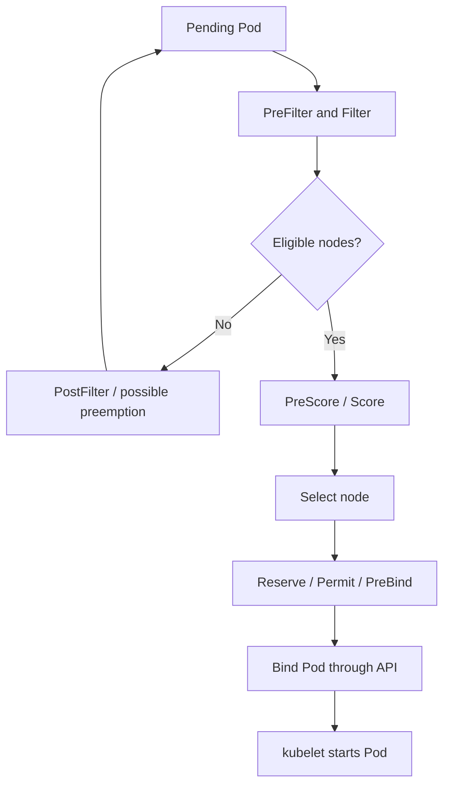

# Scheduler: filtering, scoring, topology and preemption

> **Interviewer:** All ten nodes are under 40% live CPU usage, yet my Pod is Pending. Explain the scheduler framework and why “the node is idle” doesn't mean the Pod can schedule.

The Kubernetes scheduler handles Pods that need node assignments. It chooses a **feasible** node according to declared constraints, scores feasible nodes and binds the Pod. It doesn't run the container, and the default scheduler does not schedule based purely on instantaneous live CPU utilization.



### Scheduler framework and extension points

Simplified path: queue → PreFilter → Filter → PostFilter on failure (including possible preemption) → PreScore/Score → choose candidate → Reserve → Permit → PreBind → Bind → PostBind. Plugins can affect each stage. **Filter** excludes nodes that violate hard constraints; **Score** expresses preferences among feasible nodes; **Bind** records the assignment. Custom scheduler profiles can differ from defaults.

### Requests and node allocatable

Scheduling uses **Pod resource requests** versus the node's **allocatable** resources, accounting for system reservations and workload allocations. A node may have low measured CPU but no allocatable capacity left *according to requests*. Other hard constraints can still make the Pod infeasible even when enough CPU is available.

```bash
kubectl describe pod POD -n marketplace
kubectl describe node NODE
kubectl get nodes -o wide --show-labels
kubectl get priorityclass
kubectl get pvc -A
```

Look at `FailedScheduling` events. Reasons may include `Insufficient cpu`, untolerated taints, node affinity, a topology-spread constraint, a host-port conflict or volume node-affinity conflict.

### Taints, tolerations and node affinity

A taint discourages or blocks Pods lacking a matching toleration. A toleration **permits** placement; it doesn't **attract** a Pod. Use node affinity/selectors to require or prefer a particular node group.

```bash
kubectl taint nodes gpu-node-1 dedicated=gpu:NoSchedule
```

```yaml
spec:
  tolerations:
    - key: dedicated
      operator: Equal
      value: gpu
      effect: NoSchedule
  affinity:
    nodeAffinity:
      requiredDuringSchedulingIgnoredDuringExecution:
        nodeSelectorTerms:
          - matchExpressions:
              - key: workload-class
                operator: In
                values: [gpu]
```

Taint effects: `NoSchedule` blocks new scheduling without tolerance, `PreferNoSchedule` is a preference, and `NoExecute` can evict running Pods after applicable toleration semantics.

### Pod anti-affinity versus topology spread

Anti-affinity can prevent colocation of matching Pods. Topology-spread constraints express a maximum allowed skew across domains such as zones or hosts.

```yaml
topologySpreadConstraints:
  - maxSkew: 1
    topologyKey: topology.kubernetes.io/zone
    whenUnsatisfiable: DoNotSchedule
    labelSelector:
      matchLabels:
        app: bidding-api
```

`DoNotSchedule` prioritizes placement guarantees and can block rollout during a zone capacity shortage. `ScheduleAnyway` allows more flexible scheduling while expressing a preference. Neither automatically guarantees equal *healthy* replicas across zones in all failure conditions. Test failure domains and capacity availability.

### Priority and preemption

PriorityClasses influence scheduling order and whether lower-priority Pods may be preempted to make capacity. But preemption cannot create a GPU, change a volume's zone or satisfy impossible affinity. PDBs are considered but do not provide an absolute protection against preemption. Don't assign everything highest priority; priority must reflect real service criticality.

### Production scenario: rollout Pending despite idle nodes

An API's Pods require zones A and B, but zonal storage is provisioned only in C. Scheduler events report volume affinity conflict. Adding generic nodes does nothing. Inspect PVC/PV `nodeAffinity`, Pod affinity and StorageClass `volumeBindingMode`, then correct the topology. **`WaitForFirstConsumer`** often helps avoid early placement of dynamically provisioned zonal volumes.

**Spoken answer:** “The scheduler filters against hard constraints, scores feasible nodes and records the binding. Requested resources matter more than live usage for placement. If a Pod remains Pending on an apparently idle cluster, I'd read the scheduler events and check allocatable-versus-requested CPU/memory, taints, node affinity, topology spread, volume topology and host-port constraints. I'd fix the true constraint before scaling nodes or removing safety rules.”