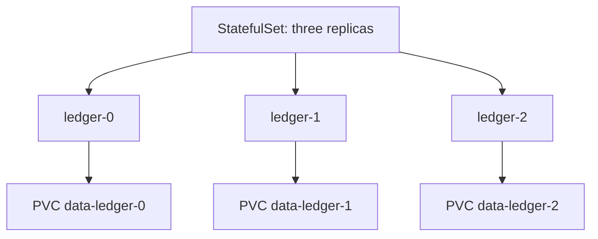

# Workload controllers and their real execution guarantees

> **Engineering focus:** Choose workload types for stateless APIs, a consensus database, node-level collectors, a one-off import and scheduled reconciliation. What guarantees do these controllers *not* provide?

| Controller | Use when | Do not assume |
|---|---|---|
| Deployment | Interchangeable, replicated long-running Pods | Zero failed requests merely because rollout is `Available` |
| ReplicaSet | Maintain a count of matching Pods (usually via Deployment) | Direct container launch or business health |
| StatefulSet | Stable ordinal identity and persistent-volume association | Database replication, consensus or consistency |
| DaemonSet | Run eligible node-level agents | Exactly one Pod on *every* node regardless of constraints |
| Job | Execute work to completion | Exactly-once business side effects |
| CronJob | Create Jobs on a schedule | Perfectly punctual, exactly-once runs |

### Deployments and rolling updates

A Deployment creates a new ReplicaSet when its Pod template changes. The controller increases new replicas and decreases old replicas according to strategy and observed readiness. Example: `replicas: 5`, `maxSurge: 2`, `maxUnavailable: 1` permits temporary extra Pods and some availability budget. Terminating Pods may still consume resources, so instantaneous object counts can exceed naive capacity estimates.

```yaml
strategy:
  type: RollingUpdate
  rollingUpdate:
    maxSurge: 2
    maxUnavailable: 0
```

`maxUnavailable: 0` is not zero-downtime magic: readiness can be misleading, service/backend registration can lag, and application versions can be incompatible with a new DB schema. `progressDeadlineSeconds` marks a stalled rollout; it does not by itself guarantee auto-rollback.

```bash
kubectl rollout status deploy/catalog-api -n marketplace
kubectl rollout history deploy/catalog-api -n marketplace
kubectl describe deploy catalog-api -n marketplace
kubectl rollout undo deploy/catalog-api -n marketplace  # Verify schema compatibility first
```

### StatefulSets and persistence



StatefulSet Pods have stable ordinals (`ledger-0`, `ledger-1`, `ledger-2`), identities and PVC associations. `volumeClaimTemplates` generally produce separate PVCs per ordinal. The default `OrderedReady` policy imposes ordered create/update/delete behavior; `Parallel` changes certain scaling behavior but doesn't remove stable identity. **StatefulSet does not perform consensus, election or database backup**: the database or operator still owns those guarantees.

```yaml
apiVersion: apps/v1
kind: StatefulSet
metadata: {name: ledger, namespace: marketplace}
spec:
  serviceName: ledger-headless
  replicas: 3
  selector:
    matchLabels: {app: ledger}
  template:
    metadata:
      labels: {app: ledger}
    spec:
      containers:
        - name: ledger
          image: registry.example.com/ledger:v1
          volumeMounts:
            - {name: data, mountPath: /var/lib/ledger}
  volumeClaimTemplates:
    - metadata: {name: data}
      spec:
        accessModes: [ReadWriteOnce]
        resources:
          requests: {storage: 20Gi}
```

A broken `OrderedReady` update may become stuck until a failed revision Pod is handled according to a documented recovery procedure. When a database is involved, protect quorum, single-writer safety and PVCs before deleting anything.

### DaemonSets

A DaemonSet targets eligible nodes for agents such as logging, CSI/CNI and security instrumentation. Node selection, taints/tolerations and OS requirements still apply. A defective privileged DaemonSet can impact an entire cluster, so use staged upgrades, tight resource allocation and permissions.

### Jobs, retry and idempotency

A Job manages execution toward completion. It can sometimes start the same program more than once even with `parallelism: 1` and `completions: 1`. For imports, migrations or reconciliation, protect business effects using idempotency keys, durable checkpoints, database unique constraints or transactional writes.

```yaml
apiVersion: batch/v1
kind: Job
metadata: {name: catalog-import, namespace: marketplace}
spec:
  completions: 1
  parallelism: 1
  backoffLimit: 3
  template:
    spec:
      restartPolicy: Never
      containers:
        - {name: importer, image: registry.example.com/importer:v1}
```

### CronJobs and concurrency policy

`Allow` permits overlaps; `Forbid` skips a new run while the previous associated Job is active; `Replace` replaces the previous active Job. None acts as a global distributed lock across clusters or systems. Time zones and missed-job policies deserve explicit consideration.

```yaml
apiVersion: batch/v1
kind: CronJob
metadata: {name: reconciliation, namespace: marketplace}
spec:
  schedule: "0 2 * * *"
  timeZone: Etc/UTC
  concurrencyPolicy: Forbid
  startingDeadlineSeconds: 1800
  jobTemplate:
    spec:
      template:
        spec:
          restartPolicy: Never
          containers:
            - {name: reconcile, image: registry.example.com/reconcile:v1}
```

**Key takeaways:** I pick workload controllers by lifecycle semantics. Deployments manage interchangeable replicas, StatefulSets stable identities and storage, DaemonSets node-scoped agents, Jobs completion work and CronJobs schedules. I avoid asserting guarantees those controllers don't provide: a Job isn't an exactly-once transaction, a StatefulSet isn't database consensus, and a Deployment `Available` condition isn't end-to-end service correctness. I build retries and stateful consistency into the application/system design.