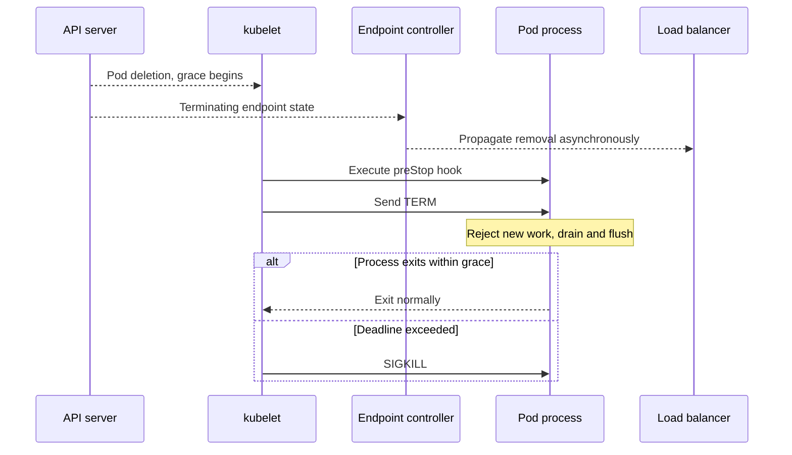

# Probes, graceful Pod termination, readiness gates and PDBs

> **Interviewer:** How do startup, readiness and liveness probes differ? Trace Pod deletion and explain exactly why a `PodDisruptionBudget` cannot guarantee zero service interruption.

### Probes have different recovery semantics

| Probe | What it asks | Consequence of sustained failure |
|---|---|---|
| Startup | Has this application initialized yet? | Container can be restarted after failure threshold; other probes suppressed until it succeeds |
| Liveness | Is this container locally stuck and requiring restart? | Kubelet restarts container |
| Readiness | Can this Pod accept normal traffic now? | Pod readiness becomes false and eligible Service endpoints change asynchronously |

```yaml
startupProbe:
  httpGet: {path: /startup, port: 8080}
  periodSeconds: 5
  failureThreshold: 24
livenessProbe:
  httpGet: {path: /live, port: 8080}
  periodSeconds: 10
  timeoutSeconds: 2
  failureThreshold: 3
readinessProbe:
  httpGet: {path: /ready, port: 8080}
  periodSeconds: 5
  timeoutSeconds: 2
  failureThreshold: 2
```

**Anti-pattern:** Liveness calls a shared database. When the DB briefly fails, *every* app Pod restarts, causing a reconnection storm. Liveness should check whether the local process can recover; readiness and dedicated dependency SLIs are better suited to traffic eligibility/dependency visibility. A readiness test that fails for every Pod on one shared dependency can itself remove all backends, so design health semantics carefully.

### Pod termination,parallel events, not a serial transaction



Normal deletion marks the Pod with a deletion timestamp and grace period. Endpoint/service controllers can update routing while kubelet begins termination. If configured, **`preStop` executes before the normal stop signal** and consumes part of the grace window. The runtime sends SIGTERM or configured stop signal; remaining processes may receive SIGKILL after the deadline. The proxy may temporarily have stale endpoint membership because propagation is asynchronous.

```yaml
terminationGracePeriodSeconds: 90
containers:
  - name: api
    image: registry.example.com/bidding-api:v1
    lifecycle:
      preStop:
        exec:
          command:
            - /bin/sh
            - -c
            - |
              wget -qO- http://127.0.0.1:8080/drain
              sleep 15
```

This is **illustrative**: `/drain` must exist and implement real drain behavior; image must contain the required shell/tools; 15 seconds is not a universal propagation guarantee. App logic should stop accepting new work, finish or explicitly cancel/hand off in-flight work, and exit inside its deadline.

### Readiness gates and cloud load balancers

`Ready=True` can depend on container readiness **and** additional readiness-gate conditions. When cloud L7 balancers address pod endpoints (e.g. via NEGs), provider-specific readiness gates can coordinate backend health. Local probe success alone doesn't prove the cloud LB sees a usable backend. Check both Kubernetes and cloud endpoint health on failed deployments.

### PodDisruptionBudget limitations

```yaml
apiVersion: policy/v1
kind: PodDisruptionBudget
metadata:
  name: bidding-api
  namespace: marketplace
spec:
  minAvailable: 4
  selector:
    matchLabels: {app: bidding-api}
```

PDBs primarily govern **voluntary evictions via the Eviction API**, such as controlled node drains. They cannot prevent unexpected node death, all forms of direct deletion, application crashes, or enforce Deployment rollout's own `maxUnavailable`. PDBs contribute to maintenance policy, but need enough replicas, multi-zone distribution, surge capacity, graceful shutdown and client retry/reconnect behavior.

### Production scenario: rollout causes short 502 bursts

Correlate Pod deletion time, SIGTERM, endpoint readiness/removal, ingress/cloud backend health and proxy error logs. Common failure: old Pod exits before load balancer target deregistration propagates; or new Pod is locally Ready before cloud health converges. Make the drain window and propagation observable, coordinate application and LB timeouts, and run rollouts under realistic live traffic.

```bash
kubectl describe pod POD -n marketplace
kubectl get pod POD -n marketplace -o jsonpath='{.status.conditions}'
kubectl get pdb -n marketplace
kubectl describe pdb bidding-api -n marketplace
kubectl rollout status deploy/bidding-api -n marketplace
kubectl get endpointslices -n marketplace
```

**Spoken answer:** “Startup, liveness and readiness serve separate purposes; misusing them can amplify an outage. Deletion starts asynchronous endpoint updates and kubelet shutdown, so preStop, SIGTERM and cloud deregistration must be coordinated rather than assumed atomic. A PDB governs eligible voluntary evictions, not every disruption. Safe rollouts combine realistic readiness, drain logic, zone headroom and end-to-end verification.”