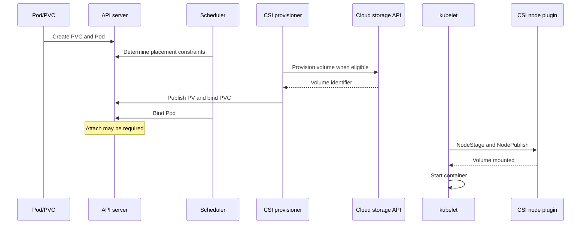

# Storage: PV, PVC, StorageClass, CSI, topology and snapshots

> **Interviewer:** A PVC is Bound but the Pod is stuck in `ContainerCreating` with `FailedMount`. Explain dynamic provisioning and which controller/node operation could still have failed. Would you force-detach the disk?

### Abstractions and responsibilities

| Object | Responsibility |
|---|---|
| `PersistentVolumeClaim` | Application request for storage size, access mode, class |
| `PersistentVolume` | Cluster storage resource, binding and source information |
| `StorageClass` | Provisioner, parameters, volume binding, expansion and reclaim behavior |
| CSI driver | Implements supported create, attach, stage, publish and snapshot operations |
| `VolumeAttachment` | API representation of a controller-side attachment where relevant |
| `VolumeSnapshot*` CRDs | CSI snapshot request/content/class through installed snapshot components |



### Dynamic provisioning sequence

A PVC is created. Under `Immediate` binding, provisioning may happen before Pod scheduling. Under **`WaitForFirstConsumer`**, scheduling constraints help pick a suitable storage topology first. The external CSI provisioner and controller driver create backing storage and complete PV/PVC binding; scheduler assigns the Pod when feasible; CSI controller attachment (if supported/needed) and CSI node staging/publishing make the volume available within the Pod.

**Bound is not Mounted.** The PVC can be Bound but attachment or node mount still fail, or the Pod can be scheduled into an incompatible zone if topology constraints aren't satisfied.

```yaml
apiVersion: storage.k8s.io/v1
kind: StorageClass
metadata: {name: production-block}
provisioner: pd.csi.storage.gke.io    # Example driver; requires installation/support
volumeBindingMode: WaitForFirstConsumer
reclaimPolicy: Retain
allowVolumeExpansion: true
parameters:
  type: pd-balanced
---
apiVersion: v1
kind: PersistentVolumeClaim
metadata: {name: ledger-data, namespace: marketplace}
spec:
  accessModes: [ReadWriteOnce]
  storageClassName: production-block
  resources:
    requests: {storage: 100Gi}
```

### Access modes and write ownership

- **RWO (ReadWriteOnce):** Typically one node may mount read-write; multiple Pods on that node might share access in some configurations. Not equivalent to single-Pod exclusivity.
- **RWOP (ReadWriteOncePod):** More explicit one-Pod access with supporting CSI version/driver.
- **ROX:** Read-only many nodes where supported.
- **RWX:** Read-write many nodes where supported by the storage system.

Neither RWO nor RWOP implements database transactions, fencing, or split-brain avoidance. A StatefulSet adds stable identity but doesn't guarantee a former leader cannot still write to a disk.

### Reclaim and deletion

A `Delete` reclaim policy can remove underlying storage after PVC/PV lifecycle events. `Retain` preserves it for deliberate recovery/reuse; it is **not a backup**. For important data, coordinate reclaim policies, snapshots, application backups, key retention and restore rehearsals.

### CSI volumes and failure phases

- Provision: external controller creates the volume.
- Bind: the PV is associated with the PVC.
- Attach (when needed): cloud block device attached to a suitable node.
- NodeStage: volume prepared on node.
- NodePublish: mount/bind into Pod-visible path.
- Expansion/snapshot: capability-dependent operations.

`FailedAttachVolume` and `FailedMount` point to different stages. Multi-attach may occur if a former node still holds the disk while a replacement Pod starts elsewhere. **Never force-detach a disk with a potentially live database writer unless fencing/single-writer safety has been established.**

### Snapshot consistency

A CSI snapshot may be storage crash-consistent, but isn't automatically application-consistent. A database may need quiescing, checkpoints, WAL processing or a database-aware backup. Validate cross-zone/region restoration, encryption/key availability, actual recovery time, and restored application correctness.

```bash
kubectl get pvc -A
kubectl get pv
kubectl get storageclass
kubectl get volumeattachments
kubectl describe pvc ledger-data -n marketplace
kubectl describe pod ledger-0 -n marketplace
kubectl get events -n marketplace --sort-by=.lastTimestamp
```

### Production scenario: ledger Pod Pending due to disk zone

Pod affinity permits zones B/C while its existing PV is fixed to A. Scheduler correctly refuses placement. The solution is to correct placement or perform a planned data/storage migration,not to modify the PV's topology label blindly or detach a live volume without safety checks. Future dynamic provisioning may use `WaitForFirstConsumer` to account for zone scheduling.

**Spoken answer:** “PVC is the storage request, StorageClass determines provisioning behavior, PV represents storage, and CSI manages the driver lifecycle. I'd distinguish binding from controller attachment and node mount, then inspect events, volume topology, CSI logs and the cloud disk. For stateful applications, I prioritize data integrity and single-writer fencing over a fast force-detach, and I verify that backups can actually restore applications.”