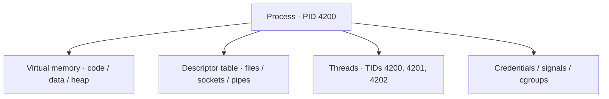
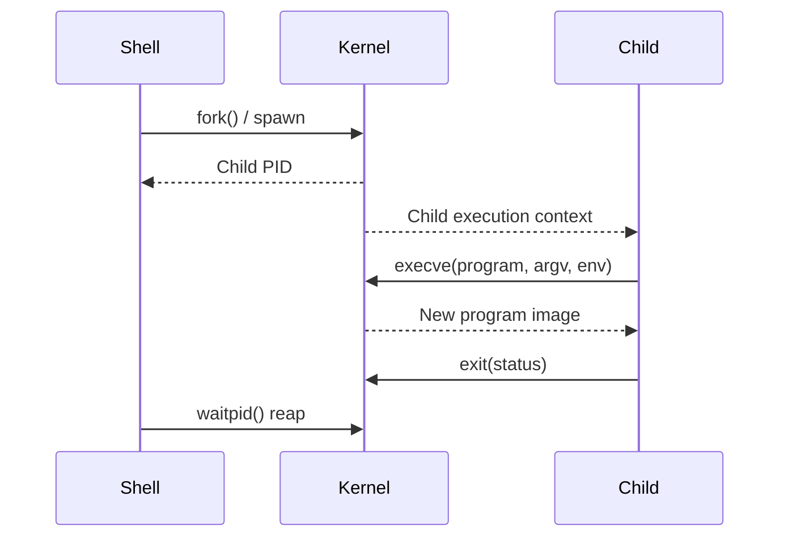
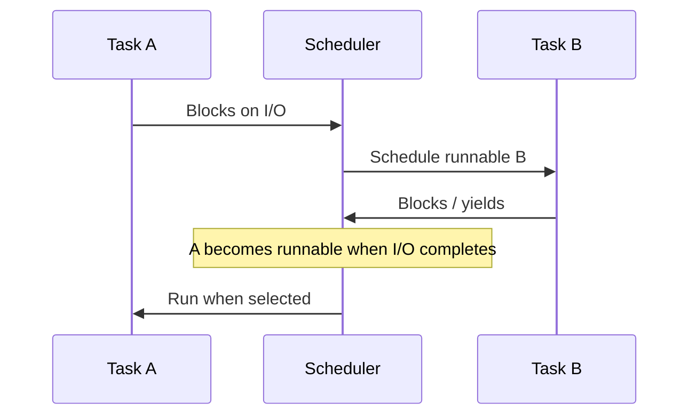

# Processes, Threads, Signals & Scheduling

> **Engineering focus:** What happens internally when a Linux command starts? Explain processes and threads, `fork()` and `execve()`, process states, scheduling, context switching, signals, and how you would diagnose an application that remains alive but stops responding.

## 1.1 Process: what the kernel actually manages

A **process** is a running program with an execution context and access to resources. A Linux process has a PID, credentials, address space, file-descriptor table, signal dispositions, scheduling attributes, namespace membership, cgroup membership, and one or more schedulable threads. The executable on disk is **not** the process: it is a program image that a process may execute.

A Linux **task** is the schedulable unit represented by a kernel `task_struct`. Threads within a process ordinarily share its address space and file-descriptor table, while retaining their own register context, execution stack, scheduling state and thread ID. This is why a multi-threaded process may be alive even when its request-handling threads cannot make progress.


**Process anatomy**




## 1.2 Running a program: fork, exec and exit

When a shell launches `python3 worker.py`, the classic Unix sequence is **create a child → replace its program image → run → exit and reap**. A shell may use `fork`, `vfork`, `posix_spawn`, or optimized mechanisms depending on the runtime and use case, so this is the conceptual sequence, not a promise about one implementation.


**Typical launch and lifecycle**




**`fork()`** creates a child process that inherits a snapshot of relevant parent state. Linux uses **copy-on-write** for many private memory mappings, so it doesn't immediately duplicate every physical memory page. Page-table work and process bookkeeping still cost time. A subsequent write to a protected shared private page can trigger a copy-on-write fault and allocate a new physical page.

**`execve()`** replaces the calling process's executable image, initializes its new stack and relevant program mappings, and starts the new program. It **does not normally allocate a new PID**. File descriptors remain open across exec unless configured with `FD_CLOEXEC` or affected by other documented behavior.

**`exit()` and `wait()`**: after exit, the kernel retains exit-status metadata for the parent/reaper. Until reaped, the task is a **zombie**. An **orphan** is different: it is a child whose original parent exited; it may still be running and is reparented to a suitable reaper.

## 1.3 Process states

| State | Meaning | What to investigate |
|---|---|---|
| `R` | Running or runnable | CPU availability, scheduler delay, quota, affinity |
| `S` | Interruptible sleep | Usually ordinary waiting; inspect wait site when persistent |
| `D` | Uninterruptible sleep | Potential block/storage/filesystem waits; don't infer disk failure without evidence |
| `T` | Stopped by job control | `SIGSTOP`, terminal job control |
| `t` | Stopped for tracing | Debugger / ptrace |
| `Z` | Zombie | Parent not reaping child status |
| `I` | Idle kernel thread | Kernel-thread state on supported versions |

```bash
ps -eo pid,ppid,stat,comm,wchan:32 --sort=pid
ps -p 4200 -o pid,ppid,stat,%cpu,%mem,cmd
ps -L -p 4200 -o pid,tid,stat,pcpu,wchan:32
top -H -p 4200
```

A persistent `D` state can resist prompt termination even after SIGKILL because the task is waiting within certain kernel operations. Use `wchan`, kernel logs and subsystem metrics; don't assume SIGKILL is guaranteed to clear it instantaneously.

## 1.4 Processes versus threads

| Processes | Threads |
|---|---|
| Ordinarily have distinct virtual address spaces | Usually share the process's address space |
| Many data exchanges require IPC | Can share in-process structures directly |
| Provide stronger accidental memory isolation | Require concurrency and synchronization discipline |
| Have independent process-level context | Have their own scheduling and execution state |

Consider a server with one listener thread and eight workers. A TCP probe might succeed because the listener still accepts connections, while all workers are blocked on a lock or database. **Process exists** is not equivalent to **request handler is progressing**.

## 1.5 Context switches and scheduling

A context switch occurs when the kernel schedules another task. It preserves/restores execution state and may incur cache/TLB costs. Common triggers are blocking on I/O, a wake-up of higher-priority work, preemption, yielding, or changes in scheduling policy.

**Voluntary switches** often occur when a task blocks or yields; **involuntary switches** can occur when the scheduler preempts a task. High switch counts can be normal for I/O-heavy services. Correlate them with throughput, runqueue delay, `futex` waits and latency before treating them as a problem.

```bash
pidstat -w -p 4200 1
grep ctxt /proc/4200/status
chrt -p 4200
ps -eo pid,cls,rtprio,ni,pri,comm
taskset -pc 4200
```

Linux supports normal fair scheduling, batch and idle classes, and policies such as `SCHED_FIFO`, `SCHED_RR` and `SCHED_DEADLINE`. Historical **CFS** discussions use `vruntime` to describe fairness; Linux 6.6 introduced **EEVDF** for fair scheduling, using eligibility and virtual deadlines. Do not describe all current Linux kernels as necessarily running the original CFS pick-next algorithm. `nice` affects relative scheduling weight; it is not a fixed CPU percentage.


**CPU is assigned to a runnable task, not necessarily a process that exists**




## 1.6 Signals and container termination

| Signal | Operational meaning |
|---|---|
| `SIGTERM` | Termination request; application can handle it |
| `SIGINT` | Interrupt, often Ctrl+C |
| `SIGKILL` | Uncatchable forced termination |
| `SIGSTOP` / `SIGCONT` | Force stop / continue |
| `SIGHUP` | Hangup; many daemons implement reload semantics |
| `SIGCHLD` | Child-state notification |
| `SIGSEGV` | Invalid memory access |
| `SIGPIPE` | Writing to a broken pipe under relevant conditions |

A container's main process must handle shutdown and child reaping appropriately. During ordinary Kubernetes termination, lifecycle hooks may run, then a stop signal is sent; forced termination follows if the grace window expires. An init helper such as `tini` can help forward signals and reap descendants when required.

```bash
kill -TERM 4200
# Last resort only: kill -KILL 4200
```

## 1.7 Production scenario: alive but unresponsive

**Symptoms:** PID exists, CPU is ~2%, listening port is open, simple health probe responds, but real requests time out.

**Investigation:** Inspect per-thread state, then correlate application request traces, worker queues and downstream calls. Use `strace` only with authorization and awareness of production overhead and sensitive syscall arguments.

```bash
ps -L -p 4200 -o pid,tid,stat,pcpu,wchan:32
sudo strace -f -ttT -p 4200
```

Repeated `futex()` waits may suggest synchronization contention, but are not proof of deadlock. Long `connect()`/`read()` calls may point to a downstream wait. An event loop in `epoll_wait()` may simply be idle. Establish **who owns the blocked work and why it doesn't complete** before restarting the service.

<div class="answer"><strong>Key takeaways</strong><p>Linux executes programs using process and thread contexts managed by the kernel. A typical shell starts a child and calls exec to load the target program. Threads within a process share much of its state but are scheduled independently. When a service is hung, First, distinguish runnable work waiting for CPU, workers blocked on I/O, and threads waiting on synchronization. Inspect task states, runqueue and resource pressure, application thread dumps and dependency latency, then make the smallest safe mitigation.</p></div>