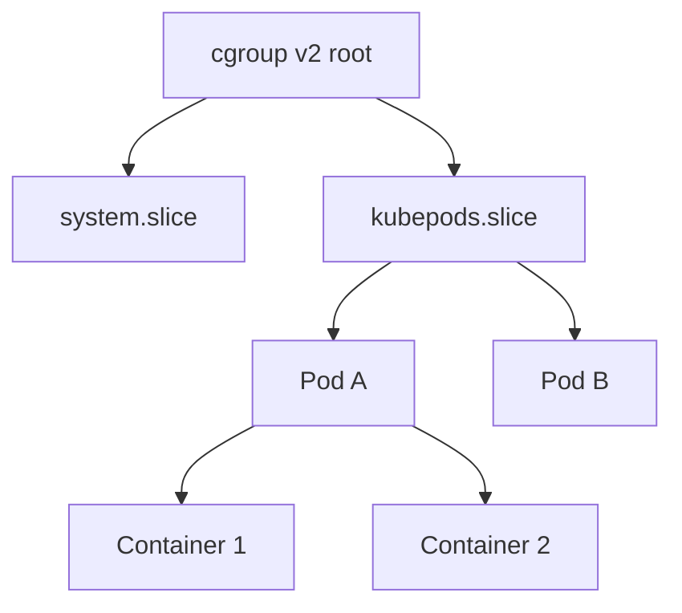
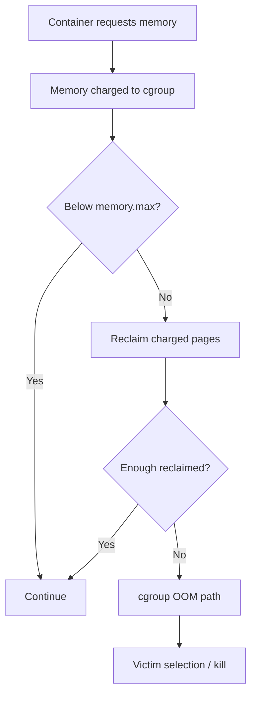

# Q3 · OOM Killer, Cgroups v2 & Container Memory

> **Interviewer:** A container with a 1 GiB memory limit is OOMKilled even though its Linux node has 20 GiB of available RAM. Why? Explain cgroups, local versus global OOM, OOM victim selection, QoS, and your investigation.

## 3.1 Namespaces versus cgroups

Linux **namespaces** isolate a process's *view* of system resources: network, PID, mount, user, IPC and other namespaces. Linux **control groups (cgroups)** measure and control resource usage. Containers commonly combine both.

Cgroups v2 provide a unified hierarchy. Resource constraints are hierarchical; child groups are subject to effective parent limits. Kubernetes and container runtimes place pods/containers into suitable cgroups, with exact hierarchy paths varying by runtime, QoS and systemd setup.


**Illustrative cgroup hierarchy**




## 3.2 The memory controller's essential files

| cgroup v2 file | Purpose |
|---|---|
| `memory.current` | Accounted current memory use |
| `memory.max` | Hard memory ceiling |
| `memory.high` | Reclaim/throttling threshold |
| `memory.low` | Best-effort memory protection |
| `memory.min` | Harder memory protection within hierarchy constraints |
| `memory.events` | High/max/OOM event counters |
| `memory.events.local` | Locally generated events |
| `memory.stat` | Anonymous, file, kernel and other categories |
| `memory.swap.current` / `.max` | Swap usage and cap |
| `memory.pressure` | cgroup-specific memory PSI |
| `memory.oom.group` | Controls applicable group OOM kill behavior |

**Important:** crossing `memory.high` can force reclaim and slow allocations without itself directly invoking an OOM kill. When a charge exceeds `memory.max` and reclaim cannot free enough memory, a cgroup OOM can occur.

## 3.3 Why a local OOM doesn't require global memory exhaustion


**Host capacity and container memory ceilings are separate**




The local cgroup is still constrained even though the host has abundant available RAM. A **global OOM** instead concerns the wider system being unable to satisfy memory requirements. The type of OOM changes both root cause and remedy.

## 3.4 OOM victim selection and scores

Linux considers eligible tasks using OOM badness scoring and adjustments, not simply "largest process dies". Inspect:

```bash
cat /proc/4200/oom_score
cat /proc/4200/oom_score_adj
```

`oom_score_adj` shifts the task's vulnerability; `-1000` provides strong protection from OOM victim selection. Do not rely on the score as a substitute for capacity control. The chosen victim depends on OOM scope and kernel conditions.

## 3.5 Kubernetes QoS versus memory hard limits

| QoS class | General pattern | Crucial caveat |
|---|---|---|
| Guaranteed | Requests and limits equal for CPU and memory on all qualifying containers | Can still exceed its memory limit and be OOMKilled |
| Burstable | Qualifying resource configuration but not Guaranteed | Can be evicted under pressure or OOM at a hard limit |
| BestEffort | Neither CPU nor memory requests/limits | More exposed to node pressure; not a hard promise of failure |

QoS influences scheduling, eviction and relevant OOM adjustments; it does **not** replace actual cgroup accounting. A container exit code `137` typically indicates SIGKILL, but **does not alone prove OOM**; verify the actual termination reason and OOM events.

## 3.6 Investigation workflow

1. Confirm `OOMKilled` in `kubectl describe pod` and inspect the termination timestamp, last state and container ID.
2. Review resource requests/limits and node-level memory pressure.
3. Inspect cgroup `memory.current`, `memory.max`, `memory.events` and `memory.stat` while the affected instance exists. After restart, some prior cgroup state may no longer be available; rely on metrics/history and node logs.
4. Check kernel journal for OOM records and distinguish cgroup OOM from system-wide OOM.
5. Break down the application footprint: heap, direct memory, native allocations, stacks, file cache and socket buffers.
6. Correlate with deployment, request concurrency, payload sizes, worker counts and traffic bursts.

```bash
kubectl describe pod api-abc -n production
kubectl get pod api-abc -n production -o yaml
cat /sys/fs/cgroup/memory.current
cat /sys/fs/cgroup/memory.max
cat /sys/fs/cgroup/memory.events
cat /sys/fs/cgroup/memory.stat
journalctl -k --since '30 minutes ago'
```

Paths visible inside a container depend on the cgroup namespace/runtime, and some production clusters restrict node access.

## 3.7 Leak versus stable working set

A memory leak means resources remain allocated/referenced after they should no longer be needed. A managed runtime may keep arenas reserved for reuse even after objects are reclaimed. Don't assume every high RSS plateau is a leak.

Compare repeated equivalent traffic cycles:

```text
Stable/reusable: idle RSS 450 → 455 → 452 MiB
Suspicious:      idle RSS 450 → 620 → 800 → 980 MiB
```

Then use language-runtime heap and native allocation diagnostics to establish retained objects or allocation sites. Growing memory under increasing concurrency is not by itself evidence of a leak.

## 3.8 Production response

A temporary memory-limit increase may restore availability if node headroom and tenancy policy permit it. But it is mitigation, not proof that the application is correct. Alternative causes include accidental large buffering, unbounded queues, file cache charges, direct-buffer leaks and thread accumulation. Prevent recurrence using realistic load tests, memory usage decomposition, high/max event alerts, request-size limits and bounded queues.

<div class="answer"><strong>Spoken senior-level answer</strong><p>“A container's memory cgroup enforces its limit independently from the host's available RAM. If `memory.max` is reached and reclaim cannot recover sufficient charged memory, the kernel can invoke a local OOM. I'd confirm the actual termination reason, inspect memory controller events and node logs, and distinguish heap, off-heap, cache and kernel charges. Increasing the limit can be an emergency mitigation, but I would prove whether this is a legitimate working set, traffic-driven spike or retention bug before calling it fixed.”</p></div>