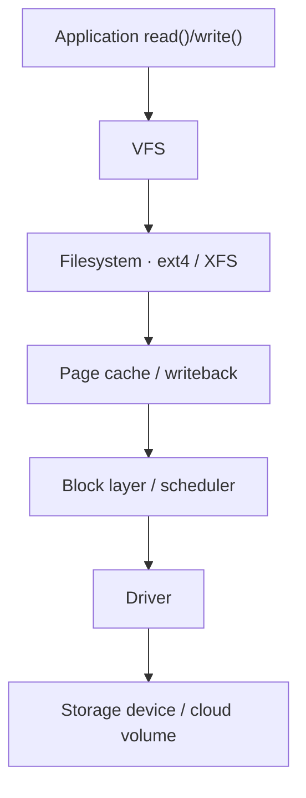
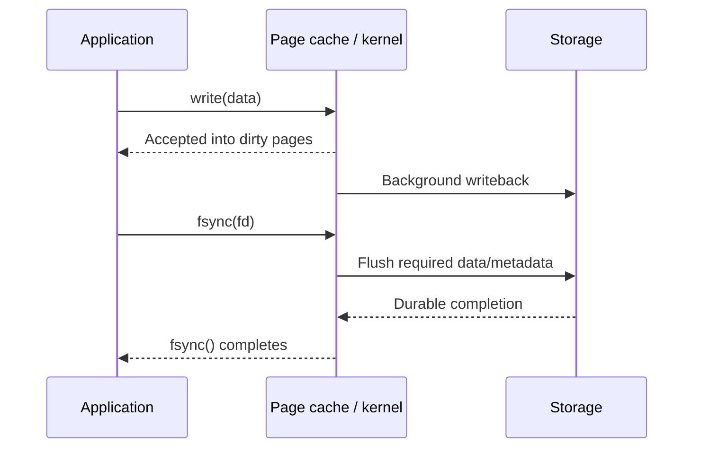

# Disk I/O, Filesystems & Durability

> **Engineering focus:** What happens when an application reads or writes a Linux file? Explain VFS, page cache, filesystem, block layer, `write()` versus `fsync()`, journaling, IOPS, latency and a slow-storage incident.

## 5.1 The layered Linux I/O path


**Typical buffered filesystem I/O**




**VFS** exposes common filesystem operations (`open`, `read`, `write`, `stat`, `rename`, `unlink`). **Filesystems** manage metadata and data extent/block mappings. The **page cache** accelerates buffered access. The **block layer** submits I/O to devices or virtual block storage. Direct I/O, memory-mapped I/O and network filesystems vary from this simplified path.

## 5.2 A read: cache hit versus cache miss

On a page-cache hit, the kernel satisfies the read without a fresh device read. On a miss, the filesystem locates the required data, the kernel requests storage I/O, fills the page cache and returns data. Sequential access often benefits from readahead; random database-style access can be IOPS/latency sensitive.

**Major page faults** can occur for demand-paged file mappings when data must be fetched. An ordinary `read()` cache miss is a storage read but does not have to appear as a process major page fault in the same manner as memory-mapped access.

## 5.3 A write is not the same as durable persistence

In normal buffered I/O, a successful `write()` may mean data has been copied into dirty page-cache pages, not permanently stored. Writeback may happen later. `fsync(fd)` asks the kernel to synchronize required file data and metadata; `fdatasync` has slightly different metadata requirements. The actual durability guarantee depends on storage, filesystem and application/database semantics.


**Buffered write lifecycle**




For crash-safe creation or rename of a new file, syncing the file alone does not necessarily ensure the directory entry is durable; syncing the parent directory may be required on relevant filesystems. A journaled filesystem improves filesystem crash recovery but does not automatically guarantee application transaction durability.

**Marketplace-style correctness:** A transactional service must not treat a buffered `write()` return as a complete durable business transaction. Define the commit, write-ahead logging, replication and acknowledgment policy explicitly.

## 5.4 Journal modes, inodes and capacity

Ext4 supports journaling modes including `data=ordered`, `data=writeback` and `data=journal`. They differ in what is journaled or ordered relative to metadata; none is a universal substitute for correct application sync/transaction design.

An **inode** stores filesystem object metadata such as owner, permissions, size, timestamps and data mapping information. Directory entries map names to objects. A filesystem can reject writes with apparent free data blocks because of quotas, read-only remount, inode exhaustion (on applicable filesystems), size limits or errors.

```bash
df -h
df -i
findmnt
lsblk -f
stat /var/log
```

## 5.5 Throughput, IOPS, latency and queue depth

- **Throughput**: bytes transferred per second, often relevant for large sequential scans.
- **IOPS**: operations completed per second, often relevant for small random accesses.
- **Latency**: time each I/O spends queued and in service, crucial for synchronous requests.
- **Queue depth**: outstanding operations; grows when work arrives faster than it completes.

Little's Law, under stable conditions: `average outstanding work = arrival rate × average time in system`. Increasing latency can increase outstanding work even if throughput stays similar.

```bash
iostat -xz 1
pidstat -d 1
cat /proc/pressure/io
cat /proc/diskstats
```

Key `iostat -xz` fields: `r/s`, `w/s`, `rkB/s`, `wkB/s`, `r_await`, `w_await`, `aqu-sz`, `%util`. **`%util=100` does not universally mean a parallel NVMe or virtual block device is at its maximum IOPS**; correlate with latency, queues and provider limits.

## 5.6 Buffered, direct and asynchronous I/O

Buffered I/O uses the page cache. `O_DIRECT` changes caching behavior under filesystem/device alignment constraints and may help applications with their own caching (e.g. some database engines) but isn't universally faster. Linux supports nonblocking I/O for suitable descriptors, thread-based async patterns, Linux AIO for supported operations, and `io_uring` for asynchronous submission/completion. The right design depends on access pattern and load.

## 5.7 Why `df` and `du` can disagree

A process can keep a file open after it has been unlinked. The directory entry disappears, but its blocks remain allocated until final references are released. This often appears after deleting an actively written log file.

```bash
sudo lsof +L1
```

Investigate owner/process and choose controlled log rotation or restart. Blindly truncating an open file through `/proc/PID/fd/` can have harmful application-specific effects.

## 5.8 Production scenario: high load, low CPU, slow disks

Hypothetical evidence:

```text
CPU utilization: 25%       MemoryAvailable: 12 GiB
Load average: 38           D-state tasks: 25
Write await: 150 ms        I/O PSI: high
Application p99: 6 seconds
```

This points to a possible I/O bottleneck; it isn't proven until you identify the device, operations and dependent service path. Check process I/O, per-device latency, filesystem errors, background workload bursts, quotas and cloud disk throughput/IOPS limitations. Mitigations may include reducing competing I/O, safely batching writes, adjusting provisioned storage or isolating volumes. Do **not** disable required durability for a latency win without explicit acceptance of data-loss risk.

<div class="answer"><strong>Key takeaways</strong><p>Trace the operation from the syscall into VFS, filesystem/page cache and the block layer. A buffered write may return before storage durability; fsync and transaction semantics establish stronger guarantees. When CPU is idle but requests stall, inspect blocked tasks, I/O PSI, device await/queue depth, and which process produces I/O. Identify the storage boundary first, then mitigate without compromising the application's data durability.</p></div>