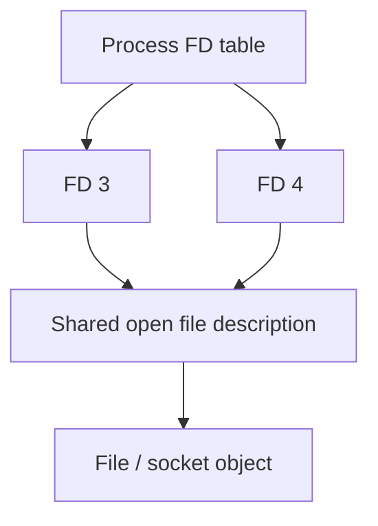
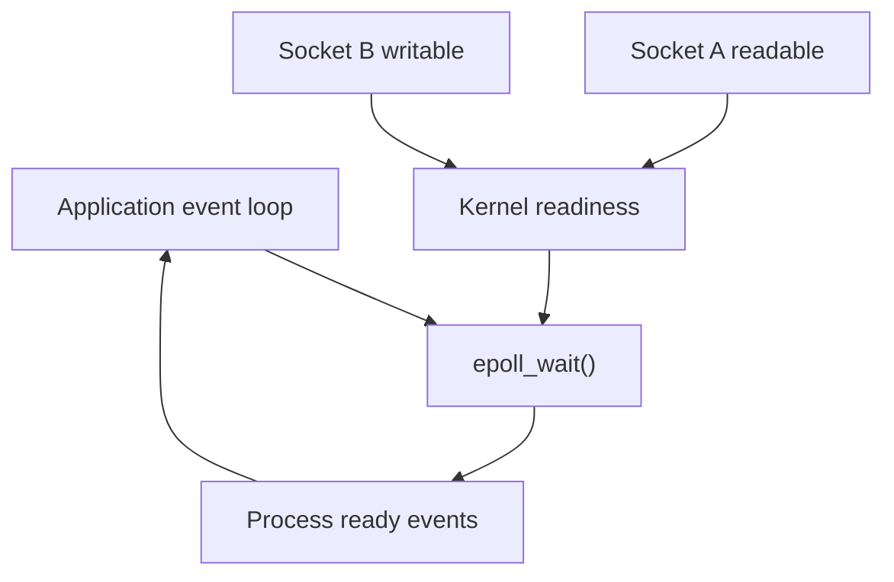

# File Descriptors, Sockets, epoll & Limits

> **Engineering focus:** A Linux API handles 20,000 connections, then starts failing with “Too many open files.” What is a file descriptor? How are sockets tracked, what limits apply, and how does epoll scale to many connections?

## 6.1 FD versus open file description

A **file descriptor** is a process-local small integer indexing an FD table. Its entry refers to a kernel **open file description**, which records relevant file status and offsets and references an object such as a file, socket or pipe.

Standard FDs: `0` stdin, `1` stdout, `2` stderr. Other FDs can represent TCP/UDP sockets, regular files, pipes, epoll instances, eventfd and timerfd.


**Two FDs can reference one open file description**




Duplicated descriptors may share the underlying open file description, including relevant file offsets and status flags. Closing one FD does not necessarily release the object while other references remain.

## 6.2 Process and system limits

**`RLIMIT_NOFILE`** has a soft currently enforced limit and a hard ceiling. A process can ordinarily raise its soft limit up to the hard limit without extra privilege. The effective limits of a running service may differ from an interactive shell, especially under systemd and containers.

```bash
ulimit -Sn
ulimit -Hn
cat /proc/4200/limits
cat /proc/sys/fs/file-max
cat /proc/sys/fs/file-nr
```

**`EMFILE`**: per-process descriptor allocation limit reached. **`ENFILE`**: system-wide file allocation limit reached. Raising process `nofile` cannot cure every other kernel or application resource exhaustion.

## 6.3 TCP sockets and descriptor cardinality

A server calls `socket`, `bind`, `listen`, then `accept`. Ordinarily, each accepted socket has its own FD. A server with 20,000 concurrent accepted connections needs approximately that many socket FDs, plus files, epoll/event descriptors and infrastructure FDs. A reverse proxy may have one frontend and a separate backend socket per tunnel; HTTP/2 pooling/multiplexing changes the arithmetic.

```bash
ss -s
ss -lntp
ss -tnp
ls /proc/4200/fd | wc -l
sudo lsof -p 4200 -nP
```

## 6.4 `select`, `poll`, `epoll`

- **`select()`** checks a set of descriptors and has traditional FD-set constraints.
- **`poll()`** accepts an array of descriptor/event requests; it avoids some select limitations but still processes the supplied set.
- **`epoll`** registers descriptors once and returns relevant readiness events, making it useful for many open sockets.


**Event-driven server**




**Level-triggered**: readiness continues to be reported while the condition remains true. **Edge-triggered**: events signal transitions; nonblocking handlers must drain reads/writes until `EAGAIN` to avoid missing work. An incorrect edge-triggered implementation can make an otherwise readable socket appear hung.

`epoll` reduces readiness-monitoring overhead, but doesn't solve application deadlocks, CPU saturation or unbounded per-connection state.

## 6.5 `ESTABLISHED`, `CLOSE_WAIT`, `TIME_WAIT`

`CLOSE_WAIT` means the peer sent FIN and the local side has not yet closed its end; persistent large counts can indicate application close-path defects. `TIME_WAIT` is normal TCP protocol state after certain close sequences. It does not inherently represent a live application FD, so **many TIME_WAIT entries ≠ automatically EMFILE**.

```bash
ss -tan state established
ss -tan state close-wait
ss -tan state time-wait
```

## 6.6 Other resource boundaries

| Limit | Failure or symptom |
|---|---|
| `RLIMIT_NOFILE` | `EMFILE` |
| System file table | `ENFILE` |
| cgroup `pids.max` | Thread/process creation failure |
| Ephemeral source-port range | New outbound connections cannot obtain usable tuples |
| Listen backlog | Accept/SYN queue pressure and connection failures |
| TCP buffers | Memory or throughput pressure |
| Conntrack table | New tracked flows fail or drop |
| cgroup memory | OOM or reclaim stalls |
| cgroup CPU quota | Throttling and tail latency |
| Application pool | Work queues despite healthy OS socket allocation |

```bash
cat /sys/fs/cgroup/pids.current
cat /sys/fs/cgroup/pids.max
cat /sys/fs/cgroup/pids.events
cat /proc/sys/net/ipv4/ip_local_port_range
```

## 6.7 Production scenario: FD ceiling reached

Hypothetical:

```text
FD soft limit: 16,384
Open FD count: ≈16,380
accept() errors: EMFILE
CPU: 28%    RAM: healthy
```

First identify which process emits `EMFILE`. Count and categorize its FDs; inspect sockets versus files, leak trends, per-connection memory, socket states and application close paths. A controlled increase in FD limits may provide headroom, but alone is not a root-cause fix if the number of open FDs rises without bound. Load test abnormal disconnects and reconnect storms, not only steady connections.

A common application error is failing to close sockets on exception paths. Prefer language constructs that guarantee closure (e.g. Python `with socket.create_connection(...) as sock`).

<div class="answer"><strong>Key takeaways</strong><p>A file descriptor is a process-local reference to a kernel object, including sockets. Every accepted connection ordinarily consumes a descriptor, and proxies may hold both client and upstream sockets. Confirm whether this is EMFILE or ENFILE, compare process limits with actual FDs, inspect socket states and close behavior, and distinguish a leak from legitimate concurrency. Provision measured headroom and fix lifecycle issues instead of only raising the limit.</p></div>