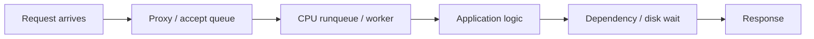
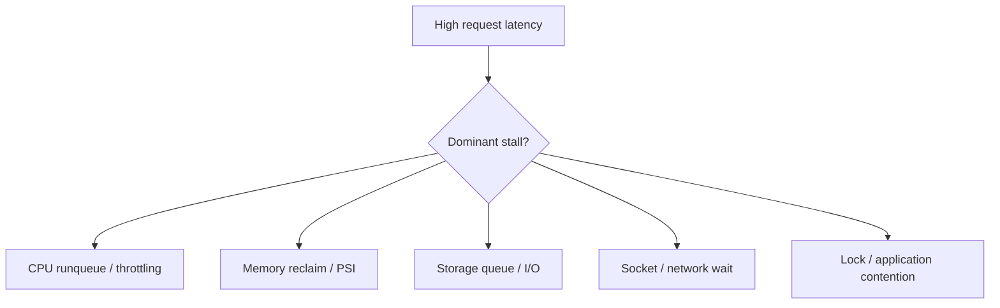

# Full Production Performance Investigation

> **Engineering focus:** A marketplace API's p99 rises from 80 ms to 4 s, but Kubernetes pods are Ready and CPU appears under 50%. You're on call. How do you determine the root cause, mitigate customer impact and prevent recurrence?

## 7.1 Start with the user operation, not your favorite tool

Identify the failing endpoint and customer journey. Is the operation slow, rejected, or **completed but the response lost**? Does a retry risk a duplicate business transaction? Determine scope by time, region, version, instance/zone and HTTP status owner. Correlate with recent releases and infrastructure changes.

Do not immediately restart DNS, containers or the database. Preserve evidence and define the failing boundary.


**Find where wall time is spent**




## 7.2 USE and RED: complementary frameworks

**USE** — Utilization, Saturation, Errors — for each resource (CPU, memory, disk, network, FD/socket pools). **RED** — request Rate, Errors, Duration — for the service/customer-facing SLI. RED tells you the failure's impact; USE helps locate a saturated resource.

| Resource | Utilization signal | Saturation / errors |
|---|---|---|
| CPU | Per-core/process utilization | Runnable delay, quota throttling, PSI |
| Memory | Anonymous/file/cache and available | Reclaim, faults, PSI, OOM |
| Storage | Throughput, IOPS | Await, queues, I/O PSI, EIO |
| Network | Throughput, connection count | Drops, retransmissions, backlog, resets |
| File descriptors | Open FDs | Near limit, EMFILE/ENFILE |
| Application | Busy workers | Queue time, lock waits, dependency timeouts |

## 7.3 Low-overhead first pass

```bash
uptime
free -h
vmstat 1 5
mpstat -P ALL 1 5
iostat -xz 1 5
ss -s
```

`mpstat`, `iostat` and `pidstat` commonly require the `sysstat` package. These commands give a coarse view; none independently proves root cause.

Inspect hot processes and the application process:

```bash
ps -eo pid,ppid,stat,%cpu,%mem,comm --sort=-%cpu | head
ps -eo pid,ppid,stat,rss,comm --sort=-rss | head
pidstat -u -r -d -w -p 4200 1
```

## 7.4 Branch by the observed stall


**Evidence-driven investigation tree**




**CPU**

```bash
top -H -p 4200
cat /proc/4200/sched
cat /sys/fs/cgroup/cpu.stat
cat /proc/pressure/cpu
```

**Memory**

```bash
cat /proc/4200/smaps_rollup
cat /sys/fs/cgroup/memory.stat
cat /sys/fs/cgroup/memory.events
cat /proc/pressure/memory
```

**Storage**

```bash
iostat -xz 1
pidstat -d -p 4200 1
cat /proc/pressure/io
```

**Sockets and threads**

```bash
ss -tnpi
ss -lntp
ps -L -p 4200 -o pid,tid,stat,pcpu,wchan:32
```

## 7.5 Profiling: on-CPU isn't the same as off-CPU

Use on-CPU profiling (e.g. `perf`) to identify where CPU execution time is spent; it may not explain an application whose workers are blocked on database sockets. Off-CPU tracing, thread dumps and request spans are more useful for lock, queue and I/O waits.

```bash
sudo perf record -F 99 -g -p 4200 -- sleep 30
sudo perf report
```

On production systems, check permission, sampling overhead, symbol access, stack unwinding, privacy and blast radius. `strace` and eBPF tools are hypotheses-driven follow-ups, not mandatory first commands. eBPF can reveal scheduler, block, TCP and syscall behavior, but it is not automatically zero overhead.

## 7.6 Four competing explanations

| Candidate | Evidence | Safe test |
|---|---|---|
| CPU quota throttling | `nr_throttled` delta grows with p99, node CPU has spare capacity | Canary with tested higher quota; watch neighbors |
| Memory reclaim | PSI, reclaim/high events, major faults grow | Decompose memory use; reduce working set or tune safely |
| Storage saturation | High `await`, queue depth, D-state tasks, I/O PSI | Isolate dominant device/process; reduce competing I/O |
| FD/socket exhaustion | EMFILE, FD count at soft limit, accept failures | Categorize FDs, check leak, controlled headroom |

Real incidents may involve more than one; memory pressure can cause extra I/O, and retry storms can amplify both CPU and connection use.

## 7.7 Managing the incident as a lead

1. **Scope and protect correctness.** Determine what users experience, whether operations may have completed without acknowledgment, and whether retries are safe.
2. **Delegate focused workstreams.** Split investigation across request traces, node/cgroup metrics, proxy/network path; keep one timeline.
3. **Form and test a hypothesis.** Prefer a narrowly scoped experiment, canary or comparison under equivalent load.
4. **Apply a reversible mitigation.** Targeted quota change, halt a competing batch job, reduce retries or roll back the affected release, depending on proof.
5. **Verify actual user outcome.** Recovery means error rate and p99 normalize, backlogs drain and business correctness is intact—not merely “pods are green.”
6. **Prevent recurrence.** Add saturation/PSI alerts, resource-sizing checks, realistic load tests, runbooks and safer deployment controls.

## 7.8 Hypothetical incident timeline

| Time | Finding/action |
|---|---|
| 20:45 | API p99 80 ms → 4,000 ms, errors rising; node CPU apparently modest |
| 20:48 | Failure isolated to traffic bursts and one deployment revision |
| 20:52 | Cgroup `nr_throttled` rises rapidly; memory and I/O pressure comparatively low |
| 20:57 | Canary with higher CPU quota improves p99 under equivalent burst load |
| 21:05 | Reviewed targeted quota mitigation, watching neighboring workloads |
| 21:15 | User-facing success and p99 recover; business outcomes reconciled |
| Postmortem | Add throttle/SLO alerts and load-test requirement before releases |

The timeline is a constructed exercise, not evidence of a real company's incident.

<div class="answer"><strong>Key takeaways</strong><p>First establish impact, error ownership and which request stage consumes latency. Healthy pods and moderate CPU utilization don't prove the service is making progress. Use RED for customer impact and USE for resource hypotheses, starting with low-overhead vmstat, pidstat, iostat and socket checks, then narrow to cgroup quotas, memory pressure, disk waits, sockets or lock contention. Choose a reversible mitigation based on evidence, verify the real operation and transaction correctness, and add tests and saturation-based alerts to prevent recurrence.</p></div>