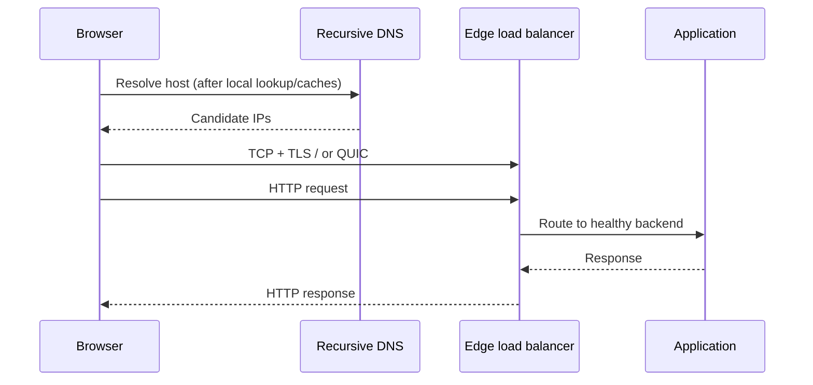

# Q1 · Trace an HTTPS request from a browser to an application

> **Interviewer:** “A user types `https://shop.example.com/products/42` into their browser and presses Enter. Tell me everything that happens, from local name resolution to rendering the page. Where could latency or failure be introduced, and how would you prove it?”

**The mental model:** URL handling → browser policy and caches → OS name-service lookup → recursive DNS and authoritative hierarchy → address choice and route → TCP (or QUIC) → TLS → HTTP → edge/proxy → application and dependencies → response parsing/rendering. This is a *possible cold-request path*, not a mandatory sequence on every navigation: connection reuse, service workers, HTTP caches, HSTS and HTTP/3 can skip or change stages.

## Visual architecture / protocol flow



The diagram illustrates a representative path; retain the detailed packet-level traces and implementation-specific caveats below.

## 1. Parse the URL and check existing browser state

Given `https://shop.example.com/products/42?view=compact`, the browser identifies scheme `https`, authority `shop.example.com`, default port 443, path `/products/42`, and query `view=compact`. The fragment, if present, is never transmitted as part of the HTTP request target. Internationalized domain names may require IDNA processing. The browser consults its policies and state: HSTS may force HTTPS; a service worker may intercept the navigation; an HTTP cache may supply a response; a compatible existing HTTP/2 or HTTP/3 connection might be reused. A configured explicit proxy changes where DNS and transport connections occur.

For a fresh network navigation, the browser needs a usable endpoint address. It may initiate A and AAAA lookups, potentially in parallel, then select candidates according to address-family and connection strategies such as Happy Eyeballs. An HTTPS/SVCB record can provide additional service-binding information, including HTTP/3 alternatives. A previous Alt-Svc response can also affect protocol selection.

## 2. Name resolution begins before the public DNS hierarchy

On a typical glibc Linux path, an application may use `getaddrinfo()`. `/etc/nsswitch.conf` decides the order of configured name-service sources; `hosts: files dns` makes `/etc/hosts` relevant before DNS. Other platforms have different resolution mechanisms, and a browser can use an internal resolver or DNS-over-HTTPS. Therefore **`getent ahosts name` and `dig name` do not test the same complete path**: `dig` performs DNS queries, while `getent` follows Linux NSS.

```bash
# Linux: inspect host lookup order, overrides, and resolver settings
grep '^hosts:' /etc/nsswitch.conf
cat /etc/hosts
cat /etc/resolv.conf
getent ahosts shop.example.com
resolvectl status                       # on systemd-resolved systems
resolvectl query shop.example.com

# macOS: effective DNS configuration
scutil --dns
dscacheutil -q host -a name shop.example.com
```

`/etc/resolv.conf` commonly identifies one or more recursive resolver IPs and settings such as search domains, `ndots`, retry count and timeouts. If it says `nameserver 127.0.0.53`, that often means a local `systemd-resolved` stub, not that public DNS traffic is sent to a remote server at that IP. VPN split-DNS can route distinct namespaces to different resolvers.

## 3. Cold recursive DNS: root → TLD → authoritative zone

Assume no useful browser, operating-system or recursive-cache entries exist. The stub resolver asks a recursive DNS resolver for the A and/or AAAA record. The full resolver performs iterative discovery: it receives a referral from the DNS root toward `.com`, a referral from `.com` toward the authoritative nameservers for `example.com`, and then an authoritative answer for `shop.example.com`. If a CNAME is returned, additional resolution may be required. Necessary glue records help the resolver find nameserver IPs when nameservers live under their own delegated domain.

```text
BROWSER / STUB         RECURSOR          ROOT             .com TLD         example.com AUTH
      |                    |                |                  |                    |
      |-- A shop.example ->|                |                  |                    |
      |                    |-- referral? -->|                  |                    |
      |                    |<-- NS .com ----|                  |                    |
      |                    |--------------------- referral? -->|                    |
      |                    |<---------------- NS example.com ---|                    |
      |                    |------------------------------------ A shop.example? -->|
      |                    |<---------------------------------- 203.0.113.20 ------|
      |<-- answer + TTL ---|                |                  |                    |
```

The recursive resolver usually caches answers and delegation data. A warm cache can skip root/TLD/authoritative queries entirely. TTL controls normal cache lifetime but doesn't force applications to discard already established connections. NXDOMAIN and NODATA can also be negatively cached. DNS lookup success is only name-to-address information; it does **not** guarantee service reachability.

```bash
dig shop.example.com A
dig shop.example.com AAAA
dig +trace shop.example.com A
dig example.com NS
dig example.com SOA
```

## 4. Route selection, next-hop discovery and transport

After choosing an IP, the host consults routing and policy rules. Longest-prefix matching normally selects the most specific route. For an off-subnet IPv4 destination, the outgoing frame targets the next hop's MAC address, obtained through ARP in Ethernet-like environments; IPv6 uses Neighbor Discovery. The destination IP stays the remote service IP unless NAT or proxy routing changes it. A home router or cloud egress device may perform SNAT/PAT and maintain per-flow translation state.

```bash
ip route get 203.0.113.20     # Linux
ip neigh show
route -n get 203.0.113.20  # macOS
```

For HTTP/1.1 or HTTP/2 over TLS/TCP, the client sends SYN, receives SYN-ACK, and sends ACK. Each endpoint negotiates TCP state including initial sequence numbers, MSS, windows and optional SACK/timestamps. A previously established connection skips this handshake. **HTTP/3 follows a different path:** QUIC runs over UDP, incorporates TLS 1.3, and does not use a TCP three-way handshake.

## 5. TLS: establish keys and validate the endpoint

In a normal TLS 1.3 HTTPS handshake, ClientHello offers versions, cipher suites, ephemeral key shares, SNI and ALPN. The server responds with a key share and encrypted certificate/authentication messages. ECDHE and HKDF derive distinct handshake/application traffic secrets. The client checks the server certificate's trust chain, validity, permitted usage, and SAN hostname, then verifies proof of private-key possession and handshake integrity. ALPN might select `h2` or `http/1.1`.

```text
CLIENT                               SERVER / EDGE
  |--- TCP connect (if needed) ----------->|
  |<-------------- TCP SYN-ACK ------------|
  |--- TLS ClientHello + key_share ------->|
  |<-- ServerHello + key_share ------------|
  |<-- EncryptedExtensions/Certificate ----|
  |<-- CertificateVerify/Finished ---------|
  |--- Finished -------------------------->|
  |======= encrypted HTTP traffic ========>|
```

If the certificate name is wrong or the chain is untrusted, a conforming client fails rather than silently accepting it. TLS at an edge proxy is a separate security session from any proxy-to-origin TLS connection. Backend re-encryption is not one uninterrupted end-to-end TLS session.

## 6. HTTP framing, connection reuse and request headers

An HTTP/1.1 request might contain `GET /products/42?view=compact HTTP/1.1` and `Host: shop.example.com`. HTTP/2 uses binary frames and multiplexes streams over a connection; HTTP/3 uses QUIC streams. Request method, headers and cookies carry application semantics. A CDN may return a cached response immediately; a WAF can apply policy; a reverse proxy uses host/path/routing rules to select a backend. When a proxy terminates TCP/TLS, the backend sees a *new* connection, possibly with trusted proxy metadata.

```text
CLIENT → DNS → EDGE/CDN/WAF → L7 PROXY → BACKEND SERVICE → APPLICATION → DB/CACHE
            cache hit ↘ response     target selection ↘ endpoint discovery
```

A proxy might convert incoming HTTP/2 to HTTP/1.1 upstream or select a Kubernetes NEG pod endpoint directly. Never assume frontend TLS or HTTP protocol settings are automatically identical on the backend connection.

## 7. Kubernetes endpoint selection and application processing

For a typical Kubernetes-backed application, an Ingress or Gateway controller configures HTTP routing and a Service provides a stable identity. An EndpointSlice tracks the current ready/serving/terminating addresses. Traditional cluster Service forwarding may use iptables or another dataplane; modern eBPF dataplanes take a different route. A cloud Application Load Balancer backed by directly registered pod IP:port NEGs can bypass the Service ClusterIP path. The application processes the request, potentially calling databases or other services.

Operationally separate these states: process Running, pod Ready, load-balancer target healthy, dependency available, and **business request successfully committed**. None automatically implies the others.

## 8. Response, transfer, rendering and browser security

The server returns an HTTP response with status, headers and body. Intermediate caches may store eligible responses under Cache-Control, validators (ETag, Last-Modified), vary semantics, or explicit policies. Compression can reduce transfer size; congestion, packet loss and flow control influence transport time. The browser parses HTML, retrieves resources, applies CSS, executes JavaScript, constructs and updates the DOM/layout, and paints content. CORS controls script access across origins; CSP restricts permitted resource/code behavior; cookies have Secure/HttpOnly/SameSite properties. HTTP status 200 doesn't guarantee the user-perceived page is ready or usable.

## 9. Trace each boundary instead of guessing

Use `curl` timing markers, then correlate application tracing, proxy access logs, cloud load-balancer timing and database spans. `curl` fields are cumulative; for a fresh TCP/TLS connection, TLS duration is approximately `time_appconnect - time_connect`.

```bash
curl -sS -o /dev/null \
  -w 'dns=%{time_namelookup}\ntcp=%{time_connect}\ntls=%{time_appconnect}\nttfb=%{time_starttransfer}\ntotal=%{time_total}\n' \
  https://shop.example.com/products/42

curl --resolve shop.example.com:443:203.0.113.20 \
  -v https://shop.example.com/products/42
```

**Common traps:** restarting DNS when TLS fails, equating a TCP ACK with completed business processing, assuming every request makes a new connection, and confusing successful pod health checks with successful end-user transactions.

## 10. Complete spoken answer

> “I would follow the request in layers, starting with the browser rather than jumping directly to DNS. The browser parses the URL and checks local caches, policy, service workers and existing connections. If it needs a new address, the application resolver can consult the operating system's hosts database, resolver configuration and local caches before sending DNS to a recursive resolver. On a cold lookup, that resolver follows root, TLD and authoritative referrals and returns cached or authoritative A/AAAA data. The client chooses an address, consults its routing table and establishes TCP—or QUIC for HTTP/3. TLS authenticates the server and derives encryption keys. The resulting HTTP request travels through any CDN, WAF or reverse proxy and is routed to a healthy application backend. In Kubernetes, that might involve a Service and EndpointSlice or direct pod endpoints registered through cloud integration. The application performs the business operation, the response returns, and the browser renders the result. At each stage I'd use the right evidence—NSS and dig for resolution, route and packet tools for connectivity, OpenSSL for TLS, proxy timing, application traces and downstream metrics—to isolate latency or failure. A healthy lower layer isn't proof the business operation succeeded.”
