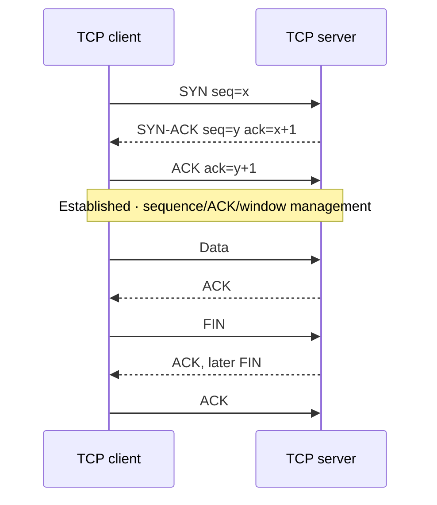

# Q2 · Explain TCP internals and the full connection lifecycle

> **Interviewer:** “Explain exactly what happens from `listen()` and `connect()` through TCP establishment, reliable byte delivery, congestion and flow control, retransmission, graceful closing and resets. Then debug a Linux service suffering intermittent TCP failures.”

TCP offers a **reliable, ordered, bidirectional byte stream**, not reliable application transactions, packet-preserved messages, or guaranteed bounded latency. The operating system implements sequence-number spaces, buffers, timers, acknowledgements and retransmissions while the application uses socket APIs.

## Visual architecture / protocol flow



The diagram illustrates a representative path; retain the detailed packet-level traces and implementation-specific caveats below.

## 1. Server socket setup and client four-tuple

A conventional server calls `socket(AF_INET, SOCK_STREAM, 0)`, `bind()` to its local address/port, `listen(backlog)`, then `accept()`. Each accepted connection has its own socket state. `listen()` does **not** directly create one socket per client; the kernel handles incoming handshakes. The client calls `connect()` and is generally assigned an ephemeral source port if it hasn't bound one.

```c
int listener = socket(AF_INET, SOCK_STREAM, 0);
bind(listener, ...);           // e.g., 0.0.0.0:443
listen(listener, 128);
for (;;) {
    int peer = accept(listener, NULL, NULL);
    // Dispatch peer to application handler.
}
```

A TCP connection is identified by source address, source port, destination address and destination port within its protocol context. NAT can alter this tuple as observed at different network points.

## 2. Three-way handshake — every sequence number

Assume client ISN 1000, server ISN 5000:

```text
CLIENT [CLOSED → SYN_SENT]                 SERVER [LISTEN]
   |------ SYN, SEQ=1000 -------------------->|
   |<-- SYN+ACK, SEQ=5000, ACK=1001 ---------|
   |------ ACK, SEQ=1001, ACK=5001 --------->|
   |                ESTABLISHED              |
   |------ DATA, SEQ=1001, LEN=100 -------->|
   |<----- ACK=1101 -------------------------|
```

The SYN consumes one sequence number; so does FIN later. Each direction has an independent sequence space. The handshake synchronizes sequence spaces, confirms reachability and mitigates ambiguity from old duplicates. The client may consider itself established after accepting SYN-ACK, while the server requires a valid final ACK for normal completion.

SYN options commonly include MSS, window scaling, SACK permitted, timestamps and possibly ECN negotiation. MSS is the maximum receive TCP payload per segment—not the path MTU. For simple IPv4 Ethernet with MTU 1500 and no options, 1500 - 20-byte IP - 20-byte TCP = 1460-byte MSS.

## 3. TCP header and flag vocabulary

The minimum TCP header is 20 bytes and includes source/destination ports, sequence number, acknowledgement number, data offset, flags, receive window, checksum and urgent pointer. Options increase header length up to 60 bytes. Important flags: SYN (start/synchronize), ACK (acknowledgement valid), FIN (orderly directional close), RST (abort/reject), PSH (prompt delivery hint, not message boundary), ECE/CWR (ECN). The TCP checksum includes a pseudo-header derived from IP information.

## 4. Sequence numbers, cumulative ACKs and SACK

Suppose 1000 bytes start at SEQ=1001. Next expected byte is 2001, so a cumulative ACK=2001 acknowledges through byte 2000. A second 1000-byte segment uses SEQ=2001. If that segment is lost but SEQ=3001 through 4000 arrives, the receiver may buffer the later data, continue advertising ACK=2001 and include a SACK block indicating received out-of-order bytes. Retransmitting the missing range allows the cumulative ACK to advance.

```text
SEND: [1001..2000] [2001..3000 LOST] [3001..4000] [4001..5000]
ACK:       2001           2001 + SACK [3001..5000]
REPAIR: retransmit [2001..3000]
ACK: 5001   (all preceding bytes now cumulatively received)
```

TCP is a **stream**. If the sender issues `send("HELLO")` and then `send("WORLD")`, one receiver `recv()` may yield `HELLOWORLD`, `HEL`, or any correctly ordered portion. Applications need delimiters, lengths or protocol framing. Local `write()` succeeding doesn't prove the peer received the bytes; TCP ACK doesn't prove the peer application processed the request.

## 5. Flow control — receiver window (`rwnd`)

The receiver advertises available receive-buffer capacity. If the application stops reading, the buffer can fill and the window can shrink to zero. The sender then stops ordinary new data and uses appropriate persist/zero-window probing to learn when a window update occurs. A zero window can be a slow-consumer or backpressure symptom, not packet loss.

Window scaling is negotiated at the handshake so the effective receive window can exceed the unscaled 65,535-byte window field. Window configuration matters on high-bandwidth/high-RTT paths.

## 6. Congestion control — sender window (`cwnd`)

Flow control protects the receiver; congestion control responds to network capacity and congestion. The amount of outstanding data is bounded by constraints including `min(cwnd, rwnd)`, available app data, pacing and sender buffers. Slow start increases the congestion window rapidly while acknowledgements indicate progress; congestion avoidance varies by algorithm. Reno is a useful conceptual baseline, CUBIC has time/cubic growth, and BBR estimates bottleneck bandwidth and propagation RTT with pacing. Don't describe all modern Linux connections as textbook Reno.

**Bandwidth-delay product:** On a 100 Mb/s path with RTT=100 ms, nominal BDP is `(100,000,000 bits/s × 0.1 s)/8 = 1.25 MB`. A sender window much smaller than this may underutilize the path.

## 7. Loss detection and retransmissions

TCP handles loss using retransmission timers and earlier loss signals. Classical RTO estimation follows `SRTT + max(G, 4×RTTVAR)` with protocol/implementation bounds. A timeout can trigger retransmission and exponential timer backoff. Reno-style fast retransmit responds to an appropriate pattern of duplicate ACKs; SACK helps identify holes. Modern stacks can use RACK and Tail Loss Probe to recover tail losses before a long RTO.

**Out-of-order arrival isn't automatically loss.** Reordering can trigger duplicate ACKs, and capture tooling can sometimes label packets as retransmissions heuristically. Correlate multiple observations rather than attributing every duplicate ACK to a faulty router.

TCP head-of-line blocking means data beyond a missing byte range cannot be delivered normally in stream order. This is one reason independent QUIC streams provide benefits for multiplexed protocols.

## 8. Buffering, Nagle, delayed ACK and pooling

`send()` normally enqueues bytes in the local kernel; `recv()` drains the receive buffer. Partial reads and writes are normal. Nagle's algorithm can coalesce small writes while data remains unacknowledged. `TCP_NODELAY` disables that behavior; it doesn't remove delayed ACKs or network queueing. Application write batching is often more important than indiscriminately changing socket flags.

Connection pooling reduces repeated TCP/TLS handshakes and ephemeral-port churn. Oversized or stale pools create other problems: too many file descriptors, downstream connection exhaustion, idle-timeout resets and uneven capacity.

## 9. Graceful close, half-close, TIME_WAIT and reset

```text
ACTIVE CLOSER                               PASSIVE CLOSER
ESTABLISHED                                 ESTABLISHED
   |-- FIN ------------------------------->| CLOSE_WAIT
FIN_WAIT_1                                  (can still send)
   |<------------------------------- ACK --|
FIN_WAIT_2                                   |
   |<-------------------------------- FIN --| LAST_ACK
   |-- ACK ------------------------------->| CLOSED
TIME_WAIT
   |-- wait according to TCP implementation |
CLOSED
```

Each FIN closes one direction. The other direction may continue transmitting: TCP half-close. The active closer normally enters TIME_WAIT to handle retransmitted final FIN and delayed duplicates. TIME_WAIT count alone isn't proof of a leak. Persistent CLOSE_WAIT often means the local application hasn't closed sockets after receiving peer FIN. FIN_WAIT_2 is waiting for peer shutdown. RST aborts or rejects rather than gracefully completing a byte stream.

## 10. SYN queue, accept queue, SYN cookies

A Linux listening socket separates incomplete handshake handling from completed connections waiting for `accept()`. `net.ipv4.tcp_max_syn_backlog` concerns incomplete requests; `listen(backlog)` and `net.core.somaxconn` influence the accept backlog. Slow accept loops can exhaust completed-connection capacity even at low CPU. SYN cookies protect against some incomplete-handshake state exhaustion attacks, but are not a general application performance fix.

```bash
ss -lntp                 # listening TCP sockets; listen queue details
ss -tan state syn-recv    # incomplete handshakes
ss -tan state established
ss -tan state close-wait
ss -tan state time-wait
nstat -az | grep -E 'TcpRetransSegs|TcpExtListenOverflows|TcpExtListenDrops'
sysctl net.core.somaxconn net.ipv4.tcp_max_syn_backlog
```

## 11. Keepalive, half-open connections and idle timeouts

A peer can crash without immediate notice to the surviving socket. TCP keepalive (when enabled per socket), app heartbeats or a subsequent write can reveal loss of connectivity. Linux's long traditional keepalive defaults are not necessarily suitable for applications with short failover targets. NAT/LB idle timeouts can expire mappings even while both applications think a connection is established. Use compatible heartbeat, pooling and `TCP_USER_TIMEOUT` policies where appropriate. The term *half-open* can mean either an incomplete handshake or a stale established session, so clarify the usage.

## 12. Capture and diagnose packets

```bash
sudo tcpdump -i any -nn 'tcp port 443'
sudo tcpdump -i any -nn 'tcp[tcpflags] & (tcp-syn|tcp-ack) == tcp-syn'
sudo tcpdump -i any -nn 'tcp[tcpflags] & tcp-rst != 0'
ss -ti             # RTT, cwnd, MSS, retransmission details where available
ss -s
```

Capture at both sides of a suspected failure boundary where possible. A client-only trace of repeated SYNs proves retransmission attempts at that point, **not** where the packets were dropped. Packet offload can create apparently oversized locally captured segments and checksum warnings before NIC completion. Be cautious when collecting sensitive application payloads.

**Fast pattern recognition:** Repeated SYN with no SYN-ACK ⇒ route/drop/return-path/overload hypotheses. SYN→RST ⇒ no listener or explicit rejection. Established flow with retransmissions ⇒ investigate loss/ACK path and RTT. Zero-window advertisements ⇒ receiving side can't currently drain data fast enough. Growing CLOSE_WAIT ⇒ application socket cleanup issue.

## 13. Complete spoken answer

> “I'd start at the socket APIs rather than the three-way handshake alone. The server creates and binds a listening socket, and the client creates an outbound socket with an ephemeral port. SYN, SYN-ACK and ACK synchronize separate sequence-number spaces and negotiate options including MSS and window scaling. Once established, TCP exposes an ordered bidirectional byte stream, not application message boundaries. Sequence numbers and cumulative ACKs track bytes, while SACK can report later received regions when earlier data is missing. The sender is constrained both by the receiver's advertised window and its own congestion window. Loss is recovered using mechanisms including retransmission timeout and modern ACK/time-based recovery. At close, FIN is orderly and directional, RST is abortive, and states such as CLOSE_WAIT and TIME_WAIT have very different diagnostic meanings. In production I would correlate `ss -ti`, listen queue/counter metrics, application behavior and packet captures at appropriate network points. I'd distinguish application processing success from TCP acknowledgement, and an overloaded receiver from an overloaded network.”
