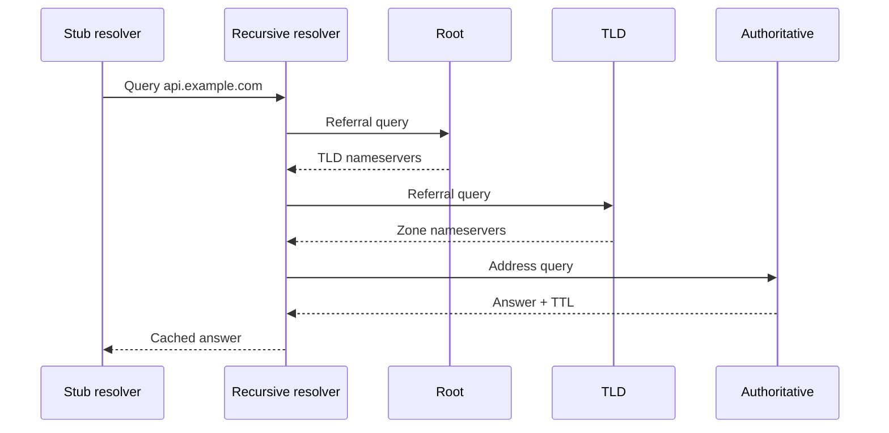
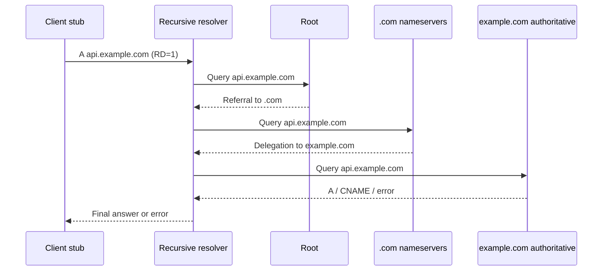
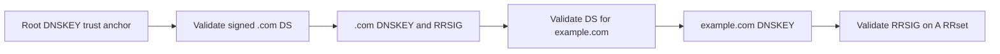

# DNS hierarchy, protocol internals and failure diagnosis

> **Engineering focus:** “A service needs `api.example.com`. Walk from the application's local resolver through root, TLD and authoritative DNS. Explain negative caching, records, DNSSEC, transport and CoreDNS. How do you resolve inconsistent or intermittent answers?”

DNS is a **distributed hierarchical naming database**, not a single hostname-to-IP file. A name can have several relevant records; a server can answer authoritatively, recursively or by forwarding, and caching allows independent resolvers to show differing answers during changes.

## Visual architecture / protocol flow



The Mermaid diagram illustrates a representative path; the accompanying explanations cover implementation-specific caveats.

## 1. Resolution begins in the application and operating system

An application calling `getaddrinfo()` usually interacts with a stub resolver or equivalent name-service layer. On glibc Linux, `/etc/nsswitch.conf` may consult `/etc/hosts` before DNS, and `/etc/resolv.conf` specifies nameservers, search suffixes, `ndots`, attempts and timeout behavior. `systemd-resolved` can provide a loopback stub on `127.0.0.53`, maintain a local cache and route queries using per-link split DNS. Browsers and applications can use independent caches or DoH. **`dig` bypasses normal hosts-file/NSS logic**, so compare with `getent` and the real application.

```bash
getent ahosts api.example.com
cat /etc/nsswitch.conf
cat /etc/hosts
cat /etc/resolv.conf
resolvectl status              # when installed
scutil --dns                   # macOS
```

## 2. Recursive versus authoritative versus iterative resolution

A stub typically sends a query with RD=1 to a recursive resolver and expects a final answer or error. A recursive resolver can contact root, TLD and authoritative nameservers by following referrals. An authoritative server provides data from its hosted zone or a delegation. It does not normally perform recursive internet-wide lookup for arbitrary clients.



If the recursive cache already contains the answer or a referral, fewer queries are needed. The hierarchy is rooted at `.`. `.com` is a top-level domain; `example.com` can be a separately delegated zone. A domain and a DNS zone aren't synonymous because child zones may be delegated. The root infrastructure has 13 named root-server identifiers deployed through many anycast sites; not merely thirteen physical servers.

## 3. Delegation, NS records, glue and bailiwick

A parent zone delegates a child zone through NS records. If the child nameserver is inside the child namespace, e.g. `ns1.example.com` for `example.com`, parent-supplied address *glue* helps avoid a circular lookup. Glue is a bootstrap hint, not a replacement for authoritative child data. A resolver evaluates which glue is appropriate to accept using bailiwick rules. Mismatched parent delegations and child-zone NS records are a frequent cause of intermittent resolution after migrations.

## 4. DNS wire format, flags and return codes

A DNS message has a 12-byte header with ID, flags and section counts. Sections are Question, Answer, Authority and Additional. A question has QNAME/QTYPE/QCLASS; resource records carry owner name, type, class, TTL and type-specific data. Key flags: RD (recursion desired), RA (recursion available), AA (authoritative answer), TC (truncated), AD (authenticated data), CD (checking disabled). Relevant RCODEs: NOERROR, NXDOMAIN, SERVFAIL, REFUSED, FORMERR. A timeout is lack of a usable response, *not* a DNS RCODE.

## 5. Know the records and their constraints

| Record | Purpose | Important detail |
|---|---|---|
| A / AAAA | IPv4 / IPv6 addresses | Can return multiple candidate addresses |
| CNAME | Canonical alias | Normally cannot coexist with other data at same owner name |
| NS | Authoritative nameservers / delegation | Parent and child information should be consistent |
| SOA | Zone administration | Serial and negative-cache TTL semantics |
| MX | Mail routing | Preference and target hostname |
| TXT | Text metadata | Domain verification, SPF, etc. |
| SRV | Service location | Priority, weight, port, target |
| PTR | Reverse DNS | Does not confer trust by itself |
| CAA | Permitted issuing CAs | Relevant to certificate issuance |
| HTTPS/SVCB | Service binding metadata | May advertise endpoint/protocol hints |
| DS/DNSKEY/RRSIG | DNSSEC trust/signatures | Used for validation |

A conventional CNAME at the zone apex conflicts with required SOA/NS records. Cloud-provider “Alias/ANAME” constructs synthesize suitable standard answers; ALIAS is not an ordinary wire-format RR type. A/AAAA record ordering or multiplicity does not guarantee proportional HTTP request balancing because clients and resolvers cache and reuse connections.

## 6. Positive cache, TTL and DNS migrations

TTL sets how long an RRset can normally be held by a cache. A recursive resolver returns *remaining* TTL. Applications, OS stubs and local caching agents can maintain additional state. A change from old IP to new IP is not globally instantaneous. If old TTL was 3600 seconds, lowering the authoritative TTL to 30 seconds immediately before switching cannot invalidate previous cached copies. For migrations, lower TTL sufficiently in advance, keep old and new endpoints functional during overlap, verify authoritative results and multiple recursive views, and account for existing TCP connections.

## 7. Negative caching: NXDOMAIN, NODATA, SERVFAIL

NXDOMAIN means the queried DNS name doesn't exist; NOERROR without the requested record type can indicate NODATA; SERVFAIL indicates an inability to finish resolution/validation. Negative answers can be cached, based on SOA negative TTL rules: the relevant value is the minimum of the SOA record TTL and SOA MINIMUM field, subject to resolver policy. A newly created record can still fail temporarily because clients cached NXDOMAIN. SERVFAIL can result from DNSSEC, an unavailable forwarder, transport failure or other resolver errors. Differentiate precise RCODEs before modifying records.

## 8. UDP, TCP, EDNS and packet sizing

Traditional DNS commonly uses UDP/53 for small queries; implementations also need TCP/53 support, including truncated-answer fallback and zone transfer use cases. Original DNS UDP messages had a 512-byte limit. EDNS(0) adds an OPT pseudo-record and advertises larger supported UDP payload capacity. Large responses may fragment; fragmentation or blocked TCP fallback can cause “small A lookups succeed, DNSKEY lookups hang.” Many operational deployments use conservative EDNS UDP payloads around 1232 bytes to avoid IPv6-minimum-MTU fragmentation, though this isn't a universal mandated cap.

```bash
dig @1.1.1.1 example.com A
dig @1.1.1.1 example.com A +tcp
dig @1.1.1.1 example.com DNSKEY +dnssec +bufsize=1232
```

DoT uses TLS (commonly TCP/853); DoH uses HTTPS; DoQ uses QUIC. These encrypt communication between a client and its resolver, **not automatically all recursive-to-authoritative hops**.

## 9. DNSSEC chain of trust

DNSSEC signs RRsets, providing authenticity and integrity for validating resolvers rather than confidentiality. Start from a trusted root DNSKEY and verify parent DS → child DNSKEY and its RRSIGs; NSEC/NSEC3 authenticate nonexistence. Common faults: incorrect DS after key rollover, expired RRSIG, DNSKEY mismatch, bad time, or large response transport failures. Validating clients may return SERVFAIL even when nonvalidating direct authoritative queries show the expected A record.



```bash
dig example.com DS +dnssec
dig example.com DNSKEY +dnssec
delv api.example.com A
```

## 10. CoreDNS and Kubernetes DNS

A typical pod may have `nameserver <cluster-DNS-IP>`, search suffixes such as `app.svc.cluster.local svc.cluster.local cluster.local`, and `options ndots:5`. CoreDNS's Kubernetes plugin maintains Service/EndpointSlice state via API watches, not a fresh API read for every query. The `forward` plugin queries upstream resolvers for external names; `cache` stores positive/negative answers; `prometheus` provides metrics. With `ndots:5`, `api.external.com` can be attempted with search suffixes before the absolute name, amplifying DNS QPS. NodeLocal DNSCache may reduce cluster-wide DNS traffic and some conntrack overhead. Some GKE clusters instead use Cloud DNS for GKE with different service discovery and scope behavior.

```text
.:53 {
    errors
    ready
    kubernetes cluster.local in-addr.arpa ip6.arpa {
        pods insecure
        fallthrough in-addr.arpa ip6.arpa
        ttl 30
    }
    forward . /etc/resolv.conf
    cache 30
    prometheus :9153
}
```

An ordinary ClusterIP Service normally resolves to its virtual Service IP; headless Services can return endpoint addresses. DNS success does not prove the Service has ready endpoints or that NetworkPolicy allows connectivity.

## 11. Route 53, Cloud DNS and split-horizon

AWS public hosted zones are authoritative public DNS; private hosted zones resolve through associated VPCs and VPC Resolver. Route 53 Resolver inbound/outbound endpoints plus conditional rules support hybrid DNS. An associated private zone for `example.com` can shadow public records under the same namespace: do **not** assume missing private names fall back to public records.

Google Cloud DNS similarly supports public/private zones, forwarding zones and peering zones; its scope and precedence differ from AWS. GKE may use kube-dns or Cloud DNS for GKE; cluster and VPC scopes affect which clients see Kubernetes service records. Successful private resolution doesn't establish reachability to the returned pod IPs.

## 12. Production DNS troubleshooting ladder

**Step 1:** Determine exact failing QNAME/QTYPE, RCODE/timeout, client resolver and geographic scope. **Step 2:** Compare application/NSS result to `dig` from the same workload. **Step 3:** Directly query configured recursive resolver. **Step 4:** Follow delegation and query authoritative NS explicitly. **Step 5:** Compare UDP/TCP, A/AAAA, TTL, DNSSEC checking and split-horizon views. **Step 6:** Correlate CoreDNS/Cloud DNS logs, cache metrics, forwarding failures, NetworkPolicy and packet traces.

```bash
getent ahosts api.example.com
dig api.example.com A +stats
dig @1.1.1.1 api.example.com A
dig +trace api.example.com A
dig example.com SOA
dig example.com NS
kubectl -n kube-system get configmap coredns -o yaml
kubectl -n kube-system logs deployment/coredns --since=15m
sudo tcpdump -i any -nn '(udp port 53 or tcp port 53)'
```

**Common scenarios:** public domain succeeds but VPC returns NXDOMAIN → matching private zone. A-only succeeds while AAAA fails → family-specific or NODATA path. DNS works from node but not pod → different resolver/NetworkPolicy path. Only large answers fail → EDNS/MTU/TCP fallback. Some clients retain old backend → cache/TTL and persistent connections.

## 13. Key takeaways

> Distinguish the application stub resolver, the recursive resolver and authoritative DNS. Locally I inspect the runtime, NSS, hosts file and resolver settings because a `dig` query doesn't always represent the application's resolution path. On a cold public lookup, the recursive resolver follows referrals from root to TLD to the authoritative zone, resolves any aliases, and caches the result according to TTL. Explain NS delegation and glue separately. DNS returns more than addresses: A/AAAA, CNAME, NS, SOA, SRV, TXT and security-related records all have different semantics. NXDOMAIN differs from NODATA and SERVFAIL, and negative answers are cacheable. DNS commonly uses UDP but requires TCP support, and EDNS/DNSSEC can expose packet-size or validation faults. Inside Kubernetes, CoreDNS may serve Service names from watched API state and forward other queries; search suffixes and caches affect query volume. For production failures I compare the same question from the affected workload, OS resolver, recursive servers and authoritative servers, then validate TTL, DNSSEC, forwarding, network policies and transport. Never conclude an application is reachable solely because its DNS answer is correct.
