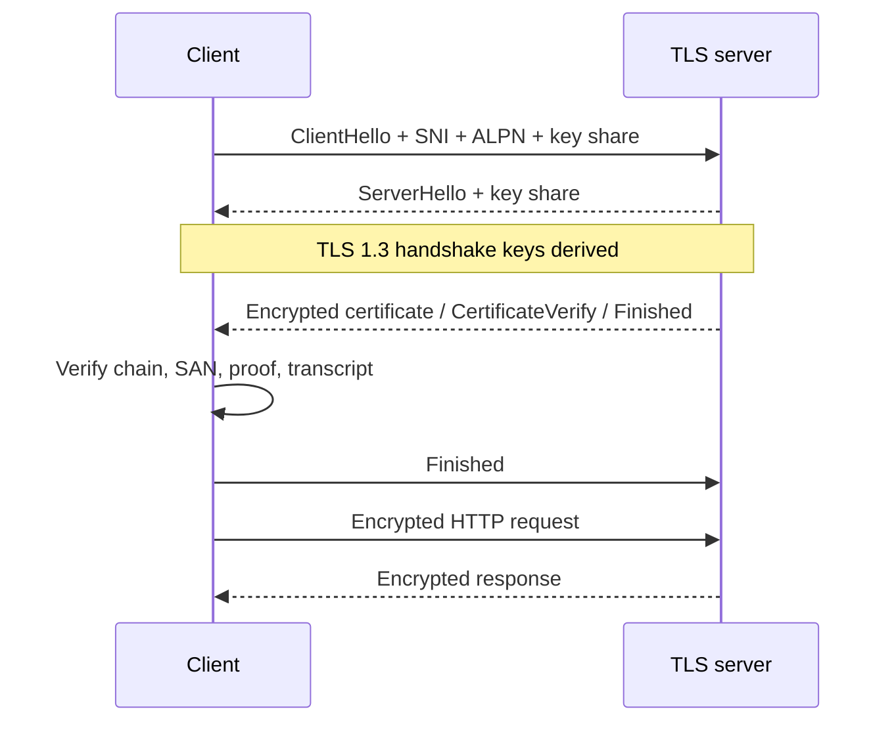

# Q4 · TLS 1.2/1.3, PKI, mTLS and certificate operations

> **Interviewer:** “After TCP connects to an HTTPS endpoint, explain the cryptography, certificate trust and exact TLS 1.2 versus 1.3 handshake. Then design mTLS, termination, certificate rotation and incident diagnosis for cloud/Kubernetes services.”

TLS protects application communication with **authentication, confidentiality and integrity**. It doesn't guarantee safe business logic, authenticated downstream hops after termination, or successful transaction execution. RFC 9846 (July 2026) is the current TLS 1.3 standard and obsoletes RFC 8446, while maintaining interoperable TLS 1.3 protocol semantics.

## Visual architecture / protocol flow



The diagram illustrates a representative path; retain the detailed packet-level traces and implementation-specific caveats below.

## 1. Key primitives: symmetric, asymmetric, hash and key derivation

TLS negotiates session secrets using ephemeral public-key exchange (or approved PSK modes), authenticates endpoints through signatures/certificates or PSKs, and protects bulk data with symmetric AEAD such as AES-GCM or ChaCha20-Poly1305. A hash is not encryption. HMAC and HKDF underpin distinct key derivation and transcript authentication. Certificate public keys are primarily for verifying identity proofs in modern TLS, *not* for encrypting each HTTP request.

## 2. ECDHE and forward secrecy

For a curve generator G, the client picks ephemeral private `a` and publishes `A=aG`; the server picks `b` and publishes `B=bG`. Each derives the same shared point: `aB = abG = bA`. Neither private ephemeral value is transmitted. HKDF derives key material from the agreed secret and transcript. If ephemeral secrets are properly erased, stealing a server's long-term certificate key later doesn't alone decrypt recorded full ECDHE sessions. Static RSA transport in old TLS 1.2 had different guarantees; TLS 1.3 removed it. PSK-only TLS 1.3 resumption doesn't provide a *new* ECDHE-based forward secrecy guarantee.

## 3. Certificate fields and PKI trust

An X.509 leaf certificate contains an issuer, subject, SAN identity, public key, serial number, validity dates, extensions such as Key Usage/EKU/Basic Constraints, and an issuer signature. It does not contain the private key. A normal chain is leaf → intermediate CA → accepted root trust anchor; servers commonly send leaf+intermediates, not the root. Clients validate chain signatures/constraints, time, intended EKU, hostname against SAN and local policy. Root trust is configured, not bestowed by self-signing.

```text
CLIENT TRUST STORE
   root CA (explicit trust)
      ↓ signs
   intermediate CA (BasicConstraints CA:TRUE)
      ↓ signs
   leaf server cert (SAN api.example.com, serverAuth)
      ↓ plus possession proof
   TLS authenticated endpoint
```

SAN identifies certificate-valid hostnames; SNI is a ClientHello hint that helps the server choose a virtual-host certificate; ALPN chooses an application protocol (`h2`, `http/1.1`). SNI does not prove identity. A wildcard `*.example.com` generally covers one leftmost label, not the apex or `a.b.example.com`. Modern identity verification follows SAN-based rules (RFC 9525).

## 4. Full TLS 1.2 ECDHE handshake

```text
CLIENT                               SERVER
ClientHello ------------------------>
              <---------------- ServerHello
              <---------------- Certificate
              <---------------- ServerKeyExchange (ECDHE + signature)
              <---------------- ServerHelloDone
ClientKeyExchange ------------------->
ChangeCipherSpec -------------------->
Finished (encrypted) ---------------->
              <---------------- ChangeCipherSpec
              <---------------- Finished (encrypted)
HTTP encrypted <===================> HTTP encrypted
```

This is a normal certificate-authenticated, *full* TLS 1.2 ECDHE handshake without client certificates. A TLS 1.2 cipher name like `TLS_ECDHE_RSA_WITH_AES_128_GCM_SHA256` bundles key exchange, authentication and AEAD/hash choices. The normal full handshake takes about two TLS RTTs after transport establishment. Earlier static RSA key-transport configurations lack ECDHE forward secrecy.

## 5. Full TLS 1.3 handshake — one RTT

```text
CLIENT                               SERVER
ClientHello: versions, SNI, ALPN, key_share ------->
              <---------- ServerHello + key_share
   [both derive handshake traffic keys]
              <---------- EncryptedExtensions (encrypted)
              <---------- Certificate (encrypted)
              <---------- CertificateVerify (encrypted)
              <---------- Finished (encrypted)
[verify path, name, proof and transcript]
Finished (encrypted) ----------------------------->
Encrypted HTTP <=============================> Encrypted HTTP
              <---------- NewSessionTicket (optional)
```

TLS 1.3 separates cipher-suite AEAD/hash from signature and key-share group selection. After ServerHello, ordinary full-handshake certificate and verification messages are encrypted. ClientHello still exposes SNI unless ECH is used. `legacy_version=0x0303` is a compatibility field; the `supported_versions` extension communicates negotiated TLS 1.3. Finished authenticates the handshake transcript. TLS 1.3 uses HKDF-derived directional handshake/application secrets; KeyUpdate can refresh application secrets without a new TCP connection.

## 6. mTLS — mutual endpoint authentication

Normally the server proves its identity with a certificate and its private-key possession signature. In mTLS, the server additionally requests a client certificate; the client sends a certificate and CertificateVerify proof, and the server validates the chain, clientAuth purpose, identity and application authorization policy. **mTLS authenticates identity; it doesn't grant universal authorization.** Workload identity systems may use URI SANs such as `spiffe://trust-domain/ns/team/sa/service`. A service mesh can automate certificate issuance, short lifetimes, rotation and policy but adds control/data plane costs and new failure modes.

```text
SERVICE A APP → Proxy A ══ mTLS ══ Proxy B → SERVICE B APP
                           ↑ trust and identity authority
```

## 7. Termination, passthrough and re-encryption

- **Edge termination:** Client TLS ends at L7 load balancer; backend might be HTTP plaintext.
- **L4 passthrough:** TCP/UDP forwarding preserves client TLS security endpoint at origin (depending on transport/proxy mode).
- **Re-encryption:** Edge decrypts client TLS and initiates a different TLS session toward backend. Both legs can be encrypted, but the edge can see plaintext.

Backend HTTPS doesn't automatically mean strict backend identity validation: some managed LBs encrypt to targets without checking their certificate chains. Confirm exact provider/product configuration, CA bundle and hostname/SNI validation rather than assuming any two encrypted hops equal authenticated end-to-end TLS.

AWS ALB HTTPS listener generally terminates TLS, while NLB TCP listeners can pass TLS through and NLB TLS listeners terminate it. Google Cloud Application Load Balancers terminate TLS at target HTTPS proxies; backend authenticated TLS depends on supported configuration. GKE Ingress, Gateway and standalone ingress controllers may own certificates through different mechanisms.

## 8. ACME, cert-manager and zero-downtime rotation

ACME commonly verifies domain control through HTTP-01 or DNS-01. DNS-01 is useful for wildcard issuance but needs carefully scoped DNS write permissions. cert-manager `Issuer`/`ClusterIssuer` and `Certificate` resources automate issuance into Kubernetes TLS Secrets. A TLS Secret typically stores `tls.crt` and `tls.key`; base64 encoding is not encryption. Restrict RBAC, enable suitable secrets encryption, and never put keys in Git.

There are three separate certificate states: desired (`Certificate`), stored (`Secret`) and **actually served** by TLS endpoint. Rotation can update a Secret without updating a cloud L7 certificate or a proxy that never reloaded. For CA replacement use overlap: distribute trust in old+new CA, issue from new CA, verify all peers, then remove old CA after migration. Existing long-lived TLS sessions don't automatically revalidate the certificate every moment.

## 9. OCSP, CRLs, CT and revocation

CRLs list revoked certificate serials in signed publications; OCSP returns signed status where the issuer supports it; stapling puts a signed response into the TLS exchange. Certificate Transparency logs help discover issuance; they are not revocation. Public CA practices evolve: Let's Encrypt retired its OCSP service in August 2025, using CRLs, so missing OCSP staple is not universally a failure. Client revocation behavior and managed-LB mTLS checks vary. If a private key leaks, replace key and certificate, revoke where appropriate, assess exposure, and do not treat git-history cleanup as proof the key wasn't copied.

## 10. Session reuse versus resumption, 0-RTT and replay

Persistent HTTP keepalive/HTTP/2 reuse means *no new connection TLS handshake*. TLS resumption means a new TLS session uses previously established PSK/ticket context. TLS 1.3 supports PSK-only and PSK-(EC)DHE modes with different forward-secrecy properties. Optional 0-RTT early data can be sent before the full handshake completes but is replayable; it is generally inappropriate for non-idempotent payment/provisioning operations unless the application has explicit replay protection.

## 11. Production commands — actual TLS endpoint matters

```bash
openssl s_client -connect api.example.com:443 \
  -servername api.example.com -showcerts
openssl s_client -connect api.example.com:443 \
  -servername api.example.com -verify_hostname api.example.com \
  -verify_return_error -brief
openssl s_client -connect api.example.com:443 -servername api.example.com -tls1_3
openssl s_client -connect api.example.com:443 -servername api.example.com -alpn h2,http/1.1
openssl x509 -in cert.pem -noout -dates -subject -issuer -ext subjectAltName
openssl verify -CAfile root.pem -untrusted intermediates.pem \
  -verify_hostname api.example.com leaf.pem
curl -v --resolve api.example.com:443:203.0.113.20 https://api.example.com/
```

An OpenSSL `-showcerts` listing does not prove a valid trust path. Use `-verify_return_error` and expected hostname. `curl -k` is a diagnostic toggle, **not** a production remediation. After renewal, inspect the *served* certificate with correct SNI, not only the Secret. For mTLS add `-cert client.crt -key client.key -CAfile root.pem` to an approved test endpoint. Authorized TLS key-log decryption can help investigate TLS 1.3 packets; private certificate keys alone do not decrypt modern ECDHE captures.

## 12. Complete spoken answer

> “TLS provides authenticated, confidential and integrity-protected communication on top of an appropriate transport. The client sends ClientHello with versions, cryptographic capabilities, SNI and ALPN. In TLS 1.3 it normally includes an ephemeral ECDHE key share; the server replies with its share, and both derive handshake secrets using HKDF. The server presents a certificate chain and CertificateVerify proof, while the client checks SAN hostname, time, trust path, usage and transcript integrity. TLS 1.3 normally needs one TLS RTT versus two for a full TLS 1.2 ECDHE handshake, and it removes old static RSA transport. Application data uses symmetric AEAD. mTLS adds client certificate identity, but authorization remains separate. In a cloud design I'd state exactly where TLS terminates and whether backend TLS is separately authenticated. For rotation I'd verify desired, stored and served certificates and use overlapping trust for CA replacement. In an incident I'd separate DNS, TCP, TLS negotiation and HTTP/backend errors, then test with SNI-correct OpenSSL and curl rather than disabling validation.”
