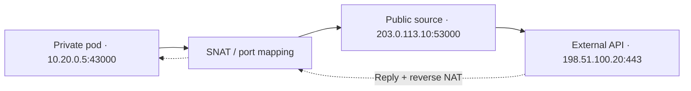
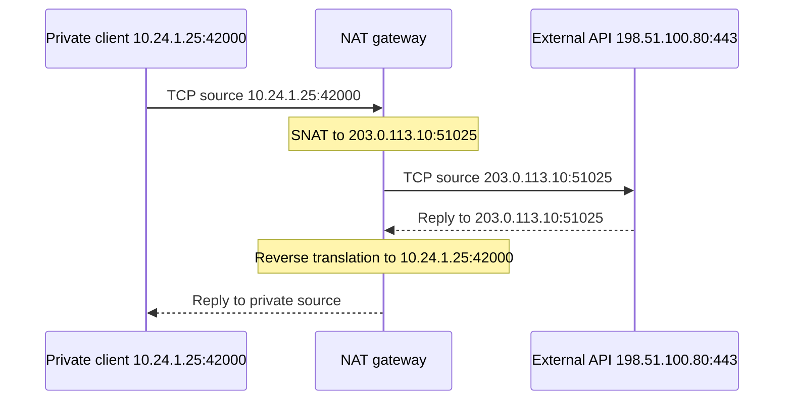

# Q6 · CIDR, routing, ARP/NDP, NAT and conntrack

> **Interviewer:** “Design private and public networks for a multi-zone application. Calculate subnets, explain how the kernel chooses a route and how a packet reaches an external API. Then debug NAT port exhaustion and asymmetric routing.”

An IP design must model allocation *and* actual routing/security paths. CIDR determines prefix ranges, routing chooses next hops, link discovery resolves the next-hop address, NAT optionally rewrites endpoint addresses, and firewalls/policies permit or deny traffic. Don't treat these as one mechanism.

## Visual architecture / protocol flow



The Mermaid diagram illustrates a representative path; the accompanying explanations cover implementation-specific caveats.

## 1. IPv4 and CIDR math

An IPv4 address has 32 bits. A prefix `/n` leaves `32-n` host bits and describes `2^(32-n)` total addresses. `10.24.16.35/24` belongs to `10.24.16.0/24`, total 256 addresses, mask `255.255.255.0`. Divide a `/24` into four equal networks by borrowing 2 bits: four `/26` blocks at `.0`, `.64`, `.128`, `.192`, each 64 addresses. A `/32` matches a single address; `/0` matches all IPv4 addresses. Total addresses are **not** necessarily usable cloud workload addresses because providers reserve some.

| CIDR | IPv4 addresses | Common use |
|---|---:|---|
| /16 | 65,536 | Large VPC allocation |
| /20 | 4,096 | Regional subnet example |
| /24 | 256 | Subnet / delegated block |
| /26 | 64 | Small subnet |
| /28 | 16 | Small allocation |
| /32 | 1 | Host route |

Use nonoverlapping VPC/subnet/Pod ranges if networks may later connect through peering/VPN. Account for future node pools, peak pods, DR environments, and secondary range reservation. IPv6 uses 128-bit addresses; `/64` is a common subnet size, and NDP replaces ARP for neighbor resolution.

## 2. How a host chooses a route

A destination lookup checks policy routing and the routing table, normally choosing the **longest matching prefix**. `10.40.2.0/24` takes precedence over `10.40.0.0/16` and `0.0.0.0/0` for `10.40.2.15`. With equal specificity, priorities/metrics and routing policy determine selection. A directly connected subnet needs no off-subnet gateway; other traffic goes to the selected next hop. The IP destination generally remains unchanged during forwarding unless NAT applies.

```bash
ip -br addr
ip route show
ip rule show
ip route get 10.40.2.15
ip -6 route
```

## 3. ARP, MAC and NDP

For IPv4 over Ethernet-like networking, a host must know the next-hop MAC to construct its outgoing L2 frame. ARP asks who owns the next-hop IPv4 address. On an off-subnet route, the L2 destination is the router's MAC—not the remote internet server's MAC. Routers decapsulate and encapsulate for the next link; IP TTL decreases. IPv6 uses ICMPv6 Neighbor Solicitation/Advertisement and Router Advertisement in NDP. Cloud virtual networking can abstract aspects of a physical L2 network; don't blindly expect traditional ARP behavior in every provider dataplane.

## 4. SNAT, DNAT, PAT and connection identifiers

SNAT rewrites source IP/port, commonly for internet egress. DNAT rewrites destination IP/port, commonly for inbound publishing and Kubernetes Service paths. PAT enables many flows to share a translated public IP using different source ports. The connection is identified through protocol plus source/destination addresses and ports; translation state ensures return traffic maps back correctly.



IP ranges `192.0.2.0/24`, `198.51.100.0/24`, and `203.0.113.0/24` are reserved documentation networks. NAT is not by itself authentication, a firewall, or a guarantee of reachability.

## 5. Linux conntrack and failure modes

Netfilter conntrack records flows, timeouts and translation associations when the dataplane uses it. Table exhaustion can prevent tracking new flows and lead to intermittent connections or DNS timeouts even when application CPU is low. Some eBPF implementations use different state tables/maps, so check the actual CNI and Service dataplane. Many TIME_WAIT connections are not automatically a conntrack exhaustion problem; measure both separately.

```bash
sudo conntrack -S
sudo conntrack -L -p tcp
sysctl net.netfilter.nf_conntrack_count
sysctl net.netfilter.nf_conntrack_max
nstat -az | grep -E 'TcpRetransSegs|ListenOverflows'
```

## 6. Ephemeral-port and NAT allocation exhaustion

A client uses ephemeral local source ports for outbound TCP flows. A NAT function needs unique translated flow mappings. A high number of simultaneous connections to a *single external destination tuple* can hit port-allocation limits despite modest bandwidth. Concentrated traffic, new connections per second, idle hold time, backend destination count, and pool reuse all matter. AWS documents up to 55,000 concurrent connections per NAT gateway IPv4 address per destination IP/port/protocol tuple. Google Cloud NAT has a **different** allocation model that reserves ports for VMs, with static/dynamic options and different limits. Do not apply the AWS constant to GCP.

## 7. AWS NAT versus Cloud NAT

AWS NAT gateway is associated with an Availability Zone and uses routing through that NAT resource; CloudWatch exposes `ErrorPortAllocation` and other metrics. Google Cloud NAT configures distributed VPC dataplane translations through Cloud Router NAT configuration, commonly at regional scope; it isn't an ordinary proxy VM instance. For Cloud NAT, inspect NAT IP capacity, port allocation per VM, relevant subnet/pod ranges, static/dynamic allocation, timeout settings and logs. GKE may masquerade Pod source to node IP before Public NAT, or preserve Pod IP when configured appropriately; this changes allocation identity and logging.

```bash
# AWS context
aws ec2 describe-nat-gateways
# Google Cloud context
gcloud compute routers nats list --router=ROUTER --region=REGION
gcloud compute routers nats describe NAT --router=ROUTER --region=REGION
```

## 8. Asymmetric routing and stateful firewalls

If request traffic traverses gateway A but reply traffic returns through gateway B, a stateful device may not have the corresponding NAT/firewall state and drop the reply. Such asymmetry can arise from route propagation, hybrid connections, policy routing or multi-interface systems. Capture at source, stateful gateway and destination to locate the change. Asymmetric routing isn't inherently invalid in all topologies, but stateful devices often impose symmetry requirements.

## 9. MTU, PMTU and fragmentation

MTU is the maximum frame/packet payload size accepted on a given link context; PMTU is the path's limiting packet size. TCP MSS limits application bytes per segment; typical IPv4 MTU 1500 without options yields MSS 1460. Encapsulation (VPN/VXLAN) adds overhead and can reduce available inner packet size. Path MTU Discovery can fail if essential ICMP feedback is blocked. Small requests succeeding while larger TLS/DNS responses hang is a *clue*, not proof; also check proxy size limits and application behavior.

```bash
ip link show
tracepath 198.51.100.80
sudo tcpdump -i any -nn 'host 198.51.100.80'
```

## 10. Security groups, VPC firewalls and trust boundaries

Network routes decide *where packets go*; firewall rules decide *whether selected traffic is permitted*. AWS Security Groups are stateful ENI-oriented controls; AWS NACLs are subnet-oriented and stateless. GCP VPC firewall rules and hierarchical policies have their own precedence and target models; Kubernetes NetworkPolicy covers pod/workload paths where enforced. DNS success cannot bypass these controls. NAT doesn't provide a substitute for explicit egress policy, secret handling and workload authentication.

## 11. Troubleshoot a failing external API path

First isolate whether DNS, TCP SYN, TLS or application request fails. Identify source pod, source IP before and after node masquerade, effective VPC route, NAT gateway/source port, external destination tuple and return path. Compare existing versus new connections, NAT port-allocation metrics, conntrack entries and packet capture evidence. If ports are exhausted, immediate options may include reducing connection churn, limiting concurrency or retries, expanding provider-specific NAT capacity and distributing egress by approved paths. Adding application replicas can worsen a shared NAT bottleneck.

## 12. Complete spoken answer

> “I'd define nonoverlapping CIDR ranges for nodes, pods, services and private connectivity, and plan for future scaling rather than current address count alone. Each packet follows the routing table's longest-prefix match, then the next-hop resolution and provider dataplane. SNAT and DNAT change packet endpoint addresses at the configured translation boundary; conntrack or equivalent dataplane state associates the return flow. For external egress I would trace whether Pod IPs are first masqueraded to node addresses and how the managed NAT allocates source ports. I would distinguish AWS NAT's destination-related capacity from GCP's per-VM port-allocation model. If connections fail intermittently under load, I'd test DNS, SYN and TLS separately, inspect conntrack/NAT metrics and capture both sides of the suspected boundary. I'd prefer pooling, admission control and targeted NAT capacity changes over blindly increasing replicas. I'd also consider asymmetric routes, MTU, firewall policies and IPv6 separately.”
