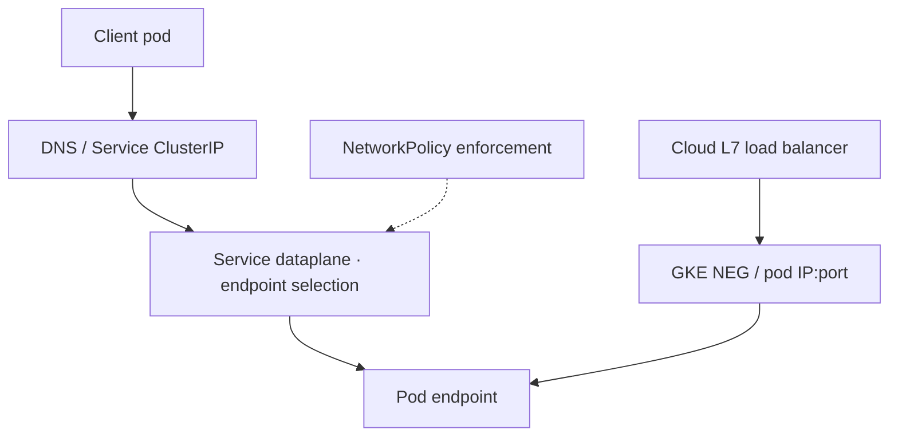
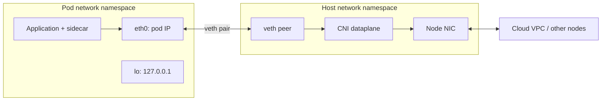
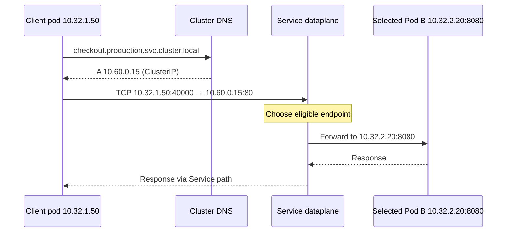
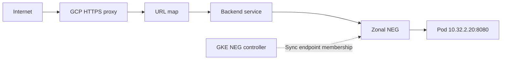

# Q7 · Kubernetes networking, CNI, Services and GKE

> **Interviewer:** “Explain how a pod gets an IP and communicates with other pods on the same and different nodes. How do Services, EndpointSlices, CNI, kube-proxy and eBPF work? Compare GKE VPC-native networking, Dataplane V2, NetworkPolicy, NEGs and Cloud NAT egress.”

## Visual architecture / protocol flow



The Mermaid diagram illustrates a representative path; the accompanying explanations cover implementation-specific caveats.

## 1. Linux network namespace and pod sandbox

A normal Kubernetes pod has a network namespace containing its interfaces, addresses, routes and sockets. Multiple containers in that pod share its IP and localhost network namespace. They cannot normally bind the same IP/port/protocol combination simultaneously without a special socket-sharing design. This is unrelated to the *Kubernetes namespace* used to group API objects and scope RBAC.

When a pod is scheduled, the kubelet coordinates the container runtime and CNI/network implementation to create its sandbox, configure networking, assign IPs and install routes. A common Linux design uses a veth pair with one interface in the pod namespace and its peer on the host; real GKE/other dataplanes vary.



## 2. Same-node versus cross-node pod traffic

Same-node traffic can be switched/routed within the node CNI dataplane. Cross-node traffic requires pod IP routing across nodes and the underlying VPC/underlay or overlay encapsulation such as VXLAN. In an overlay, encapsulation adds header overhead and affects MTU. With native VPC routing and alias IPs, pod IPs can be directly routable through the cloud virtual network. The Kubernetes API server doesn't forward ordinary application packets; controllers configure desired state and the dataplane forwards packets.

## 3. CNI, kube-proxy and dataplane responsibilities

CNI provides a specification for connecting container namespaces and plugins that implement it. Some plugins also manage IPAM/routing and policy. Historically kube-proxy has configured iptables or IPVS for Services, watching Services/EndpointSlices. eBPF dataplanes can implement service selection and policy using BPF programs/maps. A ClusterIP is a virtual address, not necessarily a daemon with a socket bound to that IP. Don't debug all clusters by assuming kube-proxy iptables is the authoritative dataplane.

## 4. Pod IP and Service IP lifecycle

For a normal Service, DNS returns its ClusterIP. The client sends a packet addressed to ClusterIP:port; the node/CNI dataplane chooses an eligible endpoint and forwards it to podIP:targetPort using a supported mechanism. EndpointSlices store endpoint IPs and ready/serving/terminating conditions. DNS can succeed even when a Service has zero ready endpoints. For a headless Service (`clusterIP: None`), DNS can return endpoint IPs instead of a virtual Service address.



## 5. GKE VPC-native alias IP design

GKE VPC-native clusters obtain node IPs from a subnet primary range and pod IPs from secondary ranges. Nodes may receive delegated Pod blocks sized according to maximum pods per node. Address exhaustion can occur because reserved pod blocks count even when relatively few pods are running. Reserve nonoverlapping capacity for future nodes, clusters, secondary ranges and hybrid connectivity. Some GKE cluster designs use GKE-managed Service address ranges rather than a manually allocated secondary Service range.

## 6. GKE Dataplane V2

GKE Dataplane V2 is an eBPF-based GKE networking dataplane built on Cilium technologies. It provides Service and network-policy functionality and changes the best troubleshooting tools compared with iptables-based routing. For policy drops, use GKE-supported observability and Hubble-related telemetry where enabled; for Service path failures, inspect actual BPF dataplane behavior rather than inferring all forwarding from iptables. This doesn't mean any eBPF deployment guarantees better performance: map sizing, kernel behavior, CNI mode and policy complexity matter.

## 7. NetworkPolicy default deny and explicit egress

NetworkPolicy selects pods using labels; policyTypes determine ingress/egress isolation. Ordinary Kubernetes policies express additive allows by podSelector, namespaceSelector, CIDR and protocol/port. They aren't a general L7 URL-path authorization mechanism. The CNI must implement enforcement. Namespace labels must be correct; service connectivity often requires both destination ingress and source egress allowances. Strict default-deny can accidentally block DNS, metadata endpoints or required control-plane traffic.

```yaml
apiVersion: networking.k8s.io/v1
kind: NetworkPolicy
metadata:
  name: deny-all
  namespace: checkout
spec:
  podSelector: {}
  policyTypes: [Ingress, Egress]
---
apiVersion: networking.k8s.io/v1
kind: NetworkPolicy
metadata:
  name: allow-checkout-to-payment
  namespace: checkout
spec:
  podSelector:
    matchLabels: {app: checkout}
  policyTypes: [Egress]
  egress:
  - to:
    - namespaceSelector:
        matchLabels:
          kubernetes.io/metadata.name: payments
      podSelector:
        matchLabels: {app: payment-api}
    ports:
    - protocol: TCP
      port: 8443
```

This example omits required DNS and other egress allowances intentionally—treat it as one policy building block, not a deploy-and-forget production default. A pod may be Ready yet fail to call a dependency because NetworkPolicy drops its packets.

## 8. GKE NEGs and load-balancer routing

For GKE container-native external Application Load Balancer ingress, a zonal NEG can register actual pod IP:port endpoints. Path: external forwarding rule → target HTTPS proxy → URL map → backend service/health checks → zonal NEG → pod. It can avoid normal node NodePort/ClusterIP forwarding for these ingress requests. The GKE NEG controller synchronizes endpoint membership. A pod passing local readiness does not guarantee cloud backend-health check is ready; NEG readiness gates can help coordinate some rollout cases, subject to configuration.



## 9. Outbound pod egress through Cloud NAT

In some GKE Standard configurations, ip-masq-agent first SNATs a pod's source IP to node primary IP for external destinations, after which Public NAT translates node source to a public IP. Other supported configurations preserve pod IP until Cloud NAT handles it (with corresponding range configuration). Autopilot uses managed EgressNATPolicy controls rather than the same node-level operator access as Standard. Identify the actual path before interpreting NAT port allocation, logging or firewall rules. Cloud NAT doesn't automatically grant a route or permit firewall traffic.

## 10. Operational failure modes and checks

**Pod Running but unreachable:** wrong Service selector, port or targetPort; no EndpointSlices; NetworkPolicy deny; CNI route; app not listening. **Works from node, fails in pod:** differing network namespace, resolver, policy or NAT source. **Failed scale-out:** primary node IP or secondary pod range exhausted. **Only during rolling updates:** endpoint/NEG registration or removal races; old pod terminates before backend drain completes. **Only cross-node:** pod CIDR routing or policy/MTU faults.

```bash
kubectl get pod -A -o wide
kubectl get svc,endpointslices -A
kubectl get networkpolicy -A
kubectl describe pod POD -n NAMESPACE
kubectl get nodes -o wide
kubectl exec -n NAMESPACE POD -- cat /etc/resolv.conf
# Google Cloud
gcloud container clusters describe CLUSTER --location=REGION \
  --format='yaml(ipAllocationPolicy,datapathProvider,network,subnetwork)'
gcloud compute network-endpoint-groups list
```

## 11. Lead architecture: reliability and control boundaries

Plan pod IP capacity, multi-zone placement and controlled network access from the start. Treat workload identity, NetworkPolicy, VPC firewalls, TLS/mTLS and application authorization as separate trust boundaries. Test service connectivity *from* the intended namespace and pod identity, not only from a debugging node. Monitor drops, DNS errors, Service endpoint convergence and cloud LB backend health. Validate pod draining during rollouts. Design with a repeatable incident playbook and approved access to debugging tools—especially where GKE Autopilot restricts node operations.

## 12. Complete spoken answer

> “A pod normally gets a distinct Linux network namespace and IP; containers inside it share the namespace. Kubelet/runtime/CNI coordinate interface, address and route creation. The dataplane forwards same-node and cross-node traffic, possibly using native VPC routes, overlays or eBPF. Kubernetes Services provide stable identities, while EndpointSlices describe actual backends. A ClusterIP uses dataplane forwarding rather than being a dedicated proxy process. GKE VPC-native mode allocates node IPs from primary and pod IPs from secondary subnet ranges, so per-node allocation and IP planning matter. Dataplane V2 uses eBPF for Service/policy functions. NetworkPolicy governs allowed pod flows but not business authorization or arbitrary HTTP URL paths. For ingress, GKE can use NEGs to send cloud L7 traffic directly to pod IP:port endpoints, with cloud health distinct from pod readiness. For egress I would trace any pod-to-node masquerading and Cloud NAT translation. My troubleshooting starts at the exact source/destination, then verifies resolver, routes, policy, EndpointSlice, cloud backend registration and packet/drop evidence.”
