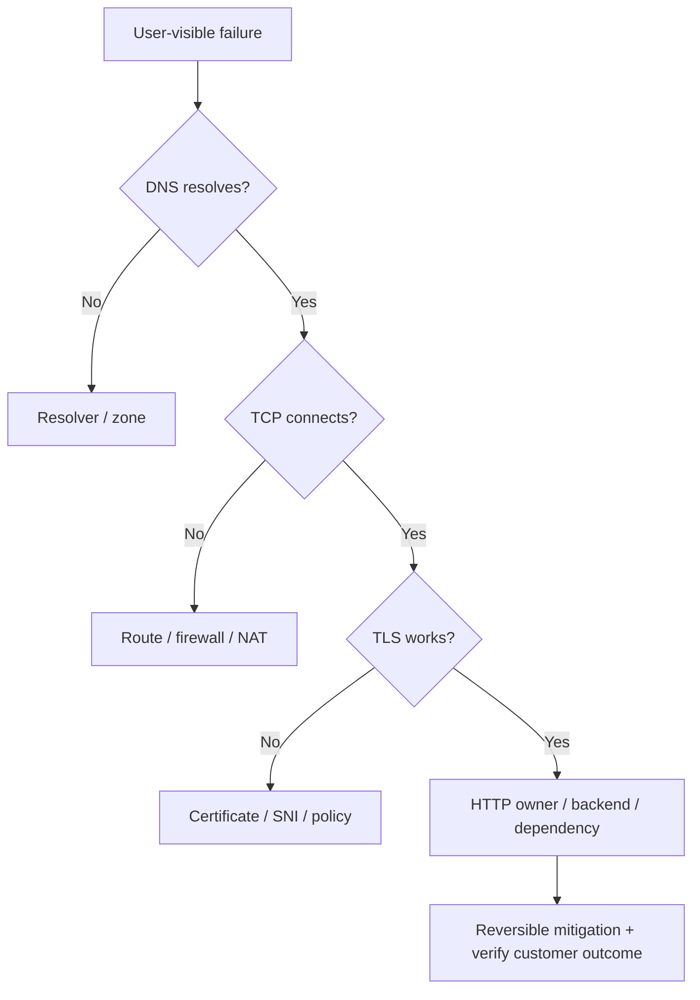
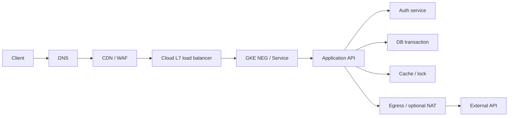

# Q8 · Production networking incidents and systematic troubleshooting

> **Interviewer:** “A marketplace's checkout endpoint intermittently fails during peak traffic. Product pages work, every pod says Ready, and some users report duplicate outcomes after retries. Lead the incident: narrow the fault, propose reversible mitigations, and explain how you would prevent recurrence.”

This final chapter applies the previous seven chapters to realistic *hypothetical* systems. The investigation should isolate the **first failing boundary**, preserve business correctness, and distinguish immediate mitigation from root-cause remediation. No particular provider architecture is assumed unless the scenario says so.

## Visual architecture / protocol flow



The Mermaid diagram illustrates a representative path; the accompanying explanations cover implementation-specific caveats.

## 1. First classify user impact and correctness risk

Define the precise failing operation: is a checkout request not reaching the API, is the transactional commit slow, or is the confirmation response lost? A timeout doesn't prove the operation didn't happen. For bids, payments, orders and infrastructure writes, retries can create duplicates unless application idempotency is implemented. Quantify impact by customer journey, region, endpoint, percentage of requests, latency distribution and start time. Establish an incident lead, communication channel, owners for independent hypotheses, and a change timeline.

## 2. Draw a dependency graph before drilling into tools



The graph is an **investigation hypothesis**, not a factual description of any specific company. At each edge, identify source, destination, protocol, connection owner, health/timeout policy, and observability. Trace from the failed operation rather than randomly inspecting healthy infrastructure.

## 3. Layer-by-layer isolation ladder

| Stage | Evidence | Typical next hypothesis |
|---|---|---|
| DNS | `getent`, `dig`, NXDOMAIN/SERVFAIL | Local resolver, authoritative zone, negative cache |
| TCP establishment | SYN/SYN-ACK/RST, `ss`, connect time | Route, firewall, NAT port allocation, listener |
| TLS | `openssl s_client`, alerts, SAN/SNI | Certificate, policy, key share, backend re-encryption |
| HTTP edge | LB generated status, edge timing | Target health, route, WAF, rate limits |
| Kubernetes | Service/EndpointSlice/NEG | Selector, readiness, dataplane, policy, drain race |
| Application | Request tracing, thread/event loop | Pool starvation, latency, retries, lock contention |
| Dependency | DB/external API timing and status | Shared capacity, egress path, correctness |

An endpoint returning HTTP 200 for `/health` isn't proof that the intended business operation completes. Attribute 502/503/504 to the component *generating* them. Use correlation IDs and distributed tracing where available, but keep in mind a failed SYN or DNS lookup never reaches application tracing.

## 4. Incident: NAT port allocation during burst

**Symptoms:** CPU low; existing outbound connections mostly healthy; new connections to one external destination time out during bursts; new replicas worsen errors. **Hypothesis:** Shared egress/NAT source-port concentration or connection-state pressure. **Evidence:** NAT allocation failure metrics/logs, destination tuple concentration, pool behavior, connection rate, pod-to-node masquerading, conntrack table state. **Mitigation:** Bound concurrency/retries, enable/reinforce connection reuse, expand provider-specific NAT capacity or approved egress paths. **Prevention:** Egress connection budget, load-test against target cardinality, NAT allocation alerts, stable pool defaults. Don't conflate AWS per-destination limits with Cloud NAT per-VM allocation.

## 5. Incident: GKE secondary Pod CIDR exhaustion

**Symptoms:** Nodes or pods cannot scale despite spare CPU/memory quota; scheduler and node provisioning errors mention IP allocation. **Hypothesis:** Node primary subnet or pod secondary range exhausted, including per-node reserved blocks. **Evidence:** GKE cluster `ipAllocationPolicy`, subnet secondary range occupancy, maxPodsPerNode, node count, allocation errors. **Mitigation:** Safely add supported address capacity/appropriate node pools or use preplanned secondary ranges; avoid disruptive network recreation mid-incident. **Prevention:** Address capacity modeling, fragmentation/headroom, alerts before depletion.

## 6. Incident: new NetworkPolicy blocks checkout-to-payment

**Symptoms:** Pods Ready; DNS may or may not work; timeouts begin immediately after security policy rollout. **Evidence:** Changed labels/selectors/ports, policy enforcement drops, direct permitted versus forbidden flow tests from the affected pod. **Mitigation:** Revert the narrow rule or add a proven least-privilege allowance, preserving broader security policy. **Prevention:** Policy contract tests and staged rollout. DNS must be explicitly handled when strict egress policies are enabled. On GKE Dataplane V2, use appropriate eBPF/drop telemetry rather than assuming iptables rules alone explain it.

## 7. Incident: zonal backend outage

**Symptoms:** High 502/503 or connection resets associated with one availability zone. **Evidence:** Load balancer backend health per zone, NEG membership, node pool condition, local policy, backend capacity and failure timing. **Mitigation:** Shift away from unhealthy targets if healthy capacity is sufficient; watch surviving-zone utilization and reconnect spikes. **Prevention:** Multi-zone placement and headroom, failure injection tests, zone-specific SLO dashboards, avoiding single-zone shared dependencies.

## 8. Incident: MTU black hole / large responses hang

**Symptoms:** TCP handshake and small requests succeed; large TLS/DNS/data transfers stall, often across tunnels/VPN. **Evidence:** Effective link and path MTUs, TCP MSS, retransmissions, fragmentation/DF behavior, blocked ICMP PMTU feedback. **Mitigation:** Repair MTU/PMTU signaling or supported MSS/encapsulation settings, not arbitrary massive application timeouts. **Alternative hypotheses:** HTTP payload limits, buffering and application parsing. The pattern suggests MTU but does not prove it.

## 9. Incident: CoreDNS healthy yet applications cannot resolve

**Symptoms:** Node resolves names but affected pod does not, or cluster-local names succeed while external names fail. **Evidence:** Pod `/etc/resolv.conf`, DNS namespace/search expansion (`ndots`), CoreDNS forwarder/cache/metrics, Cloud DNS scope/forwarding, NetworkPolicy, direct UDP/TCP DNS tests, authoritative consistency. **Mitigation:** Restore exact resolver/forwarding/policy path; avoid restarting healthy CoreDNS if the actual issue is an unreachable upstream resolver. **Prevention:** Split internal/external resolution SLOs, query failure rates, recursive latency and synthetic lookups from workloads.

## 10. Incident: readiness and NEG drain race during rollout

**Symptoms:** Error burst occurs only during rolling update; new pods Ready; old pods exit quickly. **Evidence:** Pod SIGTERM/preStop/startup/readiness timestamps, EndpointSlice terminating/serving conditions, NEG membership, backend health and drain timeout, 502/error time series. **Mitigation:** Slow rollout, restore prior version if needed, align `preStop` + termination grace + backend drain and ensure replacements are truly eligible before old endpoints disappear. **Prevention:** Production-like rollout load tests and connection-draining checks. WebSockets require reconnect support because no practical drain can guarantee arbitrarily long sessions survive a node failure.

## 11. Incident: retry storm and uncertain transaction commit

**Symptoms:** A 30-second dependency outage causes ten minutes of persistent overload; request retries create duplicate business attempts. **Evidence:** Retry/attempt counters, in-flight requests, queue depth, downstream latency, response-loss timing, idempotency metrics. **Mitigation:** Reduce concurrency and retries, stop unbounded queues, fail fast where safe, implement idempotency keys/transaction deduplication. **Prevention:** Retry budgets, jitter, absolute deadlines, circuit breakers, backpressure and fault-injection tests. Transport ACKs and HTTP timeouts cannot prove an operation committed or rolled back.

## 12. A reproducible live runbook

```bash
# Host and DNS path
getent ahosts api.example.com
dig api.example.com A
cat /etc/resolv.conf

# Route and TCP path
ip route get 198.51.100.80
ss -lntp
ss -ti
sudo tcpdump -i any -nn 'host 198.51.100.80 and tcp port 443'

# TLS and HTTP layer
openssl s_client -connect api.example.com:443 \
  -servername api.example.com -verify_hostname api.example.com \
  -verify_return_error -brief
curl -v --connect-timeout 3 --max-time 10 https://api.example.com/health

# Kubernetes control-plane view
kubectl get pods -n app -o wide
kubectl get svc,endpointslices -n app
kubectl get networkpolicy -n app
kubectl get events -n app --sort-by=.lastTimestamp

# GCP backends and NAT
gcloud compute backend-services get-health BACKEND --global
gcloud compute routers nats describe NAT --router=ROUTER --region=REGION
```

Use approved test endpoints. Be mindful of authorization, packet-capture sensitivity and node-access restrictions, particularly in managed Kubernetes environments. A packet capture at only one point rarely proves exactly where a loss happened; compare captures at adjacent boundaries when necessary.

## 13. Incident leadership and prevention

Assign one incident commander while parallel investigators focus on edge, cluster and application/dependency hypotheses. Keep a timeline; communicate confidence, uncertainty and observed customer impact, not guesses. Prefer **reversible, narrow** mitigations: rollback a policy, remove a bad endpoint, reduce retry amplification, correct routing, expand proven capacity. After recovery, validate the actual customer journey and transaction correctness, then produce a blameless review with root and contributing causes, detection gaps, containment gaps, and owners for remediation. Maintain SLOs for availability, latency and *business success* rather than only pod uptime.

## 14. Complete spoken answer

> “I'd first define which user action fails and whether the failure creates uncertainty about a transaction's outcome. I'd quantify blast radius and start time, appoint owners and review recent changes. Then I'd trace the exact path: application DNS, TCP/TLS, load balancer, Kubernetes Service or NEG, application and dependencies. I'd use connection timing and error ownership to find the first failing boundary instead of immediately restarting pods. In GKE I'd compare pod readiness, EndpointSlice state, backend NEG health, NetworkPolicy drops and actual dataplane behavior. For external calls I'd inspect node masquerading and Cloud NAT allocation; for internal dependencies I'd separate route/firewall from application pool or database saturation. I'd choose a narrow reversible mitigation and validate the customer operation, including whether retries might duplicate committed actions. Once stable, I'd document the chronology and add capacity alarms, policy tests, rollout drains, retry budgets and end-to-end SLOs. The goal is to restore correctness and prevent recurrence, not simply bring infrastructure indicators back to green.”
