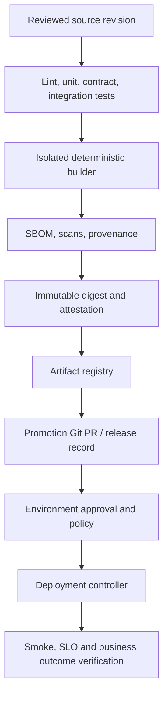

# CI/CD Architecture, Reproducible Builds and Delivery Boundaries

> **Engineering focus:** Design a secure and fast pipeline for 60 independently deployed microservices. What must CI prove, what does CD own, and how do you ensure the production artifact is the exact code that passed tests?

## First principles and system architecture

Continuous integration verifies a specific source revision and produces evidence that it can be built and tested. Continuous delivery promotes an approved **immutable artifact** into a controlled environment; continuous deployment automates that promotion subject to policy. CI success is not equivalent to business success in production. Draw trust boundaries around untrusted contribution, privileged release and cloud deployment.



### Control boundaries

- **Source integrity:** protected branch, code review, CODEOWNERS, required checks, dependency update policy. Forked PR code must not receive deployment credentials.
- **Build isolation:** pin runtime and lockfile, use ephemeral runners where possible, restrict writeable shared caches, record build input and artifact identity.
- **Release authority:** only a narrowly authorized job or pull-based reconciler may deploy a reviewed digest to production. Do not use floating image tags as a trusted release identity.
- **Verification:** compare deployed digest to CI record; capture release version in traces; roll back according to pre-agreed health and business criteria.

### GitHub Actions CI example

```yaml
name: Verify
on:
  pull_request:
permissions:
  contents: read
jobs:
  test:
    runs-on: ubuntu-latest
    steps:
      - uses: actions/checkout@v4
      - uses: actions/setup-node@v4
        with: {node-version: "20", cache: npm}
      - run: npm ci
      - run: npm test
      - run: npm run build
```

This is an instructional CI job, not an attested production release pipeline. For real deployment, pin third-party actions to reviewed commit SHAs, isolate privileges and add organization-appropriate provenance, approvals and digest publication.

## Build once, promote by digest

```bash
docker build --pull -t registry.example.com/catalog:build-1234 .
docker push registry.example.com/catalog:build-1234
# Resolve immutable sha256 digest from registry/build output.
kubectl get deploy catalog-api -n marketplace \
  -o jsonpath='{.spec.template.spec.containers[*].image}'
```

Tags can be mutated; a digest binds the deployment to bytes. Dependency lockfiles alone do not guarantee bit-for-bit reproducibility because builders, timestamps, operating-system packages and network downloads may vary. Separate **reproducibility** (same outputs) from **provenance** (trusted evidence of how outputs were produced).

## Test strategy and feedback loop

Use fast unit/static checks for every commit, interface/contract tests for compatibility, ephemeral integration environments for critical dependencies and a small number of valuable end-to-end user journeys. Measure queue wait, test flake rate, time to first useful failure and test failure classification. Optimizations must not let an untrusted cache contaminate privileged builds.

### Hypothetical incident

The `stable` Docker tag is repointed after CI tests commit A. Production later pulls commit B, which never passed release tests. Compare deployed RepoDigests with the build attestation, halt promotions and restore the known tested digest. Fix the promotion pipeline to record and enforce immutable identities.

### Senior trade-offs and Key takeaways

> Isolate three identities: the reviewed source revision, the immutable artifact digest, and the approved environment deployment record. CI verifies the source and builds once on trusted infrastructure; CD promotes that exact digest with least privilege and observed SLO gates. Optimize feedback speed without sacrificing trust boundaries or the ability to audit exactly what code is running.

**References:** [GitHub Actions hardening](https://docs.github.com/en/actions/security-guides/security-hardening-for-github-actions) · [SLSA](https://slsa.dev/)
