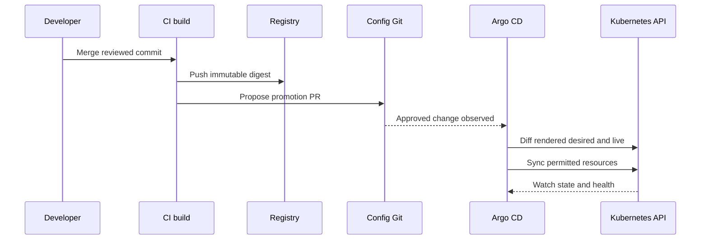
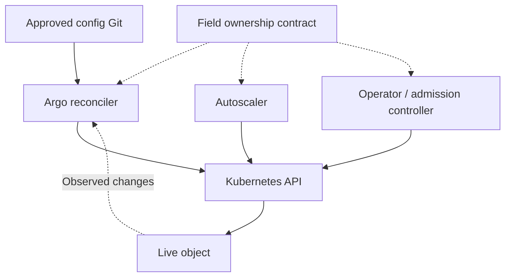

# GitOps Reconciliation, Argo CD, Drift and Ownership

> **Engineering focus:** Explain what Argo CD actually reconciles. How does GitOps differ from simply running kubectl in CI? What happens when an SRE fixes a production incident manually but GitOps keeps reverting the change?

## Desired state and data plane

GitOps is a control-loop architecture, not a synonym for Git-hosted YAML. A reviewed configuration source defines desired state; a controller observes live state, computes the difference and converges where allowed. CI should produce and attest the artifact; the delivery repository references an immutable image digest; Argo CD applies declarative desired state using controlled cluster credentials.



## Meaning of status

**Synced** means the configured comparison rules find desired and observed resources aligned. It does not prove the application can complete business transactions. **Healthy** depends on resource-specific assessments and can miss downstream correctness. **Prune** enables deletion when a formerly managed resource is removed from Git; **selfHeal** attempts to correct drift initiated outside Git. Without an explicit sync trigger and self-heal, a manual patch can remain.

Argo CD operates with reconciliation intervals, webhooks and caches, so changes are not universally instantaneous. ApplicationSet controllers can recreate or override Application specifications. The emergency suspension mechanism must target the actual owner, not only a generated child object. <https://argo-cd.readthedocs.io/en/stable/user-guide/auto_sync/>

## Application example

```yaml
apiVersion: argoproj.io/v1alpha1
kind: Application
metadata:
  name: catalog-prod
  namespace: argocd
spec:
  project: catalog
  source:
    repoURL: https://github.com/example-org/deployment-config.git
    targetRevision: main
    path: apps/catalog/prod
  destination:
    server: https://kubernetes.default.svc
    namespace: marketplace
  syncPolicy:
    automated:
      prune: false
      selfHeal: true
    syncOptions:
      - CreateNamespace=false
```

This needs the Argo CD CRDs/controller, a legitimate `catalog` AppProject, repo access and destination authorization. For a large team, scope sources, clusters, namespaces and resources with AppProjects and Kubernetes RBAC. Do not operate every team from a single unrestricted application credential.

## Who owns replicas, fields and secrets?

If HPA controls `spec.replicas` but GitOps insists on a fixed value, two controllers can repeatedly fight. Avoid unmanaged overlapping writers; adopt a defined ownership policy or targeted diff ignore when warranted. Operators also mutate annotations, generated ConfigMaps and CRD status. Ignore only known legitimate fields, not the entire spec. Do not commit plaintext production secrets; use an approved encryption or external secrets mechanism, and authorize the controller narrowly.



## Hypothetical incident: emergency fix reverts

A production operator increases replicas or reverts an image manually while `selfHeal` remains active. The GitOps controller restores the broken Git version. The solution is a documented break-glass process: suspend the correct automated owner when authorized, approve the emergency revision in Git, or isolate the release path for rollback. Record the temporary override and reconcile it after recovery. Audit log and Git diff must explain what actually happened.

```bash
argocd app get catalog-prod
argocd app diff catalog-prod
argocd app history catalog-prod
kubectl get application catalog-prod -n argocd -o yaml
kubectl get applicationsets -n argocd
```

## Key takeaways

> GitOps is declarative reconciliation from a reviewed desired-state source, separate from the software build. The controller observes Git and live resources and applies allowed changes, with policies for self-heal and pruning. Distinguish Synced from real application health and define field ownership alongside HPA and operators. During an incident, the emergency process must change the source of truth or safely suspend the correct reconciler so it cannot immediately undo the fix.

**References:** [Argo CD sync policy](https://argo-cd.readthedocs.io/en/stable/user-guide/auto_sync/) · [Argo CD projects](https://argo-cd.readthedocs.io/en/stable/user-guide/projects/)
